Diese Seite erklärt die On-demand Migration, die Voraussetzungen und eine Migrationsdurchführung. Die Durchführung verwendet Cloudflare R2 als Beispiel.

## 1. Überblick

Die On-demand Migration ist ein eingehender Abruf. Wenn ein Client einen Schlüssel liest, der im lokalen Bucket fehlt, liest RustFS das Objekt von der konfigurierten Quelle, liefert es aus und speichert es lokal. Sie können auch einen Backfill starten, um Schlüssel zu ziehen, die noch kein Client angefordert hat. Das Aktivierungsformular sagt, dass RustFS auf der Quelle weder schreibt noch löscht. Die Migrationsseite sagt, dass neue `PUT`- und `DELETE`-Operationen in RustFS nicht zur Quelle synchronisiert werden und dass spätere Änderungen an der Quelle lokale Kopien nicht aktualisieren. Die On-demand Migration ist keine fortlaufende Replikation von der Quelle.

| Ziel | Verwenden |
| --- | --- |
| Objekte aus einem Provider der Liste unten nach RustFS ziehen, bei einem Lese-Miss oder per Backfill | On-demand Migration |
| Objektversionen aus einem RustFS-Bucket in einen anderen Bucket schieben | [Bucket-Replikation](./replication.md) |
| Standortkonfiguration und Identitätsdaten zwischen Bereitstellungen synchronisieren | [Site-Replikation](/de/operations/high-availability/site-replication) |

Die [Bucket-Replikation](./replication.md) ist eine ausgehende Kopie von Objektversionen und setzt Versionierung auf beiden Buckets voraus. Nachdem ein Schlüssel lokal gespeichert ist, folgt die On-demand Migration der Quelle nicht weiter.

**Source connection** → **Provider** listet diese Quellen. Die Namen sind die Console-Beschriftungen. Google Cloud Storage erscheint zweimal: HMAC und Native.

1. Amazon S3
2. S3-compatible storage
3. MinIO
4. RustFS
5. Cloudflare R2
6. Google Cloud Storage (HMAC)
7. Azure Blob Storage (Native)
8. Google Cloud Storage (Native)

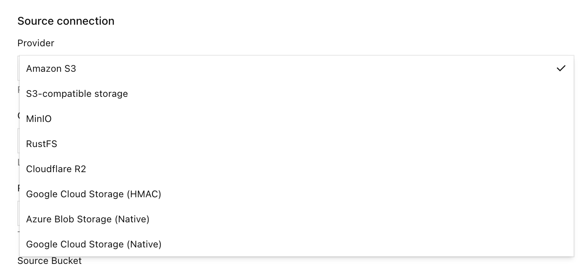

Wenn Sie einen Provider benötigen, der nicht in dieser Liste steht, öffnen Sie einen Pull Request im [RustFS-Repository](https://github.com/rustfs/rustfs) zur offiziellen Prüfung.

:::warning[Schließen Sie keine Replikationsschleife]
Wählen Sie keinen Bucket als Quelle der On-demand Migration, der bereits Replikationsziel dieses lokalen Buckets ist.
:::

:::note[Das Aktivieren der Quelle kopiert keine Daten]
**Migration active** bedeutet, dass der Bucket an die Quelle gehängt ist. Die Laufzeitzähler bleiben bei null, bis ein Client einen fehlenden Schlüssel liest oder Sie einen Backfill starten.
:::

## 2. Voraussetzung

- Eine installierte RustFS-Instanz. Installieren Sie RustFS mit dem [Linux-Schnellstart](/de/installation/linux/quick-start), melden Sie sich an der Console an und erstellen Sie einen Bucket. Diese Durchführung nutzte Console v1.0.3 auf Port `9001`.
- Die RustFS-CLI [`rc`](/de/operations/rc) auf dem Host, der den lokalen Bucket liest.
- Ein [Cloudflare-R2](https://developers.cloudflare.com/r2/)-Bucket für dieses Beispiel.

## 3. Migration

Dieser Abschnitt verwendet **Cloudflare R2 als Beispiel**. Eine Migration von einem anderen Provider in der Liste im Überblick folgt demselben Ablauf: einen leeren lokalen Bucket erstellen, die On-demand Migration aktivieren, **Provider** wählen, **Test connection** auswählen, **Enable migration** auswählen und danach bei einem GET-Miss oder per Backfill ziehen. Nur Endpunkt, Zugangsdaten und Bucket-Felder unterscheiden sich je nach Provider.

Die Screenshots dieser Durchführung verwenden Platzhalter für die R2-Konto-ID und den Zugriffsschlüssel. Der Host in der Terminal-Eingabeaufforderung ist `localhost`.

Zugangsdaten und Endpunkt in diesem Abschnitt gelten für das Cloudflare-R2-Beispiel. Für einen anderen Provider tragen Sie Endpunkt, lesende Zugangsdaten und Bucket-Namen dieses Systems in dieselben Console-Felder ein.

- Eine RustFS-Console mit **On-demand migration**. Diese Durchführung nutzte Console v1.0.3 auf Port `9001`.
- Ein Console-Konto, das die **Settings** des lokalen Buckets öffnen kann.
- Die RustFS-CLI [`rc`](/de/operations/rc) auf dem Host, der den lokalen Bucket liest.
- Ein Cloudflare-R2-API-Token, das Objekte im Quell-Bucket lesen kann. Begrenzen Sie das Token nach Möglichkeit auf diesen Bucket. Öffentlicher Zugriff auf den R2-Bucket gehört nicht zu diesem Ablauf.
- Der R2-S3-Endpunkt des Quell-Buckets, `https://<account-id>.r2.cloudflarestorage.com`. Wenn der Bucket eine Jurisdiction nutzt, kopieren Sie den Endpunkt aus dem R2-Dashboard.

Richten Sie `rc` auf die lokale RustFS-S3-API, nicht auf R2:

```bash
rc alias set rustfs http://localhost:9000 <your-access-key> <your-secret-key> --region us-east-1 --bucket-lookup path
```

Der lokale Bucket in dieser Durchführung heißt `migration`. Der R2-Bucket heißt `dl-rustfs`. Für `migration` war die Versionierung aktiviert und Object Lock deaktiviert. Object Lock war zum Aktivieren der On-demand Migration nicht nötig, und die Versionierung war keine Voraussetzung für das Aktivieren. Mit aktivierter Versionierung kann ein lokaler Löschmarker den Quellschlüssel verdecken.

:::warning[Verwenden Sie ein lesendes Quell-Token]
Erstellen Sie ein R2-Token, das den Quell-Bucket lesen, dort aber nicht schreiben oder löschen kann. Das Formular sagt, dass RustFS das Geheimnis speichert und es nicht an die Console zurückgibt.
:::

### 1. Einen leeren lokalen Bucket erstellen

Öffnen Sie in der Console **Browser** → **Buckets**, erstellen Sie einen Bucket namens `migration` und prüfen Sie, dass er keine Objekte enthält. Öffnen Sie **Settings** dieses Buckets, wenn Sie die Quelle anhängen.

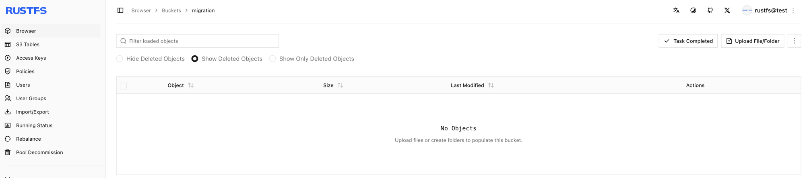

### 2. On-demand Migration öffnen

1. Öffnen Sie den Bucket `migration` und wählen Sie **Settings**.
2. Wählen Sie **Automation**.
3. Suchen Sie **On-demand migration**.
4. Wenn noch nichts konfiguriert ist, wählen Sie **Open migration settings** oder **+ Enable on-demand migration**. Wenn die Migration bereits aktiv ist, wählen Sie **Manage migration**.

Die unkonfigurierte Seite in dieser Durchführung meldet, dass keine Migrationsquelle konfiguriert ist, und bietet **+ Enable on-demand migration**.

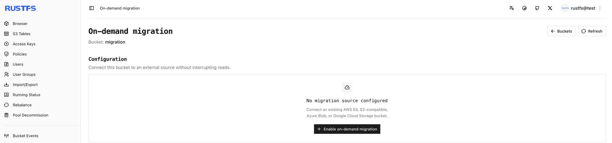

Nachdem die Quelle aktiviert ist, zeigt **Automation** den Status **Migration active** und **Manage migration**.

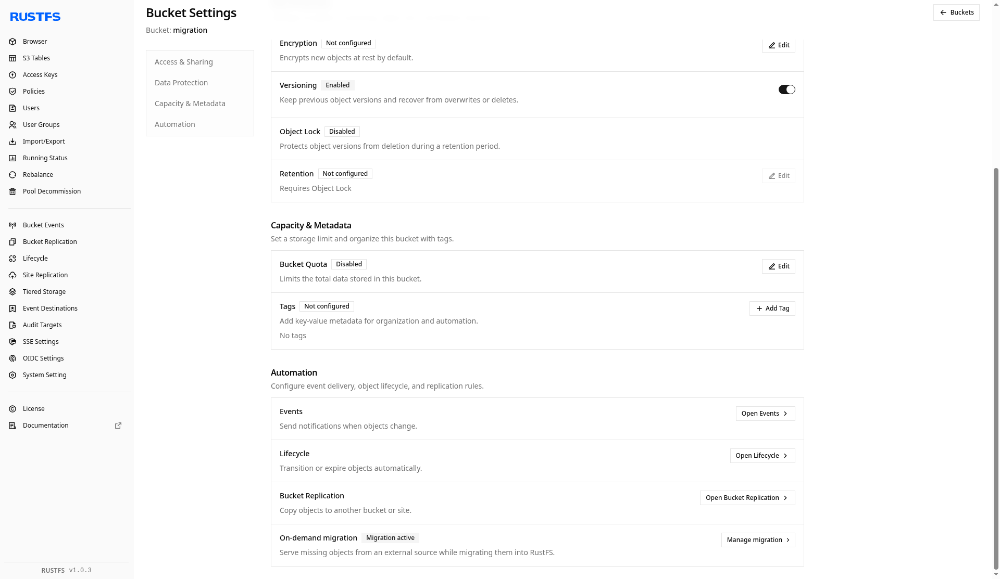

### 3. Den Bucket auf Cloudflare R2 richten

Setzen Sie die Quelle in **Enable on-demand migration** wie folgt. Ersetzen Sie Konto-ID und Schlüssel durch Ihr eigenes R2-Token. Lassen Sie das Sitzungstoken leer, sofern das Token keines verlangt. Lassen Sie **Local prefix** leer, damit der gesamte Quell-Namespace sichtbar ist. Diese Durchführung speicherte kein zusätzliches Präfix (**All keys**, **No added prefix**).

| Feld | Wert in dieser Durchführung |
| --- | --- |
| Source | Cloudflare R2 |
| Endpoint | `https://<account-id>.r2.cloudflarestorage.com` |
| Region | `us-east-1` (das Formular akzeptiert auch `auto`) |
| Source Bucket | `dl-rustfs` |
| Addressing style | Automatic |
| Access Key | R2-Zugriffsschlüssel-ID |
| Secret Key | R2-Geheimnis |
| Session token | Leer |
| Local prefix | Leer |

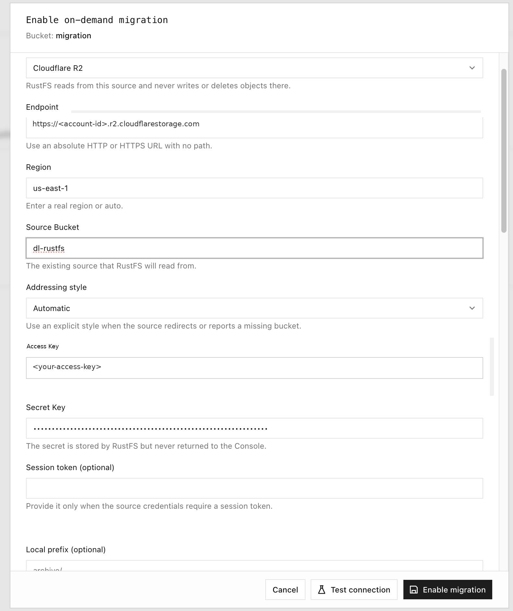

### 4. Die Verbindung testen und die Migration aktivieren

Wählen Sie **Test connection**. Eine erfolgreiche Prüfung meldet **Connection test passed** und zeigt einen Beispiel-Objektschlüssel aus dem Quell-Bucket. Wählen Sie danach **Enable migration**.

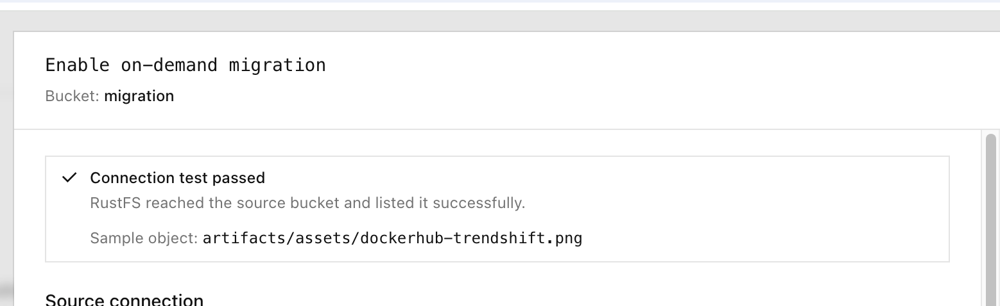

Dasselbe Ergebnis erscheint auch als Toast:

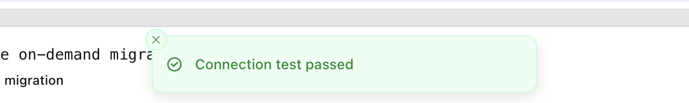

Der Konfigurationsstatus wird **Migration active**. Bis etwas gelesen oder per Backfill gezogen wird, bleibt **Runtime status** bei null migrierten Objekten und null migrierten Daten. **Latest job** bleibt **No backfill yet**.

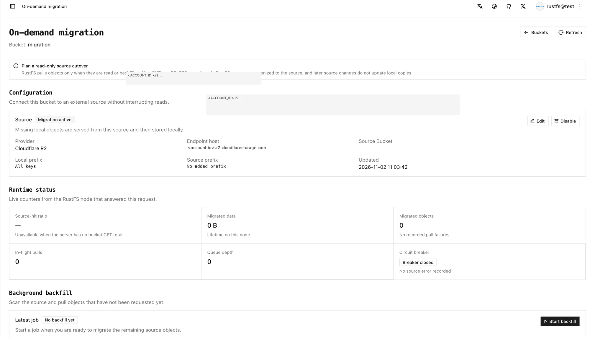

### 5. Ein Objekt mit rc cp abrufen

Lesen Sie den lokalen Bucket mit `rc`. Senden Sie diese Anfrage nicht an den R2-Endpunkt. In dieser Durchführung war der lokale Bucket noch leer, und ein fehlendes Objekt wurde gezogen. Der erste Miss liefert das Objekt an den Client und speichert es lokal. Ein späteres Lesen desselben Schlüssels bedient RustFS.

```bash
rc cp rustfs/migration/artifacts/rustfs/packages/nightly/rustfs-nightly-2026-11-02.deb /tmp/
```

```text
rustfs/migration/artifacts/rustfs/packages/nightly/rustfs-nightly-2026-11-02.deb -> /tmp/rustfs-nightly-2026-11-02.deb (71.34 MiB)
```

Verwenden Sie einen anderen Schlüssel, wenn der Quell-Bucket dieses Objekt nicht enthält. Die Terminalsitzung zeigt dieses `rc cp` und spätere `rc ls`-Prüfungen des lokalen Nightly-Präfixes. Die Liste ist das lokale Präfix, nachdem Objekte vorhanden waren. Das einzelne `rc cp` oben ist der Abruf von 71,34 MiB.

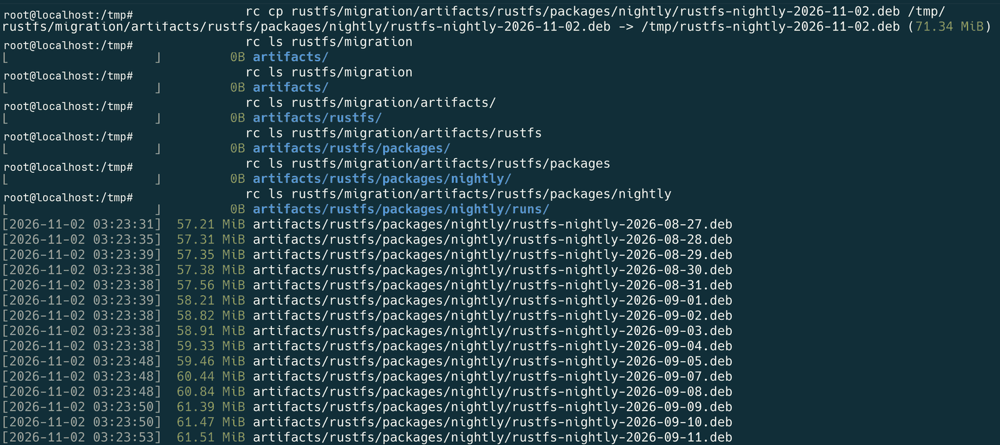

Dasselbe Nightly-Präfix im R2-Bucket, wie es im Cloudflare-Dashboard erschien:

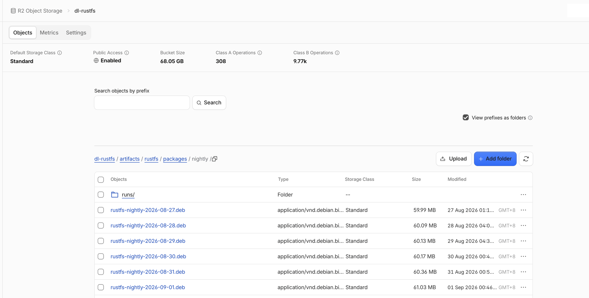

Die Bucket-Größe in diesem Dashboard ist die Summe von Cloudflare für den Bucket. Die späteren RustFS-Zähler auf dieser Seite sind das, was der Migrationsjob gemeldet hat.

Nach dem Abruf des einzelnen Objekts zeigt der Console-**Browser** dieses Objekt im lokalen Bucket:

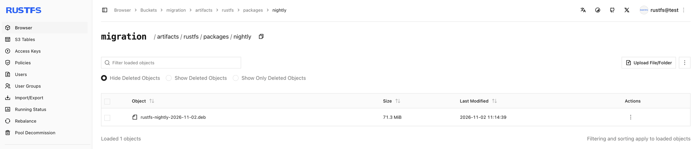

### 6. Ein Präfix per Backfill übernehmen

**Start backfill** durchsucht die Quelle und zieht Schlüssel, die lokal noch nicht vorhanden sind. Der Dialog in dieser Durchführung verwendete diese Einstellungen:

| Option | Bedeutung | Wert in der Durchführung |
| --- | --- | --- |
| Source listing prefix | Nur dieses Präfix auflisten | `artifacts/rustfs/packages/nightly/` |
| Existing local objects | Verhalten, wenn der Schlüssel bereits lokal ist | **Always skip** |
| Dry run | Treffer auflisten, ohne Objekte einzureihen oder zu schreiben | Für die Probe ein, für den Abruf aus |

**Dry run** listet passende Objekte auf, ohne ein Objekt einzureihen oder zu schreiben. Prüfen Sie das Präfix und schalten Sie **Dry run** aus, bevor Sie ziehen.

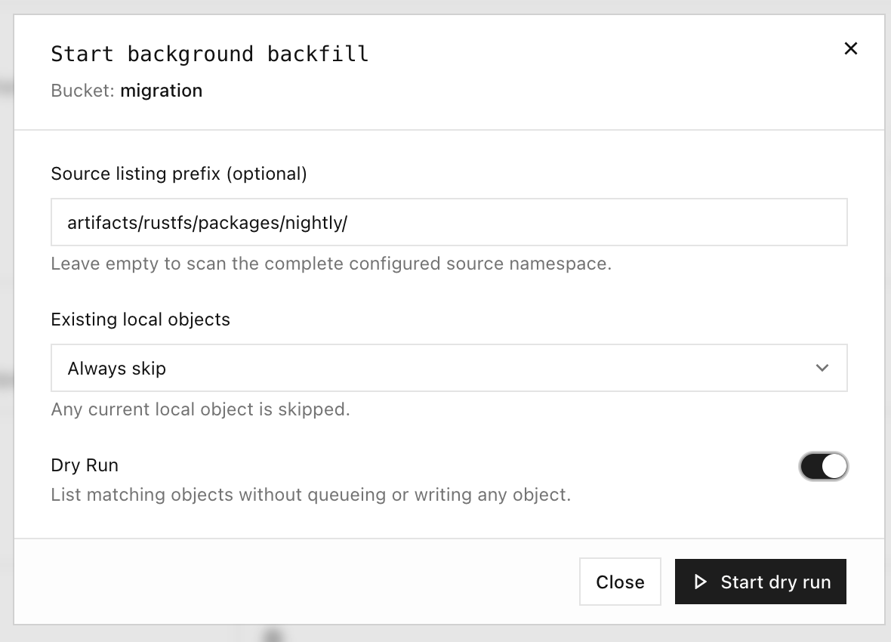

Es folgt ein während der Durchführung aufgezeichnetes Präfix-Listing. Der erste Schlüssel war in der Laboraufzeichnung abgeschnitten. Der vollständige Schlüssel hat die Form `artifacts/rustfs/packages/nightly/rustfs-nightly-2026-10-29.deb`. Die Zeitstempel sind die Laboraufzeichnung, etwa UTC. Die vollständige Liste ist länger als dieser Auszug.

```text
…ghtly-2026-10-29.deb
[2026-11-02 03:25:08]  70.36 MiB artifacts/rustfs/packages/nightly/rustfs-nightly-2026-10-30.deb
[2026-11-02 03:25:08]  70.65 MiB artifacts/rustfs/packages/nightly/rustfs-nightly-2026-10-31.deb
[2026-11-02 03:25:08]  71.15 MiB artifacts/rustfs/packages/nightly/rustfs-nightly-2026-11-01.deb
[2026-11-02 03:14:39]  71.34 MiB artifacts/rustfs/packages/nightly/rustfs-nightly-2026-11-02.deb
[2026-11-02 03:25:08]  71.34 MiB artifacts/rustfs/packages/nightly/rustfs-nightly-latest.deb
```

Während ein Backfill Objekte schreibt, zeigt die Console aufgelistete und gezogene Anzahlen. Solange der Quell-Scan noch läuft, erscheint kein Fertigstellungsprozentsatz.

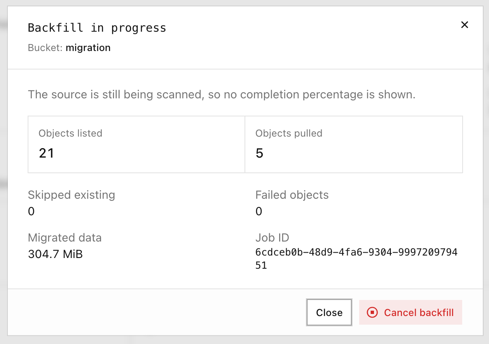

### 7. Einen Testlauf ausführen und dann den Quell-Namespace übernehmen

Lassen Sie **Source listing prefix** leer, um den konfigurierten Quell-Namespace zu durchsuchen. Führen Sie zuerst **Dry run** aus und prüfen Sie die aufgelistete Menge. Schalten Sie **Dry run** danach aus und starten Sie den Backfill.

Ein Testlauf in dieser Durchführung endete mit aufgelisteten Objekten und ohne Abruf:

| Listed | Pulled | Skipped | Failed objects | Data |
| --- | --- | --- | --- | --- |
| 128 | 0 | 0 | 0 | 0 B |

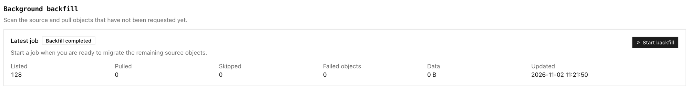

Der anschließende vollständige Backfill mit leerem Präfix endete so:

| Listed | Pulled | Skipped | Failed objects | Data |
| --- | --- | --- | --- | --- |
| 128 | 127 | 1 | 0 | 8.0 GiB |

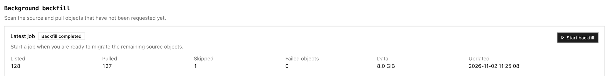

### 8. Den Bucket prüfen

Prüfen Sie auf der Seite der On-demand Migration:

1. **Runtime status** — migrierte Objekte und migrierte Daten sind nicht mehr null, und es sind keine Abruffehler verzeichnet.
2. **Background backfill** — der letzte Job zeigt die Anzahlen für aufgelistet, gezogen, übersprungen und fehlgeschlagen.
3. **Browser** und `rc` — listen Sie das Präfix mit `rc ls` auf, wie in der Terminalsitzung oben, und lesen Sie einen lokalen Schlüssel erneut mit `rc cp`.

In dieser Durchführung zeigte das Laufzeitfenster **Migrated data** 8,1 GiB und **Migrated objects** 128. Der letzte Backfill zeigte Listed 128, Pulled 127, Skipped 1, Failed objects 0 und Data 8,0 GiB.

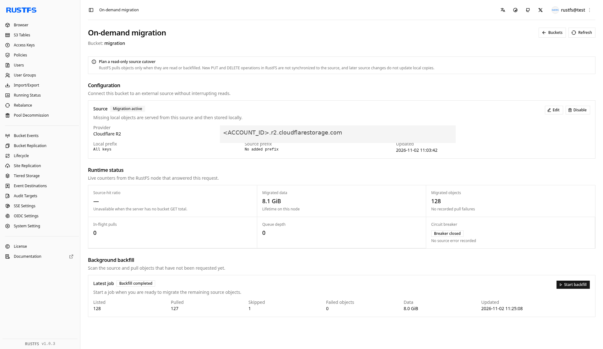

Die Bucket-Liste nach der Durchführung zeigt `migration` mit 128 Objekten und 8,1 GiB:

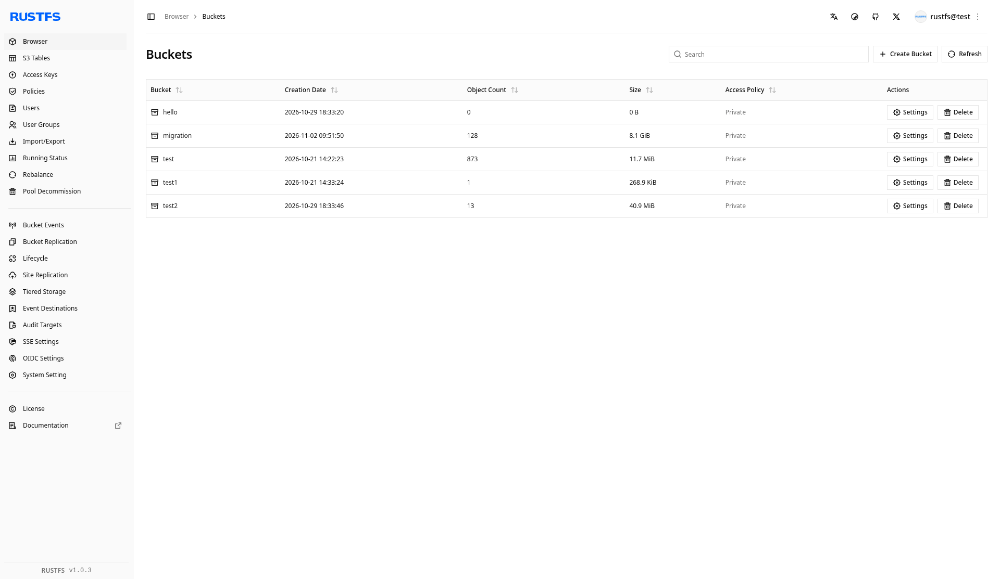

:::warning[Die lokale Kopie folgt der Quelle nicht]
Eine spätere Änderung desselben Schlüssels in R2 wird nicht über das lokale Objekt gezogen. Ein lokales `PUT` dieses Schlüssels wird nicht zur Quelle zurückgeschrieben und bleibt vor dem Quellschlüssel. Die On-demand Migration ist keine fortlaufende Replikation von der Quelle.
:::

### Nächste Schritte

- [Bucket-Replikation konfigurieren](./replication.md), wenn Sie eine ausgehende Kopie brauchen
- [rc installieren und verwenden](/de/operations/rc)
- [Site-Replikation konfigurieren](/de/operations/high-availability/site-replication) für Standortkonfiguration und Identitätsdaten
