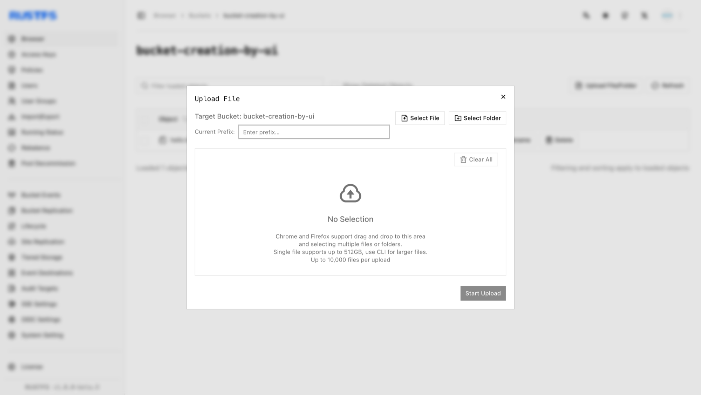
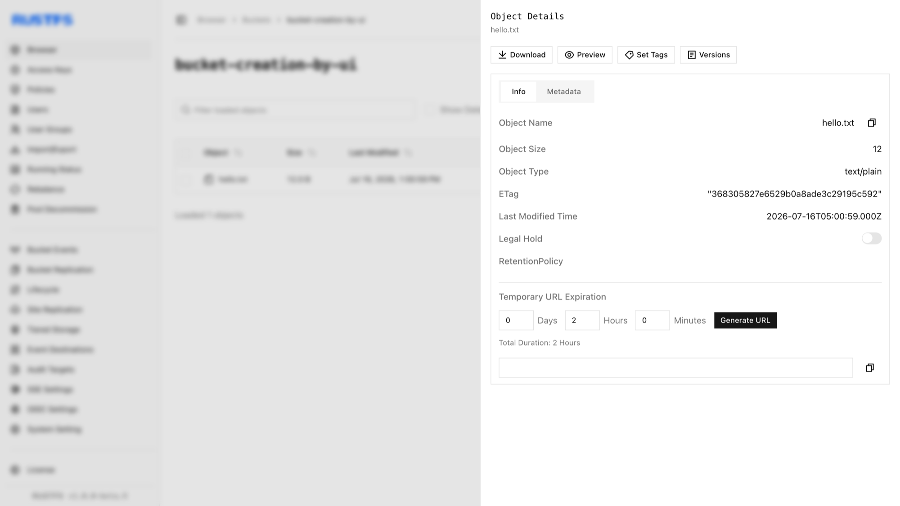

Objekte sind die grundlegenden Speichereinheiten in RustFS. Sie enthalten Daten, Metadaten und einen eindeutigen Objektschlüssel. Diese Anleitung beschreibt das Erstellen von Objekten (Upload).

## Voraussetzungen

- Eine laufende RustFS-Instanz (siehe [Installationsanleitung](../../../installation/index.md)).
- [`rc`](/de/operations/rc), installiert und mit einem Alias für den Kommandozeilenablauf konfiguriert.
- Ein Ziel-Bucket. Erstellen Sie einen Bucket wie unter [Bucket erstellen](../bucket/creation.md) beschrieben.

## Objekte erstellen

### RustFS-Oberfläche verwenden

1. Melden Sie sich an der RustFS-Console an.
2. Wählen Sie den Ziel-Bucket.
3. Wählen Sie auf der Bucket-Seite oben rechts **New Directory** (Neues Verzeichnis), **New File** (Neue Datei) oder **Upload File/Folder** (Datei oder Ordner hochladen).
4. Um von Ihrem lokalen Rechner hochzuladen, klicken Sie auf **Upload File/Folder**, wählen Sie die Dateien aus und klicken Sie auf **Start Upload** (Upload starten).



Wählen Sie ein Objekt aus, um seine Details anzuzeigen.



### `rc` verwenden

Installation und Alias-Konfiguration stehen in der [`rc`-Anleitung](/de/operations/rc).

Laden Sie eine Datei hoch:

```bash
rc object copy /path/to/hello.txt rustfs/my-bucket/hello.txt
rc object list rustfs/my-bucket
```

Prüfen Sie den Upload in der RustFS-Console.

### API verwenden

Laden Sie eine Datei über die API hoch:

```http
PUT /{bucketName}/{objectName} HTTP/1.1
```

S3-Anfragen müssen mit AWS Signature V4 signiert sein. Verwenden Sie deshalb einen S3-Client, anstatt Header von Hand zu setzen. Mit der für Ihre Zugriffsschlüssel konfigurierten [AWS CLI](https://docs.aws.amazon.com/cli/latest/userguide/getting-started-install.html):

```bash
aws s3api put-object \
  --bucket bucket-creation-by-api \
  --key hello.txt \
  --body /path/to/hello.txt \
  --endpoint-url http://localhost:9000
```

Prüfen Sie den Upload in der RustFS-Console.

## Objekte löschen

Siehe [Objekt löschen](./deletion.md).

Um ein Objekt über die S3-API zu löschen, verwenden Sie:

```http
DELETE /{bucketName}/{objectName} HTTP/1.1
```

Beispiel für eine Anfrage:

```bash
aws s3api delete-object \
  --bucket bucket-creation-by-api \
  --key hello.txt \
  --endpoint-url http://localhost:9000
```

Prüfen Sie in der RustFS-Console, dass das Objekt nicht mehr angezeigt wird.
