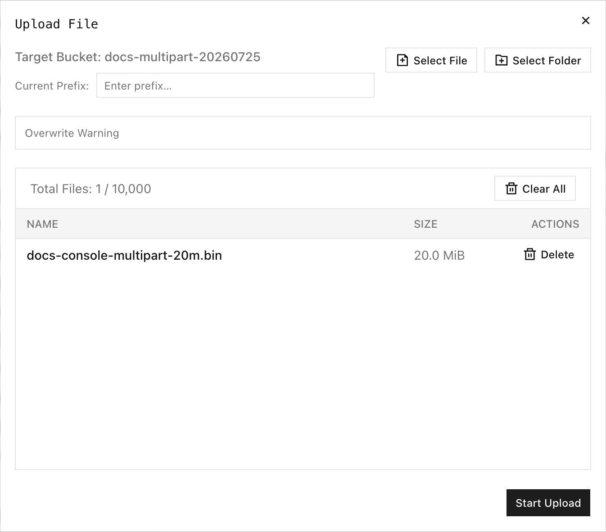

Ein mehrteiliger Upload teilt ein Objekt in unabhängig hochgeladene Teile und setzt sie auf dem Server zusammen. Verwenden Sie ihn für große Objekte, wiederholbare Übertragungen und Browser-Uploads, die Fortschritt und Abbruch benötigen.

## Überblick

Der mehrteilige S3-Ablauf hat drei erforderliche Phasen:

1. **CreateMultipartUpload** gibt eine Upload-ID zurück.
2. **UploadPart** lädt nummerierte Teile hoch und gibt für jeden Teil ein ETag zurück.
3. **CompleteMultipartUpload** übermittelt die geordneten Teilnummern und ETags, um das endgültige Objekt zu erstellen.

Brechen Sie einen nicht abgeschlossenen Upload mit **AbortMultipartUpload** ab, damit temporäre Teile nicht weiter Speicher belegen.

RustFS akzeptiert Teilnummern von `1` bis `10000`. `ListParts` und `ListMultipartUploads` geben höchstens 1.000 Einträge je Antwort zurück und verwenden Marker für die Seitenaufteilung. Das abgeschlossene Objekt erscheint erst, nachdem die Abschlussanfrage erfolgreich war.

## In der Console hochladen

1. Melden Sie sich an der RustFS-Console an und öffnen Sie den Ziel-Bucket.
2. Wählen Sie **Upload File/Folder** (Datei oder Ordner hochladen).
3. Geben Sie optional ein **Current Prefix** (aktuelles Präfix) ein.
4. Wählen Sie **Select File** (Datei auswählen) oder **Select Folder** (Ordner auswählen) und wählen Sie anschließend den hochzuladenden Inhalt.
5. Prüfen Sie die ausgewählten Namen und Größen und wählen Sie dann **Start Upload** (Upload starten).



Der Upload-Dialog der Console unterstützt bis zu 10.000 Dateien und gibt für eine einzelne Datei ein Maximum von 512 GB an. Das sind Upload-Grenzen der Console. S3-Clients können andere lokale Grenzen haben.

Nachdem der Upload gestartet ist, gruppiert **Task Management** (Aufgabenverwaltung) die Aufgaben in die Zustände **Pending** (ausstehend), **Processing** (in Bearbeitung), **Completed** (abgeschlossen), **Failed** (fehlgeschlagen) und **Canceled** (abgebrochen). Jede laufende Aufgabe zeigt den Fortschritt und eine Aktion **Cancel** (Abbrechen). Wenn Sie eine aktive mehrteilige Aufgabe abbrechen, wird die aktuelle Teilanfrage abgebrochen und die Aufgabe als abgebrochen markiert.

Aktualisieren Sie den Bucket nach dem Abschluss und prüfen Sie Objektgröße und Änderungszeit.

## `rc` verwenden

Laden Sie ein Objekt mit `rc` hoch und prüfen Sie es:

```bash
rc object copy /path/to/hello.txt rustfs/my-bucket/hello.txt
rc object stat rustfs/my-bucket/hello.txt --json
```

:::note[Grenzen des mehrteiligen Uploads in rc 0.1.29]

`rc 0.1.29` stellt keine Befehle zum Erstellen, Hochladen von Teilen, Abschließen, Auflisten von Teilen oder Abbrechen eines mehrteiligen Uploads bereit. Ein geprüfter `rc object copy` von 20 MiB verwendete eine einzelne `PutObject`-Anfrage und keinen mehrteiligen Upload. Verwenden Sie die Console oder ein S3-SDK, wenn ausdrückliches mehrteiliges Verhalten erforderlich ist. Prüfen Sie das abgeschlossene Objekt mit `rc object stat`.

:::

Listen Sie bei einem versionierten Bucket die Version auf, die ein abgeschlossener mehrteiliger Upload erzeugt hat:

```bash
rc bucket version list rustfs/my-bucket/hello.txt --json
```

RustFS gibt eine Versions-ID zurück, wenn der Abschluss eines mehrteiligen Uploads in einem versionierten Bucket erfolgreich ist.

## Mehrteilige S3-Operationen

Verwenden Sie ein S3-SDK, das diese Standardoperationen unterstützt:

| Phase | S3-Operation | Erforderliche Werte |
| --- | --- | --- |
| Starten | `CreateMultipartUpload` | Bucket, Objektschlüssel, Metadaten, Verschlüsselung und optionale Object-Lock-Einstellungen. |
| Hochladen | `UploadPart` | Bucket, Objektschlüssel, Upload-ID, Teilnummer und Inhalt. Speichern Sie das zurückgegebene ETag. |
| Prüfen | `ListParts` | Bucket, Objektschlüssel und Upload-ID. Blättern Sie bei Bedarf durch die Seiten. |
| Abschließen | `CompleteMultipartUpload` | Geordnete Teilnummern und ihre genauen ETags. |
| Abbrechen | `AbortMultipartUpload` | Bucket, Objektschlüssel und Upload-ID. |
| Auffinden | `ListMultipartUploads` | Bucket und optionales Präfix. Blättern Sie bei Bedarf durch die Seiten. |

Verwenden Sie eine Upload-ID nicht für einen anderen Objektschlüssel. Übermitteln Sie abgeschlossene Teile in aufsteigender Teilnummernreihenfolge und behalten Sie jedes ETag genau so bei, wie es zurückgegeben wurde.

## Überprüfung

Nach dem Abschluss:

```bash
rc object stat rustfs/my-bucket/hello.txt --json
rc object show rustfs/my-bucket/hello.txt > /tmp/hello-downloaded.txt
cmp /path/to/hello.txt /tmp/hello-downloaded.txt
```

Prüfen Sie, dass `size_bytes` mit der lokalen Datei übereinstimmt und dass `cmp` erfolgreich beendet wird. Bestätigen Sie bei einem versionierten Bucket zusätzlich, dass `rc bucket version list` eine Versions-ID zurückgibt.

## Fehlerbehebung

| Symptom | Prüfung |
| --- | --- |
| Der Upload bleibt in **Processing** | Prüfen Sie die Browserverbindung und lassen Sie die Registerkarte der Console geöffnet. Brechen Sie ab und wiederholen Sie den Upload, wenn die Verbindung unterbrochen wird. |
| Eine Teilanfrage schlägt fehl | Wiederholen Sie diesen Teil mit derselben Upload-ID und Teilnummer und verwenden Sie anschließend das zuletzt zurückgegebene ETag. |
| Der Abschluss meldet einen ungültigen Teil | Prüfen Sie die übermittelten Teilnummern, die Reihenfolge und die ETags gegen `ListParts`. |
| Das Objekt fehlt nach dem Hochladen der Teile | Senden Sie `CompleteMultipartUpload`. Hochgeladene Teile allein erstellen das Objekt nicht. |
| Der temporäre Speicher wächst weiter | Listen Sie unvollständige Uploads auf und brechen Sie diejenigen ab, die nicht mehr benötigt werden. |
| Der Abschluss schlägt bei einem gesperrten Objektschlüssel fehl | Prüfen Sie die Object-Lock-Aufbewahrung oder den Legal Hold der aktuellen Zielversion. |

## Nächste Schritte

- [Objekte erstellen und anzeigen](./creation.md)
- [Objektversionen verwalten](./versioning.md)
- [Objekte mit Object Lock schützen](./object-lock.md)
