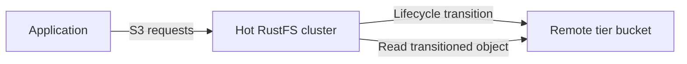

Die gestufte Speicherung von RustFS verschiebt Objekte aus dem lokalen Speicher in ein konfiguriertes entferntes Backend. Diese Seite erklärt die unterstützten Ziele und zeigt, wie Sie eine RustFS-Stufe in der Console hinzufügen und pflegen.

Die Übertragung in die entfernte Stufe erfolgt asynchron. RustFS behält die Objektmetadaten lokal, überträgt die Objektdaten in die entfernte Stufe und bedient S3-Lesevorgänge weiterhin über den ursprünglichen Bucket und Objektschlüssel.



:::note[Stufennamen sind keine AWS-Speicherklassen]

Lebenszyklusregeln verweisen auf eine registrierte Stufe über ihren Namen in Großbuchstaben, etwa `COLDTIER`. Ersetzen Sie ihn nicht durch AWS-Klassenbezeichnungen wie `INTELLIGENT_TIERING`, `GLACIER` oder `DEEP_ARCHIVE`, es sei denn, Sie haben eine RustFS-Stufe mit genau diesem gültigen Namen registriert und das Zielverhalten geprüft.

:::

## Unterstützte Backends

Der RustFS-Quellcode definiert Warm-Backend-Implementierungen für diese Zieltypen:

| Typ | Konfigurationsschlüssel | Typisches Ziel |
| --- | --- | --- |
| RustFS | `rustfs` | Eine andere RustFS-Bereitstellung |
| S3 | `s3` | Amazon S3 oder ein von diesem Backend unterstützter S3-Endpunkt |
| Wasabi | `wasabi` | Wasabi-Objektspeicher |
| MinIO | `minio` | Eine MinIO-Bereitstellung |
| Aliyun | `aliyun` | Alibaba Cloud Object Storage Service (OSS) |
| Tencent | `tencent` | Tencent Cloud Object Storage (COS) |
| Huaweicloud | `huaweicloud` | Huawei Cloud Object Storage Service (OBS) |
| Azure | `azure` | Azure Blob Storage |
| GCS | `gcs` | Google Cloud Storage |
| R2 | `r2` | Cloudflare R2 |

Die Konfigurationsdaten der Anbieter und die Anforderungen an die Zugangsdaten unterscheiden sich. Der vollständige Ablauf unten verwendet das RustFS-Backend, weil der RustFS-Quellcode für diesen Pfad einen Ende-zu-Ende-Test vom heißen Cluster zum kalten Cluster enthält.

## Bevor Sie beginnen

Bereiten Sie Folgendes vor:

- Eine RustFS-Quellbereitstellung, die die heißen Daten speichert.
- Eine separate RustFS-Zielbereitstellung und einen vorhandenen Ziel-Bucket. Dieses Beispiel verwendet `my-bucket` auf dem Ziel.
- Ziel-Zugangsdaten mit der Berechtigung, Objekte in diesem Bucket zu schreiben, zu lesen, aufzulisten und zu löschen.
- Zugriff auf die RustFS-Console der Quellbereitstellung.

Verwenden Sie in der Produktion TLS für beide Bereitstellungen. Beschränken Sie die Ziel-Zugangsdaten auf den dedizierten Stufen-Bucket und das Präfix.

## 1. Gestufte Speicherung öffnen

Melden Sie sich an der RustFS-Console der Quellbereitstellung an. Wählen Sie in der linken Navigation **Tiered Storage** (gestufte Speicherung) und anschließend oben rechts **Add Tier** (Stufe hinzufügen).

## 2. Ziel auswählen

Wählen Sie den Zielanbieter. Dieses Beispiel verwendet **RustFS**, um die Quellbereitstellung mit einer anderen RustFS-Bereitstellung zu verbinden.

## 3. Zieldetails eingeben

Füllen Sie das Formular aus:

| Feld | Wert |
| --- | --- |
| **Name (A-Z,0-9,_)** | Geben Sie einen eindeutigen Stufennamen in Großbuchstaben ein, etwa `COLDTIER`. |
| **Endpoint** | Geben Sie den S3-Endpunkt der Ziel-RustFS ein. |
| **Access Key** | Geben Sie den Zugriffsschlüssel der Zielbereitstellung ein. |
| **Secret Key** | Geben Sie den geheimen Zugriffsschlüssel der Zielbereitstellung ein. |
| **Bucket** | Geben Sie den Namen des vorhandenen Ziel-Buckets ein, etwa `my-bucket`. |
| **Prefix (Optional)** | Geben Sie optional ein Präfix ein, das den gestuften Objekten vorbehalten ist. |
| **Region** | Geben Sie optional die Zielregion ein, etwa `us-east-1`. |

Belassen Sie **Storage Class** beim Standardwert, es sei denn, das Ziel-Backend erfordert eine andere unterstützte Speicherklasse.

:::warning[Stufen-Zugangsdaten schützen]

Das Formular enthält einen geheimen Zugriffsschlüssel. Verwenden Sie Zugangsdaten, die auf den Ziel-Bucket und das Präfix beschränkt sind. Legen Sie den Schlüssel nicht in Screenshots, Tickets oder Protokollen offen.

:::

## 4. Stufe speichern

Wählen Sie **Save** (Speichern). RustFS prüft das Backend, indem es ein kleines Objekt schreibt, liest und entfernt. Das Speichern schlägt fehl, wenn Endpunkt, Zugangsdaten, Bucket-Berechtigungen oder Backend-Konfiguration diese Prüfung nicht abschließen können.

Nachdem die Stufe in der Liste **Tiers** (Stufen) erscheint, konfigurieren Sie eine Übergangsregel unter [Lebenszyklusverwaltung](/de/administration/data/lifecycle-management). Eine registrierte Stufe verschiebt keine Objekte, bis eine Lebenszyklusregel ihren Namen referenziert.

## Stufen mit `rc` verwalten

Installieren und konfigurieren Sie [`rc`](/de/operations/rc) und listen Sie anschließend die auf der Quellbereitstellung registrierten Stufen auf:

```bash
rc bucket lifecycle tier list local
```

Fügen Sie eine RustFS-Stufe mit denselben Einstellungen hinzu, die der Ablauf in der Console beschreibt:

```bash
rc bucket lifecycle tier add rustfs COLDTIER local \
  --endpoint <target-rustfs-endpoint> \
  --access-key <your-access-key> \
  --secret-key <your-secret-key> \
  --bucket my-bucket \
  --region us-east-1
```

Zeigen Sie die Stufenkonfiguration und die verfügbaren Statistiken an:

```bash
rc bucket lifecycle tier info COLDTIER local
```

Die übrigen Stufenbefehle aktualisieren Zugangsdaten oder entfernen eine Stufe:

```bash
rc bucket lifecycle tier edit COLDTIER local \
  --access-key <your-access-key> \
  --secret-key <your-secret-key>
rc bucket lifecycle tier remove COLDTIER local
```

Unter [Lebenszyklusverwaltung](/de/administration/data/lifecycle-management) erstellen Sie Übergangsregeln, bestätigen Übergänge und stellen lokale Kopien wieder her. Führen Sie `rc bucket lifecycle tier <command> --help` aus, um anbieterspezifische Optionen anzuzeigen, bevor Sie eine Stufe ändern.

## Stufenaktivität überwachen

Verwenden Sie den Statistikendpunkt der Stufe mit einer SigV4-signierten Anfrage und der Berechtigung `admin:ListTier`:

```http
GET /rustfs/admin/v3/tier-stats?tier=COLDTIER HTTP/1.1
Host: <hot-rustfs-endpoint>
```

Überwachen Sie Übergangsfehler zusammen mit der Kapazität des Quellclusters und der Verfügbarkeit auf der Zielseite. Eine konfigurierte Stufe fügt den Zieldienst und den Netzwerkpfad dem Lesepfad für Objekte hinzu, die keine wiederhergestellte lokale Kopie haben.

## Stufe ändern oder entfernen

Die Admin-API stellt diese ändernden Routen bereit. Alle erfordern `admin:SetTier`:

| Operation | Route |
| --- | --- |
| Stufe bearbeiten | `POST /rustfs/admin/v3/tier/{tiername}` |
| Stufe entfernen | `DELETE /rustfs/admin/v3/tier/{tiername}` |
| Alle Stufen löschen | `POST /rustfs/admin/v3/tier/clear` |

Bevor Sie eine Stufe bearbeiten oder entfernen:

1. Deaktivieren Sie Lebenszyklusregeln, die die Stufe referenzieren.
2. Prüfen Sie, dass keine Übergangsaufträge sie noch verwenden.
3. Prüfen Sie, dass keine Quellobjekte von Daten abhängen, die in ihrem Ziel-Bucket oder Präfix gespeichert sind.
4. Sichern Sie die Stufenkonfiguration und notieren Sie den Zielort.

Normale Stufenänderungen prüfen die Backend-Nutzung und schützen nicht leere Ziele. Verwenden Sie eine `force`-Option nicht, um diese Prüfungen zu umgehen, es sei denn, Sie haben unabhängig nachgewiesen, dass jedes übertragene Objekt wiederherstellbar bleibt. Wenn Sie die Konfiguration einer aktiven Stufe entfernen, können übertragene Objekte vom Quellcluster aus unlesbar werden.

:::warning[Stufenobjekte nicht direkt ändern]

Benennen Sie erzeugte Objekte im Ziel-Bucket nicht um, überschreiben Sie sie nicht und löschen Sie sie nicht. Verwalten Sie Quellobjekte über den heißen RustFS-Cluster, damit RustFS lokale Übergangsmetadaten und entfernte Daten konsistent halten kann.

:::

## Referenz der Admin-API

Der aktuelle RustFS-Quellcode registriert diese Stufenrouten:

| Methode | Route | Berechtigung |
| --- | --- | --- |
| `PUT` | `/rustfs/admin/v3/tier` | `admin:SetTier` |
| `POST` | `/rustfs/admin/v3/tier/{tiername}` | `admin:SetTier` |
| `DELETE` | `/rustfs/admin/v3/tier/{tiername}` | `admin:SetTier` |
| `POST` | `/rustfs/admin/v3/tier/clear` | `admin:SetTier` |
| `GET` | `/rustfs/admin/v3/tier` (Konfigurationen auflisten) | `admin:ListTier` |
| `GET` | `/rustfs/admin/v3/tier/{tier}` (Konnektivität prüfen) | `admin:ListTier` |
| `GET` | `/rustfs/admin/v3/tier-stats` (Statistiken lesen) | `admin:ListTier` |

Alle Anfragen an die Admin-API erfordern SigV4-Authentifizierung. Diese Routen sind eine administrative Schnittstelle und keine gewöhnlichen S3-Bucket-Operationen.

## Nächste Schritte

Lesen Sie die [Lebenszyklusverwaltung](/de/administration/data/lifecycle-management) und konfigurieren Sie [Zugriffsrichtlinien](/de/security-compliance/iam/policies) für die Administratoren und Dienst-Zugangsdaten der gestuften Speicherung.
