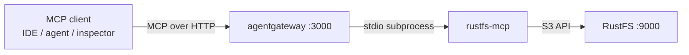
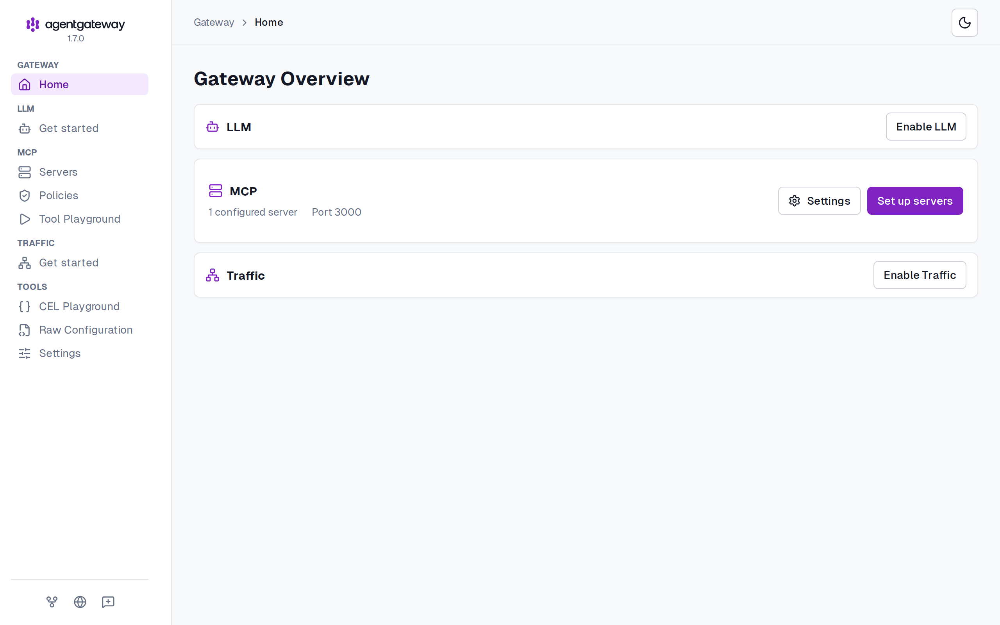
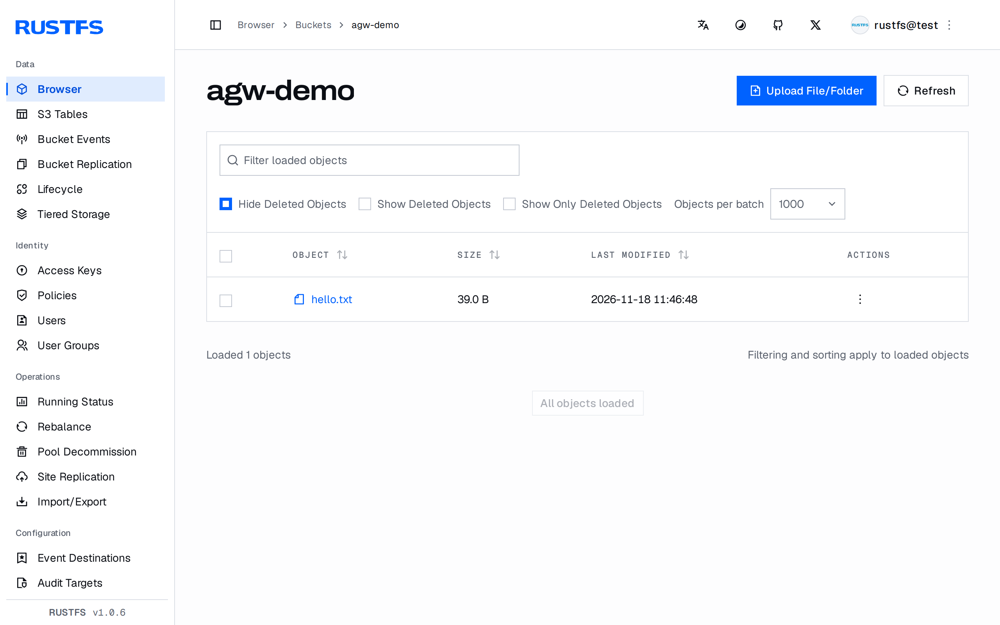

[agentgateway](https://github.com/agentgateway/agentgateway) ist ein KI-nativer Proxy für MCP-, A2A- und LLM-Traffic. Sein MCP-Gateway föderiert MCP-Server und stellt sie über das Netzwerk mit Authentifizierung, Policies und OpenTelemetry-Observability bereit. [RustFS bringt einen eigenen MCP-Server mit](https://github.com/rustfs/mcp), der Speicheroperationen als Tools exponiert — jedoch nur über stdio, also als lokaler Subprozess und nicht fernzugreifbar. Diese Anleitung verbindet beide: agentgateway startet den RustFS-MCP-Server als stdio-Target und serviert ihn als entfernten MCP-Endpunkt, sodass jeder MCP-Client RustFS-Speicher über das Gateway bedienen kann. Der Ablauf wurde mit agentgateway `1.7.0`, dem `rustfs/mcp`-Server und RustFS `1.0.6` verifiziert.

Sie benötigen Docker auf dem Gateway-Host und einen erreichbaren RustFS-Server.

## Architektur



Das Gateway startet `rustfs-mcp` als Kindprozess und übersetzt zwischen dessen stdio-Transport und dem MCP-Streamable-HTTP-Listener auf Port 3000. Speicheroperationen fließen durch das Gateway — dessen Policies, Rate Limiting und Telemetrie gelten damit auch für Objektspeicher-Toolaufrufe.

:::note[Warum ein Gateway für einen stdio-Server]

Ein stdio-MCP-Server ist nur von der Maschine erreichbar, die ihn startet. agentgateway ergänzt den fehlenden Transport — entfernte Clients verbinden sich über HTTP, während die S3-Zugangsdaten auf dem Gateway-Host bleiben.

:::

## 1. Das RustFS-MCP-Server-Image bauen

Der MCP-Server liegt in einem eigenen Repository. Bauen Sie das Image aus dem Quellcode:

```bash
git clone https://github.com/rustfs/mcp.git rustfs-mcp
docker build -t rustfs/rustfs-mcp:latest rustfs-mcp
```

Das Build ergibt ein Image, das den MCP-Server über stdio ausführt und über die Standard-`AWS_*`-Umgebungsvariablen mit jedem S3-kompatiblen Endpunkt spricht.

## 2. agentgateway konfigurieren

Erstellen Sie die Gateway-Konfiguration. Das Target startet das MCP-Image als Subprozess; der Volume-Mount legt ein Host-Verzeichnis für das Upload-Tool offen, und der Endpunkt zeigt über die Docker-Bridge-Gateway-Adresse auf RustFS:

```yaml title="config.yaml"
mcp:
  port: 3000
  targets:
  - name: rustfs
    stdio:
      cmd: docker
      args:
      - run
      - --rm
      - -i
      - -v
      - /data/agentgateway/demo:/demo
      - -e
      - AWS_ACCESS_KEY_ID=<your-access-key>
      - -e
      - AWS_SECRET_ACCESS_KEY=<your-secret-key>
      - -e
      - AWS_REGION=us-east-1
      - -e
      - AWS_ENDPOINT_URL=http://172.17.0.1:9000
      - rustfs/rustfs-mcp:latest
```

:::note[Endpunkt-Adressierung aus dem MCP-Container]

Der MCP-Server läuft in einem Container — `127.0.0.1:9000` auf dem RustFS-Host ist für ihn nicht erreichbar. Verwenden Sie die Docker-Bridge-Gateway-Adresse `172.17.0.1:9000` (oder einen gemeinsamen Netzwerk-Alias). Läuft RustFS selbst in Docker in einem eigenen Bridge-Netzwerk, isoliert Docker die Bridges voneinander — hängen Sie beide Container an dasselbe Netzwerk und verwenden Sie den Containernamen.

:::

Starten Sie das Gateway mit dem Konfigurationsinhalt:

```bash
agentgateway -c "$(cat config.yaml)"
```

Das Log bestätigt die Listener: das MCP-Bind auf Port 3000, die Admin-UI unter `http://localhost:15000/ui` und einen Stats-Endpunkt auf 15020.



## 3. RustFS-Tools über das Gateway aufrufen

Der MCP-Inspector treibt das Gateway für die manuelle Verifizierung an:

```bash
npx @modelcontextprotocol/inspector --cli http://localhost:3000/mcp --method tools/list
```

```json
"tools": ["create_bucket", "delete_bucket", "get_object", "list_buckets", "list_objects", "upload_file"]
```

Erstellen Sie einen Bucket und laden Sie eine Datei über das Gateway hoch:

```bash
npx @modelcontextprotocol/inspector --cli http://localhost:3000/mcp \
  --method tools/call --tool-name create_bucket \
  --tool-arg bucket_name=agw-demo

npx @modelcontextprotocol/inspector --cli http://localhost:3000/mcp \
  --method tools/call --tool-name upload_file \
  --tool-arg local_file_path=/demo/hello.txt \
  --tool-arg bucket_name=agw-demo --tool-arg object_key=hello.txt
```

```text
✅ **File uploaded successfully!**
```

:::note[Der Upload-Pfad liegt auf der MCP-Server-Seite]

`upload_file` liest `local_file_path` aus dem Dateisystem des Prozesses, der den MCP-Server ausführt — also aus dem Container heraus. Der Volume-Mount `-v /data/agentgateway/demo:/demo` aus Schritt 2 legt ein Host-Verzeichnis als `/demo` im Container offen, weshalb das Tool die Datei lesen kann.

:::

## 4. Die Objekte in RustFS bestätigen

Das über das Gateway geschriebene Objekt landet wie jeder S3-Schreibvorgang im Bucket. Bestätigen Sie es mit der S3-API und ersetzen Sie alle Verbindungsplatzhalter:

```bash
aws s3api list-objects --bucket agw-demo \
  --endpoint-url http://localhost:9000
```

```json
{
    "Contents": [
        {
            "Key": "hello.txt",
            "Size": 39,
            "StorageClass": "STANDARD"
        }
    ]
}
```

Lesen Sie es über das Gateway zurück und schließen Sie den Kreis:

```bash
npx @modelcontextprotocol/inspector --cli http://localhost:3000/mcp \
  --method tools/call --tool-name get_object \
  --tool-arg bucket_name=agw-demo --tool-arg object_key=hello.txt --tool-arg mode=read
```

    Content: hello from rustfs-mcp via agentgateway



## Verifizierungsergebnisse

| Prüfung | Erwartetes Ergebnis |
| --- | --- |
| MCP-Handshake über das Gateway | `serverInfo.name` meldet `rustfs-mcp-server` mit Protokoll `2025-03-26` |
| `tools/list` | Alle sechs Speicher-Tools föderiert: `create_bucket`, `delete_bucket`, `get_object`, `list_buckets`, `list_objects`, `upload_file` |
| `create_bucket` über das Gateway | Bucket erscheint in RustFS |
| `upload_file` über das Gateway | Objekt landet im Bucket; sichtbar in der Konsole und über die S3-API |
| `get_object` über das Gateway | Inhalt stimmt byteweise mit der hochgeladenen Datei überein |
| Gateway-Admin-UI | Zeigt den konfigurierten MCP-Server und Port |

## Fehlerbehebung

### `Error: invalid config: invalid type: string "config.yaml"`

Der Config-Parameter erwartet den Konfigurationsinhalt, nicht einen Pfad. Übergeben Sie den Dateiinhalt: `agentgateway -c "$(cat config.yaml)"`.

### MCP-Tools laufen in Timeout oder melden Verbindungsfehler

Der MCP-Container erreicht die RustFS-Adresse nicht. `127.0.0.1:9000` im Container ist der Container selbst — verwenden Sie `172.17.0.1:9000` (Docker-Bridge-Gateway) oder einen gemeinsamen Netzwerk-Alias, siehe Schritt 2.

### `upload_file` schlägt mit fehlender lokaler Datei fehl

Der Pfad wird im MCP-Server-Container aufgelöst. Mounten Sie das Host-Verzeichnis mit `-v` in den Container und referenzieren Sie den gemounteten Pfad, siehe Schritt 2.

### `GET /mcp` liefert `406 Not Acceptable`

Erwartet: Der Streamable-HTTP-Endpunkt akzeptiert nur `POST`-Anfragen mit `Accept: application/json, text/event-stream`-Headern — verwenden Sie einen MCP-Client wie den Inspector statt eines Browsers.

## Nächste Schritte

- Die Referenz des [RustFS-MCP-Servers](/developer/mcp) enthält das vollständige Tool-Set.
- Erstellen Sie dedizierte Zugangsdaten mit der [Zugangsdatenverwaltung](/security-compliance/iam/access-token) für die Gateway-Identität.
- Folgen Sie der [agentgateway-Dokumentation](https://agentgateway.dev/docs/) für Authentifizierungs-Policies, Rate Limiting und OpenTelemetry auf demselben Gateway.
