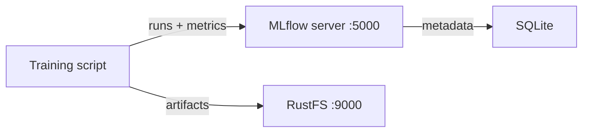

In dieser Anleitung verbinden Sie [MLflow](https://github.com/mlflow/mlflow) — die Plattform für Experiment-Tracking und die Model Registry — mit **RustFS** als S3-Artefaktspeicher. Sie starten den MLflow-Tracking-Server mit Docker Compose, protokollieren Parameter, Metriken und Artefakte eines Trainingslaufs und prüfen, dass die Artefakte in RustFS gespeichert werden. Der Ablauf wurde mit `ghcr.io/mlflow/mlflow:v2.22.1` und `rustfs/rustfs-x86-musl:v2.3.1` verifiziert.

Sie benötigen Docker mit dem Compose-Plugin. Dieses Setup ist für lokale Integrationstests gedacht, nicht für den Produktivbetrieb.

## Architektur



Der Tracking-Server hält Experiment- und Lauf-Metadaten in SQLite und speichert Artefakte — Modelldateien, Plots und Berichte — über die Artefakt-Wurzel `s3://` direkt in RustFS. Der Client benötigt dieselben RustFS-Zugangsdaten, weil er die Artefakte selbst mit boto3 und der Einstellung `MLFLOW_S3_ENDPOINT_URL` hochlädt.

## 1. Projektdateien anlegen

Erstellen Sie ein Arbeitsverzeichnis:

```bash
mkdir rustfs-mlflow
cd rustfs-mlflow
```

Erstellen Sie eine Umgebungsdatei und ersetzen Sie beide Platzhalter für die Zugangsdaten:

```ini title=".env"
RUSTFS_ACCESS_KEY=<your-access-key>
RUSTFS_SECRET_KEY=<your-secret-key>
MLFLOW_BUCKET=my-bucket
```

Verwenden Sie dedizierte Zugangsdaten für den Artefakt-Bucket. Nehmen Sie `.env` nicht in die Versionsverwaltung auf.

Erstellen Sie die Compose-Datei:

```yaml title="compose.yaml"
services:
  rustfs:
    image: rustfs/rustfs-x86-musl:v2.3.1
    environment:
      RUSTFS_ACCESS_KEY: ${RUSTFS_ACCESS_KEY}
      RUSTFS_SECRET_KEY: ${RUSTFS_SECRET_KEY}
      RUSTFS_VOLUMES: /data
      RUSTFS_ADDRESS: ":9000"
      RUSTFS_CONSOLE_ADDRESS: ":9001"
      RUSTFS_CONSOLE_ENABLE: "true"
    volumes:
      - rustfs-data:/data
    ports:
      - "9000:9000"
      - "9001:9001"
    healthcheck:
      test: ["CMD", "curl", "-sf", "http://127.0.0.1:9000/health"]
      interval: 10s
      timeout: 5s
      retries: 6
      start_period: 10s
    networks:
      - mlflow

  create-bucket:
    image: rustfs/rc:latest
    depends_on:
      rustfs:
        condition: service_healthy
    environment:
      RUSTFS_ACCESS_KEY: ${RUSTFS_ACCESS_KEY}
      RUSTFS_SECRET_KEY: ${RUSTFS_SECRET_KEY}
      MLFLOW_BUCKET: ${MLFLOW_BUCKET}
    entrypoint:
      - /bin/sh
      - -c
      - |
        /usr/bin/rc alias set rustfs http://rustfs:9000 "$${RUSTFS_ACCESS_KEY}" "$${RUSTFS_SECRET_KEY}"
        /usr/bin/rc mb --ignore-existing rustfs/$${MLFLOW_BUCKET}
    networks:
      - mlflow

  mlflow:
    image: ghcr.io/mlflow/mlflow:v2.22.1
    command:
      - server
      - --backend-store-uri
      - sqlite:////mlflow/mlflow.db
      - --default-artifact-root
      - s3://${MLFLOW_BUCKET}/mlflow-artifacts
      - --host
      - 0.0.0.0
      - --port
      - "5000"
    environment:
      AWS_ACCESS_KEY_ID: ${RUSTFS_ACCESS_KEY}
      AWS_SECRET_ACCESS_KEY: ${RUSTFS_SECRET_KEY}
      MLFLOW_S3_ENDPOINT_URL: http://rustfs:9000
      AWS_DEFAULT_REGION: us-east-1
    depends_on:
      create-bucket:
        condition: service_completed_successfully
    ports:
      - "5000:5000"
    volumes:
      - mlflow-db:/mlflow
    networks:
      - mlflow

networks:
  mlflow:

volumes:
  rustfs-data:
  mlflow-db:
```

Der Dienst `create-bucket` muss abgeschlossen sein, bevor der Server startet, weil MLflow den Bucket nicht anlegt. `MLFLOW_S3_ENDPOINT_URL` richtet den boto3-Client des Servers mit pfadbasierter Adressierung (Path-Style) auf RustFS aus. Die SQLite-Datenbank liegt auf einem Volume, damit die Experiment-Metadaten einen Neustart überstehen. Produktivbereitstellungen sollten stattdessen ein verwaltetes Datenbank-Backend verwenden.

## 2. Bereitstellung prüfen und starten

Prüfen Sie die Compose-Datei, bevor Sie Container starten:

```bash
docker compose config
```

Starten Sie die Dienste und warten Sie auf den Tracking-Server:

```bash
docker compose up -d
docker compose ps
```

Der Dienst `create-bucket` sollte mit dem Code `0` enden, und die MLflow-Oberfläche sollte unter `http://localhost:5000` antworten:

```bash
curl -sf http://localhost:5000/ >/dev/null && echo ready
```

Öffnen Sie die RustFS Console (Weboberfläche) unter `http://localhost:9001`, um im nächsten Schritt zu sehen, wie die Artefakte in `my-bucket` ankommen.

## 3. Trainingslauf protokollieren

Erstellen Sie das Client-Skript. Es läuft im MLflow-Image, das alle Abhängigkeiten mitbringt:

```bash title="train_demo.py" {12}
import mlflow

mlflow.set_tracking_uri("http://localhost:5000")
mlflow.set_experiment("rustfs-demo")

with mlflow.start_run(run_name="rustfs-verify") as run:
    mlflow.log_params({"model": "demo-regressor", "alpha": 0.5})
    for step in range(3):
        mlflow.log_metric("rmse", 0.9 - step * 0.2, step=step)
    with open("model-summary.txt", "w") as f:
        f.write("demo model trained against RustFS artifact store\n")
    mlflow.log_artifact("model-summary.txt", artifact_path="reports")
    print("run_id:", run.info.run_id)
    print("artifact_uri:", run.info.artifact_uri)
```

Kopieren Sie das Skript in den laufenden Container und führen Sie es mit der Dienstumgebung aus:

```bash
docker compose cp train_demo.py mlflow:/tmp/train_demo.py
docker compose exec -w /tmp mlflow python train_demo.py
```

Die Ausgabe von `artifact_uri` lautet `s3://my-bucket/mlflow-artifacts/<experiment-id>/<run-id>/artifacts`. Der Client lädt das Artefakt direkt nach RustFS hoch.

## 4. Artefakte in RustFS prüfen

Lesen Sie das Artefakt über den Tracking-Server zurück und listen Sie dasselbe Objekt in RustFS auf. Speichern Sie das Folgende als `verify.py`, ersetzen Sie `<your-run-id>` durch die in Schritt 3 ausgegebene Kennung und führen Sie das Skript auf dieselbe Weise aus:

```bash title="verify.py" {5}
import mlflow

mlflow.set_tracking_uri("http://localhost:5000")
client = mlflow.MlflowClient()
print([a.path for a in client.list_artifacts("<your-run-id>", "reports")])
path = client.download_artifacts("<your-run-id>", "reports/model-summary.txt")
print(open(path).read())
```

Der Download liest das Objekt über den Tracking-Server aus RustFS. Prüfen Sie anschließend die Objekte im Bucket:

```bash
docker compose exec rustfs /usr/bin/rc ls local/my-bucket/mlflow-artifacts/ -r
```

Die Ausgabe sollte das Artefakt-Objekt enthalten:

```text
mlflow-artifacts/1/a1aece9243504f2680a52fba0c32765f/artifacts/reports/model-summary.txt
```


Läufe, Parameter und Metriken überstehen einen Neustart des Servers, weil sie in SQLite liegen, während die Artefakte in RustFS bleiben:

```bash
docker compose restart mlflow
docker compose exec -w /tmp mlflow python verify.py
```

Der Aufruf `list_artifacts` gelingt am neu gestarteten Server erneut und liest dieselben Objekte aus RustFS.

## 5. Bereitstellung anhalten oder zurücksetzen

Stoppen Sie die Container und behalten Sie alle Daten:

```bash
docker compose down
```

Das RustFS-Volume behält die Artefakt-Objekte, das MLflow-Volume die Metadaten-Datenbank. Um alles zu löschen, einschließlich der Artefakte in RustFS, fügen Sie `--volumes` hinzu.

## Fehlerbehebung

### `ModuleNotFoundError: No module named 'boto3'` beim Protokollieren von Artefakten

Der Client, der `log_artifact` ausführt, benötigt boto3, weil er direkt nach S3 hochlädt. Installieren Sie boto3 in der Umgebung, die das Trainingsskript ausführt, oder führen Sie das Skript wie in Schritt 3 im MLflow-Image aus.

### `AccessDenied` oder Verbindungsfehler beim Hochladen von Artefakten

Stellen Sie sicher, dass `MLFLOW_S3_ENDPOINT_URL` in der Client-Umgebung gesetzt ist. Ohne diese Variable sendet boto3 Anfragen an das echte AWS S3. Der Endpunkt muss von dem Rechner aus erreichbar sein, auf dem das Trainingsskript läuft. Verwenden Sie außerhalb des Compose-Netzwerks `http://localhost:9000` und innerhalb `http://rustfs:9000`.

### Der Server startet nicht und meldet einen Bucket-Fehler

Der Artefakt-Bucket muss existieren, bevor der Server startet. Prüfen Sie die Logs des Dienstes `create-bucket`:

```bash
docker compose logs create-bucket
```

## Nächste Schritte

- Lesen Sie die [S3-Kompatibilitätshinweise](/de/administration/protocols/s3), bevor Sie weitere MLflow-Operationen verwenden.
- Erstellen Sie dedizierte Produktions-Zugangsdaten über die [Zugriffsschlüssel-Verwaltung](/de/security-compliance/iam/access-token).
- Folgen Sie der [MLflow-Dokumentation](https://mlflow.org/docs/latest/), um eine Model Registry hinzuzufügen oder den Metadatenspeicher auf eine verwaltete Datenbank zu verlagern.
