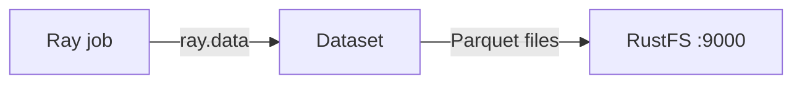

In dieser Anleitung verbinden Sie [Ray](https://github.com/ray-project/ray) — das verteilte KI- und Python-Compute-Framework — über die S3-Dateisystemunterstützung von Ray Data mit **RustFS**. Sie führen einen Ray-Job im offiziellen Image aus, schreiben einen Datensatz als Parquet in einen RustFS-Bucket, lesen ihn zurück und prüfen die Objekte. Der Ablauf wurde mit `rayproject/ray:2.44.0-py311` (Ray 2.44, pyarrow-Dateisystem) und `rustfs/rustfs-x86-musl:v2.3.1` verifiziert.

Sie benötigen Docker. Dieses Setup ist für lokale Integrationstests gedacht, nicht für den Produktivbetrieb.

## Architektur



Ray Data liest und schreibt Datensätze über das `S3FileSystem` von pyarrow. Wenn Sie ein für RustFS konfiguriertes `S3FileSystem` übergeben, gehen alle Datensatzoperationen — Parquet, CSV und JSON — an den Bucket.

## 1. Job-Datei anlegen

Erstellen Sie das Skript und ersetzen Sie alle Verbindungsplatzhalter:

```python title="ray_s3.py"
import ray
ray.init(ignore_reinit_error=True)

import pandas as pd
from pyarrow.fs import S3FileSystem

fs = S3FileSystem(
    endpoint_override="http://<your-rustfs-endpoint>:9000",
    access_key="<your-access-key>",
    secret_key="<your-secret-key>",
    region="us-east-1",
)

df = pd.DataFrame({"id": range(5), "value": [x * 1.5 for x in range(5)]})
ds = ray.data.from_pandas(df)
ds.write_parquet("my-bucket/ray-demo/events/", filesystem=fs)

back = ray.data.read_parquet("my-bucket/ray-demo/events/", filesystem=fs).take_all()
print("rows:", len(back))
print("sample:", back[0])
ray.shutdown()
```

`endpoint_override` erwartet die vollständige Endpunkt-URL einschließlich des Schemas. Das `S3FileSystem` von pyarrow verwendet für eigene Endpunkte Anfragen mit pfadbasierter Adressierung (Path-Style), daher ist kein zusätzliches Flag nötig. Dasselbe Dateisystem-Objekt funktioniert für `write_csv`, `read_json` und die übrigen Methoden von Ray Data.

## 2. Job ausführen

Führen Sie das Skript im Ray-Image im selben Docker-Netzwerk wie RustFS aus:

```bash
docker run --rm --network oo-rustfs_default \
  -v "$PWD/ray_s3.py":/tmp/ray_s3.py \
  rayproject/ray:2.44.0-py311 python /tmp/ray_s3.py
```


```text
rows: 5
sample: {'id': 0, 'value': 0.0}
```

## 3. Objekte in RustFS prüfen

Listen Sie das Datensatz-Präfix auf:

```bash
rc ls rustfs/my-bucket/ray-demo/ -r
```

Ray Data hat den Datensatz als Parquet-Block geschrieben:

```text
ray-demo/events/0_000000_000000.parquet
```


## 4. Anhalten oder zurücksetzen

Ray Data hält keinen eigenen Zustand. So löschen Sie den Demo-Datensatz:

```bash
rc rm rustfs/my-bucket/ray-demo/ --recursive --force
```

## Fehlerbehebung

### `Unable to connect to endpoint` oder Zeitüberschreitungen

Stellen Sie sicher, dass `endpoint_override` das Schema enthält und vom Ray-Container aus erreichbar ist. Im Compose-Netzwerk lautet der Hostname `rustfs`; vom Host aus verwenden Sie `http://localhost:9000`.

### `Access Denied` beim Schreiben

Stellen Sie sicher, dass Zugriffsschlüssel und geheimer Zugriffsschlüssel direkt an `S3FileSystem` übergeben werden. Ray liest auf diesem Codepfad die AWS-Umgebungsvariablen des Containers nicht.

## Nächste Schritte

- Lesen Sie die [S3-Kompatibilitätshinweise](/de/administration/protocols/s3), bevor Sie weitere Ray-Operationen verwenden.
- Erstellen Sie dedizierte Produktions-Zugangsdaten über die [Zugriffsschlüssel-Verwaltung](/de/security-compliance/iam/access-token).
- Folgen Sie der [Ray-Data-Dokumentation](https://docs.ray.io/en/latest/data/data.html), um Transformationen, das Einlesen für das Training und Checkpoints auf demselben Bucket zu verketten.
