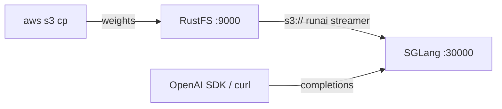

In dieser Anleitung verbinden Sie [SGLang](https://github.com/sgl-project/sglang) — das Serving-Framework für große Sprach- und multimodale Modelle — mit **RustFS** als Speicher für die Modellgewichte. Sie laden ein Modell in einen RustFS-Bucket hoch, richten SGLang auf die `s3://`-URI und bedienen OpenAI-kompatible Anfragen, während die Gewichte direkt aus dem Bucket gestreamt werden. Der Ablauf wurde mit `lmsysorg/sglang:v0.5.22-xeon` (SGLang 0.5.22, CPU-Engine) verifiziert, das `Qwen/Qwen2.5-0.5B-Instruct` aus einem RustFS-Bucket auf einem Nur-CPU-Host ausliefert.

Sie benötigen Docker und ein kleines Hugging-Face-Modell. Dieses Setup ist für lokale Integrationstests gedacht, nicht für den Produktivbetrieb.

## Architektur



Wenn `--model-path` eine Objektspeicher-URI ist, wechselt SGLang automatisch zum Ladeformat `runai_streamer`: Die Metadatendateien (`config.json`, Tokenizer) werden einmal in den lokalen Cache geladen, danach streamen die Gewichtstensoren verzögert während das Engine lädt. Der Bucket bleibt die einzige Kopie des Modells, Serving-Hosts brauchen keinen lokalen Modellspeicher.

:::note[Das CPU-Image enthält keinen S3-Streamer]

Das `xeon`-CPU-Image enthält kein `runai-model-streamer-s3`; der Serverstart mit einem `s3://`-Modellpfad schlägt mit `ImportError: S3 files module not found` fehl. Installieren Sie das Paket vor dem Start im Container — die virtuelle Umgebung des Images wird mit `uv` verwaltet und hat kein `pip`-Modul.

:::

## 1. Modell nach RustFS hochladen

Laden Sie die Modelldateien von Hugging Face und kopieren Sie sie in den Bucket. Ersetzen Sie alle Verbindungsplatzhalter:

```bash
docker run --rm -v "$PWD/models:/models" --entrypoint python3 \
  lmsysorg/sglang:v0.5.22-xeon -c \
  'from huggingface_hub import snapshot_download; snapshot_download("Qwen/Qwen2.5-0.5B-Instruct", local_dir="/models/qwen2.5-0.5b-instruct")'

aws s3 cp models/qwen2.5-0.5b-instruct \
  s3://my-bucket/sglang-models/qwen2.5-0.5b-instruct --recursive \
  --endpoint-url http://<your-rustfs-endpoint>:9000 \
  --acl private
```

Exportieren Sie die Zugangsdaten für die folgenden Befehle:

```bash
export AWS_ACCESS_KEY_ID=<your-access-key>
export AWS_SECRET_ACCESS_KEY=<your-secret-key>
export AWS_DEFAULT_REGION=us-east-1
```

Verwenden Sie ein Präfix pro Modell, sodass mehrere Modelle denselben Bucket teilen. Der Streamer liest Gewichtsdateien ausschließlich im Format `.safetensors`.

## 2. SGLang gegen den Bucket starten

Starten Sie das CPU-Image, installieren Sie das S3-Streamer-Paket und starten Sie den Server mit der Bucket-URI:

```bash
docker run -d --name sglang -p 30000:30000 \
  -e AWS_ACCESS_KEY_ID \
  -e AWS_SECRET_ACCESS_KEY \
  -e AWS_DEFAULT_REGION \
  -e AWS_ENDPOINT_URL=http://<your-rustfs-endpoint>:9000 \
  --entrypoint bash lmsysorg/sglang:v0.5.22-xeon -c \
  'uv pip install -q runai-model-streamer-s3 && \
   python3 -m sglang.launch_server \
     --model-path s3://my-bucket/sglang-models/qwen2.5-0.5b-instruct \
     --served-model-name qwen2.5-0.5b-instruct \
     --host 0.0.0.0 --port 30000 \
     --device cpu --trust-remote-code \
     --disable-overlap-schedule \
     --mem-fraction-static 0.45'
```

`AWS_ENDPOINT_URL` richtet den Streamer auf RustFS; Anfragen an den eigenen Endpunkt verwenden Path-Style-Adressierung. `--mem-fraction-static` bestimmt den KV-Cache-Anteil am Hostspeicher auf dem CPU-Backend — erhöhen Sie den Wert auf Hosts mit mehr freiem RAM. Warten Sie auf die Startzeile:

```bash
docker logs -f sglang
```

```text
The server is fired up and ready to roll!
```

## 3. Inferenz ausführen

Prüfen Sie, dass das Modell bereitgestellt wird, und senden Sie eine OpenAI-kompatible Completion-Anfrage:

```bash
curl -s http://localhost:30000/v1/models
```

```json
{"object":"list","data":[{"id":"qwen2.5-0.5b-instruct","object":"model","owned_by":"sglang","root":"qwen2.5-0.5b-instruct","max_model_len":32768}]}
```

```bash
curl -s http://localhost:30000/v1/completions \
  -H "Content-Type: application/json" \
  -d '{"model":"qwen2.5-0.5b-instruct","prompt":"RustFS is","max_tokens":16,"temperature":0}'
```

```json
{"object":"text_completion","model":"qwen2.5-0.5b-instruct","choices":[{"index":0,"text":" a file system for the Linux kernel that is designed to be used in embedded systems","finish_reason":"length"}],"usage":{"prompt_tokens":4,"total_tokens":20,"completion_tokens":16}}
```


## 4. Anhalten oder Zurücksetzen

Demo abreißen und die Bucket-Objekte behalten:

```bash
docker rm -f sglang
```

Gespeichertes Modell löschen:

```bash
aws s3 rm s3://my-bucket/sglang-models --recursive \
  --endpoint-url http://<your-rustfs-endpoint>:9000
```

## Fehlerbehebung

### `ImportError: S3 files module not found`

Das S3-Backend des RunAI-Streamers fehlt. Führen Sie wie in Schritt 2 gezeigt `uv pip install runai-model-streamer-s3` im Container aus, bevor Sie den Server starten.

### `pip: command not found` oder `No module named pip`

Das `/opt/.venv` des Images wurde von `uv` ohne `pip` erstellt. Verwenden Sie `uv pip install` statt `pip install`.

### `Loaded weights leave no GPU memory for the KV cache`

`--mem-fraction-static` ist für die geladenen Gewichte auf diesem Host zu klein. Die Fehlermeldung nennt den minimal machbaren Wert — starten Sie den Server mit einem größeren Anteil neu (zum Beispiel `0.45` auf einem 16-GB-Host für ein 0,5-B-Modell).

### Anfragen schlagen mit Signatur- oder Zugriffsfehlern fehl

Stellen Sie sicher, dass im Server-Container alle vier Variablen gesetzt sind: `AWS_ACCESS_KEY_ID`, `AWS_SECRET_ACCESS_KEY`, `AWS_DEFAULT_REGION` und `AWS_ENDPOINT_URL` einschließlich des Schemas.

## Nächste Schritte

- Lesen Sie vor weiteren Serving-Operationen die [S3-Kompatibilitätshinweise](/administration/protocols/s3).
- Erstellen Sie dedizierte Produktionszugangsdaten mit [Zugangsdatenverwaltung](/security-compliance/iam/access-token).
- Folgen Sie der [SGLang-Dokumentation](https://docs.sglang.io/) für Tensorparallelität, Quantisierung und größere Modelle auf demselben bucket-gestützten Modelllager.
