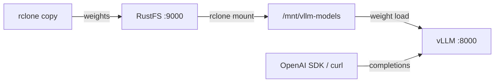
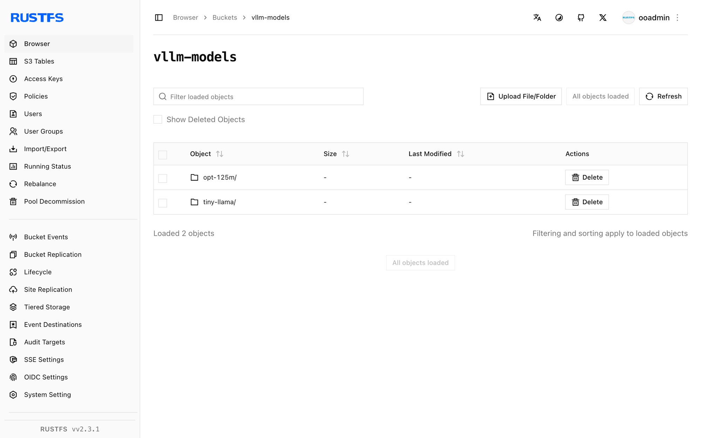

In dieser Anleitung verbinden Sie [vLLM](https://github.com/vllm-project/vllm) — die LLM-Inferenz-Engine mit hohem Durchsatz — mit **RustFS** als Speicher für die Modellgewichte. Sie laden ein Modell in einen RustFS-Bucket hoch, binden den Bucket auf dem vLLM-Host über ein rclone-Mount ein und stellen das Modell über die OpenAI-kompatible API bereit. Der Ablauf wurde auf einem Nur-CPU-Host mit `vllm/vllm-openai-cpu` (vLLM 0.30.0) verifiziert, das `facebook/opt-125m` aus einem von `rustfs/rustfs-x86-musl:v2.3.1` bereitgestellten RustFS-Bucket ausliefert.

Sie benötigen Docker und rclone auf dem Host, auf dem vLLM läuft. Dieses Setup ist für lokale Integrationstests gedacht, nicht für den Produktivbetrieb.

## Architektur



Der Bucket ist die einzige Kopie des Modells. Hosts, die das Modell bereitstellen, binden den Bucket nur lesend ein. Jeder Knoten bezieht die Gewichte aus RustFS, und es gibt keinen lokalen Modellspeicher, der auseinanderlaufen kann.

:::note[Warum ein rclone-Mount]

vLLM 0.30 lädt Modellpfade mit `s3://` über den RunAI Model Streamer. Dessen Lesezugriffe mit Byte-Ranges schlagen derzeit gegen eigene S3-Endpunkte wie RustFS fehl (der Loader meldet `File access error` bei jedem Offset ungleich null). Den Bucket als Dateisystem einzubinden ist der hier geprüfte Weg, die Gewichte in RustFS zu belassen, während vLLM sie als lokale Dateien liest.

:::

## 1. Modell nach RustFS hochladen

Legen Sie den Bucket an und kopieren Sie die Modellgewichte hinein. Ersetzen Sie alle Verbindungsplatzhalter:

```ini title="rclone.conf"
[rustfs]
type = s3
provider = Other
access_key_id = <your-access-key>
secret_access_key = <your-secret-key>
endpoint = http://<your-rustfs-endpoint>:9000
region = us-east-1
```


```bash
rc mb rustfs/vllm-models
rclone copy ./opt-125m rustfs:vllm-models/opt-125m --transfers 4
```

Jedes Hugging-Face-Layout ist geeignet: `config.json`, die Tokenizer-Dateien und die Gewichtsdateien (`model.safetensors` oder `pytorch_model.bin`). Legen Sie ein Modell pro Präfix ab, damit mehrere Modelle denselben Bucket nutzen können.

## 2. Bucket auf dem vLLM-Host einbinden

Binden Sie den Bucket auf dem Rechner, auf dem vLLM läuft, nur lesend ein und erlauben Sie anderen Clients den Zugriff mit `--allow-other`:

```bash
mkdir -p /mnt/vllm-models
rclone mount rustfs:vllm-models /mnt/vllm-models \
  --allow-other --daemon
ls /mnt/vllm-models/opt-125m/
```


```text
config.json  merges.txt  model.safetensors  tokenizer.json  vocab.json
```

## 3. vLLM ausführen

Starten Sie das CPU-Image gegen die eingehängten Gewichte:

```bash
docker run -d --name vllm -p 8000:8000 --shm-size=2g \
  -v /mnt/vllm-models:/models:ro \
  vllm/vllm-openai-cpu:latest \
  --model /models/opt-125m --served-model-name opt-125m \
  --dtype float32 --max-model-len 256 --gpu-memory-utilization 0.15
```

vLLM liest die Gewichte über das Mount. Der Container bleibt zustandslos, und das Modell liegt in RustFS. Warten Sie, bis der Server bereit ist:

```bash
curl -s http://localhost:8000/v1/models | head -c 200
```


```text
{"object":"list","data":[{"id":"opt-125m","object":"model","created":...,"root":"/models/opt-125m",...}]}
```

`--gpu-memory-utilization` steuert den Anteil des Arbeitsspeichers, der auf dem CPU-Backend für den KV-Cache reserviert wird. Setzen Sie den Wert auf kleinen Hosts herunter. `--dtype float32` entspricht dem, was die CPU-Attention-Kernel für dieses Modell unterstützen.

## 4. Inferenz ausführen

Senden Sie eine OpenAI-kompatible Completion-Anfrage:

```bash
curl -s http://localhost:8000/v1/completions \
  -H "Content-Type: application/json" \
  -d '{"model": "opt-125m", "prompt": "RustFS is", "max_tokens": 12, "temperature": 0}'
```


```json
{"id":"cmpl-...","object":"text_completion","model":"opt-125m",
 "choices":[{"index":0,"text":" a great tool for building your own server. It's a",
 "finish_reason":"length",...}]}
```

Die Anfrage entspricht dem OpenAI-Schema, daher funktioniert der Python-Client unverändert:

```python
from openai import OpenAI

client = OpenAI(base_url="http://localhost:8000/v1", api_key="EMPTY")
print(client.completions.create(
    model="opt-125m", prompt="RustFS is", max_tokens=12, temperature=0,
).choices[0].text)
```



## 5. Anhalten oder zurücksetzen

So bauen Sie die Demo ab und behalten die Objekte im Bucket:

```bash
docker rm -f vllm
fusermount -u /mnt/vllm-models
```

So löschen Sie das gespeicherte Modell:

```bash
rclone purge rustfs:vllm-models
```

## Fehlerbehebung

### `Cannot find any model weights with /models/...`

Der Mount hatte einen veralteten Verzeichnis-Cache, oder die Gewichtsdateien sind nie im Bucket angekommen. Führen Sie `rclone copy` erneut aus und prüfen Sie die Dateien über das Mount mit `ls`, bevor Sie vLLM starten. Ein kurzes `--dir-cache-time` (zum Beispiel `10s`) hilft, solange Sie die Einrichtung anpassen.

### `Unsupported CPU attention configuration: head_dim=...`

Die CPU-Kernel von vLLM unterstützen nur eine feste Auswahl an Head-Dimensionen. Sehr kleine Testmodelle wie `hf-internal-testing/tiny-random-*` verwenden ungewöhnliche Formen, die erst zur Anfragezeit fehlschlagen. Verwenden Sie ein echtes kleines Modell wie `facebook/opt-125m`.

### `Insufficient space in /dev/shm`

Die CPU-Engine von vLLM tauscht Tensoren über Shared Memory aus. Starten Sie den Container mit `--shm-size=2g` (oder `--ipc=host`).

### Der Server bricht mit `Available memory on node 0 ... is less than desired CPU memory utilization` ab

Die Standardreservierung für den KV-Cache beträgt 90 Prozent des Arbeitsspeichers. Senken Sie sie mit `--gpu-memory-utilization 0.15`. Das Flag gilt auf dem CPU-Backend trotz seines Namens als Anteil am Arbeitsspeicher.

## Nächste Schritte

- Lesen Sie die [S3-Kompatibilitätshinweise](/de/administration/protocols/s3), bevor Sie weitere Inferenz-Bereitstellungen verwenden.
- Erstellen Sie dedizierte Produktions-Zugangsdaten über die [Zugriffsschlüssel-Verwaltung](/de/security-compliance/iam/access-token).
- Folgen Sie der [vLLM-Dokumentation](https://docs.vllm.ai/en/latest/serving/openai_compatible_server.html) für Chat-Templates, Tensor-Parallelität und quantisierte Gewichte auf demselben Bucket als Modellspeicher.
