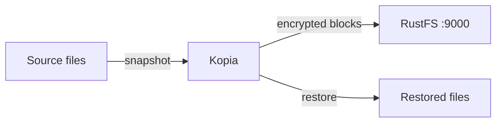

In dieser Anleitung verbinden Sie [Kopia](https://github.com/kopia/kopia) — das quelloffene Werkzeug für Backup und Wiederherstellung — mit **RustFS** als S3-Repository. Sie legen ein Repository in einem RustFS-Bucket an, erstellen einen Snapshot eines Verzeichnisses, stellen ihn in einem leeren Verzeichnis wieder her und vergleichen die Prüfsummen. Der Ablauf wurde mit `kopia/kopia:0.18.1` und `rustfs/rustfs-x86-musl:v2.3.1` verifiziert.

Sie benötigen Docker. Dieses Setup ist für lokale Integrationstests gedacht, nicht für den Produktivbetrieb.

## Architektur



Kopia speichert die Formatdateien des Repositorys und die deduplizierten, verschlüsselten Inhaltsblöcke im Bucket. Die Wiederherstellung liest die Blöcke zurück und setzt die ursprünglichen Dateien wieder zusammen. Die Prüfsumme jeder wiederhergestellten Datei muss mit der Quelle übereinstimmen.

## 1. Repository anlegen

Legen Sie zuerst den Bucket an und initialisieren Sie anschließend das Kopia-Repository darin. Der Endpunkt ist ein reiner Wert `host:port` ohne Schema. `--disable-tls` schaltet den Client auf unverschlüsseltes HTTP um:

```bash
rc alias set rustfs http://<your-rustfs-endpoint>:9000 <your-access-key> <your-secret-key>
rc mb rustfs/kopia-backups

docker run --rm --network oo-rustfs_default kopia/kopia:0.18.1 repository create s3 \
  --bucket kopia-backups \
  --access-key <your-access-key> \
  --secret-access-key <your-secret-key> \
  --endpoint <your-rustfs-endpoint>:9000 \
  --region us-east-1 \
  --disable-tls \
  --password <your-kopia-password> \
  --override-username demo --override-hostname workstation
```

Kopia prüft den Anbieter, indem es über die S3-API liest und schreibt, bevor es Erfolg meldet.

## 2. Verbinden, Snapshot erstellen und wiederherstellen

Führen Sie die folgenden Befehle aus dem Verzeichnis aus, das Ihre `repository.config` enthält (angelegt im vorherigen Schritt). Kopia liest die Verbindungseinstellungen aus dieser Datei, die S3-Flags sind daher nur einmal nötig:

```bash
export KOPIA_PASSWORD=<your-kopia-password>
export KOPIA_CONFIG_PATH=/config/repository.config

alias kopia='docker run --rm --network oo-rustfs_default \
  -e KOPIA_PASSWORD -e KOPIA_CONFIG_PATH \
  -v "$PWD/config:/config" \
  -v "$PWD/source:/source:ro" \
  -v "$PWD/restore:/restore" kopia/kopia:0.18.1'

kopia repository connect s3 \
  --bucket kopia-backups \
  --access-key <your-access-key> \
  --secret-access-key <your-secret-key> \
  --endpoint <your-rustfs-endpoint>:9000 \
  --region us-east-1 --disable-tls \
  --override-username demo --override-hostname workstation

kopia snapshot create /source
kopia snapshot list
```

Stellen Sie den Snapshot in einem leeren Verzeichnis wieder her und vergleichen Sie die Prüfsummen mit der Quelle. Die Snapshot-ID ist die Kennung `ka...`, die `snapshot list` ausgibt:

```bash
kopia restore <snapshot-id> /restore

sha256sum source/blob.bin restore/blob.bin
```


```text
bec4530e2798465b...  source/blob.bin
bec4530e2798465b...  restore/blob.bin
```

## 3. Objekte in RustFS prüfen

Listen Sie den Bucket auf:

```bash
rc ls rustfs/kopia-backups/ -r
```

Die Ausgabe zeigt die Formatdateien des Repositorys und die gepackten Inhaltsblöcke, die der Snapshot geschrieben hat:

```text
kopia.blobcfg
kopia.repository
p0000.../...
```


## 4. Anhalten oder zurücksetzen

Kopia ist ein clientseitiges Werkzeug und hält keinen laufenden Zustand. Um das Repository und alle Snapshots zu löschen, entfernen Sie den Bucket:

```bash
rc rb rustfs/kopia-backups --force
```

## Fehlerbehebung

### `Endpoint url cannot have fully qualified paths`

Der Endpunkt muss ein reiner Wert `host:port` ohne Schema oder Pfad sein. Kopia baut die Objekt-URLs selbst.

### `server gave HTTP response to HTTPS client`

Ohne `--disable-tls` spricht Kopia HTTPS. RustFS ohne TLS benötigt das Flag `--disable-tls` sowohl bei `repository create s3` als auch bei `repository connect s3`.

### `can't connect to storage` mit einem DNS-Fehler

Der S3-Client verwendet Adressierung im Virtual-Hosted-Stil. Belassen Sie den Endpunkt als reinen Wert `host:port`. Kopia verwendet für Endpunkte in dieser Form Anfragen mit pfadbasierter Adressierung (Path-Style).

## Nächste Schritte

- Lesen Sie die [S3-Kompatibilitätshinweise](/de/administration/protocols/s3), bevor Sie weitere Kopia-Operationen verwenden.
- Erstellen Sie dedizierte Produktions-Zugangsdaten über die [Zugriffsschlüssel-Verwaltung](/de/security-compliance/iam/access-token).
- Folgen Sie der [Kopia-Repository-Dokumentation](https://kopia.io/docs/repositories/), um Richtlinien, Aufbewahrung und geplante Snapshots hinzuzufügen.
