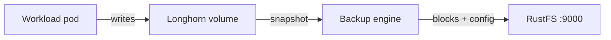
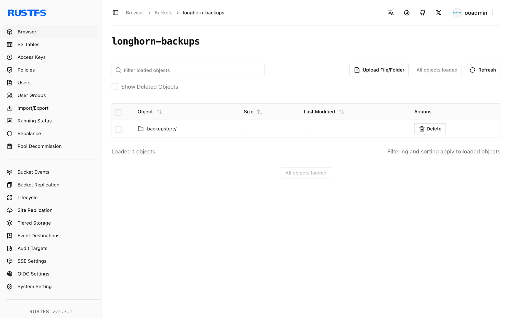

In dieser Anleitung verbinden Sie [Longhorn](https://github.com/longhorn/longhorn) — das verteilte Blockspeichersystem für Kubernetes — mit **RustFS** als S3-Backup-Ziel. Sie konfigurieren das Backup-Ziel, sichern ein Volume mit Daten, löschen das Volume, stellen es aus RustFS wieder her und prüfen die Daten. Der Ablauf wurde mit Longhorn 1.9.0 auf k3s (Kubernetes 1.30) und `rustfs/rustfs-x86-musl:v2.3.1` verifiziert.

Sie benötigen einen Kubernetes-Cluster mit installiertem Longhorn und `kubectl`-Zugriff darauf. Diese Anleitung ist für Integrationstests gedacht, nicht für den Produktivbetrieb.

## Architektur



Longhorn speichert Backups im Präfix `backupstore/volumes/` des Ziel-Buckets als inhaltsadressierte Blöcke plus eine kleine Volume-Konfigurationsdatei. Die Wiederherstellung liest diese Objekte in ein neues Volume auf jedem Knoten zurück, der RustFS erreichen kann.

## 1. Backup-Bucket anlegen

Legen Sie mit dem [`rc`-Client](https://github.com/rustfs/cli) einen eigenen Bucket an. Verwenden Sie Ihren eigenen Endpunkt und Ihre eigenen Zugangsdaten:

```bash
rc alias set rustfs http://<your-rustfs-endpoint>:9000 <your-access-key> <your-secret-key>
rc mb rustfs/longhorn-backups
```

Longhorn legt den Bucket nicht an. Dieser Schritt muss abgeschlossen sein, bevor das erste Backup startet.

## 2. Backup-Ziel konfigurieren

Speichern Sie die RustFS-Zugangsdaten in einem Secret im Namespace `longhorn-system`. `AWS_ENDPOINTS` muss ein Endpunkt sein, den jeder Knoten erreichen kann. Verwenden Sie die Knoten-IP oder die Adresse eines internen Load Balancers, nicht eine Portweiterleitung von Ihrer Arbeitsstation:

```bash
kubectl -n longhorn-system create secret generic rustfs-s3-secret \
  --from-literal=AWS_ACCESS_KEY_ID=<your-access-key> \
  --from-literal=AWS_SECRET_ACCESS_KEY=<your-secret-key> \
  --from-literal=AWS_ENDPOINTS=http://<your-rustfs-endpoint>:9000
```

Longhorn 1.9 verwaltet Backup-Ziele über die Ressource `BackupTarget`. Patchen Sie das Ziel `default` mit dem RustFS-Bucket:

```bash
kubectl -n longhorn-system patch backupTarget default --type merge -p '
spec:
  backupTargetURL: s3://longhorn-backups@us-east-1/
  credentialSecret: rustfs-s3-secret
  pollInterval: 5m'
```

Der Abschnitt `@us-east-1` ist die Regionsangabe im S3-URL-Format. Er muss nicht zu einer echten Bereitstellungsregion passen.

Warten Sie, bis das Ziel verfügbar ist. Damit ist bestätigt, dass Longhorn den Bucket über das Secret erreicht hat:

```bash
kubectl -n longhorn-system get backupTarget default
```


```text
NAME      URL                                CREDENTIAL         AVAILABLE   LASTSYNCEDAT
default   s3://longhorn-backups@us-east-1/   rustfs-s3-secret   true        2026-09-21T08:36:55Z
```

## 3. Daten schreiben und ein Backup erstellen

Legen Sie ein Test-Volume mit Daten an. Das folgende Manifest erzeugt eine PVC mit 1 GiB und einen Pod, der eine Marker-Datei schreibt:

```yaml title="demo.yaml"
apiVersion: v1
kind: PersistentVolumeClaim
metadata:
  name: demo-vol
spec:
  accessModes: [ReadWriteOnce]
  storageClassName: longhorn
  resources:
    requests:
      storage: 1Gi
---
apiVersion: v1
kind: Pod
metadata:
  name: demo-app
spec:
  volumes:
  - name: data
    persistentVolumeClaim:
      claimName: demo-vol
  containers:
  - name: app
    image: busybox:1.36
    command: ["sh", "-c", "echo 'longhorn rustfs demo' > /data/hello.txt && sleep 3600"]
    volumeMounts:
    - name: data
      mountPath: /data
```

Wenden Sie es an und warten Sie, bis der Pod läuft:

```bash
kubectl apply -f demo.yaml
kubectl get pod demo-app
```

Erstellen Sie einen Snapshot und sichern Sie ihn. Das geht in der Longhorn-Oberfläche (**Volume → Snapshot → Backup**) oder deklarativ:

```bash
VOLUME=$(kubectl get pvc demo-vol -o jsonpath='{.spec.volumeName}')
kubectl -n longhorn-system apply -f - <<EOF
apiVersion: longhorn.io/v1beta2
kind: Snapshot
metadata:
  name: demo-snap
  namespace: longhorn-system
spec:
  volume: $VOLUME
EOF
```

Legen Sie anschließend die Ressource `Backup` für diesen Snapshot an:

```bash
kubectl -n longhorn-system apply -f - <<EOF
apiVersion: longhorn.io/v1beta2
kind: Backup
metadata:
  name: demo-backup
  namespace: longhorn-system
spec:
  snapshotName: demo-snap
EOF
```

Warten Sie, bis das Backup abgeschlossen ist:

```bash
kubectl -n longhorn-system wait --for=jsonpath='{.status.state}'=Completed backup/demo-backup --timeout=300s
kubectl -n longhorn-system get backup demo-backup -o jsonpath='{.status.backupURL}'
```

## 4. Backup in RustFS prüfen

Listen Sie den Bucket auf:

```bash
rc ls rustfs/longhorn-backups/ -r
```

Die Ausgabe sollte die Volume-Konfiguration und die inhaltsadressierten Blöcke enthalten:

```text
backupstore/volumes/08/62/pvc-b73aeb3a-1482-4146-a8c9-749954c5dd7d/backups/backup_backup-f52accbdf3984e3d.cfg
backupstore/volumes/08/62/pvc-b73aeb3a-1482-4146-a8c9-749954c5dd7d/blocks/15/22/15220b19...blk
```



## 5. Daten wiederherstellen und prüfen

Legen Sie ein neues Volume an, das aus dem Backup wiederhergestellt wird. Verwenden Sie die `backupURL` aus Schritt 3:

```bash
kubectl -n longhorn-system apply -f - <<EOF
apiVersion: longhorn.io/v1beta2
kind: Volume
metadata:
  name: demo-restored
  namespace: longhorn-system
spec:
  size: "1073741824"
  numberOfReplicas: 1
  fromBackup: "<backupURL-from-step-3>"
EOF
```

Die Wiederherstellung läuft, wenn das Volume zum ersten Mal angehängt wird. Legen Sie eine PVC an, die über ein statisches PV an das wiederhergestellte Volume gebunden ist, und hängen Sie sie ein:

```bash
kubectl apply -f - <<EOF
apiVersion: v1
kind: PersistentVolume
metadata:
  name: demo-restored-pv
spec:
  capacity:
    storage: 1Gi
  accessModes: [ReadWriteOnce]
  claimRef:
    name: demo-restored
    namespace: default
  csi:
    driver: driver.longhorn.io
    volumeHandle: demo-restored
    fsType: ext4
  storageClassName: longhorn-static
---
apiVersion: v1
kind: PersistentVolumeClaim
metadata:
  name: demo-restored
spec:
  accessModes: [ReadWriteOnce]
  storageClassName: longhorn-static
  volumeName: demo-restored-pv
  resources:
    requests:
      storage: 1Gi
EOF
```

Hängen Sie das wiederhergestellte Volume in einem Prüf-Pod ein:

```bash
kubectl apply -f - <<EOF
apiVersion: v1
kind: Pod
metadata:
  name: restore-verify
spec:
  volumes:
  - name: data
    persistentVolumeClaim:
      claimName: demo-restored
  containers:
  - name: verify
    image: busybox:1.36
    command: ["sh", "-c", "cat /data/hello.txt && sleep 300"]
    volumeMounts:
    - name: data
      mountPath: /data
EOF
sleep 40
kubectl logs restore-verify
```

Die Ausgabe zeigt die Marker-Datei aus Schritt 3. Damit ist nachgewiesen, dass die Daten über RustFS und zurück übertragen wurden:

```text
longhorn rustfs demo
```

## 6. Aufräumen

Löschen Sie die Test-Workloads und das wiederhergestellte Volume:

```bash
kubectl delete pod restore-verify demo-app
kubectl delete pvc demo-restored demo-vol
kubectl -n longhorn-system delete volume/demo-restored
```

Das Backup in RustFS bleibt bestehen, bis Sie es in der Longhorn-Oberfläche oder im Bucket entfernen.

## Fehlerbehebung

### `No available disk candidates to create a new replica`

Longhorn hat auf dem Knoten keine Disk, auf der Replicas eingeplant werden können. Prüfen Sie, dass der Knoten seine Standardfestplatte registriert hat:

```bash
kubectl -n longhorn-system get nodes.longhorn.io -o jsonpath='{.items[0].status.diskStatus}'
```

Wenn die Map leer ist, legen Sie `/var/lib/longhorn` auf dem Knoten an und registrieren Sie die Festplatte:

```bash
kubectl -n longhorn-system patch nodes.longhorn.io <node-name> --type merge -p '
spec:
  disks:
    default:
      path: /var/lib/longhorn
      allowScheduling: true'
```

### `failed to create backup ... missing input parameter`

Das Backup lief, bevor das Standard-Backup-Ziel konfiguriert war. Schließen Sie Schritt 2 ab, stellen Sie sicher, dass `AVAILABLE` den Wert `true` hat, und erstellen Sie das Backup erneut.

### Das Backup-Ziel wird nie verfügbar

Das Secret muss existieren, bevor das Ziel synchronisiert, und `AWS_ENDPOINTS` muss von den Knoten selbst erreichbar sein. Prüfen Sie die Logs von `longhorn-manager` auf S3-Fehler:

```bash
kubectl -n longhorn-system logs -l app=longhorn-manager | grep -i s3 | tail
```

## Nächste Schritte

- Lesen Sie die [S3-Kompatibilitätshinweise](/de/administration/protocols/s3), bevor Sie weitere Backup-Ziele verwenden.
- Erstellen Sie dedizierte Produktions-Zugangsdaten über die [Zugriffsschlüssel-Verwaltung](/de/security-compliance/iam/access-token).
- Folgen Sie der [Longhorn-Backup-Dokumentation](https://longhorn.io/docs/1.9.0/backups-and-restore/), um wiederkehrende Backup-Jobs und geplante Snapshots zu konfigurieren.
