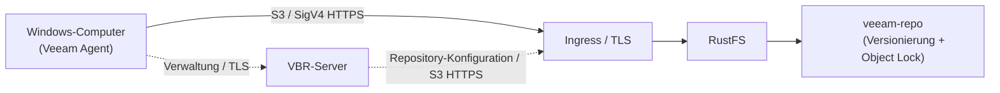
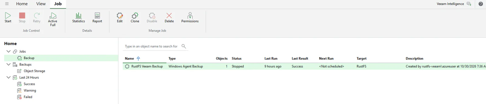

Veeam Backup & Replication (VBR) ist eine Enterprise-Backup-Plattform, die Sicherungsdaten in S3-kompatiblem Objektspeicher ablegt. Diese Anleitung zeigt, wie Sie RustFS als VBR-Objektspeicher-Repository registrieren, mit dem Veeam Agent einen gesamten Windows-Computer sichern und eine Datei aus dem gespeicherten Backup wiederherstellen.

Sie benötigen eine über HTTPS erreichbare RustFS-Instanz, einen dedizierten Backup-Bucket, einen Windows-Computer mit VBR 13 und eine Veeam-Lizenz mit Objektspeicher-Backup. Laden Sie VBR von der [offiziellen Veeam-Downloadseite](https://www.veeam.com/products/downloads.html) herunter. Dimensionieren Sie den Backup-Server nach den [Veeam-Systemanforderungen](https://helpcenter.veeam.com/docs/vbr/userguide/system_requirements_backup_server.html?ver=13), nicht nach der Ausstattung einer kleinen Labor-VM.

:::note[Lizenzanforderung]

Backups auf S3-kompatiblen Objektspeicher sind eine Enterprise-Funktion von Veeam. Kaufen Sie für den Produktivbetrieb eine Veeam-Enterprise-Lizenz oder eine andere kostenpflichtige Lizenz, die diese Funktion umfasst. Für einen Proof of Concept (POC) können Sie eine [kostenlose 30-Tage-Testlizenz für Veeam Data Platform anfordern](https://www.veeam.com/products/data-platform-trial.html) und vor dem Job installieren. Der Download oder die Installation von VBR allein aktiviert diese Funktion nicht. In der geprüften Konfiguration konnte Community Edition das Repository hinzufügen, verweigerte jedoch ohne die erforderliche Lizenz den Objektspeicher-Backup-Job.

:::

## Geprüfte Konfiguration

Der berichtete Test verwendete VBR **13.1.2.57**, RustFS **1.0.1**, ein Windows-Agent-Backup und ein Repository im Verbindungsmodus **Direct**. Ein Backup-Job und eine Dateiwiederherstellung waren erfolgreich. Dies ist ein Integrationstest, keine Veeam-Zertifizierung oder Prüfung von Bare-Metal-Wiederherstellung, erzwungener Aufbewahrung oder sämtlichen Veeam-Workloads. Die beobachteten Objekte von ungefähr 1 MiB sind keine Zusicherung einer festen Blockgröße.

## Architektur



Im Modus Direct sendet der Agent Backup-Daten an RustFS; VBR verwaltet Job und Repository. Bei einer Gateway-Konfiguration laufen die Daten über den ausgewählten Gateway- oder Mount-Server. Der übertragende Agent oder Gateway muss den RustFS-HTTPS-Endpunkt erreichen und dessen Zertifikat vertrauen können. Siehe [Verbindungsmodi für Veeam Agent](https://helpcenter.veeam.com/docs/vbr/userguide/agents_object_storage.html?ver=13). Das Objektschlüsselpräfix lautet `veeam`, der Bucket `veeam-repo`.

## 1. Bucket und Zugangsdaten vorbereiten

Erstellen Sie einen dedizierten Bucket mit Versionierung und Object Lock (Objektsperre). Versionierung ist Voraussetzung für Object Lock und damit für unveränderliche Veeam-Backups:

```bash
rc bucket create <your-alias>/veeam-repo --with-lock
rc bucket version info <your-alias>/veeam-repo
```

Verwenden Sie die folgende auf den Bucket beschränkte Ausgangsrichtlinie und prüfen Sie sie für Ihren Veeam-Modus. Bucket- und Objektaktionen haben unterschiedliche Ressourcenbereiche. `s3:CreateBucket` entfällt, weil der Bucket bereits existiert. Dies ist keine nachgewiesene Minimalrichtlinie: Die Laborrichtlinie enthält Legal-Hold-Verwaltung und das Umgehen der Governance-Aufbewahrung. Prüfen Sie diese Rechte vor dem Produktivbetrieb und entfernen Sie unnötige Berechtigungen. Insbesondere erlaubt `s3:BypassGovernanceRetention` das Umgehen des Governance-Schutzes; diese Zugangsdaten garantieren daher keinen Schutz vor dem Löschen geschützter Versionen.

```json
{
  "Version": "2012-10-17",
  "Statement": [
    {
      "Effect": "Allow",
      "Action": ["s3:GetObject","s3:PutObject","s3:DeleteObject",
                 "s3:GetObjectVersion","s3:DeleteObjectVersion",
                 "s3:AbortMultipartUpload","s3:ListMultipartUploadParts",
                 "s3:PutObjectRetention","s3:GetObjectRetention",
                 "s3:PutObjectLegalHold","s3:GetObjectLegalHold",
                 "s3:BypassGovernanceRetention"],
      "Resource": ["arn:aws:s3:::veeam-repo/*"]
    },
    {
      "Effect": "Allow",
      "Action": ["s3:ListBucket","s3:ListBucketVersions","s3:GetBucketLocation",
                 "s3:GetBucketVersioning","s3:GetBucketObjectLockConfiguration",
                 "s3:ListBucketMultipartUploads"],
      "Resource": ["arn:aws:s3:::veeam-repo"]
    }
  ]
}
```

```bash
rc admin policy create <your-alias> veeam-repo-rw <path-to-policy-file>
rc admin user add <your-alias> veeam <your-secret-key>
rc admin policy attach <your-alias> veeam-repo-rw --user veeam
```

Veeam verlangt HTTPS für S3-kompatiblen Objektspeicher. Sie können TLS mit Traefik oder Nginx vor RustFS terminieren. Der SAN muss den Endpunkt-Hostnamen abdecken; VBR und der übertragende Agent oder Gateway müssen der Zertifikatskette vertrauen. Installieren Sie bei einer privaten CA deren Stammzertifikat in den entsprechenden Vertrauensspeichern. Importieren Sie kein beliebiges Endpunktzertifikat als vertrauenswürdige CA und deaktivieren Sie die Prüfung nicht.

Konfigurieren Sie für diesen Backup-Bucket keine Lifecycle-Ablauf- oder Übergangsregeln; Veeam soll die Backup-Aufbewahrung verwalten. Siehe [Objektspeicher-Einschränkungen für Veeam Agent](https://helpcenter.veeam.com/docs/agentforwindows/userguide/backup_to_object_storage.html).

## 2. RustFS-Repository in VBR hinzufügen

Gehen Sie in der VBR-Konsole zu **Backup Infrastructure → Backup Repositories → Add Repository → Object storage → S3 Compatible**:

1. Service point: Ihr RustFS-HTTPS-Endpunkt, Region: `us-east-1`.
2. Credentials: Access Key und Secret Key des Benutzers `veeam`. Wählen Sie **Direct** für den dargestellten Datenpfad oder einen Gateway, wenn direkter Zugriff ungeeignet ist.
3. Bucket: `veeam-repo`, Folder: `veeam`.
4. Falls ein neuer Bucket noch keine Präfixe enthält, erstellen Sie mit einem S3-Client ein Objekt unter `veeam/` und wählen Sie Folder über **Browse**.
5. Aktivieren Sie für einen Test unveränderlicher Backups **Make backups immutable** und prüfen Sie die Objektaufbewahrung separat. Object Lock im Bucket allein macht nicht jedes Backup unveränderlich.


Wenn Veeam meldet, dass die automatische Bucket-Bereitstellung mit Access Denied fehlschlägt, wählen Sie **Yes**, um sie zu deaktivieren und fortzufahren — der Bucket existiert bereits, und der IAM-Benutzer kann absichtlich keine Buckets anlegen.

Konfigurieren Sie für Agent-Backups ausdrücklich **Set Access Permissions → Security** gemäß [Veeams Anleitung für S3-kompatiblen Repository-Zugriff](https://helpcenter.veeam.com/docs/vbr/userguide/access_permissions.html?ver=13). **Provided by the backup server** verwendet einen Gateway- oder Mount-Server, auch wenn das Repository Direct anzeigt. Tatsächlicher Direct-Zugriff erfordert eine kompatible IAM/STS-Konfiguration oder **Agents share credentials to object storage repository**. Letzteres gibt Repository-Zugangsdaten an geschützte Computer weiter und ist weniger sicher; nutzen Sie es nur bei Bedarf in einem isolierten POC. Allgemeine IAM/STS-Unterstützung belegt nicht die Kompatibilität mit Veeams Zugangsdatenverfahren; prüfen Sie den Modus vor dem Produktivbetrieb.

Der Laborbericht dokumentiert die Security-Auswahl nicht und bestätigt daher nicht unabhängig, dass die Daten einen Gateway umgingen.

Bei Erfolg erscheint das Repository als **S3-compatible**. Used Space ist eine Veeam-Verbrauchsangabe, keine unabhängige Messung der RustFS-Kapazität:


## 3. Geschützten Computer registrieren

Der Backup-Job allein installiert den Veeam Agent nicht. Verwenden Sie eine Protection Group:

1. **Inventory → Physical and Cloud Infrastructure → Add protection group…**
2. Typ **Individual computers**: Fügen Sie den Computer mit seinem tatsächlichen Hostnamen und lokalen Administrator-Zugangsdaten in der Form `HOSTNAME\user` hinzu.
3. Lassen Sie **Install Veeam Backup & Replication Agent** aktiviert und klicken Sie auf Apply.

:::warning[Windows-UAC-Remoteeinschränkungen]

Prüfen Sie zuerst Hostname, Zugangsdaten, Erreichbarkeit und Firewall. Nur bei bestätigter UAC-Remotefilterung eines lokalen Kontos sollte ein Administrator erwägen, `LocalAccountTokenFilterPolicy` unter `HKLM\SOFTWARE\Microsoft\Windows\CurrentVersion\Policies\System` auf `1` zu setzen. Dies erlaubt erhöhte Remotetoken für lokale Administratoren und ist keine allgemeine Lösung für Zugriffsfehler. Beschränken Sie den Zugriff auf ein vertrauenswürdiges Verwaltungsnetz, dokumentieren Sie den vorherigen Wert und stellen Sie ihn wieder her, sobald er nicht mehr benötigt wird; prüfen Sie anschließend die Agent-Verwaltung. Siehe [Microsofts UAC-Remoteeinschränkungen](https://learn.microsoft.com/en-us/troubleshoot/windows-server/windows-security/user-account-control-and-remote-restriction). Starten Sie nach der Installation neu, wenn Backup agent **Reboot required** anzeigt.

:::

## 4. Backup-Job ausführen

1. **Home → Backup Job → Windows computer…**
2. Computers: **From protection group**, Backup Mode: **Entire computer**.
3. Storage: Backup repository = **RustFS**, Aufbewahrung nach Bedarf.
4. Finish, dann klicken Sie mit der rechten Maustaste auf den Job und wählen **Start**.

Nach Abschluss des Jobs zeigt die Jobliste **Last Result: Success**, und der Wiederherstellungspunkt erscheint unter **Home → Backups → Object Storage → RustFS Veeam Backup**:



Prüfen Sie die Objekte in RustFS:

```bash
rc object find <your-alias>/veeam-repo/ | tail -1
```

Im Test wurden Datenobjekte unter `Veeam/Backup/veeam/Clients/{agent-id}/…` beobachtet. Das Auflisten eines Objekts allein bestätigt weder die Vollständigkeit des Backups noch einen Wiederherstellungspunkt oder unveränderliche Aufbewahrung.

## 5. Dateien wiederherstellen

1. **Home → Backups → Object Storage → RustFS Veeam Backup → <computer>**.
2. Klicken Sie mit der rechten Maustaste auf den Wiederherstellungspunkt → **Restore guest files…** → Browse.
3. Wählen Sie im Backup Browser eine Datei aus, stellen Sie sie in einen Zielordner wieder her und prüfen Sie den Inhalt.


Eine erfolgreiche Wiederherstellung mit übereinstimmendem Inhalt prüft den Backup- und Dateiwiederherstellungsablauf für diese Datei, nicht sämtliche Wiederherstellungspunkte. Prüfen Sie für einen POC mit unveränderlichen Backups zusätzlich Aufbewahrungsmodus und Ablaufdatum sowie mit kontrollierten Testdaten, dass geschützte Versionen während der Aufbewahrung nicht gelöscht werden können. Führen Sie keine destruktiven Prüfungen an produktiven Backups aus.

## Fehlerbehebung

| Symptom | Lösung |
|---|---|
| "Backup to object storage requires a valid Enterprise edition license" | Installieren Sie eine Lizenz mit Objektspeicher-Backup (Trial oder kostenpflichtig); Community Edition kann solche Jobs nicht ausführen |
| "backup agent is missing" während des Jobs | Registrieren Sie die Maschine über eine Protection Group (Schritt 3); der Job-Assistent installiert keine Agents |
| Agent-Push schlägt mit Access Denied fehl | Prüfen Sie zuerst Zugangsdaten, Hostname und Firewall; beachten Sie die UAC-Warnung nur bei bestätigter Remotefilterung |
| Spalte Backup agent zeigt "Reboot required" | Starten Sie die Maschine neu, um die Agent-Installation abzuschließen |
| Konsole zeigt HTTP 502 direkt nach dem Boot | Die Veeam-Dienste starten noch; wiederholen Sie, wenn `VeeamBackupSvc` und der PostgreSQL-Dienst Running sind |
| Folder-Liste im Assistenten ist leer | Die Folder-Auswahl listet bestehende Präfixe; legen Sie zuerst ein Platzhalter-Objekt unter dem Präfix an, dann Browse |
| Repository-Kapazität zeigt N/A | SOSAPI-Berichte sind für das Backup nicht erforderlich; der Support wird in [rustfs/rustfs#1511](https://github.com/rustfs/rustfs/issues/1511) verfolgt |

## Nächste Schritte

- [Veeam-Downloads](https://www.veeam.com/products/downloads.html) und [POC-Testlizenz](https://www.veeam.com/products/data-platform-trial.html).
- [Objektspeicher-Anforderungen für Veeam Agent](https://helpcenter.veeam.com/docs/agentforwindows/userguide/backup_to_object_storage.html).
- [RustFS Object Lock](../../../administration/data/object/object-lock.md) und [Bucket-Versionierung](../../../administration/data/object/versioning.md).
