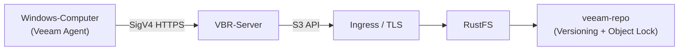

Veeam Backup & Replication (VBR) ist eine Enterprise-Backup-Plattform, die Sicherungsdaten in S3-kompatiblem Objektspeicher ablegt. Diese Anleitung zeigt, wie Sie RustFS als VBR-Objektspeicher-Repository registrieren, mit dem Veeam Agent einen gesamten Windows-Computer sichern und eine Datei aus dem gespeicherten Backup wiederherstellen.

Sie benötigen eine laufende RustFS-Instanz, die über HTTPS erreichbar ist, einen für Backups vorgesehenen Bucket, eine Windows-Maschine mit installiertem VBR 13 (praktisch mindestens 4 vCPU und 8 GB RAM) sowie eine Veeam-Lizenz, die Backup auf Objektspeicher umfasst.

:::note[Lizenzanforderung]

Backup auf Objektspeicher ist eine Veeam-Funktion der Enterprise-Stufe. VBR Community Edition kann ein S3-Repository hinzufügen und validieren, aber das Ausführen eines Backup-Jobs darauf erfordert eine Enterprise-Lizenz oder den kostenlosen 30-Tage-Evaluierungsschlüssel (Veeam Data Platform Trial Key).

:::

## Architektur



Während des Backups schreibt Veeam etwa 1 MiB große Backup-Blöcke über die S3-API in den Bucket; bei einer Wiederherstellung werden nur die Blöcke zurückgelesen, die die angeforderten Daten enthalten. Das Bucket-Präfix in dieser Anleitung ist `veeam`, der Bucket ist `veeam-repo`.

## 1. Bucket und Anmeldedaten vorbereiten

Erstellen Sie einen dedizierten Bucket mit aktiviertem Versioning und Object Lock. Versioning ist Voraussetzung für das Object Lock, auf dem die Veeam-Immutability basiert:

```bash
rc bucket create <your-alias>/veeam-repo --with-lock
rc bucket version info <your-alias>/veeam-repo
```

Erstellen Sie eine Richtlinie mit minimalen Rechten, die auf den Bucket beschränkt ist. Die Richtlinie lässt `s3:CreateBucket` bewusst aus: Veeam bietet das automatische Anlegen von Buckets an, und abzulehnen ist der empfohlene Weg, wenn der Bucket bereits existiert.

```json
{
  "Version": "2012-10-17",
  "Statement": [
    {
      "Effect": "Allow",
      "Action": ["s3:GetObject","s3:PutObject","s3:DeleteObject",
                 "s3:GetObjectVersion","s3:DeleteObjectVersion",
                 "s3:AbortMultipartUpload","s3:ListMultipartUploadParts",
                 "s3:ListBucketMultipartUploads",
                 "s3:PutObjectRetention","s3:GetObjectRetention",
                 "s3:PutObjectLegalHold","s3:GetObjectLegalHold",
                 "s3:BypassGovernanceRetention"],
      "Resource": ["arn:aws:s3:::veeam-repo/*"]
    },
    {
      "Effect": "Allow",
      "Action": ["s3:ListBucket","s3:ListBucketVersions","s3:GetBucketLocation",
                 "s3:GetBucketVersioning"],
      "Resource": ["arn:aws:s3:::veeam-repo"]
    }
  ]
}
```

```bash
rc admin policy create <your-alias> veeam-repo-rw <path-to-policy-file>
rc admin user add <your-alias> veeam <your-secret-key>
rc admin policy attach <your-alias> veeam-repo-rw --user veeam
```

Veeam verlangt HTTPS für den Objektspeicher. Beenden Sie TLS vor RustFS (z. B. mit Traefik oder Nginx) mit einem Zertifikat, dessen SAN den Endpunkt-Hostnamen abdeckt, und importieren Sie dieses Zertifikat in den Speicher **Trusted Root Certification Authorities** des Veeam-Servers.

## 2. RustFS-Repository in VBR hinzufügen

Gehen Sie in der VBR-Konsole zu **Backup Infrastructure → Backup Repositories → Add Repository → Object storage → S3 Compatible**:

1. Service point: Ihr RustFS-HTTPS-Endpunkt, Region: `us-east-1`.
2. Credentials: Access Key und Secret Key des Benutzers `veeam`.
3. Bucket: `veeam-repo`, Folder: `veeam`.
4. Optional: **Make backups immutable** aktivieren (das Object Lock des Buckets ist bereits aktiviert).


Wenn Veeam meldet, dass die automatische Bucket-Bereitstellung mit Access Denied fehlschlägt, wählen Sie **Yes**, um sie zu deaktivieren und fortzufahren — der Bucket existiert bereits, und der IAM-Benutzer kann absichtlich keine Buckets anlegen.

Bei Erfolg wird das Repository als **S3-compatible** aufgeführt, und der belegte Speicherplatz entspricht dem Bucket-Inhalt:


## 3. Geschützten Computer registrieren

Der Backup-Job allein installiert den Veeam Agent nicht. Verwenden Sie eine Protection Group:

1. **Inventory → Physical and Cloud Infrastructure → Add protection group…**
2. Typ **Individual computers**, fügen Sie die Maschine mit ihrem echten Hostnamen und lokalen Administrator-Anmeldedaten in der Form `HOSTNAME\user` hinzu.
3. Lassen Sie **Install Veeam Backup & Replication Agent** aktiviert und klicken Sie auf Apply.

:::note[Windows UAC]

Wenn der Agent-Push mit einem Zugriffsfehler fehlschlägt, setzen Sie `LocalAccountTokenFilterPolicy` auf dem Zielcomputer unter `HKLM\SOFTWARE\Microsoft\Windows\CurrentVersion\Policies\System` auf `1` und führen Sie erneut einen Rescan durch. Nach der Agent-Installation starten Sie die Maschine neu, sobald die Spalte Backup agent **Reboot required** anzeigt.

:::

## 4. Backup-Job ausführen

1. **Home → Backup Job → Windows computer…**
2. Computers: **From protection group**, Backup Mode: **Entire computer**.
3. Storage: Backup repository = **RustFS**, Aufbewahrung nach Bedarf.
4. Finish, dann klicken Sie mit der rechten Maustaste auf den Job und wählen **Start**.

Nach Abschluss des Jobs zeigt die Jobliste **Last Result: Success**, und der Restore Point erscheint unter **Home → Backups → Object Storage → RustFS Veeam Backup**:


Prüfen Sie die Objekte in RustFS:

```bash
rc object find <your-alias>/veeam-repo/ | tail -1
```

Veeam speichert etwa 1 MiB große Datenblöcke unter `Veeam/Backup/veeam/Clients/{agent-id}/…`, jedes Objekt mit ETag und Version.

## 5. Dateien wiederherstellen

1. **Home → Backups → Object Storage → RustFS Veeam Backup → <computer>**.
2. Klicken Sie mit der rechten Maustaste auf den Restore Point → **Restore guest files…** → Browse.
3. Wählen Sie im Backup Browser eine Datei aus, stellen Sie sie in einen Zielordner wieder her und prüfen Sie den Inhalt.


Die Wiederherstellung liest nur die Blöcke zurück, die die ausgewählte Datei enthalten — damit ist der gesamte Lesepfad gegen RustFS validiert.

## Fehlerbehebung

| Symptom | Lösung |
|---|---|
| "Backup to object storage requires a valid Enterprise edition license" | Installieren Sie eine Lizenz mit Objektspeicher-Backup (Trial oder kostenpflichtig); Community Edition kann solche Jobs nicht ausführen |
| "backup agent is missing" während des Jobs | Registrieren Sie die Maschine über eine Protection Group (Schritt 3); der Job-Assistent installiert keine Agents |
| Agent-Push schlägt mit Access Denied fehl | Setzen Sie `LocalAccountTokenFilterPolicy=1` auf dem Ziel; verwenden Sie den echten Hostnamen, nicht `localhost` |
| Spalte Backup agent zeigt "Reboot required" | Starten Sie die Maschine neu, um die Agent-Installation abzuschließen |
| Konsole zeigt HTTP 502 direkt nach dem Boot | Die Veeam-Dienste starten noch; wiederholen Sie, wenn `VeeamBackupSvc` und der PostgreSQL-Dienst Running sind |
| Folder-Liste im Assistenten ist leer | Die Folder-Auswahl listet bestehende Präfixe; legen Sie zuerst ein Platzhalter-Objekt unter dem Präfix an, dann Browse |
| Repository-Kapazität zeigt N/A | SOSAPI-Berichte sind für das Backup nicht erforderlich; der Support wird in [rustfs#1511](https://github.com/rustfs/rustfs/issues/1511) verfolgt |
