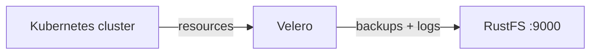

In dieser Anleitung verbinden Sie [Velero](https://github.com/vmware-tanzu/velero) — das Werkzeug für Backup und Wiederherstellung in Kubernetes — mit **RustFS** als Objektspeicher-Backend. Sie installieren Velero in einem Kubernetes-Cluster mit einem RustFS-Backup-Speicherort, sichern Cluster-Ressourcen, löschen sie, stellen sie aus dem Bucket wieder her und prüfen die wiederhergestellten Objekte. Der Ablauf wurde mit Velero CLI 1.16.2, `velero-plugin-for-aws:v1.12.2` auf k3s (Kubernetes 1.30) und `rustfs/rustfs-x86-musl:v2.3.1` verifiziert.

Sie benötigen einen Kubernetes-Cluster mit `kubectl`-Zugriff und die Velero-CLI. Diese Anleitung ist für Integrationstests gedacht, nicht für den Produktivbetrieb.

## Architektur



Velero serialisiert Kubernetes-Ressourcen und optional Pod-Volume-Daten in gzip-Archive unter `backups/<name>/` im Bucket. Die Wiederherstellung lädt diese Archive herunter und legt die Ressourcen im Cluster neu an.

## 1. Backup-Bucket anlegen

Legen Sie einen eigenen Bucket an. Velero legt keine Buckets an:

```bash
rc alias set rustfs http://<your-rustfs-endpoint>:9000 <your-access-key> <your-secret-key>
rc mb rustfs/velero-backups
```

## 2. Velero installieren

Schreiben Sie die Zugangsdaten in eine Datei und installieren Sie den Velero-Server. Die `s3Url` muss ein Endpunkt sein, den die Cluster-Pods selbst erreichen können. Verwenden Sie die Knoten-IP oder eine interne Adresse, nicht eine Portweiterleitung von Ihrer Arbeitsstation:

```bash
cat > velero-creds <<EOF
[default]
aws_access_key_id=<your-access-key>
aws_secret_access_key=<your-secret-key>
EOF

kubectl create namespace velero
kubectl create secret generic cloud-credentials \
  --namespace velero --from-file=cloud=velero-creds

velero install \
  --provider aws \
  --plugins velero/velero-plugin-for-aws:v1.12.2 \
  --bucket velero-backups \
  --backup-location-config region=us-east-1,s3ForcePathStyle="true",s3Url=http://<your-rustfs-endpoint>:9000 \
  --secret-file velero-creds \
  --use-volume-snapshots=false
```

Warten Sie, bis die Bereitstellung bereit ist und der Backup-Speicherort auf `Available` wechselt:

```bash
kubectl -n velero get pods
velero backup-location get
```


```text
NAME      PROVIDER   BUCKET/PREFIX    PHASE      LAST VALIDATED   ACCESS MODE   DEFAULT
default   aws        velero-backups   Available  2026-09-22 ...   ReadWrite     true
```

## 3. Cluster-Ressourcen sichern

Legen Sie zwei Demo-Ressourcen an und sichern Sie den gesamten Bereich des Default-Namespace:

```bash
kubectl create configmap demo-cm --from-literal=key=rustfs-velero-demo
kubectl create deployment nginx --image=nginx:1.27

velero backup create demo-backup --wait
velero backup get
```

Das Backup lädt die Ressourcen-Archive und die Logs nach RustFS hoch.

## 4. Backup in RustFS prüfen

Listen Sie den Bucket auf:

```bash
rc ls rustfs/velero-backups/ -r
```

Der Backup-Archivsatz liegt unter dem Präfix `backups/`:

```text
backups/demo-backup/demo-backup-resources.json.gz
backups/demo-backup/demo-backup-logs.gz
backups/demo-backup/demo-backup-itemoperations.json.gz
```


## 5. Wiederherstellen und prüfen

Löschen Sie die Demo-Ressourcen und stellen Sie sie aus dem Backup wieder her. Die Wiederherstellung liest die Archive aus RustFS und legt die Ressourcen neu an:

```bash
kubectl delete configmap demo-cm
kubectl delete deployment nginx

velero restore create --from-backup demo-backup --wait
```

Prüfen Sie, dass die Ressourcen mit ihrem ursprünglichen Inhalt zurück sind:

```bash
kubectl get configmap demo-cm -o jsonpath="{.data.key}"
kubectl get deployment nginx
```


```text
rustfs-velero-demo
NAME    READY   UP-TO-DATE   AVAILABLE   AGE
nginx   1/1     1            1           10s
```

## 6. Anhalten oder zurücksetzen

Die Backups bleiben im Bucket `velero-backups` und lassen sich in jeden Cluster wiederherstellen, der Velero mit demselben Bucket betreibt. So entfernen Sie das Demo-Backup aus RustFS:

```bash
velero backup delete demo-backup --confirm
rc rm rustfs/velero-backups/backups/ --recursive --force
```

## Fehlerbehebung

### Der Backup-Speicherort bleibt `Unavailable`

Der Velero-Pod erreicht die `s3Url` nicht. Endpunkte in einem eigenen Docker-Bridge-Netzwerk sind von Kubernetes-Pods aus nicht erreichbar. Verwenden Sie die Bridge-IP des Docker-Hosts (zum Beispiel `http://172.17.0.1:9000` auf einem Einzelhost-Cluster) oder eine Knotenadresse. Patchen Sie den Speicherort und lassen Sie Velero erneut prüfen:

```bash
kubectl -n velero patch backupstoragelocation default --type merge -p \
  '{"spec":{"config":{"s3Url":"http://172.17.0.1:9000"}}}'
```

### Das Backup endet mit `PartiallyFailed` und einem DaemonSet-Fehler

Der Fehler `daemonset pod not found in running state` bedeutet, dass der Node-Agent-Pod (für Pod-Volume-Backups) nicht lief. Die Archive der Cluster-Ressourcen sind davon nicht betroffen. Warten Sie auf den Agent, oder behalten Sie `--default-volumes-to-fs-backup` nur bei, wenn der Agent läuft.

### `FailedValidation` direkt nach der Installation

Der erste Backup-Versuch trifft einen Speicherort, der noch nicht geprüft wurde. Warten Sie, bis `velero backup-location get` den Wert `Available` meldet, bevor Sie Backups anlegen.

## Nächste Schritte

- Lesen Sie die [S3-Kompatibilitätshinweise](/de/administration/protocols/s3), bevor Sie weitere Velero-Operationen verwenden.
- Erstellen Sie dedizierte Produktions-Zugangsdaten über die [Zugriffsschlüssel-Verwaltung](/de/security-compliance/iam/access-token).
- Folgen Sie der [Velero-Dokumentation](https://velero.io/docs/main/), um Zeitpläne, Volume-Snapshots und Abläufe für die Cluster-Migration hinzuzufügen.
