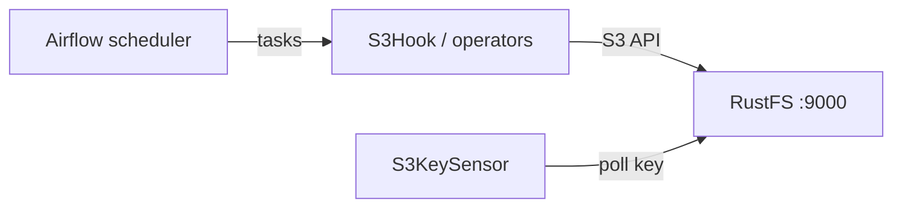
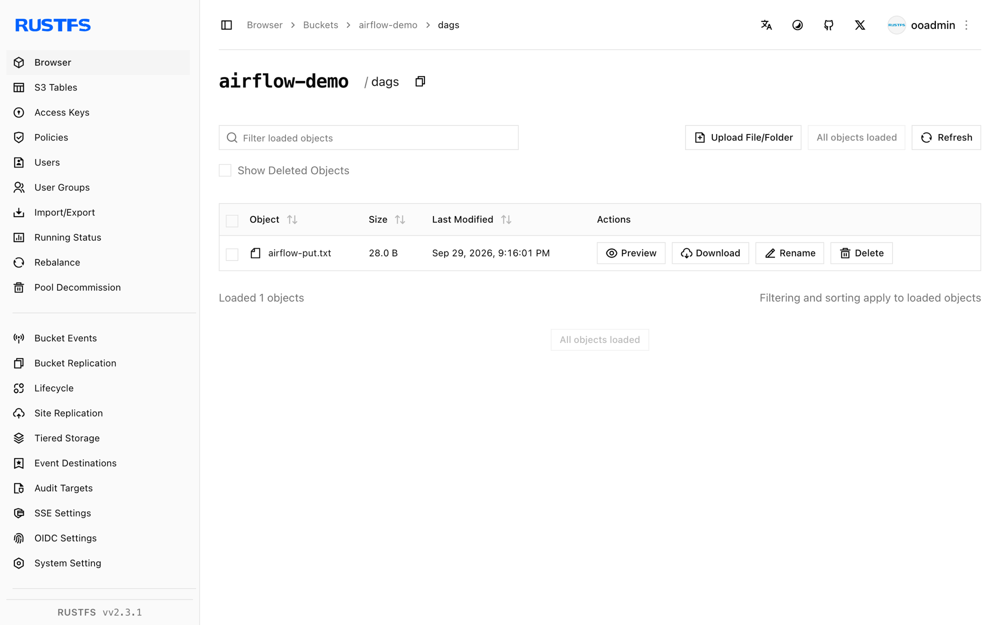

In dieser Anleitung verbinden Sie [Apache Airflow](https://github.com/apache/airflow) — die Plattform zur Workflow-Orchestrierung — über die Hooks, Operatoren und Sensoren des Amazon-S3-Providers mit **RustFS**. Sie registrieren eine Verbindung mit eigenem Endpunkt, führen einen DAG aus, der ein Objekt in einen RustFS-Bucket schreibt, mit `S3KeySensor` auf einen Objektschlüssel wartet und das Objekt mit `S3Hook` wieder liest. Der Ablauf wurde mit `apache/airflow:3.3.2` (Standalone, SequentialExecutor) und dem Provider `apache-airflow-providers-amazon` gegen `rustfs/rustfs-x86-musl:v2.3.1` verifiziert.

Sie benötigen Docker oder eine vorhandene Airflow-Installation. Diese Bereitstellung ist für lokale Integrationstests gedacht, nicht für den Produktivbetrieb.

## Architektur



Jede S3-Interaktion innerhalb eines DAG läuft über den S3-Client des Providers, den die `endpoint_url` der Verbindung auf RustFS ausrichtet. Operatoren, Sensoren und Hooks verwenden dasselbe Verbindungsobjekt.

## 1. Airflow starten

Starten Sie eine Standalone-Instanz mit deaktivierten Beispielen und legen Sie den Demo-Bucket an:

```bash
docker run -d --name airflow --network oo-rustfs_default -p 8080:8080 \
  -e AIRFLOW__CORE__LOAD_EXAMPLES=False \
  -v "$PWD/dags":/opt/airflow/dags \
  apache/airflow:3.3.2 standalone

rc mb rustfs/airflow-demo
```

Das Image enthält alle Provider vorinstalliert, einschließlich `apache-airflow-providers-amazon`.

## 2. Die RustFS-Verbindung registrieren

Der S3-Provider liest seinen Endpunkt aus dem Extra-Feld der Verbindung. Ersetzen Sie alle Platzhalter der Verbindung:

```bash
docker exec airflow airflow connections add rustfs \
  --conn-type aws \
  --conn-extra '{"endpoint_url": "http://<your-rustfs-endpoint>:9000", "region_name": "us-east-1", "aws_access_key_id": "<your-access-key>", "aws_secret_access_key": "<your-secret-key>"}'
```

Die Schlüssel `aws_access_key_id` und `aws_secret_access_key` in `--conn-extra` liefern die Zugangsdaten. `endpoint_url` lenkt den boto3-Client von AWS auf RustFS um.

## 3. Den DAG schreiben

Der DAG schreibt ein Objekt mit einem Operator, wartet mit einem Sensor auf den Objektschlüssel und liest es mit dem Hook zurück:

```python title="rustfs_demo.py"
import datetime

from airflow.providers.amazon.aws.hooks.s3 import S3Hook
from airflow.providers.amazon.aws.operators.s3 import S3CreateObjectOperator
from airflow.providers.amazon.aws.sensors.s3 import S3KeySensor
from airflow.sdk import dag, task

@dag(
    schedule=None,
    start_date=datetime.datetime(2026, 1, 1),
    catchup=False,
    tags=["rustfs"],
)
def rustfs_demo():
    create = S3CreateObjectOperator(
        task_id="write_object",
        s3_bucket="airflow-demo",
        s3_key="dags/airflow-put.txt",
        data="written by airflow to rustfs",
        aws_conn_id="rustfs",
        replace=True,
    )

    wait = S3KeySensor(
        task_id="wait_for_object",
        bucket_key="dags/airflow-put.txt",
        bucket_name="airflow-demo",
        aws_conn_id="rustfs",
        timeout=120,
        poke_interval=10,
        mode="reschedule",
    )

    @task
    def read_object():
        hook = S3Hook(aws_conn_id="rustfs")
        body = hook.read_key(key="dags/airflow-put.txt", bucket_name="airflow-demo")
        print("read back:", body)
        assert body == "written by airflow to rustfs"

    create >> [wait, read_object()]

rustfs_demo()
```

Beachten Sie die Importpfade: `S3CreateObjectOperator` liegt im Modul `operators`, `S3KeySensor` im Modul `sensors`. Der Import beider Klassen aus derselben Stelle schlägt fehl.

## 4. Fortsetzen und auslösen

Neue DAGs starten pausiert, und ein Auslöser, der im pausierten Zustand feuert, bleibt dauerhaft in der Warteschlange. Heben Sie die Pause zuerst auf und lösen Sie den DAG dann aus:

```bash
docker exec airflow airflow dags unpause rustfs_demo
docker exec airflow airflow dags trigger rustfs_demo
```

Beobachten Sie, bis der Lauf abgeschlossen ist:

```bash
docker exec airflow airflow dags list-runs rustfs_demo | head -3
```

```text
dag_id       run_id                                    state
rustfs_demo  manual__2026-09-29T13:15:57.332688+00:00  success
```

Alle drei Tasks sind erfolgreich: `write_object`, `wait_for_object` und `read_object`.

## 5. Objekte in RustFS prüfen

Listen Sie das Bucket-Präfix auf:

```bash
rc ls rustfs/airflow-demo/ -r
rc cat rustfs/airflow-demo/dags/airflow-put.txt
```

```text
[2026-09-29 13:16:01]       28 B dags/airflow-put.txt
written by airflow to rustfs
```



## 6. Stoppen oder zurücksetzen

Um die Demo abzubauen und die Bucket-Objekte zu behalten:

```bash
docker rm -f airflow
```

Um die gespeicherten Daten zu löschen:

```bash
rc rm rustfs/airflow-demo/ --recursive --force
```

## Fehlerbehebung

### DAG-Läufe bleiben nach dem Auslösen im Status `queued`

Der DAG ist pausiert. Neue DAGs sind in Airflow 3 standardmäßig pausiert, und Läufe, die in diesem Zustand ausgelöst werden, werden nie ausgeführt. Führen Sie `airflow dags unpause rustfs_demo` aus. Läufe in der Warteschlange starten danach von selbst.

### `cannot import name 'S3KeySensor' from 'airflow.providers.amazon.aws.operators.s3'`

Der Sensor liegt in einem eigenen Modul: `from airflow.providers.amazon.aws.sensors.s3 import S3KeySensor`.

### Tasks schlagen mit Verbindungsfehlern fehl

Die `endpoint_url` muss vom Airflow-Container aus erreichbar sein. Verwenden Sie den Docker-Netzwerk-Hostnamen von RustFS, nicht `localhost`. Airflow 3 stellt den Endpunkt für die Integritätsprüfung unter `/api/v2/monitor/health` bereit, wenn Sie den Komponentenstatus prüfen möchten.

## Nächste Schritte

- Lesen Sie die [S3-Kompatibilitätshinweise](/de/administration/protocols/s3), bevor Sie weitere Provider-Hooks einsetzen.
- Erstellen Sie dedizierte Produktions-Zugangsdaten über die [Zugriffsschlüssel-Verwaltung](/de/security-compliance/iam/access-token).
- Folgen Sie der [Dokumentation des Amazon-Providers](https://airflow.apache.org/docs/apache-airflow-providers-amazon/stable/index.html) für Transfer-Operatoren wie `S3ToLocalFilesystemOperator` und `LocalFilesystemToS3Operator`.
