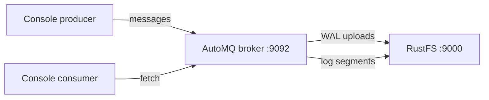
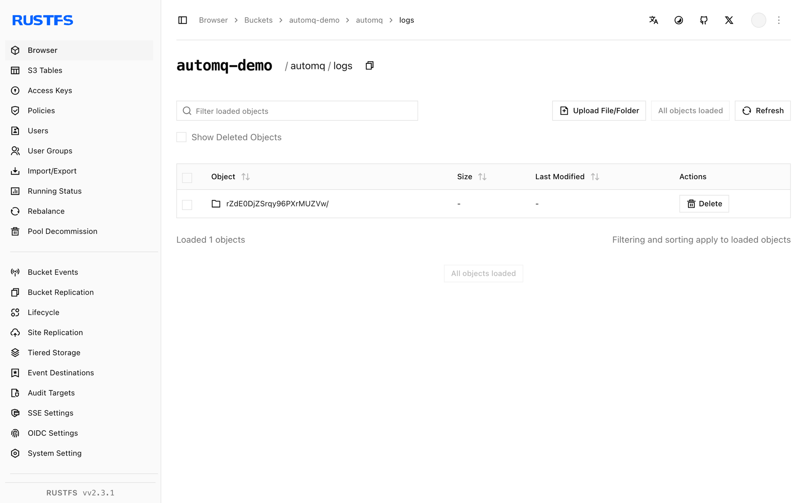

In dieser Anleitung verbinden Sie [AutoMQ](https://github.com/AutoMQ/automq) — die cloud-native Kafka-Distribution, die ihren Log-Speicher im Objektspeicher hält — mit **RustFS**. Sie starten einen AutoMQ-Broker mit einem Knoten im KRaft-Modus, dessen S3-Log-Buckets auf RustFS zeigen, und produzieren und konsumieren anschließend Nachrichten. Der Ablauf wurde mit AutoMQ 1.3.0 (Kafka-API 3.9.0) gegen `rustfs/rustfs-x86-musl:v2.3.1` verifiziert.

Sie benötigen Docker. Diese Bereitstellung ist für lokale Integrationstests gedacht, nicht für den Produktivbetrieb.

## Architektur



AutoMQ trennt den Speicher von den Brokern: das Write-Ahead-Log wird lokal gepuffert und danach als unveränderliche Stream-Objekte in den Bucket hochgeladen. Der Broker behält über das WAL hinaus kein lokales Datenverzeichnis.

## 1. Den Broker starten

Starten Sie AutoMQ so, dass die S3-Buckets auf RustFS zeigen. Vier Angaben sind zwingend: durch Leerzeichen getrennte Skriptargumente (die Form `--key=value` lässt das Startskript endlos laufen), `JAVA_TOOL_OPTIONS` mit `-XX:-UseContainerSupport` (das mitgelieferte JDK 17 stürzt sonst bei der Erkennung von cgroup v2 ab), die kombinierte Rolle `server` und Zugangsdaten über die Umgebungsvariablen `KAFKA_S3_ACCESS_KEY` und `KAFKA_S3_SECRET_KEY` (die Skriptargumente `--s3.access.key` werden ignoriert):

```bash
docker run -d --name automq --hostname automq --network oo-rustfs_default -p 9092:9092 \
  -e JAVA_TOOL_OPTIONS="-XX:-UseContainerSupport" \
  -e KAFKA_HEAP_OPTS="-Xms512m -Xmx512m -XX:MetaspaceSize=96m -XX:MaxDirectMemorySize=512M" \
  -e KAFKA_S3_ACCESS_KEY=<your-access-key> \
  -e KAFKA_S3_SECRET_KEY=<your-secret-key> \
  -v /opt/automq-data:/data/kafka \
  automqinc/automq:1.3.0 /opt/automq/scripts/start.sh up \
  --process.roles server \
  --node.id 0 \
  --controller.quorum.voters 0@automq:9093 \
  --s3.region us-east-1 \
  --s3.bucket automq-demo \
  --s3.endpoint http://rustfs:9000
```

Der Broker bindet seinen Listener an die Container-IP. Sprechen Sie ihn für die Kafka-Konsolenwerkzeuge über diese IP an. Der Hostname `automq` funktioniert ebenfalls von innerhalb des Containers.

## 2. Ein Topic anlegen und produzieren

```bash
AIP=<automq-container-ip>
docker exec automq sh -c "cd /opt/automq/kafka && \
  ./bin/kafka-topics.sh --bootstrap-server $AIP:9092 --create --topic rustfs-automq --partitions 1 --replication-factor 1"

docker exec automq sh -c "cd /opt/automq/kafka && \
  printf 'mq-msg-one\nmq-msg-two\nmq-msg-three\n' | \
  ./bin/kafka-console-producer.sh --bootstrap-server $AIP:9092 --topic rustfs-automq"
```

## 3. Die Nachrichten konsumieren

```bash
docker exec automq sh -c "cd /opt/automq/kafka && \
  ./bin/kafka-console-consumer.sh --bootstrap-server $AIP:9092 \
  --topic rustfs-automq --from-beginning --max-messages 3 --timeout-ms 30000"
```

```text
mq-msg-one
mq-msg-two
mq-msg-three
Processed a total of 3 messages
```

## 4. Objekte in RustFS prüfen

Listen Sie den Bucket auf. AutoMQ schreibt seine Log-Streams und Metriken als Objekte:

```bash
rc ls rustfs/automq-demo/ -r
```

```text
automq/logs/rZdE0DjZSrqy96PXrMUZVw/0/2026100700/fcd3fc76-... 
automq/logs/rZdE0DjZSrqy96PXrMUZVw/0/2026100701/52877dc7-...
automq/metrics/rZdE0DjZSrqy96PXrMUZVw/0/2026100701/4733e680-...
```

Die Objekte der Log-Streams enthalten die Topic-Daten. Der Broker behält lokal nur das WAL, daher verschiebt das Hoch- oder Herunterskalieren von Brokern keine Daten.



## 5. Stoppen oder zurücksetzen

```bash
docker rm -f automq
rc rm rustfs/automq-demo/ --recursive --force
```

## Fehlerbehebung

### Das Startskript gibt endlos Zeilen `setup_value:` bei voller CPU-Last aus

Der Argumentparser akzeptiert nur die durch Leerzeichen getrennte Form (`--s3.bucket x`, nicht `--s3.bucket=x`). Die Form mit `=` lässt den Parser endlos laufen.

### `java.lang.NullPointerException ... CgroupInfo.getMountPoint()`

Das mitgelieferte JDK 17 scheitert in diesem Image an der Erkennung von cgroup v2. Setzen Sie `JAVA_TOOL_OPTIONS="-XX:-UseContainerSupport"`.

### `unknown process role broker,controller`

Das Skript von AutoMQ 1.3.0 erwartet, dass die kombinierte Rolle `server` heißt.

### Der Broker startet, Clients erhalten aber `Connection to node -1 could not be established`

Der Listener bindet sich an die Container-IP (`hostname -I`). Sprechen Sie den Broker über diese IP oder über den Hostnamen `automq` aus demselben Docker-Netzwerk an. `localhost` funktioniert nur für Werkzeuge, die im Broker-Container selbst laufen.

### `List objects failed, cost: 120000+ ms`

AutoMQ verwendet standardmäßig Adressierung im Virtual-Hosted-Stil und gerät gegenüber IP-Endpunkten in eine Wiederholungsschleife. Erzwingen Sie Buckets mit pfadbasierter Adressierung (Path-Style), indem Sie die Bucket-URLs über `KAFKA_CFG_S3_DATA_BUCKETS` und `KAFKA_CFG_S3_OPS_BUCKETS` auf `0@s3://<bucket>?region=us-east-1&endpoint=http://rustfs:9000&pathStyle=true&authType=static` setzen, und übergeben Sie die Zugangsdaten über `KAFKA_S3_ACCESS_KEY` und `KAFKA_S3_SECRET_KEY`.

## Nächste Schritte

- Vergleichen Sie die Anleitung mit [Kafka](/de/developer/integration/big-data/kafka), wenn Sie die S3-Anbindung über Connect auf unverändertem Kafka bevorzugen.
- Erstellen Sie dedizierte Produktions-Zugangsdaten über die [Zugriffsschlüssel-Verwaltung](/de/security-compliance/iam/access-token).
- Folgen Sie der [AutoMQ-Dokumentation](https://docs.automq.com/) für Cluster mit mehreren Knoten und die Abstimmung der WAL-Parameter auf demselben Bucket.
