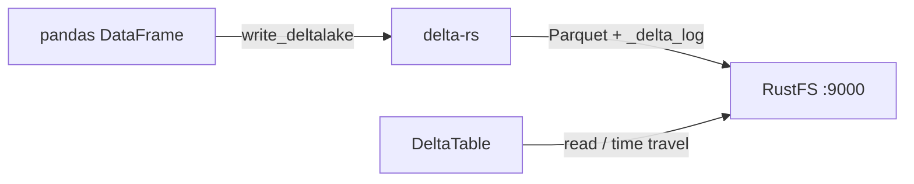

In dieser Anleitung verbinden Sie [Delta Lake](https://github.com/delta-io/delta) — das quelloffene Lakehouse-Tabellenformat — über delta-rs, die Rust-native Delta-Implementierung, mit **RustFS**. Sie schreiben aus Python eine Delta-Tabelle in einen RustFS-Bucket, lesen sie mit der ACID-Transaktionshistorie zurück und prüfen die Dateien `_delta_log` und Parquet im Bucket. Der Ablauf wurde mit dem Python-Paket `deltalake` (delta-rs) und pandas gegen `rustfs/rustfs-x86-musl:v2.3.1` verifiziert.

Sie benötigen Python 3.9 oder neuer. Diese Bereitstellung ist für lokale Integrationstests gedacht, nicht für den Produktivbetrieb.

## Architektur



delta-rs speichert jede Tabelle als Parquet-Dateien plus ein Transaktionsprotokoll (`_delta_log/`). Die gesamte Ein- und Ausgabe läuft über die Crate `object_store`, konfiguriert mit denselben AWS-Umgebungsvariablen wie andere S3-Clients.

## 1. Den Client installieren

```bash
pip install deltalake pandas pyarrow
```

`pyarrow` wird benötigt, um pandas-Frames in Delta-kompatible Record-Batches umzuwandeln.

## 2. Eine Delta-Tabelle schreiben

Legen Sie den Bucket an und schreiben Sie eine Tabelle. Ersetzen Sie alle Verbindungsplatzhalter. `AWS_S3_ALLOW_UNSAFE_RENAME` ist erforderlich, weil RustFS kein copy-if-not-exists bereitstellt, das delta-rs sonst für Commit-Konflikte verwendet:

```python title="delta_s3.py"
import pandas as pd
from deltalake import DeltaTable, write_deltalake

storage_options = {
    "AWS_ENDPOINT_URL": "http://<your-rustfs-endpoint>:9000",
    "AWS_ACCESS_KEY_ID": "<your-access-key>",
    "AWS_SECRET_ACCESS_KEY": "<your-secret-key>",
    "AWS_REGION": "us-east-1",
    "AWS_ALLOW_HTTP": "true",
    "AWS_S3_ALLOW_UNSAFE_RENAME": "true",
}

table = "s3://<your-bucket>/events"
df = pd.DataFrame({"id": [1, 2, 3], "name": ["alpha", "beta", "gamma"]})
write_deltalake(table, df, storage_options=storage_options)
print("written:", df.shape[0], "rows")
```

```text
written: 3 rows
```

Die URI `table` verwendet die übliche Form `s3://bucket/prefix`. Endpunkt und Zugangsdaten kommen aus `storage_options`.

## 3. Die Tabelle zurücklesen

```python title="delta_read.py"
from deltalake import DeltaTable

back = DeltaTable("s3://<your-bucket>/events", storage_options=storage_options).to_pandas()
print("read back:", back.shape[0], "rows")
print(back.sort_values("id").to_string(index=False))
print("version:", DeltaTable("s3://<your-bucket>/events", storage_options=storage_options).version())
```

```text
read back: 3 rows
 id   name
  1  alpha
  2   beta
  3  gamma
version: 0
```

Weil die Version im Transaktionsprotokoll geführt wird, unterstützt dieselbe Tabelle Time Travel mit `DeltaTable(..., version=N)` und Anhänge, die die Version erhöhen.

## 4. Objekte in RustFS prüfen

Listen Sie das Tabellenpräfix auf:

```bash
rc ls rustfs/<your-bucket>/ -r
```

Der erste Commit hat das Transaktionsprotokoll und eine Parquet-Datei angelegt:

```text
events/_delta_log/00000000000000000000.json
events/part-00000-3859855e-45e4-4ae5-94ff-2d8eab5e7ebb-c000.snappy.parquet
```

Jeder weitere Schreibvorgang fügt einen Protokolleintrag `NNNNNNNNNNNNNNNNNNNN.json` und Parquet-Teile hinzu. Leser spielen das Protokoll ab, um einen konsistenten Snapshot zu erhalten.


## 5. Stoppen oder zurücksetzen

delta-rs hält keinen eigenen Zustand. So löschen Sie die Tabelle:

```bash
rc rm rustfs/<your-bucket>/events/ --recursive --force
```

## Fehlerbehebung

### `Import pyarrow failed` beim Schreiben eines pandas-DataFrame

`write_deltalake` wandelt Frames über Arrow um. Installieren Sie `pyarrow` zusammen mit `deltalake` und `pandas`.

### `Generic DeltaTable error: commit conflict` oder Umbenennungsfehler beim Commit

delta-rs committet, indem es temporäre Objekte kopiert und umbenennt. Dafür ist ein atomares Umbenennen auf dem Backend nötig. Setzen Sie bei S3-kompatiblen Speichern ohne copy-if-not-exists in `storage_options` den Wert `AWS_S3_ALLOW_UNSAFE_RENAME: "true"`. Das ist für einen einzelnen Schreiber akzeptabel, für gleichzeitige Schreiber nicht.

### `Unknown lengthy error: AWS connectivity or endpoint errors`

Prüfen Sie, dass `AWS_ENDPOINT_URL` das Schema enthält und dass `AWS_ALLOW_HTTP` für Endpunkte mit unverschlüsseltem HTTP auf `"true"` steht. Ohne diesen Wert spricht der S3-Client nur HTTPS.

## Nächste Schritte

- Lesen Sie die [S3-Kompatibilitätshinweise](/de/administration/protocols/s3), bevor Sie weitere Delta-Clients einsetzen.
- Erstellen Sie dedizierte Produktions-Zugangsdaten über die [Zugriffsschlüssel-Verwaltung](/de/security-compliance/iam/access-token).
- Folgen Sie der [delta-rs-Dokumentation zum Schreiben](https://delta-io.github.io/delta-rs/usage/writing/writing-to-s3/) für Konfigurationen mit gleichzeitigen Schreibern und einer Commit-Koordination auf DynamoDB-Basis.
