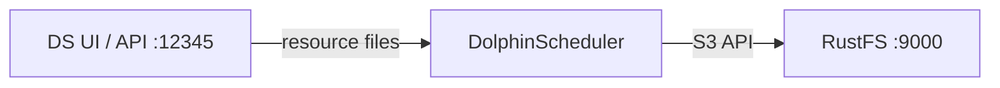
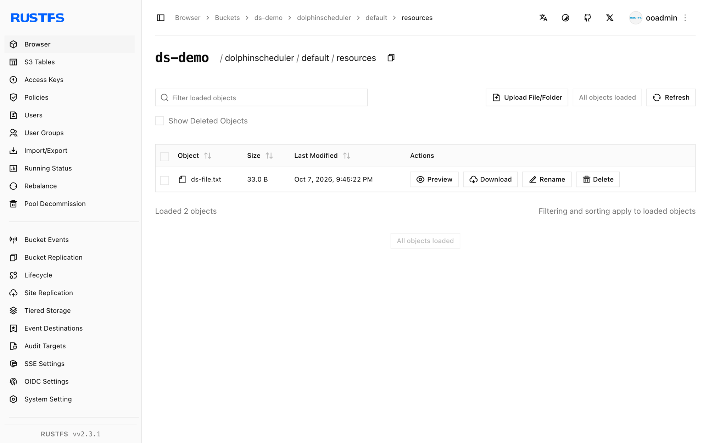

In dieser Anleitung verbinden Sie [Apache DolphinScheduler](https://github.com/apache/dolphinscheduler) — den Workflow-Scheduler — mit **RustFS** als Speicher für das Resource Center. Sie betreiben den Standalone-Server, stellen den Ressourcenspeicher auf S3 um, laden eine Ressourcendatei über die API hoch und prüfen das Objekt im Bucket. Der Ablauf wurde mit DolphinScheduler 3.2.1 (Standalone-Server) gegen `rustfs/rustfs-x86-musl:v2.3.1` verifiziert.

Sie benötigen Docker.

## Architektur



Das Resource Center speichert Workflow-Skripte, Abhängigkeits-JARs und weitere Dateien. Bei S3-Speicher wird jede hochgeladene Datei zu einem Objekt unter `dolphinscheduler/<tenant>/resources/` im Bucket.

## 1. Den Standalone-Server starten

```bash
docker run -d --name dolphinscheduler --hostname dolphinscheduler \
  --network oo-rustfs_default -p 12345:12345 \
  apache/dolphinscheduler-standalone-server:3.2.1
```

Der einzelne Container bündelt Master, Worker, API, Alert und ein eingebettetes ZooKeeper. Die Oberfläche liegt unter `http://localhost:12345/dolphinscheduler/ui` (Standardanmeldung `admin` / `dolphinscheduler123`).

## 2. Das Resource Center auf RustFS umstellen

Das Speicher-Backend liegt in `/opt/dolphinscheduler/conf/common.properties`. Hängen Sie die S3-Properties an die vorhandene Datei an. Ersetzen Sie die Datei nicht, sie enthält viele weitere Einstellungen:

```bash
docker exec dolphinscheduler bash -c "cat >> /opt/dolphinscheduler/conf/common.properties << 'EOF'

resource.storage.type=S3
resource.storage.base.dir=/ds-resources
resource.aws.s3.bucket.name=ds-demo
resource.aws.s3.endpoint=http://<your-rustfs-endpoint>:9000
resource.aws.access.key.id=<your-access-key>
resource.aws.secret.access.key=<your-secret-key>
resource.aws.region=us-east-1
EOF"
docker restart dolphinscheduler
```

Warten Sie, bis die API wieder verfügbar ist (etwa eine Minute), und legen Sie dann den Bucket an:

```bash
rc mb rustfs/ds-demo
```

## 3. Eine Ressourcendatei hochladen

Melden Sie sich über die API an, um eine Sitzungs-ID zu erhalten, und laden Sie dann eine Datei hoch. Der Endpunkt verlangt sowohl den Parameter `name` als auch `fullName`:

```bash
printf "ds resource file stored in rustfs" > /tmp/ds-file.txt
TOKEN=$(curl -s -m 10 -X POST http://localhost:12345/dolphinscheduler/login \
  -d "userName=admin&userPassword=dolphinscheduler123" \
  | python3 -c "import json,sys; print(json.load(sys.stdin)['data']['sessionId'])")

curl -s -m 30 -X POST "http://localhost:12345/dolphinscheduler/resources" \
  -H "session-id: $TOKEN" -H "Cookie: sessionId=$TOKEN" \
  -F "file=@/tmp/ds-file.txt" -F "type=FILE" -F "currentDir=/" \
  -F "name=ds-file.txt" -F "fullName=/ds-file.txt" -F "description=demo"
```

```json
{"code":0,"msg":"success","data":null,"failed":false,"success":true}
```

## 4. In DolphinScheduler und RustFS prüfen

Lesen Sie die Datei über die API zurück:

```bash
curl -s -m 30 "http://localhost:12345/dolphinscheduler/resources/view-ui?fullName=/ds-file.txt&skipLineNum=100&limit=100" \
  -H "session-id: $TOKEN" -H "Cookie: sessionId=$TOKEN" | grep "ds resource"
```

```text
ds resource file stored in rustfs
```

Listen Sie den Bucket auf. Die Datei liegt unter dem Ressourcenpräfix des Tenants:

```bash
rc ls rustfs/ds-demo/ -r
```

```text
dolphinscheduler/default/resources/ds-file.txt
dolphinscheduler/default/udfs/
```



## 5. Stoppen oder zurücksetzen

```bash
docker rm -f dolphinscheduler
rc rm rustfs/ds-demo/ --recursive --force
```

## Fehlerbehebung

### Der Server startet mit einem Azure-Fehler zu `clientId/tenantId/clientSecret` nicht

Die Speicherkonfiguration wurde als neue Datei geschrieben statt angehängt, dadurch ging `resource.storage.type=S3` verloren und die Standardwerte zeigten auf Azure. Hängen Sie die Einstellungen immer an die vorhandene `common.properties` an, wie in Schritt 2.

### `Required request parameter 'name'/'fullName' is not present`

Der Endpunkt zum Anlegen von Ressourcen verlangt die Formularfelder `name` und `fullName` zusätzlich zu `file`, `type` und `currentDir`.

### Die API antwortet mit 405 auf den Token-Aufruf

Die Login- und Token-Endpunkte akzeptieren POST. Endpunkte im Stil von `/api/v2/token` unterscheiden sich je nach Version. Verwenden Sie das Login-Formular aus Schritt 3 und übergeben Sie bei jedem Aufruf den Header `session-id` sowie `Cookie: sessionId=...`.

## Nächste Schritte

- Vergleichen Sie die Anleitung mit [Airflow](/de/developer/integration/big-data/airflow) für Orchestrierung ohne eingebautes Resource Center.
- Erstellen Sie dedizierte Produktions-Zugangsdaten über die [Zugriffsschlüssel-Verwaltung](/de/security-compliance/iam/access-token).
- Folgen Sie der [DolphinScheduler-Dokumentation](https://dolphinscheduler.apache.org/en-us/docs/latest/user_doc/common/resource-management.html), um dasselbe S3-Resource-Center in die Ausführung von Worker-Tasks einzubinden.
