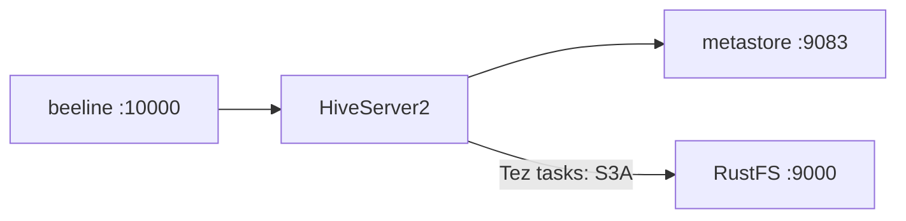

In dieser Anleitung verbinden Sie [Apache Hive](https://github.com/apache/hive) — das klassische Data Warehouse — über das Dateisystem S3A mit **RustFS**. Sie betreiben das Docker-Image von Hive 4.0.1 mit einem Metastore und HiveServer2, konfigurieren S3A in drei Konfigurationsschichten, legen eine externe Tabelle über einem RustFS-Speicherort an und laden Daten und fragen sie ab. Der Ablauf wurde mit Hive 4.0.1 gegen `rustfs/rustfs-x86-musl:v2.3.1` verifiziert.

Sie benötigen Docker (zwei Container: Metastore und HiveServer2).

## Architektur



Hive speichert Tabellenmetadaten im Metastore (in diesem Test Derby) und Tabellendaten am S3A-Speicherort der Tabelle. Die Abfrageausführung läuft auf Tez im Container hiveserver2.

## 1. Metastore und HiveServer2 starten

```bash
docker run -d --name hive-metastore --hostname hive-meta --network oo-rustfs_default \
  -e SERVICE_NAME=metastore -e DB_DRIVER=derby apache/hive:4.0.1

docker run -d --name hive-server --hostname hive-server --network oo-rustfs_default \
  -e SERVICE_NAME=hiveserver2 -e DB_DRIVER=derby apache/hive:4.0.1
```

Der Metastore braucht 1–2 Minuten, um sein Derby-Schema zu initialisieren. HiveServer2 lauscht auf 10000, der Metastore auf 9083.

## 2. S3A an drei Stellen konfigurieren

Tez-Tasks lesen das Hadoop-Konfigurationsverzeichnis, HiveServer2 liest die Hive-Konfiguration, und der Metastore braucht den Endpunkt ebenfalls. Legen Sie eine Properties-Datei an und kopieren Sie sie an alle drei Pfade:

```xml title="s3a-core-site.xml"
<?xml version="1.0"?>
<configuration>
  <property><name>fs.s3a.endpoint</name><value>http://<your-rustfs-endpoint>:9000</value></property>
  <property><name>fs.s3a.access.key</name><value><your-access-key></value></property>
  <property><name>fs.s3a.secret.key</name><value><your-secret-key></value></property>
  <property><name>fs.s3a.path.style.access</name><value>true</value></property>
  <property><name>fs.s3a.connection.ssl.enabled</name><value>false</value></property>
  <property><name>fs.s3a.aws.credentials.provider</name><value>org.apache.hadoop.fs.s3a.SimpleAWSCredentialsProvider</value></property>
  <property><name>fs.s3a.impl</name><value>org.apache.hadoop.fs.s3a.S3AFileSystem</value></property>
</configuration>
```

```bash
rc mb rustfs/hive-demo
docker cp s3a-core-site.xml hive-server:/opt/hive/conf/hive-site.xml
docker cp s3a-core-site.xml hive-server:/opt/hive/conf/core-site.xml
docker cp s3a-core-site.xml hive-server:/opt/hadoop/etc/hadoop/core-site.xml
docker exec -u root hive-server bash -c \
  "chown hive:hive /opt/hive/conf/hive-site.xml /opt/hive/conf/core-site.xml /opt/hadoop/etc/hadoop/core-site.xml; \
   mkdir -p /home/hive/.beeline; chmod 777 /home/hive/.beeline"
docker exec hive-server bash -c \
  "echo 'export HADOOP_CONF_DIR=/opt/hadoop/etc/hadoop' >> /opt/hive/conf/hive-env.sh; \
   echo 'export HADOOP_CLASSPATH=/opt/hadoop/share/hadoop/tools/lib/*:/opt/tez/*:/opt/tez/lib/*' >> /opt/hive/conf/hive-env.sh"
docker restart hive-server
```

Das JAR `hadoop-aws` liegt in `/opt/hadoop/share/hadoop/tools/lib`. Der Export `HADOOP_CLASSPATH` setzt es auf den Abfrage-Classpath. `mkdir /home/hive/.beeline` unterdrückt einen harmlosen Fehler zum Home-Verzeichnis von Beeline.

## 3. Eine externe Tabelle anlegen

```bash
docker exec hive-server bash -c "cd /opt/hive && beeline -u 'jdbc:hive2://localhost:10000' \
  -n hive -e \"CREATE EXTERNAL TABLE default.events (id INT, label STRING) \
  ROW FORMAT DELIMITED FIELDS TERMINATED BY ',' STORED AS TEXTFILE \
  LOCATION 's3a://hive-demo/warehouse/events';\""
```

Eine Tabelle `EXTERNAL` mit einer S3A-`LOCATION` hält alle Daten in RustFS. Ein verwaltetes `CREATE TABLE ... LOCATION` auf einem Pfad außerhalb der Standarddatenbank lehnt Hive 4 nach den Regeln für verwaltete Tabellen ab. Verwenden Sie für S3A-Speicherorte externe Tabellen.

## 4. Daten laden und abfragen

`LOAD DATA INPATH` verschiebt eine lokale Datei an den S3A-Speicherort der Tabelle. Das Umbenennen führt HiveServer2 aus, das die Zugangsdaten besitzt:

```bash
docker exec hive-server bash -c "printf '1,alpha\n2,beta\n3,gamma\n' > /tmp/hive-load.txt"
docker exec hive-server bash -c "cd /opt/hive && beeline -u 'jdbc:hive2://localhost:10000' \
  -n hive -e \"LOAD DATA INPATH 'file:///tmp/hive-load.txt' INTO TABLE default.events;\""
```

```text
INFO  : Loading data to table default.events from file:/tmp/hive-load.txt
```

## 5. Abfragen und in RustFS prüfen

```bash
docker exec hive-server bash -c "cd /opt/hive && beeline -u 'jdbc:hive2://localhost:10000' \
  -n hive --outputformat=tsv2 -e 'SELECT * FROM default.events ORDER BY id;'"
```

```text
1	alpha
2	beta
3	gamma
```

Listen Sie das Tabellenverzeichnis auf. Die geladene Datei ist ein gewöhnliches Objekt:

```bash
rc ls rustfs/hive-demo/warehouse/events/
```

```text
warehouse/events/hive-load.txt
warehouse/events/hive-load_copy_1.txt
warehouse/events/hive-load_copy_2.txt
```


## 6. Stoppen oder zurücksetzen

```bash
docker rm -f hive-server hive-metastore
rc rm rustfs/hive-demo/ --recursive --force
```

## Fehlerbehebung

### `NoClassDefFoundError: org.apache.tez.mapreduce.hadoop.InputSplitInfo` bei INSERT

Die Tez-JARs fehlen auf dem Abfrage-Classpath. Fügen Sie den Export `HADOOP_CLASSPATH` aus Schritt 2 (tools lib, tez und tez lib) in `/opt/hive/conf/hive-env.sh` ein.

### `NoAwsCredentialsException: SimpleAWSCredentialsProvider: No AWS credentials in the Hadoop configuration`

Tez-Task-Prozesse lesen `/opt/hadoop/etc/hadoop/core-site.xml`, nicht nur das Hive-Konfigurationsverzeichnis. Kopieren Sie die S3A-Properties an alle drei Pfade aus Schritt 2.

### Nach jedem Beeline-Befehl erscheint `Permission denied`

Beeline versucht, `/home/hive/.beeline` anzulegen. Führen Sie einmal `mkdir -p /home/hive/.beeline && chmod 777` aus (als root im Container).

### `Unable to create database managed path file:/user/hive/warehouse/...`

Hive 4 hält verwaltete Datenbanken im Wurzelverzeichnis des verwalteten Warehouses. Verwenden Sie `CREATE EXTERNAL TABLE ... LOCATION 's3a://...'` für S3A-Speicherorte.

## Nächste Schritte

- Vergleichen Sie die Anleitung mit [Trino](/de/developer/integration/database/trino), wenn Sie interaktives SQL über dieselben Objekte ohne Metastore möchten.
- Erstellen Sie dedizierte Produktions-Zugangsdaten über die [Zugriffsschlüssel-Verwaltung](/de/security-compliance/iam/access-token).
- Folgen Sie der [Hive-Dokumentation](https://hive.apache.org/), um einen Metastore auf MySQL-Basis anzubinden und dasselbe Warehouse zwischen Hive und Spark auf demselben Bucket zu teilen.
