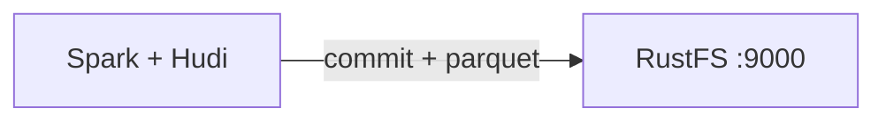
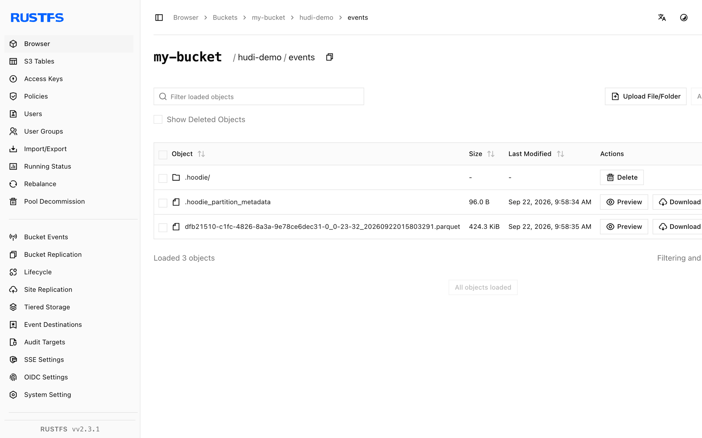

In dieser Anleitung verbinden Sie [Apache Hudi](https://github.com/apache/hudi) — die transaktionale Data-Lake-Plattform — mit **RustFS** als Copy-on-Write-Tabellenspeicher. Sie betreiben Spark mit dem Hudi-Bundle, schreiben eine Tabelle an den Speicherort `s3a://` in einem RustFS-Bucket, lesen sie zurück und prüfen die Tabellendateien. Der Ablauf wurde mit `apache/spark:3.5.6`, `hudi-spark3.5-bundle_2.12:0.15.0`, `hadoop-aws:3.3.4` und `rustfs/rustfs-x86-musl:v2.3.1` verifiziert.

Sie benötigen Docker. Diese Bereitstellung ist für lokale Integrationstests gedacht, nicht für den Produktivbetrieb.

## Architektur



Hudi speichert die Timeline `.hoodie/`, Commit-Dateien und Parquet-Datenblöcke unter dem Tabellenpfad im Bucket. Lesevorgänge lösen den aktuellen Tabellen-Snapshot aus der Timeline auf, daher läuft jeder Schreib- und Abfragevorgang über die S3-API.

## 1. Den Spark-Schreibvorgang ausführen

Hudi verlangt den Kryo-Serializer und die s3a-Zugangsdaten als Hadoop-Properties. Die folgende `spark-shell`-Sitzung legt eine nicht partitionierte Tabelle in `my-bucket` an. Ersetzen Sie alle Verbindungsplatzhalter:

```scala
import org.apache.spark.sql.SaveMode

val df = Seq((1, "a"), (2, "b"), (3, "c")).toDF("id", "name")
df.write.format("hudi")
  .option("hoodie.table.name", "events")
  .option("hoodie.datasource.write.recordkey.field", "id")
  .option("hoodie.datasource.write.precombine.field", "name")
  .option("hoodie.datasource.write.partitionpath.field", "")
  .mode(SaveMode.Overwrite)
  .save("s3a://my-bucket/hudi-demo/events")

val back = spark.read.format("hudi").load("s3a://my-bucket/hudi-demo/events")
back.select("id", "name").show()
```

```bash
docker run --rm --network oo-rustfs_default \
  -v "$PWD/hudi_test.scala":/tmp/hudi_test.scala \
  apache/spark:3.5.6 /opt/spark/bin/spark-shell \
  --packages org.apache.hudi:hudi-spark3.5-bundle_2.12:0.15.0,org.apache.hadoop:hadoop-aws:3.3.4 \
  --conf spark.serializer=org.apache.spark.serializer.KryoSerializer \
  --conf spark.hadoop.fs.s3a.endpoint=http://rustfs:9000 \
  --conf spark.hadoop.fs.s3a.path.style.access=true \
  --conf spark.hadoop.fs.s3a.access.key=<your-access-key> \
  --conf spark.hadoop.fs.s3a.secret.key=<your-secret-key> \
  --conf spark.hadoop.fs.s3a.region=us-east-1 \
  --conf spark.jars.ivy=/tmp/.ivy2 \
  --conf spark.sql.shuffle.partitions=2 \
  -i /tmp/hudi_test.scala
```

Die Flags `--packages` laden das Hudi-Bundle und den Connector s3a beim ersten Lauf herunter. Die Einstellung `spark.jars.ivy` vermeidet Berechtigungsfehler des Ivy-Cache im Container. Das zurückgelesene `show()` gibt die drei Zeilen aus:

```text
+---+----+
|  2|   b|
|  3|   c|
|  1|   a|
+---+----+
```

## 2. Objekte in RustFS prüfen

Listen Sie das Tabellenpräfix auf:

```bash
rc ls rustfs/my-bucket/hudi-demo/ -r
```

Das Hudi-Tabellenlayout erscheint unter dem Tabellenpfad: die Timeline `.hoodie/` mit der Commit-Datei sowie der Parquet-Datenblock:

```text
hudi-demo/events/.hoodie/20260922015803291.commit
hudi-demo/events/.hoodie/20260922015803291.commit.requested
hudi-demo/events/<partition>/<filegroup>/<parquet-block>
```



## 3. Stoppen oder zurücksetzen

Spark läuft als einmaliger Client und hält keinen Zustand. So löschen Sie die Demo-Tabelle:

```bash
rc rm rustfs/my-bucket/hudi-demo/ --recursive --force
```

## Fehlerbehebung

### `hoodie only support org.apache.spark.serializer.KryoSerializer as spark.serializer`

Hudi lehnt den Standard-Serializer von Spark ab. Übergeben Sie `--conf spark.serializer=org.apache.spark.serializer.KryoSerializer` wie oben gezeigt.

### `Partition-path field has to be non-empty` oder Fehler der Keygenerator-Klasse

Belassen Sie für eine nicht partitionierte Tabelle den Standard-Key-Generator und setzen Sie `hoodie.datasource.write.keygenerator.class` nicht. Setzen Sie `hoodie.datasource.write.partitionpath.field` auf die leere Zeichenkette.

### `NoSuchMethodError` oder `ClassNotFoundException` beim Hudi-Schreibvorgang

Die Versionen von Spark und dem Hudi-Bundle müssen zusammenpassen: `hudi-spark3.5-bundle_2.12` gehört zu Spark 3.5.x, und der gebündelte Hadoop-Client muss mit `hadoop-aws:3.3.4` kompatibel sein.

## Nächste Schritte

- Lesen Sie die [S3-Kompatibilitätshinweise](/de/administration/protocols/s3), bevor Sie weitere Hudi-Operationen einsetzen.
- Erstellen Sie dedizierte Produktions-Zugangsdaten über die [Zugriffsschlüssel-Verwaltung](/de/security-compliance/iam/access-token).
- Folgen Sie dem [Hudi-Spark-Leitfaden](https://hudi.apache.org/docs/quick-start-guide/), um Upserts, Compaction und Abfrageintegrationen auf derselben Tabelle hinzuzufügen.
