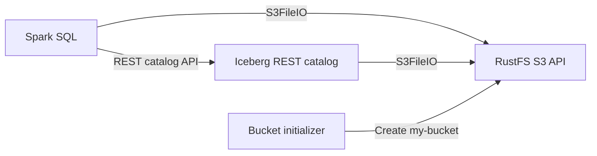

In dieser Anleitung betreiben Sie **Apache Iceberg** mit Spark, einem Iceberg-REST-Katalog und **RustFS** als S3-kompatiblem Warehouse. Sie legen eine Iceberg-Tabelle an, schreiben Zeilen, fragen sie ab und prüfen, dass die Tabellendateien in RustFS liegen.

Für den in RustFS integrierten REST-Katalog folgen Sie der [Einrichtung von S3 Tables](/de/administration/data/s3-tables) und der [PyIceberg-Anleitung](/de/developer/integration/big-data/pyiceberg). Die folgende Bereitstellung startet einen separaten Katalogdienst.

Sie benötigen Docker mit dem Compose-Plugin und ausreichend lokale Ressourcen für vier Container. Diese Bereitstellung ist für lokale Integrationstests gedacht, nicht für den Produktivbetrieb.

:::note[Upstream-Status]

Apache Iceberg [PR #14928](https://github.com/apache/iceberg/pull/14928) hat denselben Ablauf mit Spark, REST-Katalog, `S3FileIO` und RustFS gezeigt, einschließlich des Anlegens von Tabellen und der Schreibvorgänge. Der Pull Request wurde geschlossen, ohne übernommen zu werden. Der aktuelle [Spark-Schnellstart](https://iceberg.apache.org/spark-quickstart/#docker-compose) verwendet weiterhin einen anderen S3-kompatiblen Speicher. Die folgende Konfiguration beschreibt daher eine RustFS-Integration und nicht eine Voreinstellung von Apache Iceberg.

:::

## Architektur



Spark nutzt den REST-Dienst für Katalogoperationen. Spark und der REST-Katalog erhalten Endpunkt, Region, Zugangsdaten und die Einstellung für die pfadbasierte Adressierung (Path-Style) von RustFS, damit sie auf Metadaten und Datendateien in `s3://my-bucket/warehouse` zugreifen können.

## 1. Projektdateien anlegen

Legen Sie ein Arbeitsverzeichnis an:

```bash
mkdir rustfs-iceberg
cd rustfs-iceberg
```

Erstellen Sie eine Umgebungsdatei und ersetzen Sie beide Platzhalter für die Zugangsdaten:

```ini title=".env"
RUSTFS_ACCESS_KEY=<your-access-key>
RUSTFS_SECRET_KEY=<your-secret-key>
```

Verwenden Sie dedizierte Zugangsdaten für den Warehouse-Bucket. Nehmen Sie `.env` nicht in die Versionsverwaltung auf.

Erstellen Sie die Spark-Katalogkonfiguration:

```ini title="spark-defaults.conf"
spark.sql.extensions org.apache.iceberg.spark.extensions.IcebergSparkSessionExtensions
spark.sql.catalog.demo org.apache.iceberg.spark.SparkCatalog
spark.sql.catalog.demo.type rest
spark.sql.catalog.demo.uri http://rest:8181
spark.sql.catalog.demo.io-impl org.apache.iceberg.aws.s3.S3FileIO
spark.sql.catalog.demo.warehouse s3://my-bucket/warehouse
spark.sql.catalog.demo.s3.endpoint http://rustfs:9000
spark.sql.catalog.demo.s3.path-style-access true
spark.sql.defaultCatalog demo
spark.sql.catalogImplementation in-memory
```

Für diesen Endpunkt im Container-Netzwerk ist pfadbasierte Adressierung (Path-Style) erforderlich. Der Hostname `rustfs` ist nur innerhalb des Compose-Netzwerks auflösbar; Clients auf dem Host verwenden stattdessen `http://localhost:9000`.

Erstellen Sie die Compose-Datei:

```yaml title="compose.yaml"
services:
  rustfs:
    image: rustfs/rustfs:1.0.0-alpha.83
    environment:
      RUSTFS_ACCESS_KEY: ${RUSTFS_ACCESS_KEY}
      RUSTFS_SECRET_KEY: ${RUSTFS_SECRET_KEY}
      RUSTFS_VOLUMES: /data
      RUSTFS_ADDRESS: ":9000"
      RUSTFS_CONSOLE_ADDRESS: ":9001"
      RUSTFS_CONSOLE_ENABLE: "true"
      RUSTFS_OBS_LOGGER_LEVEL: error
      RUSTFS_OBS_LOG_DIRECTORY: /var/log/rustfs/
    volumes:
      - rustfs-data:/data
    ports:
      - "9000:9000"
      - "9001:9001"
    networks:
      - iceberg

  create-bucket:
    image: rustfs/rc:latest
    depends_on:
      - rustfs
    environment:
      RUSTFS_ACCESS_KEY: ${RUSTFS_ACCESS_KEY}
      RUSTFS_SECRET_KEY: ${RUSTFS_SECRET_KEY}
    entrypoint:
      - /bin/sh
      - -c
      - |
        until /usr/bin/rc alias set rustfs http://rustfs:9000 "$${RUSTFS_ACCESS_KEY}" "$${RUSTFS_SECRET_KEY}"; do
          echo "Waiting for RustFS..."
          sleep 2
        done
        /usr/bin/rc ls rustfs/my-bucket >/dev/null 2>&1 || /usr/bin/rc mb rustfs/my-bucket
    networks:
      - iceberg

  rest:
    image: apache/iceberg-rest-fixture
    depends_on:
      create-bucket:
        condition: service_completed_successfully
    environment:
      AWS_ACCESS_KEY_ID: ${RUSTFS_ACCESS_KEY}
      AWS_SECRET_ACCESS_KEY: ${RUSTFS_SECRET_KEY}
      AWS_REGION: us-east-1
      CATALOG_WAREHOUSE: s3://my-bucket/warehouse
      CATALOG_IO__IMPL: org.apache.iceberg.aws.s3.S3FileIO
      CATALOG_S3_ENDPOINT: http://rustfs:9000
      CATALOG_S3_PATH__STYLE__ACCESS: "true"
    ports:
      - "8181:8181"
    networks:
      - iceberg

  spark-iceberg:
    image: tabulario/spark-iceberg
    depends_on:
      create-bucket:
        condition: service_completed_successfully
      rest:
        condition: service_started
    environment:
      AWS_ACCESS_KEY_ID: ${RUSTFS_ACCESS_KEY}
      AWS_SECRET_ACCESS_KEY: ${RUSTFS_SECRET_KEY}
      AWS_REGION: us-east-1
    volumes:
      - ./spark-defaults.conf:/opt/spark/conf/spark-defaults.conf:ro
    ports:
      - "8888:8888"
      - "8080:8080"
    networks:
      - iceberg

networks:
  iceberg:

volumes:
  rustfs-data:
```

Das [`rc`-Image](https://github.com/rustfs/cli) stellt den offiziellen Kommandozeilen-Client von RustFS bereit. Die Initialisierung prüft, ob `my-bucket` bereits existiert, bevor sie ihn anlegt. Wiederholte Starts löschen vorhandene Warehouse-Daten daher nicht. Das RustFS-Volume behält Warehouse-Objekte, wenn Container neu erstellt werden.

:::warning[Image-Versionen]

Die Images aus dem Apache-Iceberg-Schnellstart werden im Upstream-Beispiel ohne stabile Versions-Tags veröffentlicht. Bevor Sie dieses Muster außerhalb lokaler Tests verwenden, legen Sie jedes Image auf einen getesteten Tag oder Digest fest und prüfen Sie die Versionen von Spark, der Iceberg-Laufzeit und des REST-Katalogs gemeinsam.

:::

## 2. Bereitstellung prüfen und starten

Lösen Sie die Compose-Datei auf, bevor Sie die Container starten:

```bash
docker compose config
```

Starten Sie die Dienste und warten Sie, bis die Bucket-Initialisierung abgeschlossen ist:

```bash
docker compose up -d
docker compose ps -a
```

Der Dienst `create-bucket` sollte den Exit-Code `0` anzeigen. Prüfen Sie die Logs, wenn er nicht abschließt:

```bash
docker compose logs create-bucket
```

Öffnen Sie die RustFS Console unter `http://localhost:9001`. Der REST-Katalog ist unter `http://localhost:8181` erreichbar, der Spark-Notebook-Server unter `http://localhost:8888`.

## 3. Iceberg-Tabelle anlegen und abfragen

Starten Sie Spark SQL:

```bash
docker compose exec spark-iceberg spark-sql
```

Legen Sie einen Namespace und eine partitionierte Tabelle an:

```sql
CREATE NAMESPACE IF NOT EXISTS demo.nyc;

CREATE TABLE demo.nyc.taxis
(
	vendor_id bigint,
	trip_id bigint,
	trip_distance float,
	fare_amount double,
	store_and_fwd_flag string
)
PARTITIONED BY (vendor_id);
```

Fügen Sie Beispielzeilen ein und fragen Sie sie ab:

```sql
INSERT INTO demo.nyc.taxis
VALUES
	(1, 1000371, 1.8, 15.32, 'N'),
	(2, 1000372, 2.5, 22.15, 'N'),
	(2, 1000373, 0.9, 9.01, 'N'),
	(1, 1000374, 8.4, 42.13, 'Y');

SELECT * FROM demo.nyc.taxis ORDER BY trip_id;
```

Die Abfrage sollte vier Zeilen zurückgeben:

```text
1  1000371  1.8  15.32  N
2  1000372  2.5  22.15  N
2  1000373  0.9  9.01   N
1  1000374  8.4  42.13  Y
```

## 4. Objekte in RustFS prüfen

Listen Sie das Warehouse aus dem Image der Bucket-Initialisierung auf:

```bash
docker compose run --rm --entrypoint /bin/sh create-bucket -c \
  '/usr/bin/rc alias set rustfs http://rustfs:9000 "$RUSTFS_ACCESS_KEY" "$RUSTFS_SECRET_KEY" >/dev/null && /usr/bin/rc find rustfs/my-bucket/warehouse'
```

Die Ausgabe sollte Iceberg-Metadaten und Datenobjekte unter dem Präfix `warehouse/nyc/taxis` enthalten. Sie können den Bucket `my-bucket` auch in der RustFS Console prüfen.

## 5. Stack anhalten oder zurücksetzen

Halten Sie die Container an und behalten Sie das RustFS-Datenvolume:

```bash
docker compose down
```

Um das lokale Warehouse zu löschen und mit einem leeren RustFS-Volume zu starten, geben Sie ausdrücklich `--volumes` an:

```bash
docker compose down --volumes
```

## Fehlerbehebung

### Spark erreicht RustFS nicht

Verwenden Sie innerhalb von Compose `http://rustfs:9000`. `http://localhost:9000` bezeichnet in `spark-defaults.conf` den Spark-Container selbst.

Prüfen Sie, dass `spark.sql.catalog.demo.s3.path-style-access` den Wert `true` hat. Anfragen im Virtual-Hosted-Stil erfordern zusätzliche Domain- und DNS-Konfiguration für RustFS.

### Der Katalog gibt einen S3-Fehler zurück

Prüfen Sie, ob die Zugangsdaten in `.env` mit den RustFS-Zugangsdaten übereinstimmen und ob der Dienst `create-bucket` erfolgreich abgeschlossen wurde:

```bash
docker compose logs create-bucket rest
```

Die REST-Katalog-Property verwendet doppelte Unterstriche in `CATALOG_IO__IMPL` und `CATALOG_S3_PATH__STYLE__ACCESS`. Die Fixture wandelt sie in die Iceberg-Property-Namen mit Punkten und Bindestrichen um.

## Nächste Schritte

- Lesen Sie die [Hinweise zur S3-Kompatibilität](/de/administration/protocols/s3), bevor Sie weitere Iceberg-Operationen einsetzen.
- Erstellen Sie dedizierte Produktions-Zugangsdaten über die [Zugriffsschlüssel-Verwaltung](/de/security-compliance/iam/access-token).
- Folgen Sie der [Apache-Iceberg-Dokumentation zu Spark](https://iceberg.apache.org/docs/latest/spark-getting-started/), um Ihre vorhandene Spark-Umgebung zu konfigurieren.
