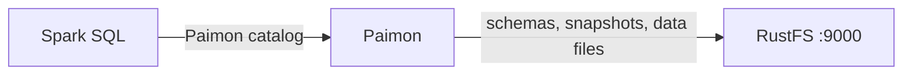

In dieser Anleitung verbinden Sie [Apache Paimon](https://github.com/apache/paimon) — das Streaming-Lakehouse-Tabellenformat — mit **RustFS** als Warehouse-Speicher. Sie legen mit Spark einen Paimon-Katalog über einem RustFS-Bucket an, schreiben eine Tabelle mit Primärschlüssel und lesen sie zurück. Der Ablauf wurde mit Paimon 1.2.0 auf Spark 3.5.6 gegen `rustfs/rustfs-x86-musl:v2.3.1` verifiziert.

Sie benötigen Docker und den Client `rc`.

## Architektur



Paimon speichert jede Tabelle unter dem Warehouse des Katalogs als Verzeichnis `*.db` mit `schema/`, `snapshot/` und Datendateien. Die gesamte Ein- und Ausgabe läuft über Paimons eigenes S3-FileIO (`paimon-s3`), nicht über Hadoop S3A.

## 1. Spark starten

```bash
docker run -d --name spark-paimon --hostname spark --network oo-rustfs_default \
  spark:3.5.6-scala2.12-java17-python3-ubuntu sleep infinity
docker cp paimon_test.sql spark-paimon:/tmp/paimon_test.sql
```

Legen Sie die SQL-Datei an. Die Katalogoptionen werden unten auf der CLI übergeben, nicht in der Datei:

```sql title="paimon_test.sql"
CREATE TABLE paimon.default.events (id INT, label STRING) TBLPROPERTIES ("primary-key"="id");
INSERT INTO paimon.default.events VALUES (1,'alpha'),(2,'beta'),(3,'gamma');
SELECT * FROM paimon.default.events ORDER BY id;
```

## 2. Das SQL-Skript ausführen

Drei Bestandteile sind erforderlich: die Spark-Erweiterungen, Paimons eigenes S3-FileIO (`paimon-s3`; die Hadoop-S3A-JARs verwendet der Reader von Paimon nicht) und die `s3.*`-Optionen auf Katalogebene:

```bash
docker exec -u root spark-paimon bash -c "cd /opt/spark && \
  ./bin/spark-sql \
  --packages org.apache.paimon:paimon-spark-3.5:1.2.0,org.apache.paimon:paimon-s3:1.2.0,org.apache.hadoop:hadoop-aws:3.3.4 \
  --conf spark.sql.extensions=org.apache.paimon.spark.extensions.PaimonSparkSessionExtensions \
  --conf spark.sql.catalog.paimon=org.apache.paimon.spark.SparkCatalog \
  --conf spark.sql.catalog.paimon.warehouse=s3://paimon-demo/warehouse \
  --conf spark.sql.catalog.paimon.s3.endpoint=http://rustfs:9000 \
  --conf spark.sql.catalog.paimon.s3.access-key=<your-access-key> \
  --conf spark.sql.catalog.paimon.s3.secret-key=<your-secret-key> \
  --conf spark.sql.catalog.paimon.s3.path-style-access=true \
  -f /tmp/paimon_test.sql"
```

```text
Time taken: 9.447 seconds
1	alpha
2	beta
3	gamma
Time taken: 1.257 seconds, Fetched 3 row(s)
```

Ohne die Zeile mit den Erweiterungen bricht Paimon sofort mit einem Fehler `requiredSparkConfsCheck` ab. Ohne `paimon-s3` scheitert der Katalog mit `UnsupportedSchemeException: Could not find a file io implementation for scheme 's3'`.

## 3. Objekte in RustFS prüfen

```bash
rc ls rustfs/paimon-demo/warehouse/ -r | head -6
```

```text
warehouse/default.db/events/schema/schema-0
warehouse/default.db/events/snapshot/snapshot-1
warehouse/default.db/events/bucket-0/data-...
warehouse/default.db/events/manifest/...
```

Der Bucket enthält das vollständige Lakehouse-Layout: Schemas, Snapshots, Manifeste und Datendateien je Bucket.


## 4. Stoppen oder zurücksetzen

```bash
docker rm -f spark-paimon
rc rm rustfs/paimon-demo/ --recursive --force
```

## Fehlerbehebung

### `UnsupportedSchemeException: Could not find a file io implementation for scheme 's3'`

Das eigene FileIO von Paimon braucht sein S3-Plugin auf dem Classpath. Fügen Sie `org.apache.paimon:paimon-s3:1.2.0` in `--packages` neben dem Spark-Connector hinzu.

### `When using Paimon, it is necessary to configure spark.sql.extensions...`

Fügen Sie `--conf spark.sql.extensions=org.apache.paimon.spark.extensions.PaimonSparkSessionExtensions` hinzu. Ohne diese Zeile bricht Paimon sofort ab.

### `SCHEMA_NOT_FOUND: The schema paimon cannot be found`

Der Katalog wurde nicht registriert. Registrieren Sie ihn als `spark.sql.catalog.paimon` und qualifizieren Sie Tabellennamen mit `paimon.`.

### Schreibvorgänge schlagen auf der Executor-Seite mit S3-Fehlern fehl

Die `s3.*`-Optionen auf Katalogebene (`s3.endpoint`, `s3.access-key`, `s3.secret-key`, `s3.path-style-access`) liest das FileIO von Paimon. Die Hadoop-Einstellungen `fs.s3a.*` allein verwendet die Dateioperation auf der Executor-Seite nicht.

## Nächste Schritte

- Vergleichen Sie die Anleitungen zu [Iceberg](/de/developer/integration/big-data/iceberg), [Hudi](/de/developer/integration/big-data/hudi) und [Delta Lake](/de/developer/integration/big-data/delta-lake) für die anderen Lakehouse-Formate auf demselben Bucket.
- Erstellen Sie dedizierte Produktions-Zugangsdaten über die [Zugriffsschlüssel-Verwaltung](/de/security-compliance/iam/access-token).
- Folgen Sie der [Paimon-Dokumentation](https://paimon.apache.org/docs/master/) für Compaction, Changelog-Producer und Streaming-Schreibvorgänge mit Flink auf demselben Bucket.
