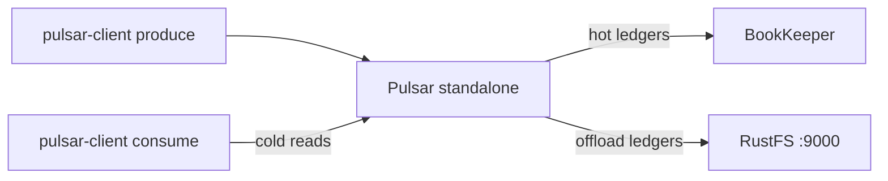
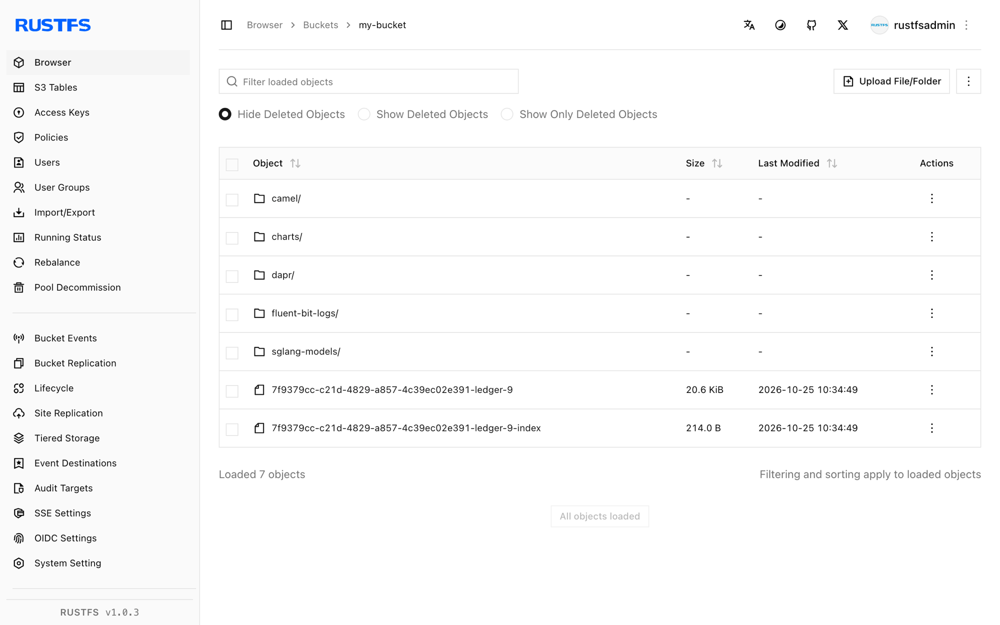

In dieser Anleitung verbinden Sie [Apache Pulsar](https://github.com/apache/pulsar) über seinen Tiered-Storage-S3-Offloader mit **RustFS**. Sie betreiben einen Standalone-Broker, dessen Offloading auf einen RustFS-Bucket zeigt, produzieren Nachrichten, lösen eine Ledger-Auslagerung aus und lesen die ausgelagerten Nachrichten aus dem Bucket zurück. Der Ablauf wurde mit `apachepulsar/pulsar-all:4.0.4` verifiziert, das ein Topic nach RustFS auslagert und Kaltlesevorgänge daraus bedient.

Sie benötigen Docker. Dieses Setup ist für lokale Integrationstests gedacht, nicht für den Produktivbetrieb.

## Architektur



Alte Ledgers werden als `<offloader-id>-ledger-<n>`-Datenblöcke plus ein kleines `-index`-Objekt in den Bucket hochgeladen. Fordert ein Konsument Nachrichten an, die nicht mehr in BookKeeper liegen, liest der Broker sie transparent aus dem Bucket zurück.

## 1. Standalone-Broker mit Offloading starten

Das einfache `apachepulsar/pulsar`-Image enthält keine Offloader-Pakete und schlägt mit `No offloader found for driver 'S3'` fehl — verwenden Sie das `pulsar-all`-Image, das sie mitbringt. Der Broker wird auf einen kleinen Heap begrenzt:

```bash
docker run -d --name pulsar -p 6650:6650 -p 8080:8080 \
  -e ACCESS_KEY_ID=<your-access-key> \
  -e ACCESS_KEY_SECRET=<your-secret-key> \
  -e PULSAR_MEM="-Xms512m -Xmx512m" \
  --entrypoint bash apachepulsar/pulsar-all:4.0.4 -c '
    sed -i -e "s|^managedLedgerMaxEntriesPerLedger=.*|managedLedgerMaxEntriesPerLedger=100|" \
           -e "s|^managedLedgerMinLedgerRolloverTimeMinutes=.*|managedLedgerMinLedgerRolloverTimeMinutes=1|" \
           /pulsar/conf/standalone.conf
    printf "\nmanagedLedgerOffloadDriver=S3\nmanagedLedgerOffloadBucket=my-bucket\nmanagedLedgerOffloadServiceEndpoint=http://<your-rustfs-endpoint>:9000\nmanagedLedgerOffloadRegion=us-east-1\n" >> /pulsar/conf/standalone.conf
    exec bin/pulsar standalone -nss
  '
```

Die beiden `managedLedger*`-Änderungen verkleinern die Ledgers, sodass ein Roll noch in der Demo passiert; der angehängte Block aktiviert das Offloading.

:::note[Der Treiber S3 liest managedLedgerOffload*-Schlüssel, nicht s3ManagedLedgerOffload*]

Für den Treiber `S3` löst der Offloader die generischen Schlüssel `managedLedgerOffloadBucket`, `managedLedgerOffloadServiceEndpoint` und `managedLedgerOffloadRegion` auf. Die Namen `s3ManagedLedgerOffload*` gehören zum Treiber `aws-s3` und werden hier ignoriert — mit ihnen stürzt der Offloader mit `NullPointerException: endpoint` ab. Dasselbe gilt für Zugangsdaten: Der Treiber `S3` liest die Umgebungsvariablen `ACCESS_KEY_ID` und `ACCESS_KEY_SECRET`, nicht das Paar `AWS_*`.

:::

Warten Sie auf den Broker:

```bash
docker logs -f pulsar 2>&1 | grep -m1 "The ledger offloader was created"
```

## 2. Nachrichten produzieren und das Topic am Leben halten

Topics ohne Subscription löscht der Inactive-Topic-Aufräumdienst binnen Minuten, womit die Demo vorzeitig endet. Produzieren Sie eine erste Charge und legen Sie danach eine dauerhafte Subscription an, die das Topic registriert hält:

```bash
docker exec pulsar bin/pulsar-client produce -m "hello rustfs offload" -n 300 \
  persistent://public/default/rustfs-test
```

```text
300 messages successfully produced
```

```bash
timeout 30 docker exec pulsar bin/pulsar-client consume -s keepalive -n 1 -p Earliest \
  persistent://public/default/rustfs-test
```

## 3. Ledger rollen und Offloading auslösen

Ein Ledger rollt nur, wenn nach Ablauf von `managedLedgerMinLedgerRolloverTimeMinutes` noch ein Schreibvorgang erfolgt — die Prüfung läuft beim Schreiben, nicht im Hintergrund. Warten Sie mindestens eine Minute, produzieren Sie eine weitere Charge, um das Rollen zu erzwingen, und lagern Sie alles vor dem letzten Kilobyte aus:

```bash
sleep 65
docker exec pulsar bin/pulsar-client produce -m "rollover" -n 120 \
  persistent://public/default/rustfs-test
docker exec pulsar bin/pulsar-admin topics offload -s 1K \
  persistent://public/default/rustfs-test
```

```text
Offload triggered for persistent://public/default/rustfs-test for messages before 11:0:-1
```

Das Offloading dauert einen Moment — warten Sie auf den Abschluss:

```bash
sleep 30
docker exec pulsar bin/pulsar-admin topics offload-status \
  persistent://public/default/rustfs-test
```

```text
Offload was a success
```

Bestätigen Sie, dass die Ledger-Objekte in RustFS gelandet sind — Datenblock plus Index, im Bucket-Wurzelverzeichnis:

```bash
aws s3 ls s3://my-bucket/ --recursive \
  --endpoint-url http://<your-rustfs-endpoint>:9000 | grep ledger
```

```text
2026-10-25 02:34:49      21057 7f9379cc-c21d-4829-a857-4c39ec02e391-ledger-9
2026-10-25 02:34:49        214 7f9379cc-c21d-4829-a857-4c39ec02e391-ledger-9-index
```

## 4. Ausgelagerte Nachrichten zurücklesen

Konsumieren Sie mit einer frischen Subscription ab der frühesten Position. Das erste Ledger liegt jetzt nur noch in RustFS, daher ist jede Nachricht, die der Broker liefert, ein Kaltlesevorgang aus dem Bucket:

```bash
timeout 90 docker exec pulsar bin/pulsar-client consume -s coldread -n 420 -p Earliest \
  persistent://public/default/rustfs-test 2>&1 | grep -c "^-----"
```

```text
420
```

Alle 420 Nachrichten — die 300 aus dem ausgelagerten Ledger plus die 120 aus dem aktiven — kommen über den Bucket zurück.



## 5. Anhalten oder Zurücksetzen

Broker abreißen und die Bucket-Objekte behalten:

```bash
docker rm -f pulsar
```

Ausgelagerte Ledgers löschen:

```bash
aws s3 rm s3://my-bucket/ --recursive --exclude "*" --include "*ledger*" \
  --endpoint-url http://<your-rustfs-endpoint>:9000
```

## Fehlerbehebung

### `No offloader found for driver 'S3'. Please make sure you dropped the offloader nar packages`

Das Image enthält die Offloader-NARs nicht. Verwenden Sie wie in Schritt 1 `apachepulsar/pulsar-all`.

### `NullPointerException: endpoint` beim Offloading

Der Offloader hat keinen Service-Endpoint gelesen — die Schlüssel `managedLedgerOffload*` fehlen oder wurden mit den Namen `s3ManagedLedgerOffload*` des `aws-s3`-Treibers geschrieben. Hängen Sie den Block aus Schritt 1 an und starten Sie neu.

### `Couldn't get the access key id.` im Broker-Log

Der Treiber `S3` liest nicht `AWS_ACCESS_KEY_ID`. Exportieren Sie `ACCESS_KEY_ID` und `ACCESS_KEY_SECRET` auf dem Broker-Container.

### `Topic ... not found` während der Demo

Der Inactive-Topic-Aufräumdienst hat das Topic gelöscht, weil es keine Subscription hatte. Wiederholen Sie Schritt 2 und belassen Sie die `keepalive`-Subscription.

### `Offload was a success`, aber keine Objekte erscheinen

Hochgeladen werden nur geschlossene Ledgers unterhalb der Größenschwelle, und ein Ledger rollt beim nächsten Schreibvorgang nach Ablauf des Mindestalters. Produzieren Sie eine weitere Charge und lösen Sie das Offloading erneut aus.

## Nächste Schritte

- Lesen Sie vor automatischen Offload-Schwellwerten auf Namespaces die [S3-Kompatibilitätshinweise](/administration/protocols/s3).
- Erstellen Sie dedizierte Produktionszugangsdaten mit [Zugangsdatenverwaltung](/security-compliance/iam/access-token).
- Folgen Sie der [Pulsar-Tiered-Storage-Dokumentation](https://pulsar.apache.org/docs/next/cookbooks-tiered-storage/) für Namespace-Schwellwerte, Retention-Richtlinien und Multi-Node-Broker gegen denselben Bucket.
