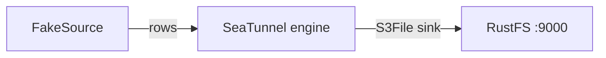

In dieser Anleitung verbinden Sie [Apache SeaTunnel](https://github.com/apache/seatunnel) — die Datenintegrations-Engine — über den Connector S3File mit **RustFS**. Sie führen einen Batch-Job aus, der mit FakeSource Zeilen erzeugt und sie als JSON-Dateien in einen RustFS-Bucket schreibt. Der Ablauf wurde mit SeaTunnel 2.3.12 gegen `rustfs/rustfs-x86-musl:v2.3.1` verifiziert.

Sie benötigen Docker und den Client `rc`.

## Architektur



Der Sink S3File schreibt über das Hadoop-Dateisystem S3A, daher akzeptiert der Connector sowohl eigene Zugangsdatenoptionen als auch die üblichen Hadoop-Schlüssel `fs.s3a.*`.

## 1. Die Engine starten

Der Connector und die Hadoop-AWS-JARs liegen im Image:

```bash
docker run --rm apache/seatunnel:2.3.12 \
  sh -c "ls /opt/seatunnel/connectors/ | grep s3; ls /opt/seatunnel/lib/ | grep hadoop-aws"
```

```text
connector-file-s3-2.3.12.jar
seatunnel-hadoop-aws.jar
```

## 2. Die Job-Konfiguration schreiben

Der heikle Punkt: der Sink prüft `access_key` und `secret_key` zur Kompilierzeit, während der eigentliche S3A-Client die Schlüssel `fs.s3a.*` liest. Geben Sie beide an und lassen Sie das Schema im Endpunkt weg. Die gebündelte Hadoop-Version lehnt Endpunkte mit `http://` ab:

```text title="seatunnel-rustfs.conf"
env {
  parallelism = 1
  job.mode = "BATCH"
}

source {
  FakeSource {
    plugin_output = "fake"
    row.num = 5
    schema = {
      fields {
        id = "int"
        name = "string"
        value = "double"
      }
    }
  }
}

sink {
  S3File {
    bucket = "s3a://seatunnel-demo"
    access_key = "<your-access-key>"
    secret_key = "<your-secret-key>"
    fs.s3a.endpoint = "<your-rustfs-endpoint>:9000"
    fs.s3a.access.key = "<your-access-key>"
    fs.s3a.secret.key = "<your-secret-key>"
    fs.s3a.aws.credentials.provider = "org.apache.hadoop.fs.s3a.SimpleAWSCredentialsProvider"
    fs.s3a.connection.ssl.enabled = "false"
    file_format_type = "json"
    path = "/out"
  }
}
```

## 3. Den Job ausführen

```bash
docker run --rm --network oo-rustfs_default \
  -v "$PWD/seatunnel-rustfs.conf":/task.conf:ro \
  apache/seatunnel:2.3.12 \
  sh -c "cd /opt/seatunnel && ./bin/seatunnel.sh --config /task.conf -e local"
```

```text
2026-10-07 ... INFO  ... Submit job finished, job id: 1159846059493556225
```

## 4. Objekte in RustFS prüfen

```bash
rc ls rustfs/seatunnel-demo/out/
rc cat rustfs/seatunnel-demo/out/T_1159846059493556225_2de3d99235_0_1_0.json | head -1
```

```text
out/T_1159846059493556225_2de3d99235_0_1_0.json
{"id":168282592,"name":"ELyqD","value":1.594479327987022E308}
```

Fünf Zeilen von FakeSource sind als eine JSON-Datei im Bucket gelandet.


## 5. Stoppen oder zurücksetzen

SeaTunnel im Modus `-e local` ist zustandslos. So löschen Sie die Ausgabe:

```bash
rc rm rustfs/seatunnel-demo/ --recursive --force
```

## Fehlerbehebung

### `Plugin PluginIdentifier{... pluginName='S3'} not found`

Die Sink-Klasse ist als `S3File` registriert, nicht als `S3`.

### `There are unconfigured options, the options('access_key', 'secret_key') are required`

Der Sink S3File verlangt eigene Optionen `access_key` und `secret_key`, auch wenn Schlüssel `fs.s3a.*` vorhanden sind. Geben Sie beide Sätze wie in Schritt 2 an.

### `No AWS Credentials provided by InstanceProfileCredentialsProvider`

Der S3A-Client auf der Coordinator-Seite ist auf den Instance-Profile-Provider zurückgefallen, weil `fs.s3a.aws.credentials.provider` und das Paar `fs.s3a.access.key`/`fs.s3a.secret.key` fehlten. Fügen Sie alle drei wie in Schritt 2 hinzu.

### Der Job hängt bei `doesBucketExist`

Die gebündelte Hadoop-Version lehnt Endpunkte mit dem Schema `http://` ab. Verwenden Sie für `fs.s3a.endpoint` die reine Form `host:port` und fügen Sie `fs.s3a.connection.ssl.enabled = "false"` hinzu.

## Nächste Schritte

- Lesen Sie die [S3-Kompatibilitätshinweise](/de/administration/protocols/s3), bevor Sie weitere SeaTunnel-Connectoren einsetzen.
- Erstellen Sie dedizierte Produktions-Zugangsdaten über die [Zugriffsschlüssel-Verwaltung](/de/security-compliance/iam/access-token).
- Folgen Sie der [SeaTunnel-Dokumentation zu S3File](https://seatunnel.apache.org/docs/connector-v2/sink/S3File) für die Formate Parquet und ORC, partitionierte Schreibvorgänge und die passende Quelle S3File.
