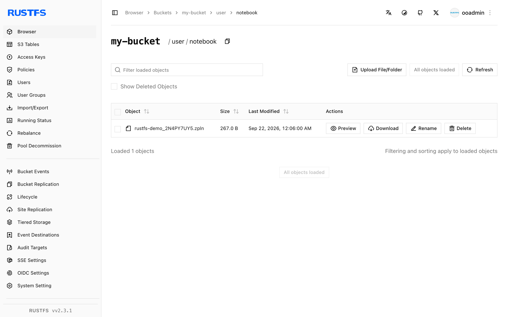

In dieser Anleitung verbinden Sie [Apache Zeppelin](https://github.com/apache/zeppelin) — das webbasierte Notebook für Datenanalyse — über Zeppelins S3-Notebook-Speicher mit **RustFS**. Sie starten Zeppelin mit einem RustFS-Bucket, legen eine Notiz an und prüfen, dass die Notebook-Datei in RustFS liegt und einen Neustart übersteht. Der Ablauf wurde mit `apache/zeppelin:0.12.0` und `rustfs/rustfs-x86-musl:v2.3.1` verifiziert.

Sie benötigen Docker. Diese Bereitstellung ist für lokale Integrationstests gedacht, nicht für den Produktivbetrieb.

## Architektur


Mit der Speicherklasse `S3NotebookRepo` wird jede Notiz als JSON-Datei `.zpln` unter dem Präfix `user/notebook/` des Buckets persistiert. Zeppelin liest und schreibt den Bucket direkt, daher überstehen Notizen Container-Neustarts und lassen sich zwischen Instanzen teilen.

## 1. Zeppelin starten

Legen Sie eine Umgebungsdatei an und ersetzen Sie beide Platzhalter für die Zugangsdaten:

```ini title=".env"
AWS_ACCESS_KEY_ID=<your-access-key>
AWS_SECRET_ACCESS_KEY=<your-secret-key>
```

Starten Sie Zeppelin im selben Docker-Netzwerk wie RustFS mit den S3-Speichereinstellungen:

```bash
docker run -d --name zeppelin --network oo-rustfs_default \
  -p 8080:8080 \
  -e AWS_ACCESS_KEY_ID \
  -e AWS_SECRET_ACCESS_KEY \
  -e ZEPPELIN_NOTEBOOK_STORAGE=org.apache.zeppelin.notebook.repo.S3NotebookRepo \
  -e ZEPPELIN_NOTEBOOK_S3_BUCKET=my-bucket \
  -e ZEPPELIN_NOTEBOOK_S3_ENDPOINT=http://rustfs:9000 \
  -e ZEPPELIN_NOTEBOOK_S3_PATH_STYLE_ACCESS=true \
  apache/zeppelin:0.12.0
```

Zeppelin liest Umgebungsvariablen `ZEPPELIN_*` als Konfigurationseigenschaften, daher ist keine Bearbeitung von `zeppelin-site.xml` nötig. Diese Anleitung verwendet den vorhandenen `my-bucket`. Notizen landen unter seinem Präfix `user/notebook/`, das der S3-Speicher bei Bedarf anlegt.

## 2. Eine Notiz anlegen

Warten Sie auf die Oberfläche unter `http://localhost:8080`, legen Sie dann in der Notebook-Liste eine Notiz namens `rustfs-demo` an und fügen Sie einen Absatz hinzu, oder verwenden Sie die REST-API:

```bash
NOTE=$(curl -s -X POST "http://localhost:8080/api/notebook" \
  -H "Content-Type: application/json" \
  -d '{"name": "rustfs-demo"}' | python3 -c "import json,sys; print(json.load(sys.stdin)['body'])")
echo "note id: $NOTE"
```

## 3. Das Notebook in RustFS prüfen

Listen Sie das Notebook-Präfix auf:

```bash
rc ls rustfs/my-bucket/user/notebook/ -r
```

Die Notiz liegt als JSON-Datei, benannt nach der Notiz und ihrer ID:

```text
user/notebook/rustfs-demo_2N4PY7UY5.zpln
```



Notizen überstehen einen Neustart, weil Zeppelin sie aus dem Bucket lädt:

```bash
docker restart zeppelin
curl -s "http://localhost:8080/api/notebook" | head -c 200
```

Die Notizliste enthält `2N4PY7UY5` nach dem Neustart erneut.

## 4. Die Bereitstellung stoppen oder zurücksetzen

Stoppen Sie Zeppelin und behalten Sie die Notizen:

```bash
docker rm -f zeppelin
```

Die Notizen bleiben im Präfix `user/notebook/` von `my-bucket`. Um sie zu löschen, entfernen Sie das Präfix:

```bash
rc rm rustfs/my-bucket/user/notebook/ --recursive --force
```

## Fehlerbehebung

### Zeppelin startet, Notizen erscheinen aber nie im Bucket

Prüfen Sie, dass die drei Variablen `ZEPPELIN_NOTEBOOK_S3_*` gesetzt sind und dass die Umgebungsvariablen der Zugangsdaten den Container erreichen. Das S3-Repository wird beim Start initialisiert, daher muss der Container nach jeder Änderung neu erstellt werden.

### `UnknownHostException: my-bucket.rustfs`

Das Flag für pfadbasierte Adressierung (Path-Style) wurde nicht übernommen. Belassen Sie `ZEPPELIN_NOTEBOOK_S3_PATH_STYLE_ACCESS=true` genau wie gezeigt. Ist die pfadbasierte Adressierung deaktiviert, behandelt Zeppelin den Bucket als Hostnamen.

## Nächste Schritte

- Lesen Sie die [S3-Kompatibilitätshinweise](/de/administration/protocols/s3), bevor Sie weitere Zeppelin-Operationen einsetzen.
- Erstellen Sie dedizierte Produktions-Zugangsdaten über die [Zugriffsschlüssel-Verwaltung](/de/security-compliance/iam/access-token).
- Folgen Sie der [Zeppelin-Speicherdokumentation](https://zeppelin.apache.org/docs/latest/setup/storage/storage.html#notebook-storage-in-s3), um Notizen in Präfixen je Benutzer zu organisieren.
