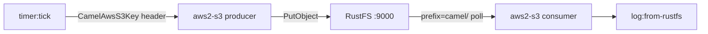

In dieser Anleitung verbinden Sie [Apache Camel](https://github.com/apache/camel) — das vielseitige Integrationsframework — über seine S3-Komponente mit **RustFS**. Sie schreiben eine Integration mit zwei Routen in YAML: eine Produzentenroute, die per Timer eine Nachricht in den Bucket schreibt, und eine Konsumentenroute, die diese Objekte zurückliest und protokolliert. Der Ablauf wurde mit Camel JBang auf `eclipse-temurin:21-jdk` unter Verwendung der Komponente `aws2-s3` mit übersteuertem Endpunkt und Path-Style-Adressierung verifiziert.

Sie benötigen Docker. Dieses Setup ist für lokale Integrationstests gedacht, nicht für den Produktivbetrieb.

## Architektur



Camel JBang führt die Routendatei direkt aus und löst die S3-Komponenten-Abhängigkeiten automatisch auf — kein Projektgerüst, kein Build, kein Deploy.

## 1. Integrationsroute schreiben

Erstellen Sie die Routendatei. Die Zugangsdaten kommen aus der AWS-Standard-Credential-Chain (Umgebungsvariablen), daher tragen die URIs nur Adressierung:

```yaml title="route.yaml"
- from:
    uri: "timer:tick"
    parameters:
      period: "5000"
    steps:
      - setBody:
          simple: "Hello from Camel at ${date:now:yyyy-MM-dd HH:mm:ss}"
      - setHeader:
          name: "CamelAwsS3Key"
          simple: "camel/hello-${date:now:HHmmss}.txt"
      - to:
          uri: "aws2-s3://my-bucket?overrideEndpoint=true&uriEndpointOverride=http://<your-rustfs-endpoint>:9000&forcePathStyle=true&useDefaultCredentialsProvider=true"
- from:
    uri: "aws2-s3://my-bucket?prefix=camel/&deleteAfterRead=false&maxMessagesPerPoll=5&overrideEndpoint=true&uriEndpointOverride=http://<your-rustfs-endpoint>:9000&forcePathStyle=true&useDefaultCredentialsProvider=true"
    steps:
      - to:
          uri: "log:from-rustfs"
```

Der Produzent setzt den Objektschlüssel über den Header `CamelAwsS3Key` — hier ein Zeitstempel pro Nachricht, sodass jeder Tick ein neues Objekt schreibt. Der Konsument pollt das Präfix `camel/` mit `deleteAfterRead=false`; Objekte bleiben nach dem Konsum im Bucket.

:::note[Komponentenname und Endpunkt-Optionen]

Die Komponente, die Camel JBang in diesem Workflow auflöst, ist `aws2-s3`. `overrideEndpoint=true` aktiviert den eigenen Endpunkt, `uriEndpointOverride` trägt seine URL, `forcePathStyle=true` wählt die Path-Style-Adressierung, die RustFS erwartet, und `useDefaultCredentialsProvider=true` lässt die Komponente die Zugangsdaten aus den Standard-Umgebungsvariablen lesen.

:::

## 2. Route mit Camel JBang ausführen

Führen Sie die Integration in einem Container mit exportierten Zugangsdaten aus. JBang fragt beim ersten Einsatz nach Vertrauen — fügen Sie daher vor dem Start die Trust-Regeln hinzu:

```bash
docker run --rm --network bridge \
  -e AWS_ACCESS_KEY_ID=<your-access-key> \
  -e AWS_SECRET_ACCESS_KEY=<your-secret-key> \
  -e AWS_REGION=us-east-1 \
  -v "$PWD:/routes" \
  --entrypoint bash eclipse-temurin:21-jdk -c '
    export JBANG_DIR=/root/.jbang PATH=/root/.jbang/bin:$PATH
    curl -Ls https://sh.jbang.dev | bash >/dev/null 2>&1
    jbang trust add https://github.com/apache/ 2>/dev/null || true
    jbang trust add /routes 2>/dev/null || true
    cd /routes && jbang camel@apache/camel run route.yaml
  '
```

Der erste Lauf lädt die Camel-Runtime und die Abhängigkeiten herunter und startet die Routen. Der Konsument protokolliert jedes gelesene Objekt:

```text
2026-10-25 02:02:41.069  INFO 120 --- [-s3://my-bucket] from-rustfs : Exchange[ExchangePattern: InOnly, BodyType: byte[], Body: Hello from Camel at 2026-10-25 02:02:38]
```

## 3. Objekte prüfen

Bestätigen Sie, dass die Objekte des Produzenten in RustFS liegen. Ersetzen Sie alle Verbindungsplatzhalter:

```bash
aws s3 ls s3://my-bucket/camel/ \
  --endpoint-url http://<your-rustfs-endpoint>:9000
```

```text
2026-10-25 02:02:13         39 hello-020213.txt
2026-10-25 02:02:18         39 hello-020218.txt
2026-10-25 02:02:23         39 hello-020223.txt
```


## 4. Anhalten oder Zurücksetzen

Stoppen Sie den Container, um die Routen zu beenden. Demo-Objekte löschen:

```bash
aws s3 rm s3://my-bucket/camel --recursive \
  --endpoint-url http://<your-rustfs-endpoint>:9000
```

## Fehlerbehebung

### `Cannot find component with name: aws-s3`

Ihre Camel-Version löst die Komponente unter einem anderen Namen auf — dieser Workflow verwendet `aws2-s3`. Nutzen Sie den Namen, den die Laufzeit in der Vorschlagsliste (`Did you mean: ... aws2-s3 ...`) meldet.

### `is not from a trusted source`

JBang weigert sich, nicht vertrauenswürdigen Code auszuführen. Führen Sie wie in Schritt 2 `jbang trust add https://github.com/apache/` und `jbang trust add /routes` vor `jbang camel@apache/camel run` aus.

### `useDefaultCredentialsProvider is set to false`

Die Komponente fand keine Credential-Konfiguration in der URI. Fügen Sie entweder `useDefaultCredentialsProvider=true` hinzu und exportieren Sie `AWS_ACCESS_KEY_ID` und `AWS_SECRET_ACCESS_KEY`, oder konfigurieren Sie die Endpunkt-Optionen `accessKey` und `secretKey` direkt.

### Konsument liest nichts

Der Konsument pollt nur das durch `prefix=camel/` gegebene Präfix. Bestätigen Sie, dass der Produzent lief (`timer`-Logzeilen erscheinen) und sein `CamelAwsS3Key`-Header mit `camel/` beginnt.

## Nächste Schritte

- Lesen Sie vor Multipart- oder Streaming-Operationen die [S3-Kompatibilitätshinweise](/administration/protocols/s3).
- Erstellen Sie dedizierte Produktionszugangsdaten mit [Zugangsdatenverwaltung](/security-compliance/iam/access-token).
- Folgen Sie der [Camel-S3-Komponenten-Dokumentation](https://camel.apache.org/components/latest/aws2-s3-component.html) für Download-Bereiche, Bucket-Operationen und Konsumenten-Tuning auf denselben Routen.
