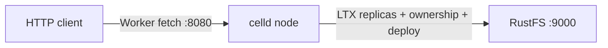

In dieser Anleitung verbinden Sie [celld](https://github.com/denoland/celld) — die selbst gehostete, verteilte Durable-Objects-Laufzeitumgebung von Denoland — mit **RustFS** als Fleet-Bucket. Sie führen `celld diagnose` gegen einen RustFS-Bucket aus (einschließlich der Prüfung auf bedingtes Schreiben), stellen einen Counter-Worker bereit, ändern den Zustand eines Durable Object über HTTP, starten celld neu und bestätigen, dass der Zustand erhalten bleibt. Der Ablauf wurde mit celld v0.6.2 gegen `rustfs/rustfs-x86-musl:v2.3.1` verifiziert.

Sie benötigen die Binärdatei `celld`, `esbuild` (zum Bündeln) und Node.js, um den bereitgestellten Worker anzusteuern.

## Architektur



celld behält nur ein lokales WAL. Jeder committete SQLite-Schreibvorgang wird im LTX-Format erfasst und in den Fleet-Bucket hochgeladen. Ein bedingter Bucket-Schreibvorgang (put-if-not-exists) weist die Knoten-Eigentümerschaft zu. Der Bucket ist die Quelle der Wahrheit. Knoten können abstürzen oder neu starten, ohne den Zustand der Durable Objects zu verlieren.

## 1. celld installieren

```bash
curl -sLo /tmp/celld.gz \
  https://github.com/denoland/celld/releases/download/v0.6.2/celld-x86_64-unknown-linux-gnu.gz
gunzip /tmp/celld.gz && chmod +x /tmp/celld
mv /tmp/celld /usr/local/bin/celld
celld --version
```

```text
celld 0.6.2
```

Installieren Sie auch esbuild. `celld deploy` bündelt Worker damit:

```bash
npm install -g esbuild
```

## 2. Den Bucket prüfen

`celld diagnose` prüft den Bucket einschließlich des bedingten Schreibens, das celld für das Ownership-Fencing benötigt:

```bash
export S3_ENDPOINT=http://<your-rustfs-endpoint>:9000
export AWS_REGION=us-east-1
export AWS_ACCESS_KEY_ID=<your-access-key>
export AWS_SECRET_ACCESS_KEY=<your-secret-key>

rc mb rustfs/celld-demo
celld diagnose --bucket s3://celld-demo
```

```text
ok listen 127.0.0.1:18080: bind check; diagnose does not serve
ok bucket s3://celld-demo
ok bucket conditional write: create, reject-create, update, reject-stale
ok fleet: 0 node lease(s) enumerated
```

`ok bucket conditional write` ist die wichtige Zeile. RustFS unterstützt put-if-not-exists nativ, daher ist kein Ausweichspeicher nötig.

## 3. Einen Knoten starten

Ein `--listen` außerhalb von Loopback verlangt ein ausdrückliches `--internal-listen`:

```bash
nohup celld --bucket s3://celld-demo \
  --listen 0.0.0.0:18080 \
  --internal-listen 0.0.0.0:9099 \
  --advertise 127.0.0.1:9099 > /opt/celld/celld.out 2>&1 &
```

```text
INFO celld: host runtime initialized event="host_runtime" worker_count=4
INFO celld::fleet: no deployment yet; run `celld deploy` ...
```

## 4. Den Counter-Worker bereitstellen

Verwenden Sie das Counter-Beispiel aus dem celld-Repository. Es ist ein Durable Object, das `n` im SQLite-Speicher bei jeder Anfrage erhöht:

```bash
curl -sLo /tmp/celld.zip https://codeload.github.com/denoland/celld/zip/refs/tags/v0.6.2
unzip /tmp/celld.zip -d /opt/celld
cd /opt/celld/celld-0.6.2/examples/counter
celld deploy . --bucket s3://celld-demo
```

```text
Uploaded counter (0.02 sec)
  s3://celld-demo/deploy/counter/bf5806589892a6cc
Current Version ID: bf5806589892a6cc
```

## 5. Den Zustand des Durable Object ändern

Jede Anfrage wird an das Durable Object `Counter` geleitet, das `n` aus dem Speicher liest, erhöht und zurückschreibt:

```bash
curl -s "http://127.0.0.1:18080/?name=rustfs"
curl -s "http://127.0.0.1:18080/?name=rustfs"
curl -s "http://127.0.0.1:18080/?name=rustfs"
```

```json
{"n":1,"url":"http://127.0.0.1:18080/?name=rustfs"}
{"n":2,"url":"http://127.0.0.1:18080/?name=rustfs"}
{"n":3,"url":"http://127.0.0.1:18080/?name=rustfs"}
```

## 6. celld neu starten und die Persistenz prüfen

Beenden Sie den Knoten, starten Sie ihn erneut und rufen Sie dieselbe URL auf. Der Zähler setzt dort fort, wo er aufgehört hat, weil der Zustand die ganze Zeit in RustFS lag:

```bash
pkill -f "celld --bucket"
nohup celld --bucket s3://celld-demo \
  --listen 0.0.0.0:18080 --internal-listen 0.0.0.0:9099 \
  --advertise 127.0.0.1:9099 > /opt/celld/celld2.out 2>&1 &
sleep 8
curl -s "http://127.0.0.1:18080/?name=rustfs"
```

```json
{"n":4,"url":"http://127.0.0.1:18080/?name=rustfs"}
```

Listen Sie den Bucket auf. Der Fleet-Zustand liegt vollständig dort:

```bash
rc ls rustfs/celld-demo/ -r | head -5
```

```text
cells/Counter:f2806128.../ltx/e1/0000/0000000000000001-0000000000000001.ltx
cells/Counter:f2806128.../own.json
deploy/counter/bf5806589892a6cc/index.js
deploy/counter/current.json
```


## 7. Stoppen oder zurücksetzen

```bash
pkill -f "celld --bucket"
rc rm rustfs/celld-demo/ --recursive --force
```

## Fehlerbehebung

### `bind --listen 127.0.0.0.1:8080 ... Address already in use`

Port 8080 ist häufig belegt (eine lokale GitLab-Registry oder ein Entwicklungsserver). Verschieben Sie den Worker-Listener: `--listen 0.0.0.0:18080`.

### `a non-loopback --listen requires an explicit --internal-listen`

Das Binden einer öffentlichen Schnittstelle verlangt einen eigenen Peer-Listener: fügen Sie `--internal-listen 0.0.0.0:9099 --advertise 127.0.0.1:9099` hinzu.

### `esbuild not found`

`celld deploy` bündelt den Worker mit esbuild. Installieren Sie es global (`npm install -g esbuild`) oder zeigen Sie mit `CELLD_ESBUILD` auf die Binärdatei.

### `celld deploy` auf dem Beispiel gibt zur Laufzeit `unknown command init for argo` aus

Das bedeutet, dass der Executor-Container oder -Pod eine `argo`-CLI-Binärdatei statt argoexec ausführt. Das ist ein Zeichen, dass im Cluster-Setup das falsche Image als Executor getaggt wurde, und hat mit celld selbst nichts zu tun. Auf einem einfachen Host ohne Cluster tritt das nicht auf.

## Nächste Schritte

- Vergleichen Sie die Anleitung mit der [Cloudflare-Dokumentation zu Durable Objects](https://developers.cloudflare.com/durable-objects/). celld betreibt dasselbe Programmiermodell auf Ihrem eigenen Bucket.
- Erstellen Sie dedizierte Produktions-Zugangsdaten über die [Zugriffsschlüssel-Verwaltung](/de/security-compliance/iam/access-token).
- Folgen Sie der [celld-README](https://github.com/denoland/celld) für Fleets mit mehreren Knoten: richten Sie einen zweiten Knoten auf denselben Bucket aus und lassen Sie bedingte Schreibvorgänge den Eigentümer wählen.
