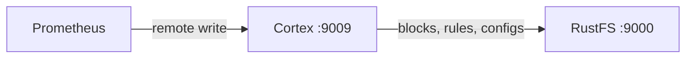

In dieser Anleitung verbinden Sie [Cortex](https://github.com/cortexproject/cortex) — das horizontal skalierbare, Prometheus-kompatible Metrik-Backend — über den nativen S3-Bucket-Speicher von Cortex mit **RustFS**. Sie betreiben Cortex im Single-Binary-Modus, richten den Speicher für Blöcke, Ruler und Alertmanager auf einen RustFS-Bucket aus, senden Metriken per Remote Write, speichern eine Regelgruppe und prüfen die Objekte. Der Ablauf wurde mit `cortexproject/cortex:v1.21.1` und `rustfs/rustfs-x86-musl:v2.3.1` verifiziert.

Sie benötigen Docker. Diese Bereitstellung ist für lokale Integrationstests gedacht, nicht für den Produktivbetrieb.

## Architektur



Cortex speichert jeden TSDB-Block, jede Ruler-Regelgruppe und jede Alertmanager-Konfiguration im Objektspeicher. Wenn Sie das Backend `s3` auf RustFS ausrichten, wird der Bucket zur einzigen Quelle der Wahrheit für alle Tenant-Daten.

## 1. Die Cortex-Konfiguration anlegen

Legen Sie die Konfigurationsdatei an und ersetzen Sie alle Verbindungsplatzhalter:

```yaml title="cortex.yaml"
target: all
auth_enabled: false

server:
  http_listen_port: 9009

distributor:
  shard_by_all_labels: true
  pool:
    health_check_ingesters: true

ingester:
  lifecycler:
    min_ready_duration: 0s
    final_sleep: 0s
    num_tokens: 512
    ring:
      kvstore:
        store: inmemory
      replication_factor: 1

blocks_storage:
  backend: s3
  s3: &s3
    endpoint: <your-rustfs-endpoint>:9000
    region: us-east-1
    bucket_name: cortex
    access_key_id: <your-access-key>
    secret_access_key: <your-secret-key>
    insecure: true
    bucket_lookup_type: path
  tsdb:
    dir: /data/tsdb
    block_ranges_period: [15m]
    ship_interval: 30s
  bucket_store:
    sync_dir: /data/tsdb-sync
    bucket_index:
      enabled: true

compactor:
  data_dir: /data/compactor
  sharding_ring:
    kvstore:
      store: inmemory

ruler:
  enable_api: true
  rule_path: /data/ruler

ruler_storage:
  backend: s3
  s3:
    <<: *s3

alertmanager:
  external_url: /alertmanager
  enable_api: true
  data_dir: /data/alertmanager

alertmanager_storage:
  backend: s3
  s3:
    <<: *s3
```

Cortex nennt das Bucket-Feld `bucket_name` und wählt mit `bucket_lookup_type: path` pfadbasierte Adressierung (Path-Style). `insecure: true` erlaubt den Endpunkt mit unverschlüsseltem HTTP. Die Werte `block_ranges_period` und `ship_interval` verkürzen den Blockzyklus, damit der Test schnell Objekte erzeugt. Behalten Sie in der Produktion die Standardwerte.

## 2. Cortex starten

Legen Sie den Bucket an und starten Sie Cortex im selben Docker-Netzwerk wie RustFS:

```bash
rc mb rustfs/cortex

docker run -d --name cortex --network oo-rustfs_default -p 9009:9009 \
  -v "$PWD/cortex.yaml":/etc/cortex/cortex.yaml:ro \
  -v /opt/cortex/data:/data \
  cortexproject/cortex:v1.21.1 -config.file=/etc/cortex/cortex.yaml
```

```text
ts=... caller=cortex.go:469 level=info msg="Cortex started"
```

## 3. Metriken und Regeln senden

Starten Sie einen Prometheus, der sich selbst scrapt und per Remote Write nach Cortex schreibt:

```yaml title="prometheus.yml"
global:
  scrape_interval: 5s
scrape_configs:
  - job_name: self
    static_configs:
      - targets: ["localhost:9090"]
remote_write:
  - url: http://cortex:9009/api/v1/push
```

```bash
docker run -d --name prom-writer --network oo-rustfs_default \
  -v "$PWD/prometheus.yml":/etc/prometheus/prometheus.yml:ro \
  prom/prometheus:latest --config.file=/etc/prometheus/prometheus.yml
```

Speichern Sie eine Regelgruppe über die Ruler-API:

```bash
cat > rules.yaml << "EOF"
name: rustfs-demo
rules:
  - alert: RustFSAlwaysFiring
    expr: vector(1)
    labels:
      severity: demo
    annotations:
      summary: "demo alert stored in RustFS"
EOF

curl -s -o /dev/null -w "%{http_code}\n" \
  -X POST http://localhost:9009/api/v1/rules/rustfs-demo \
  --data-binary @rules.yaml -H "Content-Type: application/yaml"
```

```text
202
```

Fragen Sie die aufgenommenen Serien zurück:

```bash
curl -s "http://localhost:9009/prometheus/api/v1/query?query=up"
```

```text
{"status":"success","data":{"resultType":"vector","result":[{"metric":{"__name__":"up",...},"value":[...,"1"]}]}}
```

## 4. Objekte in RustFS prüfen

Listen Sie die Bucket-Präfixe auf:

```bash
rc ls rustfs/cortex/ -r
```

Die Ruler-Konfiguration ist sofort angekommen, und der Ingester hat zwei TSDB-Blöcke ausgeliefert (jeder mit `chunks`, `index` und `meta.json`):

```text
fake/01M35WE4B1G6RRKHRV0HSGADY1/chunks/000001
fake/01M35WE4B1G6RRKHRV0HSGADY1/index
fake/01M35WE4B1G6RRKHRV0HSGADY1/meta.json
fake/01M35WWS2YCC7FBK1JSBKFQGRP/chunks/000001
fake/01M35WWS2YCC7FBK1JSBKFQGRP/index
fake/01M35WWS2YCC7FBK1JSBKFQGRP/meta.json
rules/fake/cnVzdGZzLWRlbW8=/cnVzdGZzLWRlbW8=
```


## 5. Stoppen oder zurücksetzen

Um die Demo abzubauen und die Bucket-Objekte zu behalten:

```bash
docker rm -f cortex prom-writer
```

Um die gespeicherten Daten zu löschen:

```bash
rc rm rustfs/cortex/ --recursive --force
```

## Fehlerbehebung

### `field bucket not found in type s3.Config`

Cortex verwendet `bucket_name`, nicht `bucket`. Die pfadbasierte Adressierung setzen Sie mit `bucket_lookup_type: path`. Den Schlüssel `force_path_style`, den Thanos verwendet, gibt es in Cortex nicht.

### Blöcke erscheinen nie im Bucket

Der Ingester liefert einen Block erst aus, nachdem der Head an einer Grenze von `block_ranges_period` kompaktiert wurde (Standard 2h). Setzen Sie für Tests einen kleinen Bereich wie `[15m]` zusammen mit `ship_interval: 30s` und warten Sie eine Periode ab.

### `Unauthorized` oder leere Bucket-Auflistungen

Prüfen Sie, dass `access_key_id` und `secret_access_key` in jedem `s3`-Block vorhanden sind, der den Bucket verwendet, und dass `insecure: true` zum Endpunkt mit unverschlüsseltem HTTP passt.

## Nächste Schritte

- Lesen Sie die [S3-Kompatibilitätshinweise](/de/administration/protocols/s3), bevor Sie weitere Cortex-Speicheroptionen einsetzen.
- Erstellen Sie dedizierte Produktions-Zugangsdaten über die [Zugriffsschlüssel-Verwaltung](/de/security-compliance/iam/access-token).
- Kombinieren Sie Cortex mit [Thanos](/de/developer/integration/observability/thanos), wenn Sie Blockspeicher auch für langfristige Prometheus-Daten brauchen.
