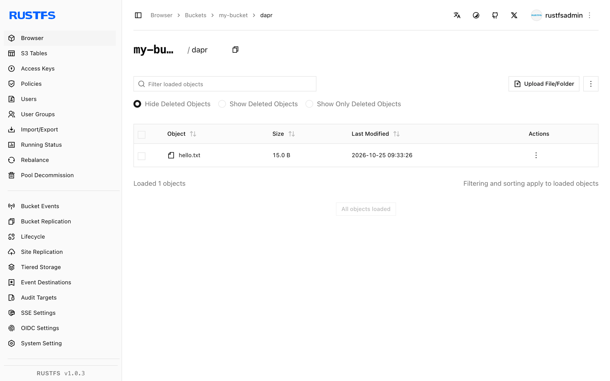

In dieser Anleitung verbinden Sie [Dapr](https://github.com/dapr/dapr) — die CNCF-portable Runtime für verteilte Anwendungen — über sein AWS-S3-Binding mit **RustFS**. Sie deklarieren eine Binding-Komponente mit einem RustFS-Bucket als Backend, starten einen Sidecar und nutzen die HTTP-API des Bindings, um ein Objekt zu erzeugen, zurückzulesen und unabhängig zu bestätigen. Der Ablauf wurde mit `daprio/dapr:1.19.0` gegen einen RustFS-Bucket mit Path-Style-Adressierung verifiziert.

Sie benötigen Docker. Dieses Setup ist für lokale Integrationstests gedacht, nicht für den Produktivbetrieb.

## Architektur


Anwendungen halten keine S3-Zugangsdaten oder Endpunkte. Der Sidecar stellt den Bucket als benanntes Binding bereit, und jede Operation ist ein POST an den Binding-Endpunkt mit einer `operation` und optionalen `metadata`.

## 1. Binding-Komponente deklarieren

Erstellen Sie die Komponentendatei. Der `endpoint` enthält das Schema, und `forcePathStyle` entspricht der Path-Style-Adressierung von RustFS:

```yaml title="rustfs-s3.yaml"
apiVersion: dapr.io/v1alpha1
kind: Component
metadata:
  name: rustfs-s3
spec:
  type: bindings.aws.s3
  version: v1
  metadata:
  - name: bucket
    value: my-bucket
  - name: endpoint
    value: http://<your-rustfs-endpoint>:9000
  - name: accessKey
    value: <your-access-key>
  - name: secretKey
    value: <your-secret-key>
  - name: region
    value: us-east-1
  - name: forcePathStyle
    value: "true"
```

## 2. Sidecar starten

Führen Sie `daprd` mit eingebundenem Komponentenverzeichnis aus. `--resources-path` ersetzt das veraltete `--components-path`:

```bash
docker run -d --name dapr \
  -v "$PWD:/components" \
  daprio/dapr:1.19.0 /daprd \
  --app-id s3demo \
  --dapr-http-port 3500 \
  --resources-path /components
```

Bestätigen Sie die Initialisierung des Bindings — das Log endet mit:

```bash
docker logs dapr 2>&1 | grep "successful init"
```

```text
successful init for output binding (rustfs-s3 (bindings.aws.s3/v1))
```

## 3. Objekt über das Binding erzeugen

Rufen Sie das Binding von einem beliebigen HTTP-Client auf, der den Sidecar erreicht. Die Metadaten `key` legen den Objektnamen fest:

```bash
curl -s -X POST http://localhost:3500/v1.0/bindings/rustfs-s3 \
  -H "Content-Type: application/json" \
  -d '{"operation":"create","data":"hello from dapr","metadata":{"key":"dapr/hello.txt"}}'
```

```json
{"location":"http://<your-rustfs-endpoint>:9000/my-bucket/dapr/hello.txt","versionID":null}
```

## 4. Objekt zurücklesen

Die Operation `get` liefert den Objektinhalt im Antwortkörper:

```bash
curl -s -X POST http://localhost:3500/v1.0/bindings/rustfs-s3 \
  -H "Content-Type: application/json" \
  -d '{"operation":"get","metadata":{"key":"dapr/hello.txt"}}'
```

```text
hello from dapr
```

Bestätigen Sie dasselbe Objekt mit einem unabhängigen Client:

```bash
aws s3 cp s3://my-bucket/dapr/hello.txt - \
  --endpoint-url http://<your-rustfs-endpoint>:9000
```

```text
hello from dapr
```



## 5. Anhalten oder Zurücksetzen

Sidecar abreißen und die Bucket-Objekte behalten:

```bash
docker rm -f dapr
```

Demo-Objekt löschen:

```bash
aws s3 rm s3://my-bucket/dapr/hello.txt \
  --endpoint-url http://<your-rustfs-endpoint>:9000
```

## Fehlerbehebung

### Binding schlägt beim Initialisieren mit einem S3-Fehler fehl

Prüfen Sie die vier Adressierungswerte gemeinsam: `endpoint` muss das Schema enthalten, `region` ist auch für Nicht-AWS-Endpunkte Pflicht, und `forcePathStyle` muss `"true"` sein. Ohne `forcePathStyle` sendet Dapr virtual-hosted-Anfragen, die RustFS ablehnt.

### `no such binding` beim Aufruf

Der Sidecar hat die Komponente nicht geladen — prüfen Sie, dass die Datei auf `.yaml` endet, im an `--resources-path` übergebenen Verzeichnis liegt und die Init-Zeile aus Schritt 2 im Log erscheint.

### `get` liefert leeren Inhalt

Der `metadata.key` stimmt nicht mit dem beim Erzeugen verwendeten Key überein. Keys sind case-sensitiv und enthalten das Präfix.

## Nächste Schritte

- Lesen Sie vor den Operationen `list`, `delete` oder `presign` die [S3-Kompatibilitätshinweise](/administration/protocols/s3).
- Erstellen Sie dedizierte Produktionszugangsdaten mit [Zugangsdatenverwaltung](/security-compliance/iam/access-token) und referenzieren Sie sie über einen Dapr-Secret-Store statt Klartextwerten in der Komponente.
- Folgen Sie der [Dapr-S3-Binding-Dokumentation](https://docs.dapr.io/reference/components-reference/supported-bindings/s3/) für den vollen Operationssatz und das Retry-Verhalten.
