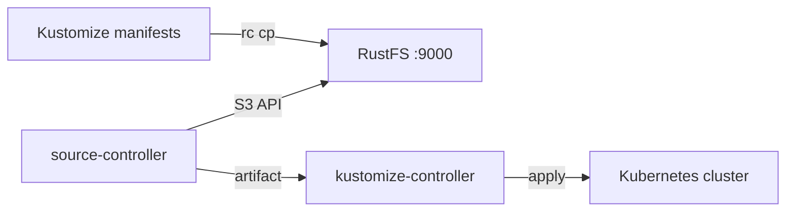

In dieser Anleitung verbinden Sie [Flux CD](https://github.com/fluxcd/flux2) — das GitOps-Toolkit für Kubernetes — über die Bucket-API des Source-Controllers mit **RustFS**. Sie befüllen einen RustFS-Bucket mit Kubernetes-Manifesten, registrieren den Bucket als Flux-Quelle `Bucket` mit dem Provider `generic` und lassen eine Kustomization alles anwenden, was er enthält. Der Ablauf wurde mit `flux v2.9.5` (source-controller) auf `k3s v1.36.4+k3s1` gegen `rustfs/rustfs-x86-musl:v2.3.1` verifiziert.

Sie benötigen einen Kubernetes-Cluster mit installiertem Flux (`flux install`) und den Client `rc`. Diese Bereitstellung ist für lokale Integrationstests gedacht, nicht für den Produktivbetrieb.

## Architektur



Der Source-Controller listet Objekte aus dem Bucket über die S3-API und lädt sie herunter, packt sie in ein Artefakt, und der Kustomize-Controller wendet die Manifeste aus diesem Artefakt an. RustFS dient als pull-basierte Quelle der Wahrheit für den Cluster.

## 1. Den Bucket befüllen

Speichern Sie ein Kustomize-Overlay im Bucket und ersetzen Sie alle Verbindungsplatzhalter:

```yaml title="clusters/staging/kustomization.yaml"
apiVersion: kustomize.config.k8s.io/v1beta1
kind: Kustomization
resources:
  - rustfs-demo-configmap.yaml
```

```yaml title="clusters/staging/rustfs-demo-configmap.yaml"
apiVersion: v1
kind: ConfigMap
metadata:
  name: rustfs-flux-demo
  namespace: default
data:
  storage: rustfs
  source: s3-bucket
```

Laden Sie die Dateien hoch:

```bash
rc mb rustfs/flux-src
rc cp --recursive ./clusters rustfs/flux-src/
rc ls rustfs/flux-src/ -r
```

```text
staging/kustomization.yaml
staging/rustfs-demo-configmap.yaml
```

## 2. Das Zugangsdaten-Secret anlegen

Flux liest die Zugangsdaten aus einem Secret im selben Namespace wie die Quelle und verwendet kleingeschriebene Schlüssel:

```bash
kubectl -n flux-system create secret generic rustfs-creds \
  --from-literal=accesskey=<your-access-key> \
  --from-literal=secretkey=<your-secret-key>
```

Die Feldnamen müssen `accesskey` und `secretkey` lauten. Eine Schreibweise wie `accessKey` schlägt mit dem Status `AuthenticationFailed` fehl.

## 3. Die Bucket-Quelle registrieren

Legen Sie die Bucket-Quelle mit dem Provider `generic` an:

```bash
flux create source bucket rustfs-demo \
  --bucket-name=flux-src \
  --endpoint=<your-rustfs-endpoint>:9000 \
  --insecure \
  --secret-ref=rustfs-creds \
  --provider=generic \
  --interval=30s \
  --namespace=flux-system
```

```text
✔ Bucket source reconciliation completed
```

Wenn die Reconciliation noch läuft, prüfen Sie den Status mit `flux get sources bucket`:

```text
NAME        REVISION       SUSPENDED READY MESSAGE
rustfs-demo sha256:481816d1 False     True  stored artifact: revision 'sha256:481816d1'
```

Der Provider `generic` verwendet Anfragen mit pfadbasierter Adressierung (Path-Style) und unverschlüsseltes HTTP mit `--insecure`, daher ist der Endpunkt die reine Form `host:port`.

## 4. Die Manifeste anwenden

Legen Sie eine Kustomization an, die das Artefakt verwendet:

```bash
flux create kustomization rustfs-demo \
  --source=Bucket/rustfs-demo \
  --path="./staging" \
  --prune=true \
  --interval=30s \
  --namespace=flux-system
```

```text
✔ applied revision sha256:481816d1
```

Bestätigen Sie, dass das Manifest im Cluster angekommen ist:

```bash
kubectl -n default get configmap rustfs-flux-demo -o jsonpath="{.data}"
```

```text
{"source":"s3-bucket","storage":"rustfs"}
```

## 5. Stoppen oder zurücksetzen

Setzen Sie die Flux-Ressourcen aus oder löschen Sie sie, ohne den Bucket anzufassen:

```bash
flux suspend source bucket rustfs-demo --namespace=flux-system
flux delete kustomization rustfs-demo --namespace=flux-system
```

Um den Bucket-Inhalt zu löschen:

```bash
rc rm rustfs/flux-src/ --recursive --force
```

## Fehlerbehebung

### `invalid 'rustfs-creds' secret data: required fields 'accesskey' and 'secretkey'`

Die Secret-Schlüssel sind kleingeschrieben. Legen Sie das Secret mit `accesskey` und `secretkey` als literalen Schlüsselnamen neu an.

### Die Reconciliation wird nie bereit

Prüfen Sie, dass der Endpunkt aus dem Cluster heraus erreichbar ist. Pods können `localhost` nicht verwenden, richten Sie die Quelle daher auf die Host-IP oder das Docker-Bridge-Gateway (häufig `172.17.0.1`), das den RustFS-Port veröffentlicht. `--insecure` ist für unverschlüsseltes HTTP erforderlich.

### `AuthenticationFailed` trotz gültiger Zugangsdaten

Prüfen Sie, dass das Secret im selben Namespace wie die Bucket-Quelle liegt und dass die Schlüssel kein nachgestelltes Leerzeichen und keine zusätzlichen Anführungszeichen enthalten.

## Nächste Schritte

- Lesen Sie die [S3-Kompatibilitätshinweise](/de/administration/protocols/s3), bevor Sie weitere Quelltypen einsetzen.
- Erstellen Sie dedizierte Produktions-Zugangsdaten über die [Zugriffsschlüssel-Verwaltung](/de/security-compliance/iam/access-token).
- Folgen Sie der [Flux-Dokumentation zur Bucket-Quelle](https://fluxcd.io/flux/components/source/buckets/), um Bucket-Quellen mit Helm-Releases und Image-Automation zu kombinieren.
