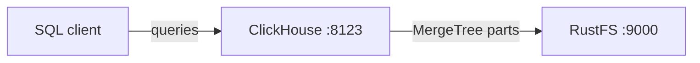

In dieser Anleitung verbinden Sie [ClickHouse](https://github.com/ClickHouse/ClickHouse) — die OLAP-Datenbank für Echtzeitanalysen — über die Speicher-Policy der S3-Disk von ClickHouse mit **RustFS**. Sie starten einen ClickHouse-Server mit Docker, legen eine MergeTree-Tabelle an, die ihre Parts auf RustFS speichert, fügen Zeilen ein und prüfen, dass die Tabellendaten im Bucket liegen. Der Ablauf wurde mit `clickhouse/clickhouse-server:25.8` und `rustfs/rustfs-x86-musl:v2.3.1` verifiziert.

Sie benötigen Docker. Diese Bereitstellung ist für lokale Integrationstests gedacht, nicht für den Produktivbetrieb.

## Architektur



Die Disk `rustfs` ist eine ClickHouse-S3-Disk, die auf den Bucket `clickhouse-data` zeigt. Tabellen mit der passenden Speicher-Policy schreiben ihre Parts — Daten-, Index- und Prüfsummendateien — in den Bucket statt auf das lokale Dateisystem.

## 1. Projektdateien anlegen

Legen Sie zuerst den Bucket an. ClickHouse legt keine Buckets an:

```bash
rc alias set rustfs http://<your-rustfs-endpoint>:9000 <your-access-key> <your-secret-key>
rc mb rustfs/clickhouse-data
```

Legen Sie die Speicherkonfiguration an und ersetzen Sie beide Platzhalter für die Zugangsdaten:

```xml title="storage.xml"
<clickhouse>
  <storage_configuration>
    <disks>
      <rustfs>
        <type>s3</type>
        <endpoint>http://rustfs:9000/clickhouse-data/</endpoint>
        <access_key_id><your-access-key></access_key_id>
        <secret_access_key><your-secret-key></secret_access_key>
      </rustfs>
    </disks>
    <policies>
      <rustfs_policy>
        <volumes>
          <main>
            <disk>rustfs</disk>
          </main>
        </volumes>
      </rustfs_policy>
    </policies>
  </storage_configuration>
</clickhouse>
```

Der Endpunkt muss mit `/` enden und enthält den Bucket-Namen als erstes Pfadsegment. Innerhalb des Compose-Netzwerks lautet der Hostname `rustfs`. Vom Host aus verwenden Sie `http://localhost:9000/clickhouse-data/`.

Starten Sie ClickHouse mit eingehängter Konfiguration:

```bash
docker run -d --name clickhouse --network oo-rustfs_default \
  -p 8123:8123 \
  -e CLICKHOUSE_PASSWORD=<your-clickhouse-password> \
  -v "$PWD/storage.xml":/etc/clickhouse-server/config.d/storage.xml:ro \
  clickhouse/clickhouse-server:25.8
```

## 2. Eine Tabelle auf der S3-Disk anlegen

Warten Sie auf die HTTP-Schnittstelle und legen Sie dann eine Datenbank und eine MergeTree-Tabelle mit der Speicher-Policy an:

```bash
curl "http://localhost:8123/?password=<your-clickhouse-password>" \
  --data-binary "CREATE DATABASE rustfs_demo"

curl "http://localhost:8123/?password=<your-clickhouse-password>" \
  --data-binary "CREATE TABLE rustfs_demo.events
    (id UInt32, name String)
    ENGINE = MergeTree ORDER BY id
    SETTINGS storage_policy = 'rustfs_policy'"

curl "http://localhost:8123/?password=<your-clickhouse-password>" \
  --data-binary "INSERT INTO rustfs_demo.events
    VALUES (1, 'clickhouse-on-rustfs'), (2, 'second')"
```

Lesen Sie die Zeilen zurück und bestätigen Sie, dass ClickHouse den Part auf der Disk `rustfs` meldet:

```bash
curl "http://localhost:8123/?password=<your-clickhouse-password>" \
  --data-binary "SELECT count(), any(name) FROM rustfs_demo.events"

curl "http://localhost:8123/?password=<your-clickhouse-password>" \
  --data-binary "SELECT name, disk_name FROM system.parts
    WHERE database = 'rustfs_demo' AND active"
```

```text
2  clickhouse-on-rustfs
all_1_1_0  rustfs
```

## 3. Objekte in RustFS prüfen

Listen Sie den Bucket auf:

```bash
rc ls rustfs/clickhouse-data/ -r
```

ClickHouse schreibt jeden Part als inhaltsadressierte Blobs. Die Ausgabe enthält mehrere kleine Objekte, und die Anzahl wächst, wenn weitere Parts geschrieben werden:

```text
dtg/hpsyncexixvdnsgorvseobogcgowg
dzp/zfblobhsatzdveqdrsfqcupkdehja
izg/gvhchqobrizpkdftuvlmakkoutwps
```


Die Daten überstehen einen Container-Neustart, weil die Parts in RustFS liegen:

```bash
docker restart clickhouse
curl "http://localhost:8123/?password=<your-clickhouse-password>" \
  --data-binary "SELECT count() FROM rustfs_demo.events"
```

## 4. Die Bereitstellung stoppen oder zurücksetzen

Stoppen Sie den Server und behalten Sie die Daten:

```bash
docker rm -f clickhouse
```

Die Parts bleiben im Bucket `clickhouse-data`, und die Tabelle lässt sich nach dem nächsten Start erneut abfragen. Um die Daten zu löschen, entfernen Sie den Bucket:

```bash
rc rb rustfs/clickhouse-data --force
```

## Fehlerbehebung

### `REQUIRED_PASSWORD` bei jeder Abfrage

Images von ClickHouse 25.8 verlangen ein Passwort für den Benutzer `default`. Setzen Sie `CLICKHOUSE_PASSWORD` am Container und übergeben Sie denselben Wert als Abfrageparameter `password`, wie oben gezeigt.

### Das Anlegen der Tabelle schlägt mit einem Disk- oder Endpunktfehler fehl

Prüfen Sie, dass der Bucket existiert, bevor die Tabelle angelegt wird, dass der Endpunkt mit `/` endet und dass die Zugangsdaten zur RustFS-Bereitstellung passen. Prüfen Sie das Server-Log auf den zugrunde liegenden S3-Fehler:

```bash
docker logs clickhouse | grep -i s3 | tail
```

## Nächste Schritte

- Lesen Sie die [S3-Kompatibilitätshinweise](/de/administration/protocols/s3), bevor Sie weitere ClickHouse-Operationen einsetzen.
- Erstellen Sie dedizierte Produktions-Zugangsdaten über die [Zugriffsschlüssel-Verwaltung](/de/security-compliance/iam/access-token).
- Folgen Sie der [ClickHouse-Dokumentation zur S3-Disk](https://clickhouse.com/docs/engines/table-engines/mergetree-family/mergetree#table_engine-mergetree-s3), um eine Cache-Disk oder eine Policy für gestufte Speicherung mit heißer und kalter Stufe hinzuzufügen.
