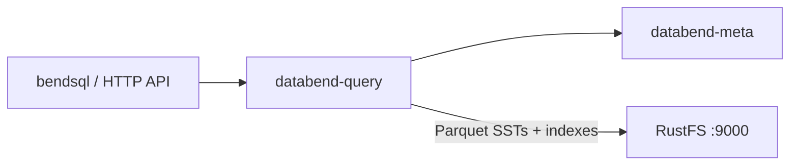
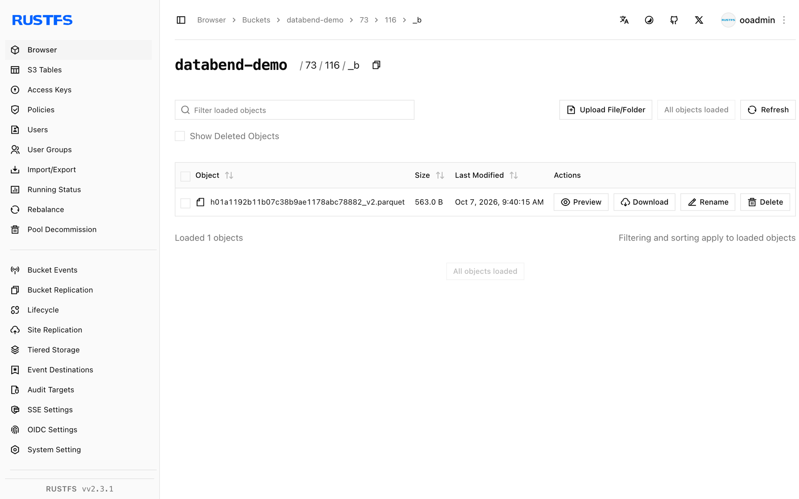

In dieser Anleitung verbinden Sie [Databend](https://github.com/datafuselabs/databend) — das quelloffene Cloud-Data-Warehouse — mit **RustFS** als Objektspeicher-Backend. Sie starten den Meta-Dienst und den Query-Knoten, richten das Speicher-Backend auf einen RustFS-Bucket aus, legen eine Datenbank und eine Tabelle an und prüfen die Parquet-Dateien im Bucket. Der Ablauf wurde mit Databend v1.2.925-patch-13 gegen `rustfs/rustfs-x86-musl:v2.3.1` verifiziert.

Sie benötigen das Release-Tarball von Databend auf einem Linux-Host (oder Docker). Diese Bereitstellung ist für lokale Integrationstests gedacht, nicht für den Produktivbetrieb.

## Architektur



Databend speichert Tabellendaten als Parquet-Dateien mit Bloom-Filter-Indizes im Objektspeicher. Der Bucket enthält damit den gesamten Tabellendatensatz, und der Query-Knoten bleibt zustandslos.

## 1. Herunterladen und installieren

Laden Sie ein Release-Tarball herunter und entpacken Sie die Binärdateien:

```bash
curl -Lo /tmp/databend.tgz \
  "https://github.com/datafuselabs/databend/releases/download/v1.2.925-patch-13/databend-v1.2.925-patch-13-x86_64-unknown-linux-gnu.tar.gz"
tar -xzf /tmp/databend.tgz -C /opt
```

Legen Sie die Datenverzeichnisse an:

```bash
mkdir -p /opt/databend/data /opt/databend/logs /opt/databend/meta-logs
```

## 2. Den Meta-Dienst konfigurieren

Legen Sie `databend-meta.toml` an. Beachten Sie die Adressen auf oberster Ebene und den Abschnitt `[raft_config]` mit `single = true`:

```toml title="databend-meta.toml"
admin_api_address = "0.0.0.0:28002"
grpc_api_address = "0.0.0.0:9191"
grpc_api_advertise_host = "127.0.0.1"

[log]
[log.file]
level = "INFO"
dir = "/opt/databend/meta-logs"

[raft_config]
id = 0
raft_dir = "/opt/databend/data/raft"
raft_api_port = 28004
raft_listen_host = "127.0.0.1"
raft_advertise_host = "127.0.0.1"
single = true
```

## 3. Den Query-Knoten konfigurieren

Legen Sie `databend-query.toml` an. Die Schlüssel `tenant_id` und `cluster_id` müssen im Abschnitt `[query]` stehen, und `[storage.s3]` zeigt auf RustFS:

```toml title="databend-query.toml"
[query]
username = "databend"
tenant_id = "default"
cluster_id = "rustfs-demo"
flight_api_address = "127.0.0.1:9091"
metric_api_address = "127.0.0.1:7071"
admin_api_address = "127.0.0.1:8081"

[[query.users]]
name = "databend"
auth_type = "no_password"

[log]
[log.file]
dir = "/opt/databend/logs"

[meta]
endpoints = ["127.0.0.1:9191"]
username = "root"
password = "root"
client_timeout_in_second = 20
auto_sync_interval = 60

[storage]
type = "s3"

[storage.s3]
bucket = "databend-demo"
endpoint_url = "http://<your-rustfs-endpoint>:9000"
access_key_id = "<your-access-key>"
secret_access_key = "<your-secret-key>"
enable_virtual_host_style = false
```

Belassen Sie alle Schlüssel vor dem Array-Eintrag `[[query.users]]`. TOML behandelt alles danach als Teil dieses Array-Elements, und falsch platzierte Schlüssel scheitern bei der Validierung mit irreführenden Fehlern.

## 4. Die Dienste starten

```bash
nohup /opt/databend/bin/databend-meta -c /opt/databend/databend-meta.toml > /opt/databend/meta.out 2>&1 &
sleep 10
nohup /opt/databend/bin/databend-query -c /opt/databend/databend-query.toml > /opt/databend/query.out 2>&1 &
sleep 20
```

## 5. Eine Tabelle anlegen und abfragen

Databend stellt eine HTTP-API auf Port 8000 bereit. Legen Sie eine Datenbank und eine Tabelle an, fügen Sie Zeilen ein und lesen Sie sie zurück. Anführungszeichen innerhalb von SQL müssen einfache Anführungszeichen sein. Doppelte Anführungszeichen bedeuten Bezeichner:

```bash
curl -s -m 90 -u databend: http://127.0.0.1:8000/v1/query \
  -H "Content-Type: application/json" \
  -d '{"sql": "CREATE DATABASE rustfs_demo; CREATE TABLE rustfs_demo.events (id INT, label STRING);"}' | head -c 120

curl -s -m 120 -u databend: http://127.0.0.1:8000/v1/query \
  -H "Content-Type: application/json" \
  -d "{\"sql\": \"INSERT INTO rustfs_demo.events VALUES (1,'alpha'),(2,'beta'),(3,'gamma')\"}" | head -c 120

curl -s -m 120 -u databend: http://127.0.0.1:8000/v1/query \
  -H "Content-Type: application/json" \
  -d "{\"sql\": \"SELECT * FROM rustfs_demo.events ORDER BY id\"}" | head -c 300
```

```text
{"id":"...","state":"Succeeded",...,"data":[["1","alpha"],["2","beta"],["3","gamma"]],...}
```

## 6. Objekte in RustFS prüfen

Listen Sie den Bucket auf. Die Tabelle liegt als Parquet-Blöcke mit Indexdateien unter numerischen Präfixen:

```bash
rc ls rustfs/databend-demo/ -r | head -4
```

```text
73/116/_b/h01a1192b11b07c38b9ae1178abc78882_v2.parquet
73/116/_i_b_v2/01a1192b11b07c38b9ae1178abc78882_v4.parquet
```



## 7. Stoppen oder zurücksetzen

```bash
pkill -f databend-query; pkill -f databend-meta
rc rm rustfs/databend-demo/ --recursive --force
```

## Fehlerbehebung

### `cluster_id is empty without resources management`

`tenant_id` und `cluster_id` standen außerhalb des Abschnitts `[query]`. In TOML gehört jeder Schlüssel zum letzten Abschnittskopf. Verschieben Sie sie zurück unter `[query]`.

### `CannotListenerPort ... 127.0.0.1:9090`

Die Flight-API verwendet standardmäßig 9090, das andere lokale Dienste oft belegen. Setzen Sie `flight_api_address`, `metric_api_address` und `admin_api_address` innerhalb von `[query]` auf freie Ports.

### Die Abfrage liefert `Authentication error: no authorization header provided`

Die HTTP-API verlangt Basic Auth passend zum Eintrag `[[query.users]]`, zum Beispiel `-u databend:` bei `auth_type = "no_password"`.

### `Unknown table` direkt nach erfolgreichem CREATE

Doppelt zitierte Zeichenketten in SQL sind Bezeichner, keine Literale. Verwenden Sie einfache Anführungszeichen für VALUES und für die Optionen CONNECTION und LOCATION.

## Nächste Schritte

- Lesen Sie die [S3-Kompatibilitätshinweise](/de/administration/protocols/s3), bevor Sie weitere Databend-Speicheroptionen einsetzen.
- Erstellen Sie dedizierte Produktions-Zugangsdaten über die [Zugriffsschlüssel-Verwaltung](/de/security-compliance/iam/access-token).
- Folgen Sie der [Databend-Dokumentation](https://docs.databend.com/) für Cluster mit mehreren Knoten und Share-Tabellen auf demselben Bucket.
