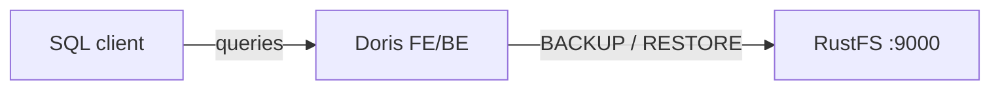

In dieser Anleitung verbinden Sie [Apache Doris](https://github.com/apache/doris) — das analytische Data Warehouse für Echtzeit — über ein S3-Backup-Repository mit **RustFS**. Sie starten einen All-in-one-Container von Doris, legen ein S3-Repository an, das auf einen RustFS-Bucket zeigt, sichern eine Tabelle, löschen sie und stellen sie aus RustFS wieder her. Der Ablauf wurde mit `apache/doris:all-in-one-4.1.3` und `rustfs/rustfs-x86-musl:v2.3.1` verifiziert.

Sie benötigen Docker. Diese Bereitstellung ist für lokale Integrationstests gedacht, nicht für den Produktivbetrieb.

## Architektur



Das Repository ist ein benannter S3-Speicherort unter dem Bucket `doris-backups`. `BACKUP SNAPSHOT` lädt Tabellenmetadaten und Tablet-Datendateien hoch. `RESTORE SNAPSHOT` lädt sie in eine neue Tabelle herunter.

## 1. Doris starten und das Repository anlegen

Legen Sie zuerst den Bucket an. Doris legt keine Buckets an:

```bash
rc alias set rustfs http://<your-rustfs-endpoint>:9000 <your-access-key> <your-secret-key>
rc mb rustfs/doris-backups
```

Starten Sie den All-in-one-Container im selben Docker-Netzwerk wie RustFS:

```bash
docker run -d --name doris --network oo-rustfs_default \
  -p 8030:8030 -p 9030:9030 apache/doris:all-in-one-4.1.3
```

Warten Sie, bis das Frontend gesund ist, und verbinden Sie sich dann über das MySQL-Protokoll (Port 9030, Benutzer `root`, im All-in-one-Image ohne Passwort).

Legen Sie eine Testtabelle mit Zeilen an:

```sql
CREATE DATABASE rustfs_demo;
CREATE TABLE rustfs_demo.events
  (id INT, name VARCHAR(50))
  DISTRIBUTED BY HASH(id) BUCKETS 1
  PROPERTIES ("replication_num" = "1");
INSERT INTO rustfs_demo.events VALUES (1, 'doris-on-rustfs'), (2, 'backup-test');
```

Legen Sie das S3-Repository an, ersetzen Sie den Endpunkt durch die IP-Adresse des RustFS-Containers und beide Platzhalter für die Zugangsdaten:

```sql
CREATE REPOSITORY `rustfs_repo`
  WITH S3
  ON LOCATION "s3://doris-backups/rustfs-repo"
  PROPERTIES (
    "AWS_ENDPOINT" = "http://<rustfs-container-ip>:9000",
    "AWS_ACCESS_KEY" = "<your-access-key>",
    "AWS_SECRET_KEY" = "<your-secret-key>",
    "AWS_REGION" = "us-east-1",
    "AWS_PATH_STYLE_ACCESS" = "true"
  );
```

Doris 4.1 setzt den Bucket auch bei aktiviertem `AWS_PATH_STYLE_ACCESS` in den Hostnamen des Endpunkts ein, daher scheitert ein Hostname-Endpunkt mit `UnknownHostException: doris-backups.rustfs`. Die IP-Adresse des Containers erzwingt Anfragen mit pfadbasierter Adressierung (Path-Style) und funktioniert. `SHOW REPOSITORIES` bestätigt, dass das Repository mit leerem `ErrMsg` registriert wurde.

## 2. Eine Tabelle nach RustFS sichern

Erstellen Sie einen Snapshot der Tabelle:

```sql
BACKUP SNAPSHOT rustfs_demo.demo_snapshot
  TO rustfs_repo
  ON (events);
```

Die Anweisung kehrt sofort zurück. Der Backup-Job läuft im Hintergrund. Beobachten Sie seinen Status:

```sql
SHOW BACKUP;
```

Warten Sie, bis `State` den Wert `FINISHED` erreicht. Die Snapshot-Metadaten und die Tablet-Datendateien sind dann Objekte im Bucket.

## 3. Das Backup in RustFS prüfen

Listen Sie den Bucket auf:

```bash
rc ls rustfs/doris-backups/ -r
```

Das Repository speichert einen Repository-Deskriptor, die Snapshot-Metadaten und die Tablet-Dateien:

```text
rustfs-repo/__palo_repository_rustfs_repo/__repo_info
rustfs-repo/__palo_repository_rustfs_repo/__ss_demo_snapshot/__meta.d50ecf9b...
rustfs-repo/__palo_repository_rustfs_repo/__ss_demo_snapshot/__ss_content/.../...dat...
```


## 4. Die Tabelle aus RustFS wiederherstellen

Löschen Sie die Tabelle und stellen Sie sie aus dem Snapshot wieder her. Der Zeitstempel stammt aus dem Snapshot-Namen, den `SHOW SNAPSHOT ON REPOSITORY rustfs_repo;` anzeigt:

```sql
DROP TABLE rustfs_demo.events;

RESTORE SNAPSHOT rustfs_demo.demo_snapshot
  FROM rustfs_repo
  ON (events)
  PROPERTIES (
    "backup_timestamp" = "2026-09-21-16-35-12",
    "replication_num" = "1"
  );
```

Warten Sie, bis der Restore-Job abgeschlossen ist, und bestätigen Sie die Daten:

```sql
SHOW RESTORE;
SELECT count(*) FROM rustfs_demo.events;
```

```text
2
```

## 5. Die Bereitstellung stoppen oder zurücksetzen

Stoppen Sie Doris und behalten Sie die Daten:

```bash
docker rm -f doris
```

Das Backup bleibt im Bucket `doris-backups` und lässt sich in jedem Doris-Cluster wiederherstellen, der dasselbe Repository registriert. Um es zu löschen, entfernen Sie den Bucket:

```bash
rc rb rustfs/doris-backups --force
```

## Fehlerbehebung

### `UnknownHostException: doris-backups.rustfs` beim Anlegen des Repositorys

Doris baut aus Bucket und Endpunkt einen Hostnamen für die Adressierung im Virtual-Hosted-Stil. Verwenden Sie die IP-Adresse des RustFS-Containers in `AWS_ENDPOINT` zusammen mit `AWS_PATH_STYLE_ACCESS = "true"`, wie oben gezeigt.

### Das Backup bleibt lange in `SNAPSHOTING`

Das Backend lädt die Tablet-Dateien hoch. Prüfen Sie, dass das Backend gesund ist (`SHOW BACKENDS;`) und den Endpunkt erreichen kann. Das All-in-one-Image braucht nach dem Start ein bis zwei Minuten, bis beide Prozesse Bereitschaft melden.

### `Failed to create repository: ... file status`

Der Bucket existiert nicht oder die Zugangsdaten sind falsch. Legen Sie `doris-backups` mit `rc mb` an und prüfen Sie das Zugriffsschlüssel-Paar erneut.

## Nächste Schritte

- Lesen Sie die [S3-Kompatibilitätshinweise](/de/administration/protocols/s3), bevor Sie weitere Doris-Operationen einsetzen.
- Erstellen Sie dedizierte Produktions-Zugangsdaten über die [Zugriffsschlüssel-Verwaltung](/de/security-compliance/iam/access-token).
- Folgen Sie der [Doris-Dokumentation zu Backup und Restore](https://doris.apache.org/docs/data-operate/backup-restore/), um periodische Snapshots zu planen.
