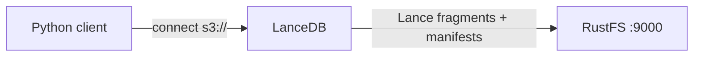

In dieser Anleitung verbinden Sie [LanceDB](https://github.com/lancedb/lancedb) — die quelloffene Vektordatenbank auf dem spaltenorientierten Format Lance — mit **RustFS** als Speicher-Backend. Sie legen eine Vektortabelle direkt an einem Speicherort `s3://` an, fügen Zeilen hinzu, führen eine Vektorsuche aus und prüfen die Lance-Tabellendateien im Bucket. Der Ablauf wurde mit dem Python-Paket `lancedb` gegen `rustfs/rustfs-x86-musl:v2.3.1` verifiziert.

Sie benötigen Python 3.9 oder neuer. Diese Bereitstellung ist für lokale Integrationstests gedacht, nicht für den Produktivbetrieb.

## Architektur



LanceDB ist eingebettet: es gibt keinen Server, den Sie starten müssten. Der Client in Python, Rust oder JavaScript spricht den Bucket direkt an und speichert jede Tabelle als Verzeichnis `*.lance` mit Datenfragmenten, Versionsmanifesten und Transaktionsprotokollen.

## 1. Den Client installieren

```bash
pip install lancedb
```

## 2. Eine Tabelle auf RustFS anlegen

Verbinden Sie sich direkt mit dem Bucket und legen Sie eine Tabelle an. Ersetzen Sie alle Verbindungsplatzhalter. Die Schlüssel in `storage_options` folgen den Object-Store-Konventionen von Lance. Eigene Endpunkte verwenden pfadbasierte Adressierung (Path-Style):

```python title="lance_s3.py"
import lancedb

storage_options = {
    "endpoint": "http://<your-rustfs-endpoint>:9000",
    "access_key_id": "<your-access-key>",
    "secret_access_key": "<your-secret-key>",
    "region": "us-east-1",
    "allow_http": "true",
}

db = lancedb.connect("s3://<your-bucket>/tables", storage_options=storage_options)

rows = [{"id": i, "label": f"row-{i}", "vector": [float(i) / 10, 0.5, 0.25, 0.1] * 2}
        for i in range(5)]
table = db.create_table("events", data=rows)
print("created:", table.count_rows(), "rows")

table.add([{"id": 99, "label": "query-target", "vector": [0.9, 0.5, 0.25, 0.1] * 2}])
print("after add:", table.count_rows(), "rows")
```

```text
created: 5 rows
after add: 6 rows
```

Die Tabellen-URI verwendet die Form `s3://bucket/prefix`. Jeder Schreib- und Lesevorgang geht über die S3-API nach RustFS.

## 3. Eine Vektorsuche ausführen

```python title="lance_search.py"
import lancedb

db = lancedb.connect("s3://<your-bucket>/tables", storage_options=storage_options)
table = db.open_table("events")

res = table.search([0.9, 0.5, 0.25, 0.1] * 2).limit(3).to_list()
print("top3:", [(r["id"], r["label"]) for r in res])
print("version:", table.version)
```

```text
top3: [(99, 'query-target'), (4, 'row-4'), (3, 'row-3')]
version: 2
```

Der nächste Nachbar ist die Zeile aus dem vorherigen Schritt, und der Versionszähler spiegelt die beiden Commits (Anlegen und Hinzufügen).

## 4. Objekte in RustFS prüfen

Listen Sie das Tabellenpräfix auf:

```bash
rc ls rustfs/<your-bucket>/ -r
```

Jede Tabelle ist ein Verzeichnis `.lance` mit Datenfragmenten, Versionsmanifesten und Transaktionsdatensätzen:

```text
tables/events.lance/_transactions/0-b93cf795-fc3d-4bc9-88c8-e37baeefdd46.txn
tables/events.lance/_versions/18446744073709551613.manifest
tables/events.lance/data/101101011110110010000100e7a149411b847dbad6ebc7d47e.lance
```

Mehrere Tabellen teilen sich den Bucket unter dem Präfix `tables/`, daher kann ein Bucket einen gesamten LanceDB-Workspace tragen.


## 5. Stoppen oder zurücksetzen

LanceDB hält keinen Serverzustand. So löschen Sie die Tabelle:

```bash
rc rm rustfs/<your-bucket>/tables/ --recursive --force
```

## Fehlerbehebung

### Verbindungs- oder Signaturfehler bei der ersten Verwendung

Prüfen Sie, dass `endpoint` das Schema enthält, dass `allow_http` für Endpunkte mit unverschlüsseltem HTTP auf `"true"` steht und dass der Bucket existiert. Der Wert `region` ist für den S3-Signer erforderlich, auch wenn RustFS ihn ignoriert.

### `Table not found` nach dem Anlegen

LanceDB listet das Bucket-Präfix auf, um Tabellen zu finden. Ein veralteter Client-Cache oder ein falsches Präfix `tables/` in der URI macht neue Tabellen unsichtbar. Verbinden Sie sich erneut mit derselben URI, die Sie beim Anlegen verwendet haben.

### Langsame Massenladungen über das Netzwerk

Lance schreibt ein Fragment je Commit. Fassen Sie bei großen Importen Zeilen in weniger Aufrufen von `table.add` zusammen. Jeder Aufruf erzeugt eine neue Datendatei im Bucket.

## Nächste Schritte

- Lesen Sie die [S3-Kompatibilitätshinweise](/de/administration/protocols/s3), bevor Sie weitere LanceDB-Speicheroptionen einsetzen.
- Erstellen Sie dedizierte Produktions-Zugangsdaten über die [Zugriffsschlüssel-Verwaltung](/de/security-compliance/iam/access-token).
- Folgen Sie der [LanceDB-Dokumentation](https://lancedb.github.io/lancedb/) für ANN-Indizes, hybride Suche und Bucket-Layouts für mehrere Tenants auf demselben Backend.
