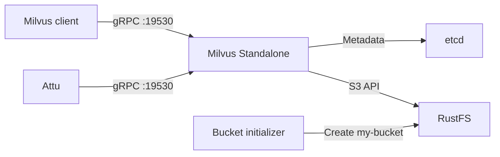

In dieser Anleitung betreiben Sie **Milvus Standalone** mit **RustFS** als S3-kompatiblem Objektspeicher-Backend. Sie starten Milvus, etcd, RustFS und Attu, fügen Beispielvektoren ein und prüfen, dass Milvus Objekte in RustFS persistiert.

Sie benötigen Docker mit dem Compose-Plugin und Python 3.9 oder neuer. Diese Bereitstellung ist für lokale Integrationstests gedacht, nicht für den Produktivbetrieb.

:::note[Namen der Milvus-Konfiguration]

Milvus fasst Einstellungen für S3-kompatiblen Speicher unter dem Konfigurationsschlüssel `minio` zusammen. Der Name verlangt keinen MinIO-Server. In dieser Anleitung zeigt `minio.address` auf den Dienst RustFS, und Milvus verwendet die von RustFS bereitgestellte S3-API.

:::

## Architektur



Milvus speichert Dienstmetadaten in etcd und persistiert Vektordaten, Indizes und zugehörige Objekte unter `s3://my-bucket/milvus` in RustFS. Das lokale Milvus-Volume bleibt für Laufzeitdaten und Caches erforderlich.

## 1. Projektdateien anlegen

Erstellen Sie ein Arbeitsverzeichnis:

```bash
mkdir rustfs-milvus
cd rustfs-milvus
```

Erstellen Sie eine Umgebungsdatei und ersetzen Sie beide Platzhalter für die Zugangsdaten:

```ini title=".env"
RUSTFS_ACCESS_KEY=<your-access-key>
RUSTFS_SECRET_KEY=<your-secret-key>
```

Verwenden Sie dedizierte Zugangsdaten für den Milvus-Bucket. Nehmen Sie `.env` nicht in die Versionsverwaltung auf.

Legen Sie die Speicherüberschreibung für Milvus an:

```yaml title="user.yaml"
common:
  storageType: remote

minio:
  address: rustfs:9000
  port: 9000
  bucketName: my-bucket
  rootPath: milvus
  useSSL: false
  useIAM: false
  cloudProvider: aws
  region: us-east-1
  useVirtualHost: false
```

`useVirtualHost: false` wählt S3-Anfragen mit pfadbasierter Adressierung (Path-Style). Der Hostname `rustfs` wird innerhalb des Compose-Netzwerks aufgelöst. Clients auf dem Host verwenden `http://localhost:9000`.

Legen Sie die Compose-Datei an:

```yaml title="compose.yaml"
services:
  etcd:
    image: quay.io/coreos/etcd:v3.5.18
    environment:
      ETCD_AUTO_COMPACTION_MODE: revision
      ETCD_AUTO_COMPACTION_RETENTION: "1000"
      ETCD_QUOTA_BACKEND_BYTES: "4294967296"
      ETCD_SNAPSHOT_COUNT: "50000"
    command:
      - etcd
      - --advertise-client-urls=http://etcd:2379
      - --listen-client-urls=http://0.0.0.0:2379
      - --data-dir=/etcd
    volumes:
      - etcd-data:/etcd
    healthcheck:
      test: ["CMD", "etcdctl", "endpoint", "health"]
      interval: 30s
      timeout: 20s
      retries: 3
    networks:
      - milvus

  rustfs:
    image: rustfs/rustfs:1.0.0-alpha.83
    environment:
      RUSTFS_ACCESS_KEY: ${RUSTFS_ACCESS_KEY}
      RUSTFS_SECRET_KEY: ${RUSTFS_SECRET_KEY}
      RUSTFS_VOLUMES: /data
      RUSTFS_ADDRESS: ":9000"
      RUSTFS_CONSOLE_ADDRESS: ":9001"
      RUSTFS_CONSOLE_ENABLE: "true"
      RUSTFS_OBS_LOGGER_LEVEL: error
      RUSTFS_OBS_LOG_DIRECTORY: /var/log/rustfs/
    volumes:
      - rustfs-data:/data
    ports:
      - "9000:9000"
      - "9001:9001"
    healthcheck:
      test: ["CMD-SHELL", "curl -fsS http://localhost:9000/health/ready"]
      interval: 10s
      timeout: 5s
      retries: 12
      start_period: 20s
    networks:
      - milvus

  create-bucket:
    image: rustfs/rc:latest
    depends_on:
      rustfs:
        condition: service_healthy
    environment:
      RUSTFS_ACCESS_KEY: ${RUSTFS_ACCESS_KEY}
      RUSTFS_SECRET_KEY: ${RUSTFS_SECRET_KEY}
    entrypoint:
      - /bin/sh
      - -c
      - |
        /usr/bin/rc alias set rustfs http://rustfs:9000 "$${RUSTFS_ACCESS_KEY}" "$${RUSTFS_SECRET_KEY}" \
          --region us-east-1 --bucket-lookup path
        /usr/bin/rc bucket create rustfs/my-bucket --ignore-existing
    networks:
      - milvus

  standalone:
    image: milvusdb/milvus:v2.6.0
    command: ["milvus", "run", "standalone"]
    security_opt:
      - seccomp:unconfined
    depends_on:
      etcd:
        condition: service_healthy
      create-bucket:
        condition: service_completed_successfully
    environment:
      ETCD_ENDPOINTS: etcd:2379
      MINIO_ADDRESS: rustfs:9000
      MINIO_ACCESS_KEY_ID: ${RUSTFS_ACCESS_KEY}
      MINIO_SECRET_ACCESS_KEY: ${RUSTFS_SECRET_KEY}
      MINIO_REGION: us-east-1
      MQ_TYPE: woodpecker
    volumes:
      - milvus-data:/var/lib/milvus
      - ./user.yaml:/milvus/configs/user.yaml:ro
    ports:
      - "19530:19530"
      - "9091:9091"
    healthcheck:
      test: ["CMD", "curl", "-f", "http://localhost:9091/healthz"]
      interval: 30s
      timeout: 20s
      retries: 3
      start_period: 90s
    networks:
      - milvus

  attu:
    image: zilliz/attu:v2.6.5
    depends_on:
      standalone:
        condition: service_healthy
    environment:
      MILVUS_URL: standalone:19530
    ports:
      - "8000:3000"
    networks:
      - milvus

networks:
  milvus:

volumes:
  etcd-data:
  rustfs-data:
  milvus-data:
```

Der Dienst `create-bucket` verwendet das offizielle Image [`rc`](https://github.com/rustfs/cli) und beendet sich, nachdem sichergestellt ist, dass `my-bucket` existiert. Benannte Volumes behalten etcd-Metadaten, RustFS-Objekte und lokale Milvus-Daten, wenn Container neu erstellt werden.

:::warning[Lokale Dienstports schützen]

Die Compose-Datei veröffentlicht die RustFS-API und die Console, die gRPC- und Integritätsports von Milvus sowie Attu auf dem Host für lokale Tests. Stellen Sie diese Ports keinem nicht vertrauenswürdigen Netzwerk bereit. Produktivbereitstellungen brauchen eingeschränkte Zugangsdaten, TLS, Authentifizierung, Ressourcenplanung, Sicherungen und unabhängig betriebene Abhängigkeiten.

:::

## 2. Die Bereitstellung prüfen und starten

Prüfen Sie die Compose-Datei, bevor Sie Container starten:

```bash
docker compose config
```

Starten Sie die Dienste:

```bash
docker compose up -d
docker compose ps -a
```

Der Dienst `create-bucket` sollte mit Code `0` enden, und `etcd`, `rustfs` sowie `standalone` sollten gesund werden. Prüfen Sie die Logs, wenn ein Dienst seinen erwarteten Zustand nicht erreicht:

```bash
docker compose logs create-bucket rustfs standalone
```

Öffnen Sie diese lokalen Oberflächen:

- RustFS-Console: `http://localhost:9001`
- Attu: `http://localhost:8000`
- Integritätsendpunkt von Milvus: `http://localhost:9091/healthz`

Attu verbindet sich über das Compose-Netzwerk mit `standalone:19530`. Wenn Attu nach einer Verbindungsadresse fragt, verwenden Sie diesen Dienstnamen statt `localhost:19530`.

## 3. Beispielvektoren einfügen und abfragen

Legen Sie eine Python-Virtualenv an und installieren Sie die Milvus-Client-Version, die zum Server-Release passt:

```bash
python3 -m venv .venv
source .venv/bin/activate
python -m pip install "pymilvus==2.6.0"
```

Legen Sie ein Testskript an:

```python title="verify_milvus.py"
from pymilvus import MilvusClient

client = MilvusClient(uri="http://localhost:19530")
collection_name = "rustfs_demo"

if client.has_collection(collection_name=collection_name):
    client.drop_collection(collection_name=collection_name)

client.create_collection(
    collection_name=collection_name,
    dimension=4,
)

client.insert(
    collection_name=collection_name,
    data=[
        {"id": 1, "vector": [0.1, 0.2, 0.3, 0.4]},
        {"id": 2, "vector": [0.2, 0.3, 0.4, 0.5]},
        {"id": 3, "vector": [0.9, 0.8, 0.7, 0.6]},
    ],
)

client.flush(collection_name=collection_name)
results = client.search(
    collection_name=collection_name,
    data=[[0.1, 0.2, 0.3, 0.4]],
    limit=2,
    output_fields=["id"],
)

print(results)
client.close()
```

Führen Sie das Skript aus:

```bash
python verify_milvus.py
```

Das Ergebnis sollte die Zeile mit der ID `1` zuerst einstufen. Öffnen Sie Attu und bestätigen Sie, dass die Collection `rustfs_demo` drei Entitäten enthält.

## 4. Milvus-Objekte in RustFS prüfen

Listen Sie mit dem Image der Bucket-Initialisierung die Objekte unter dem konfigurierten Wurzelpfad `milvus` auf:

```bash
docker compose run --rm --entrypoint /bin/sh create-bucket -c \
  '/usr/bin/rc alias set rustfs http://rustfs:9000 "$RUSTFS_ACCESS_KEY" "$RUSTFS_SECRET_KEY" --region us-east-1 --bucket-lookup path >/dev/null && /usr/bin/rc find rustfs/my-bucket/milvus'
```

Die Ausgabe sollte Objekte enthalten, die Milvus unter dem Präfix `milvus/` angelegt hat. Sie können `my-bucket` auch in der RustFS-Console öffnen.

Milvus kann Daten puffern oder kompaktieren, bevor jedes erwartete Objekt erscheint. Das erfolgreiche Einfügen, der Flush, die Abfrage und die Objektliste in RustFS validieren gemeinsam den Integrationspfad.

## 5. Den Stack stoppen oder zurücksetzen

Stoppen Sie die Container und behalten Sie alle benannten Volumes:

```bash
docker compose down
```

Um die lokalen Testdaten zu löschen, einschließlich des Inhalts des Milvus-Buckets und der etcd-Metadaten, entfernen Sie die Volumes ausdrücklich:

```bash
docker compose down --volumes
```

:::warning[Zurücksetzen löscht die Testdaten]

Die Option `--volumes` löscht die benannten Volumes dieses Compose-Projekts dauerhaft. Führen Sie sie nicht für Daten aus, die Sie behalten müssen.

:::

## Fehlerbehebung

### Milvus erreicht RustFS nicht

Verwenden Sie `rustfs:9000` als S3-Endpunkt innerhalb von Compose. `localhost:9000` im Milvus-Container meint diesen Container, nicht RustFS.

Prüfen Sie, dass `useVirtualHost` auf `false` bleibt und dass die an Milvus übergebenen Zugangsdaten zu den RustFS-Zugangsdaten passen:

```bash
docker compose logs standalone rustfs
```

### Die Bucket-Initialisierung schlägt fehl

Prüfen Sie die Bereitschaft von RustFS und die Logs der Initialisierung:

```bash
curl -fsS http://localhost:9000/health/ready
docker compose logs create-bucket
```

Prüfen Sie, dass `.env` nicht leere Zugangsdaten enthält und dass `docker compose config` beide Variablen auflöst.

### Milvus startet ohne vorhandene Daten

Ändern Sie `minio.bucketName`, `minio.rootPath` oder die etcd-Wurzel einer vorhandenen Bereitstellung nicht. Prüfen Sie, dass die Volumes `rustfs-data`, `etcd-data` und `milvus-data` noch existieren und dass derselbe Name des Compose-Projekts verwendet wird.

### Attu kann sich nicht verbinden

Der Attu-Container muss `standalone:19530` verwenden. Ein Browser oder ein Client auf dem Host verwendet `localhost:19530`. Prüfen Sie die Integrität von Milvus und die Attu-Logs:

```bash
curl -fsS http://localhost:9091/healthz
docker compose logs attu standalone
```

## Nächste Schritte

- Lesen Sie die [S3-Kompatibilitätshinweise](/de/administration/protocols/s3), bevor Sie weitere Milvus-Speicherfunktionen aktivieren.
- Erstellen Sie dedizierte Produktions-Zugangsdaten über die [Zugriffsschlüssel-Verwaltung](/de/security-compliance/iam/access-token).
- Folgen Sie der [Milvus-Dokumentation](https://milvus.io/docs), wenn Sie dieses lokale Muster auf eine verwaltete oder verteilte Bereitstellung übertragen.
