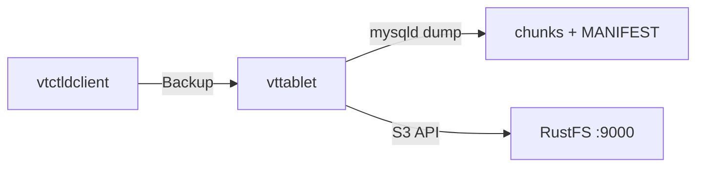

In dieser Anleitung verbinden Sie [Vitess](https://github.com/vitessio/vitess) — das Datenbank-Clustering-System zur horizontalen Skalierung von MySQL — über die S3-Backup-Speicherimplementierung von Vitess mit **RustFS**. Sie bringen eine minimale Vitess-Topologie auf einem einzelnen Host hoch, führen `Backup` auf einem Tablet aus, prüfen die Backup-Chunks und `MANIFEST` im Bucket und lesen die Backup-Liste aus RustFS zurück. Der Ablauf wurde mit `vitess/lite` (Vitess v25.0.0-SNAPSHOT, gebaut am 2026-09-22), MySQL 8.4 und `rustfs/rustfs-x86-musl:v2.3.1` verifiziert. Stabile Releases von Vitess 20+ verwenden dieselben Flags.

Sie benötigen Docker. Diese Bereitstellung ist für lokale Integrationstests gedacht, nicht für den Produktivbetrieb.

## Architektur



`vtctld` löst das Backup aus, ausgeführt wird es aber vom `vttablet`, dem das Tablet gehört: es erstellt einen Snapshot von MySQL, komprimiert die Daten in nummerierte Chunks und lädt sie zusammen mit einem `MANIFEST` über den S3-kompatiblen Endpunkt hoch.

## 1. etcd und das Vitess-Image starten

Vitess speichert seine Topologie in etcd, und das Image `vitess/lite` enthält alle Vitess-Binärdateien plus MySQL:

```bash
docker run -d --name etcd --hostname etcd --network oo-rustfs_default \
  quay.io/coreos/etcd:v3.5.17 etcd \
  --advertise-client-urls http://etcd:2379 \
  --listen-client-urls http://0.0.0.0:2379

docker run -d --name vtess --hostname vtess --network oo-rustfs_default \
  -e AWS_ACCESS_KEY_ID=<your-access-key> \
  -e AWS_SECRET_ACCESS_KEY=<your-secret-key> \
  vitess/lite:latest sleep infinity
```

Die AWS-Umgebungsvariablen liefern die Zugangsdaten für den S3-Backup-Speicher in `vtctld` und `vttablet`.

## 2. MySQL initialisieren

Initialisieren Sie eine MySQL-Instanz im üblichen Vitess-Tablet-Verzeichnis, damit `vttablet` später seine `my.cnf` laden kann:

```bash
docker exec vtess sh -c \
  "/vt/bin/mysqlctl --log_dir /tmp/vtlogs init --tablet-dir vt_0000000100"
```

Die Instanz ist bereit, wenn die Socket-Datei existiert:

```text
/vt/vtdataroot/vt_0000000100/mysql.sock
```

## 3. vtctld und vttablet starten

Starten Sie `vtctld` mit den S3-Backup-Flags, registrieren Sie die Cell und starten Sie das Tablet. Ersetzen Sie alle Verbindungsplatzhalter:

```bash
docker exec vtess sh -c "nohup /vt/bin/vtctld \
  --topo-implementation etcd2 \
  --topo-global-server-address etcd:2379 \
  --topo-global-root /vitess/global \
  --service-map grpc-vtctl,grpc-vtctld \
  --backup-storage-implementation s3 \
  --s3-backup-aws-endpoint http://<your-rustfs-endpoint>:9000 \
  --s3-backup-aws-region us-east-1 \
  --s3-backup-force-path-style \
  --s3-backup-storage-bucket vitess-backups \
  --s3-backup-storage-root commerce \
  --port 15999 --grpc-port 15998 \
  --log_dir /tmp/vtlogs > /tmp/vtlogs/vtctld.out 2>&1 &"

docker exec vtess sh -c \
  "/vt/bin/vtctldclient --server localhost:15998 \
  AddCellInfo --root /vitess/zone1 --server-address etcd:2379 zone1"

docker exec vtess sh -c "nohup /vt/bin/vttablet \
  --topo-implementation etcd2 \
  --topo-global-server-address etcd:2379 \
  --topo-global-root /vitess/global \
  --tablet-path zone1-0000000100 \
  --init-keyspace commerce --init-shard 0 --init-tablet-type replica \
  --port 15100 --grpc-port 15101 \
  --service-map grpc-queryservice,grpc-tabletmanager,grpc-throttler \
  --mycnf-file /vt/vtdataroot/vt_0000000100/my.cnf \
  --db-dba-user root --db-allprivs-user root --db-app-user root --db-repl-user root \
  --db-dba-use-ssl=false --db-allprivs-use-ssl=false \
  --db-app-use-ssl=false --db-repl-use-ssl=false \
  --backup-storage-implementation s3 \
  --s3-backup-aws-endpoint http://<your-rustfs-endpoint>:9000 \
  --s3-backup-aws-region us-east-1 \
  --s3-backup-force-path-style \
  --s3-backup-storage-bucket vitess-backups \
  --s3-backup-storage-root commerce \
  --log_dir /tmp/vtlogs > /tmp/vtlogs/vttablet.out 2>&1 &"
```

Beide Prozesse tragen die S3-Flags, weil `vttablet` das Backup ausführt, während `vtctld` Backups auflistet und entfernt. `--s3-backup-force-path-style` erzwingt pfadbasierte Adressierung (Path-Style) und ist für Endpunkte außerhalb von AWS zwingend. Prüfen Sie, dass das Tablet registriert wurde:

```bash
docker exec vtess /vt/bin/vtctldclient --server localhost:15998 GetTablets
```

```text
zone1-0000000100 commerce 0 replica vtess:15100 vtess:3306 [] <null>
```

## 4. Das Backup ausführen

Legen Sie den Bucket an und lösen Sie das Backup aus:

```bash
rc mb rustfs/vitess-backups

docker exec vtess /vt/bin/vtctldclient --server localhost:15998 \
  Backup zone1-0000000100
```

Der Stream endet damit, dass die Engine das Manifest schreibt:

```text
commerce/0 (zone1-0000000100): ... value:"Completed backing up MANIFEST (attempt 1/2)"
```

## 5. Objekte in RustFS prüfen

Listen Sie das Backup-Präfix auf:

```bash
rc ls rustfs/vitess-backups/ -r | head -4
```

Das Tablet hat komprimierte Daten-Chunks plus die Metadatendateien hochgeladen:

```text
commerce/commerce/0/2026-09-23.011225.zone1-0000000100/0
commerce/commerce/0/2026-09-23.011225.zone1-0000000100/1
commerce/commerce/0/2026-09-23.011225.zone1-0000000100/MANIFEST
```


Lesen Sie die Backup-Liste über `vtctld` aus RustFS zurück:

```bash
docker exec vtess /vt/bin/vtctldclient --server localhost:15998 GetBackups commerce/0
```

```text
2026-09-23.011225.zone1-0000000100
```

## 6. Stoppen oder zurücksetzen

Um die Demo abzubauen und die Bucket-Objekte zu behalten:

```bash
docker rm -f vtess etcd
```

Um die gespeicherten Backups zu löschen:

```bash
rc rm rustfs/vitess-backups/ --recursive --force
```

## Fehlerbehebung

### `cannot perform backup without my.cnf`

Wenn Sie Verbindungsparameter wie `--db-socket` oder `--db-host` übergeben, überspringt `vttablet` das Laden von `my.cnf`, und Backups verweigern die Ausführung. Starten Sie `vttablet` mit `--mycnf-file`, das auf die Instanzkonfiguration zeigt, und lassen Sie den Socket von dort ermitteln. Deshalb liegt die MySQL-Instanz aus Schritt 2 im Verzeichnis `vt_0000000100`.

### `unknown service vtctlservice.Vtctld`

`vtctld` stellt die von `vtctldclient` verwendete API nur bereit, wenn die Service-Map sie enthält: `--service-map grpc-vtctl,grpc-vtctld`. Stellen Sie außerdem sicher, dass `vtctldclient --server` auf den gRPC-Port zeigt (hier `15998`), nicht auf den Port der Weboberfläche.

### `node doesn't exist: /vitess/global/cells/zone1/CellInfo`

Die Cell muss existieren, bevor Tablets sich registrieren. Führen Sie `vtctldclient AddCellInfo` wie in Schritt 3 aus, bevor Sie `vttablet` starten.

### Flag-Parse-Fehler wie `unknown shorthand flag`

Vitess 20+ normalisiert Unterstriche zu Bindestrichen, schreiben Sie Flags daher im Bindestrich-Stil (`--tablet-path`). Ein langes Flag mit einem einzelnen Bindestrich wie `-tablet_dir` wird als Kurzoptionen gelesen und schlägt fehl.

## Nächste Schritte

- Lesen Sie die [S3-Kompatibilitätshinweise](/de/administration/protocols/s3), bevor Sie weitere Vitess-Speicheroptionen einsetzen.
- Erstellen Sie dedizierte Produktions-Zugangsdaten über die [Zugriffsschlüssel-Verwaltung](/de/security-compliance/iam/access-token).
- Folgen Sie der [Vitess-Dokumentation zu Backup und Restore](https://vitess.io/docs/user-guides/configuration-basic/#backups), um Backups zu planen und Tablets aus dem Bucket wiederherzustellen.
