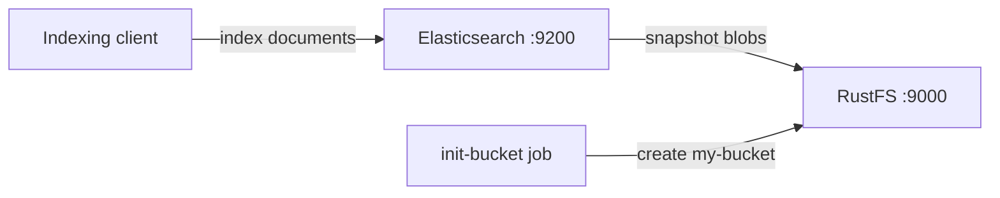

In dieser Anleitung verbinden Sie [Elasticsearch](https://github.com/elastic/elasticsearch) — die verteilte Such- und Analyse-Engine — mit **RustFS** als S3-Snapshot-Repository für die Indizes. Sie starten Elasticsearch mit dem Plugin `repository-s3`, registrieren ein auf RustFS gestütztes Snapshot-Repository, indexieren Dokumente, erstellen einen Snapshot und prüfen den gesamten Zyklus, indem Sie den Index löschen und ihn aus RustFS wiederherstellen. Der Ablauf wurde mit `docker.elastic.co/elasticsearch/elasticsearch:8.18.0` und `rustfs/rustfs-x86-musl:v2.3.1` verifiziert.

Sie benötigen Docker mit dem Compose-Plugin. Dieses Setup ist für lokale Integrationstests gedacht, nicht für den Produktivbetrieb.

## Architektur



Elasticsearch speichert die Primärdaten auf lokalen Festplatten und lagert Index-Backups in ein Snapshot-Repository aus. Das Plugin `repository-s3` schreibt Snapshot-Metadaten und Shard-Daten-Blobs über die S3-API mit pfadbasierter Adressierung (Path-Style) und unverschlüsseltem HTTP nach RustFS.

## 1. Projektdateien anlegen

Erstellen Sie ein Arbeitsverzeichnis:

```bash
mkdir rustfs-elasticsearch
cd rustfs-elasticsearch
```

Erstellen Sie eine Umgebungsdatei und ersetzen Sie beide Platzhalter für die Zugangsdaten:

```ini title=".env"
RUSTFS_ACCESS_KEY=<your-access-key>
RUSTFS_SECRET_KEY=<your-secret-key>
```

Verwenden Sie dedizierte Zugangsdaten für den Bucket. Nehmen Sie `.env` nicht in die Versionsverwaltung auf.

Elasticsearch trennt die S3-Einstellungen zwischen `elasticsearch.yml` (nicht geheime Werte) und dem Keystore (Zugangsdaten). Erstellen Sie die Konfigurationsdatei:

```yaml title="elasticsearch.yml"
discovery.type: single-node
xpack.security.enabled: false
s3.client.default.endpoint: "rustfs:9000"
s3.client.default.protocol: "http"
s3.client.default.path_style_access: "true"
s3.client.default.region: "us-east-1"
```

Erstellen Sie die Compose-Datei:

```yaml title="compose.yaml"
services:
  rustfs:
    image: rustfs/rustfs-x86-musl:v2.3.1
    environment:
      RUSTFS_ACCESS_KEY: ${RUSTFS_ACCESS_KEY}
      RUSTFS_SECRET_KEY: ${RUSTFS_SECRET_KEY}
      RUSTFS_VOLUMES: /data
      RUSTFS_ADDRESS: ":9000"
      RUSTFS_CONSOLE_ADDRESS: ":9001"
      RUSTFS_CONSOLE_ENABLE: "true"
    volumes:
      - rustfs-data:/data
    ports:
      - "9000:9000"
      - "9001:9001"
    healthcheck:
      test: ["CMD", "curl", "-sf", "http://127.0.0.1:9000/health"]
      interval: 10s
      timeout: 5s
      retries: 6
      start_period: 10s
    networks:
      - es

  create-bucket:
    image: rustfs/rc:latest
    depends_on:
      rustfs:
        condition: service_healthy
    environment:
      RUSTFS_ACCESS_KEY: ${RUSTFS_ACCESS_KEY}
      RUSTFS_SECRET_KEY: ${RUSTFS_SECRET_KEY}
    entrypoint:
      - /bin/sh
      - -c
      - |
        until /usr/bin/rc alias set rustfs http://rustfs:9000 "$${RUSTFS_ACCESS_KEY}" "$${RUSTFS_SECRET_KEY}"; do
          echo "Waiting for RustFS..."
          sleep 2
        done
        /usr/bin/rc ls rustfs/my-bucket >/dev/null 2>&1 || /usr/bin/rc mb rustfs/my-bucket
    networks:
      - es

  elasticsearch:
    image: docker.elastic.co/elasticsearch/elasticsearch:8.18.0
    environment:
      ES_JAVA_OPTS: "-Xms512m -Xmx512m"
    volumes:
      - ./elasticsearch.yml:/usr/share/elasticsearch/config/elasticsearch.yml:ro
    entrypoint: >
      bash -c '
        bin/elasticsearch-plugin install --batch repository-s3 &&
        echo "$${RUSTFS_ACCESS_KEY}" | bin/elasticsearch-keystore add -f -x s3.client.default.access_key &&
        echo "$${RUSTFS_SECRET_KEY}" | bin/elasticsearch-keystore add -f -x s3.client.default.secret_key &&
        exec bin/elasticsearch'
    ports:
      - "9200:9200"
    depends_on:
      create-bucket:
        condition: service_completed_successfully
    networks:
      - es

networks:
  es:

volumes:
  rustfs-data:
```

`repository-s3` ist ein mitgeliefertes Plugin und wird ohne Netzwerkzugriff installiert. In den Keystore gehören nur der Zugriffsschlüssel und der geheime Zugriffsschlüssel. Nicht geheime Einstellungen wie der Endpunkt müssen in `elasticsearch.yml` stehen, sonst verweigert der Knoten den Start.

## 2. Bereitstellung starten

Prüfen Sie die Compose-Datei, bevor Sie Container starten:

```bash
docker compose config
```

Starten Sie die Dienste und warten Sie, bis Elasticsearch hochgefahren ist. Der erste Start installiert das Plugin und legt die Keystore-Einträge an, was ein bis zwei Minuten dauert:

```bash
docker compose up -d
curl -s http://localhost:9200
```

## 3. Snapshot-Repository registrieren und Dokumente indexieren

Registrieren Sie RustFS als Snapshot-Repository, legen Sie einen Index an und indexieren Sie fünf Dokumente:

```bash
curl -s -X PUT "http://localhost:9200/_snapshot/rustfs_repo" \
  -H "Content-Type: application/json" \
  -d '{"type":"s3","settings":{"bucket":"my-bucket"}}'

curl -s -X PUT "http://localhost:9200/rustfs_index" \
  -H "Content-Type: application/json" \
  -d '{"mappings":{"properties":{"label":{"type":"keyword"}}}}'

for v in 1 2 3 4 5; do
  curl -s -X POST "http://localhost:9200/rustfs_index/_doc" \
    -H "Content-Type: application/json" \
    -d "{\"label\":\"rustfs-es-doc-$v\",\"value\":$v}" > /dev/null
done
curl -s -X POST "http://localhost:9200/rustfs_index/_refresh" > /dev/null
curl -s "http://localhost:9200/rustfs_index/_count"
```


```text
{"count":5,...}
```

## 4. Snapshot erstellen

Erstellen Sie einen Snapshot mit `wait_for_completion`, damit das Ergebnis sofort feststeht:

```bash
curl -s -X PUT "http://localhost:9200/_snapshot/rustfs_repo/snap1?wait_for_completion=true"
```


```text
{"snapshot":{"snapshot":"snap1",...,"indices":["rustfs_index"],"shards":{"total":1,"failed":0,"successful":1}}}
```

## 5. Objekte in RustFS prüfen

Listen Sie die Snapshot-Objekte über das Image des Bucket-Initialisierers auf:

```bash
docker compose run --rm --entrypoint /bin/sh create-bucket -c \
  '/usr/bin/rc alias set rustfs http://rustfs:9000 "$RUSTFS_ACCESS_KEY" "$RUSTFS_SECRET_KEY" >/dev/null && /usr/bin/rc ls rustfs/my-bucket/indices --recursive'
```

Snapshot-Metadaten und Shard-Daten-Blobs liegen im Bucket unter `indices/`:

```text
[2026-09-21 02:58:01]   3.56 KiB indices/mvyat2-dSEOG3uiCCiFzRA/0/__LbLsSgUUTpqji_EXvqHYCg
[2026-09-21 02:58:01]   3.21 KiB indices/mvyat2-dSEOG3uiCCiFzRA/0/__VIuGNJn3RB-RBWvr4tMn7Q
[2026-09-21 02:58:01]   1.00 KiB indices/mvyat2-dSEOG3uiCCiFzRA/0/index-e9P8q6E9QhitpkiOdgjVDQ
```

Sie können das Präfix auch in der RustFS Console (Weboberfläche) durchsuchen:


## 6. Index aus RustFS wiederherstellen

Löschen Sie den Index und stellen Sie ihn anschließend aus dem Snapshot wieder her:

```bash
curl -s -X DELETE "http://localhost:9200/rustfs_index" > /dev/null
curl -s -X POST "http://localhost:9200/_snapshot/rustfs_repo/snap1/_restore?wait_for_completion=true" > /dev/null
curl -s "http://localhost:9200/rustfs_index/_count"
```


```text
{"count":5,...}
```

Die Dokumente sind wieder vorhanden, weil die Snapshot-Blobs aus RustFS gelesen wurden.

## 7. Stack anhalten oder zurücksetzen

Stoppen Sie die Container und behalten Sie das RustFS-Datenvolumen:

```bash
docker compose down
```

Um die Snapshots zu löschen und mit einem leeren RustFS-Volume zu beginnen, geben Sie `--volumes` ausdrücklich an:

```bash
docker compose down --volumes
```

## Fehlerbehebung

### Der Knoten startet nicht und meldet „non-secure setting ... must be stored inside elasticsearch.yml“

In den Keystore gehören nur `s3.client.default.access_key` und `s3.client.default.secret_key`. Endpunkt, Protokoll, pfadbasierte Adressierung und Region sind nicht geheime Einstellungen und müssen in `elasticsearch.yml` definiert sein.

### Wiederhergestellte oder neue Shards bleiben nicht zugewiesen

Elasticsearch weist keine Shards mehr zu, wenn die Festplattennutzung die niedrige Watermark überschreitet (standardmäßig 85 Prozent). Geben Sie Speicherplatz frei oder deaktivieren Sie die Prüfung für einen lokalen Test:

```bash
curl -s -X PUT "http://localhost:9200/_cluster/settings" \
  -H "Content-Type: application/json" \
  -d '{"transient":{"cluster.routing.allocation.disk.threshold_enabled":false}}'
```

### Die Wiederherstellung schlägt fehl, weil der Index bereits existiert

Eine zuvor fehlgeschlagene Wiederherstellung lässt den Index zurück. Löschen Sie ihn mit `DELETE /rustfs_index` und führen Sie die Wiederherstellung erneut aus.

### AccessDenied- oder 403-Antworten

Stellen Sie sicher, dass die Zugangsdaten im Keystore mit den RustFS-Zugangsdaten übereinstimmen und dass der Dienst `create-bucket` erfolgreich abgeschlossen wurde:

```bash
docker compose logs create-bucket
```

## Nächste Schritte

- Lesen Sie die [S3-Kompatibilitätshinweise](/de/administration/protocols/s3), bevor Sie weitere S3-Operationen verwenden.
- Erstellen Sie dedizierte Produktions-Zugangsdaten über die [Zugriffsschlüssel-Verwaltung](/de/security-compliance/iam/access-token).
- Folgen Sie der [Elasticsearch-Snapshot-Dokumentation](https://www.elastic.co/docs/deploy-manage/tools/snapshot-and-restore) zur Snapshot-Lebenszyklusverwaltung (SLM).
