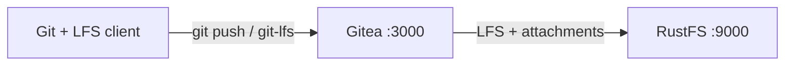
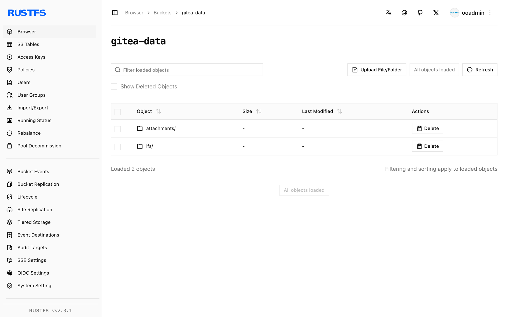

In dieser Anleitung verbinden Sie [Gitea](https://github.com/go-gitea/gitea) — den selbst gehosteten Git-Dienst — über den Speichertyp `minio` von Gitea mit **RustFS**. Sie starten Gitea mit Docker Compose, legen ein Repository an, pushen ein Git-LFS-Objekt, hängen eine Datei an ein Issue an und prüfen, dass sowohl das LFS-Objekt als auch der Anhang in RustFS gespeichert werden. Der Ablauf wurde mit `gitea/gitea:1.24.4` und `rustfs/rustfs-x86-musl:v2.3.1` verifiziert.

Sie benötigen Docker mit dem Compose-Plugin sowie die Clients `git` und `git-lfs` auf Ihrer Arbeitsstation. Dieses Setup ist für lokale Integrationstests gedacht, nicht für den Produktivbetrieb.

## Architektur



Gitea speichert das Git-Repository selbst auf der lokalen Festplatte. Der Speichertyp `minio` leitet große Dateien — LFS-Objekte, Issue-Anhänge, Avatare, Repository-Archive, Pakete und Actions-Artefakte — in den Bucket `gitea-data` in RustFS. Gitea legt den Bucket beim Start an, wenn er noch nicht existiert.

## 1. Projektdateien anlegen

Erstellen Sie ein Arbeitsverzeichnis:

```bash
mkdir rustfs-gitea
cd rustfs-gitea
```

Erstellen Sie eine Umgebungsdatei und ersetzen Sie beide Platzhalter für die Zugangsdaten:

```ini title=".env"
RUSTFS_ACCESS_KEY=<your-access-key>
RUSTFS_SECRET_KEY=<your-secret-key>
```

Verwenden Sie dedizierte Zugangsdaten für den Bucket `gitea-data`. Nehmen Sie `.env` nicht in die Versionsverwaltung auf.

Erstellen Sie die Gitea-Konfiguration und ersetzen Sie beide Platzhalter für die Zugangsdaten durch dieselben Werte wie in `.env`. Der globale Speichertyp `minio` gilt für LFS, Anhänge, Avatare, Repository-Archive, Pakete und Actions-Artefakte:

```ini title="app.ini"
APP_NAME = RustFS Gitea
RUN_MODE = prod
WORK_PATH = /data/gitea

[server]
DOMAIN = localhost
ROOT_URL = http://localhost:3000/
HTTP_PORT = 3000
LFS_START_SERVER = true

[database]
DB_TYPE = sqlite3
PATH = /data/gitea/gitea.db

[storage]
STORAGE_TYPE = minio
MINIO_ENDPOINT = rustfs:9000
MINIO_ACCESS_KEY_ID = <your-access-key>
MINIO_SECRET_ACCESS_KEY = <your-secret-key>
MINIO_BUCKET = gitea-data
MINIO_LOCATION = us-east-1
MINIO_USE_SSL = false

[log]
MODE = console
LEVEL = info

[security]
INSTALL_LOCK = true
SECRET_KEY = change-me-to-a-random-string
```

`LFS_START_SERVER` aktiviert die Git-LFS-HTTP-API. `MINIO_ENDPOINT` verwendet den Compose-internen Hostnamen `rustfs`. Der Endpunkt wird standardmäßig mit pfadbasierter Adressierung (Path-Style) erreicht.

Erstellen Sie die Compose-Datei:

```yaml title="compose.yaml"
services:
  rustfs:
    image: rustfs/rustfs-x86-musl:v2.3.1
    environment:
      RUSTFS_ACCESS_KEY: ${RUSTFS_ACCESS_KEY}
      RUSTFS_SECRET_KEY: ${RUSTFS_SECRET_KEY}
      RUSTFS_VOLUMES: /data
      RUSTFS_ADDRESS: ":9000"
      RUSTFS_CONSOLE_ADDRESS: ":9001"
      RUSTFS_CONSOLE_ENABLE: "true"
    volumes:
      - rustfs-data:/data
    ports:
      - "9000:9000"
      - "9001:9001"
    healthcheck:
      test: ["CMD", "curl", "-sf", "http://127.0.0.1:9000/health"]
      interval: 10s
      timeout: 5s
      retries: 6
      start_period: 10s
    networks:
      - gitea

  gitea:
    image: gitea/gitea:1.24.4
    depends_on:
      rustfs:
        condition: service_healthy
    environment:
      USER_UID: "1000"
      USER_GID: "1000"
    volumes:
      - gitea-data:/data
      - ./app.ini:/data/gitea/conf/app.ini:ro
    ports:
      - "3000:3000"
    networks:
      - gitea

networks:
  gitea:

volumes:
  rustfs-data:
  gitea-data:
```

Das von einem Volume gestützte Verzeichnis `/data` behält die SQLite-Datenbank und die Git-Repositories über Container-Neustarts hinweg. LFS-Objekte und Anhänge liegen in RustFS.

## 2. Bereitstellung prüfen und starten

Prüfen Sie die Compose-Datei, bevor Sie Container starten:

```bash
docker compose config
```

Starten Sie die Dienste:

```bash
docker compose up -d
docker compose ps
```

Beobachten Sie das Gitea-Protokoll, bis jedes Speicher-Backend den Typ Minio meldet:

```bash
docker compose logs gitea | grep "Initialising"
```

Die Ausgabe sollte `Attachment`, `Avatar`, `LFS` und die übrigen Speicherabschnitte auflisten, jeweils gefolgt von einer Zeile `Creating Minio storage at rustfs:9000:gitea-data`.

Öffnen Sie `http://localhost:3000` und legen Sie das Administratorkonto an. Öffnen Sie anschließend die RustFS Console (Weboberfläche) unter `http://localhost:9001`. Der Bucket `gitea-data` erscheint nach der ersten Speicheroperation.

## 3. Git-LFS-Objekt pushen

Legen Sie in der Gitea-Weboberfläche ein Repository namens `rustfs-demo` an und pushen Sie anschließend eine von LFS verfolgte Datei von Ihrer Arbeitsstation:

```bash
mkdir lfs-demo && cd lfs-demo
git init
git config user.email you@example.com
git config user.name you
git lfs install
git lfs track "*.bin"
git add .gitattributes
dd if=/dev/urandom of=dataset.bin bs=1M count=8
git add dataset.bin
git commit -m "add LFS dataset"
git remote add origin http://localhost:3000/<your-username>/rustfs-demo.git
git push origin main
```

`git push` lädt das LFS-Objekt über die Gitea-LFS-API hoch, die es nach RustFS schreibt. Klonen Sie das Repository in ein zweites Verzeichnis und führen Sie `git lfs pull` aus. Die heruntergeladene Datei `dataset.bin` muss byteweise mit dem Original übereinstimmen:

```bash
sha256sum dataset.bin
cd ../lfs-demo-clone && git lfs pull && sha256sum dataset.bin
```

Beide Prüfsummen stimmen überein, weil beide Clients das Objekt aus RustFS lesen.

## 4. Datei an ein Issue anhängen

Öffnen Sie das Repository `rustfs-demo`, legen Sie ein Issue an und hängen Sie über das Issue-Formular eine kleine Textdatei an. Gitea speichert den Upload als `attachments/<prefix>/<uuid>` im Bucket `gitea-data` und liefert Downloads über `/attachments/<uuid>` aus.

## 5. Objekte in RustFS prüfen

Listen Sie den Bucket mit dem [`rc`-Client](https://github.com/rustfs/cli) auf:

```bash
docker compose exec rustfs /usr/bin/rc ls local/gitea-data/ -r
```

Die Ausgabe sollte das LFS-Objekt unter `lfs/` und den Anhang unter `attachments/` enthalten:

```text
attachments/9/2/92fdd48d-531c-4cba-8b3f-4e2004a10fc7
lfs/37/76/6ddfc07e803de58a69328db9a58a07cf7080ddde55c155a7531bc650a000
```

Der LFS-Objektschlüssel ist der SHA-256-Inhaltshash des Git-LFS-Protokolls.



## 6. Bereitstellung anhalten oder zurücksetzen

Stoppen Sie die Container und behalten Sie alle Daten:

```bash
docker compose down
```

Das RustFS-Volume behält den Bucket `gitea-data`, daher überstehen LFS-Objekte und Anhänge einen Neustart. Um alles zu löschen, einschließlich der Objekte in RustFS, fügen Sie `--volumes` hinzu.

## Fehlerbehebung

### Statt der Anmeldeseite erscheint die Gitea-Installationsseite

Die Konfigurationsdatei muss im Container unter `/data/gitea/conf/app.ini` liegen. Ist der Mount-Pfad falsch, startet Gitea mit den Standardwerten und zeigt den Installationsassistenten. Hängen Sie die Datei wie im Compose-Beispiel ein und starten Sie neu.

### Der Push schlägt mit einem LFS- oder 403-Fehler fehl

Stellen Sie sicher, dass die Zugangsdaten in `app.ini` mit den RustFS-Zugangsdaten übereinstimmen und dass der Hostname `rustfs` im Compose-Netzwerk aufgelöst wird:

```bash
docker compose logs gitea | grep -i minio
```

### Objekte landen im lokalen Speicher statt in RustFS

Die Umgebungsvariable `GITEA__storage__STORAGE_TYPE: minio` und der Abschnitt `[storage]` in `app.ini` müssen übereinstimmen. Starten Sie Gitea nach einer Änderung neu und prüfen Sie die Logzeilen `Initialising` erneut.

## Nächste Schritte

- Lesen Sie die [S3-Kompatibilitätshinweise](/de/administration/protocols/s3), bevor Sie weitere Gitea-Speicherziele verwenden.
- Erstellen Sie dedizierte Produktions-Zugangsdaten über die [Zugriffsschlüssel-Verwaltung](/de/security-compliance/iam/access-token).
- Folgen Sie der [Gitea-Speicher-Dokumentation](https://docs.gitea.com/administration/storage-configurations), um Pakete, Actions-Artefakte oder einzelne Speicherabschnitte in eigene Buckets zu verlagern.
