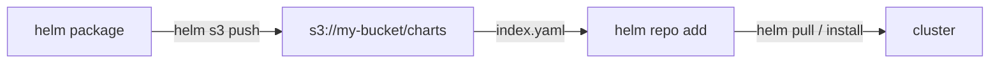

In dieser Anleitung verbinden Sie [Helm](https://github.com/helm/helm) — den CNCF-Paketmanager für Kubernetes — über das Plugin [helm-s3](https://github.com/hypnoglow/helm-s3) mit **RustFS**, sodass ein RustFS-Bucket zum privaten Chart-Repository wird. Sie initialisieren das Repository im Bucket, pushen ein gepacktes Chart, fügen das Repository in Helm hinzu und ziehen das Chart zurück. Der Ablauf wurde mit `alpine/helm:3.16.4` und helm-s3 `v0.17.2` gegen einen RustFS-Bucket verifiziert.

Sie benötigen Docker. Dieses Setup ist für lokale Integrationstests gedacht, nicht für den Produktivbetrieb.

## Architektur



Das Bucket-Präfix enthält `index.yaml` und pro Chart-Version eine `.tgz`-Datei. Helm liest und schreibt es über das Plugin, daher ist das Repository von überall erreichbar, wo RustFS erreichbar ist.

## 1. Plugin installieren und Repository initialisieren

Das `alpine/helm`-Image enthält kein `git` — installieren Sie das Plugin daher aus dem Release-Archiv statt über die Repository-URL:

```bash
cd /tmp
wget -q https://github.com/hypnoglow/helm-s3/releases/download/v0.17.2/helm-s3_0.17.2_linux_amd64.tar.gz
mkdir -p helm-s3 && tar -xzf helm-s3_0.17.2_linux_amd64.tar.gz -C helm-s3
helm plugin install helm-s3
```

Richten Sie das Plugin über seine eigenen Umgebungsvariablen auf RustFS und initialisieren Sie das Repository-Präfix:

```bash
export AWS_ENDPOINT=<your-rustfs-endpoint>:9000
export AWS_DISABLE_SSL=true
export AWS_ACCESS_KEY_ID=<your-access-key>
export AWS_SECRET_ACCESS_KEY=<your-secret-key>
export AWS_DEFAULT_REGION=us-east-1

helm s3 init s3://my-bucket/charts
```

```text
Initialized empty repository at s3://my-bucket/charts
```

:::note[helm-s3 nutzt AWS_ENDPOINT, nicht AWS_ENDPOINT_URL]

Das Plugin baut seine Anfrage-URLs aus `AWS_ENDPOINT` (Host und Port, ohne Schema) zusammen mit `AWS_DISABLE_SSL=true` für Klartext-HTTP. Die Standardvariable `AWS_ENDPOINT_URL` wird nicht berücksichtigt; die dadurch ausgelöste virtual-hosted-Adressierung des SDKs scheitert an RustFS mit `403 Forbidden`.

:::

## 2. Chart pushen

Registrieren Sie das Repository vor dem ersten Push — das Plugin liest die Helm-Repositories-Datei und bricht ab, wenn sie fehlt:

```bash
helm repo add rustfs-charts s3://my-bucket/charts
```

Erstellen und packen Sie ein Demo-Chart und pushen Sie es. `helm s3 push` erwartet den **Repository-Namen**, nicht die `s3://`-URI:

```bash
helm create demo
helm package demo
helm s3 push ./demo-0.1.0.tgz rustfs-charts
```

```text
Successfully uploaded the chart to the repository.
```

## 3. Aus dem Bucket installieren oder ziehen

Aktualisieren Sie den Repository-Index und prüfen Sie, dass das Chart auffindbar ist:

```bash
helm repo update
helm search repo rustfs-charts/demo
```

```text
NAME              	CHART VERSION	APP VERSION	DESCRIPTION
rustfs-charts/demo	0.1.0        	1.16.0     	A Helm chart for Kubernetes
```

Ziehen Sie das Chart aus RustFS zurück:

```bash
helm pull rustfs-charts/demo --destination ./pullback
tar -tzf ./pullback/demo-0.1.0.tgz | head -2
```

```text
demo/Chart.yaml
demo/values.yaml
```


## 4. Anhalten oder Zurücksetzen

Charts sind gewöhnliche Bucket-Objekte, das Aufräumen ist ein Präfix-Löschen:

```bash
aws s3 rm s3://my-bucket/charts --recursive \
  --endpoint-url http://<your-rustfs-endpoint>:9000
```

## Fehlerbehebung

### `head s3 object: Forbidden` bei `helm s3 init`

Das Plugin nutzt virtual-hosted-Adressierung — `AWS_ENDPOINT` und `AWS_DISABLE_SSL` sind nicht gesetzt. Exportieren Sie sie exakt wie in Schritt 1.

### `check if index exists in the storage` schlägt mit einem Git-Fehler fehl

Das Image enthält kein `git`, daher kann `helm plugin install <git-url>` nicht klonen. Installieren Sie wie in Schritt 1 aus dem Release-Archiv.

### `The index file already exists under the provided URI`

Das Repository-Präfix wurde bereits initialisiert. Nutzen Sie `helm s3 init --ignore-if-exists s3://my-bucket/charts` erneut oder ersetzen Sie den Index mit `--force`.

### `repo with name s3://... not found` beim Push

`helm s3 push` erwartet den mit `helm repo add` registrierten Repository-Namen — verwenden Sie `helm s3 push ./demo-0.1.0.tgz rustfs-charts`.

### `couldn't load repositories file` beim Push

Helms `repositories.yaml` existiert in dieser Umgebung noch nicht. Führen Sie vor dem Push `helm repo add rustfs-charts s3://my-bucket/charts` aus.

## Nächste Schritte

- Lesen Sie vor größeren Repositories mit vielen Chart-Versionen die [S3-Kompatibilitätshinweise](/administration/protocols/s3).
- Erstellen Sie dedizierte Produktionszugangsdaten mit [Zugangsdatenverwaltung](/security-compliance/iam/access-token).
- Folgen Sie der [helm-s3-Dokumentation](https://github.com/hypnoglow/helm-s3) für Re-Indexierung, Chart-Löschung und CI-Nutzung auf demselben Bucket.
