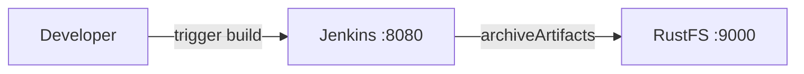

In dieser Anleitung verbinden Sie [Jenkins](https://github.com/jenkinsci/jenkins) — den Automatisierungsserver — über das Plugin Artifact Manager on S3 mit **RustFS**. Sie starten Jenkins mit dem Plugin, richten den Artifact Manager auf einen RustFS-Bucket aus, führen einen Job aus, der ein Artefakt archiviert, und prüfen, dass das Artefakt in RustFS gespeichert wird. Der Ablauf wurde mit `jenkins/jenkins:lts-jdk17` (Jenkins 2.5xx LTS) und `rustfs/rustfs-x86-musl:v2.3.1` verifiziert.

Sie benötigen Docker. Dieses Setup ist für lokale Integrationstests gedacht, nicht für den Produktivbetrieb.

## Architektur



Wenn das Plugin aktiv ist, lädt jeder Job, der Artefakte über den Standardschritt `archiveArtifacts` (oder `stash`/`unstash`) veröffentlicht, sie unter dem konfigurierten Präfix in den Bucket `jenkins-artifacts` hoch, statt sie auf der Festplatte des Controllers zu speichern.

## 1. Projektdateien anlegen

Legen Sie zuerst den Bucket an. Das Plugin prüft den Bucket, legt ihn aber nicht an:

```bash
rc alias set rustfs http://<your-rustfs-endpoint>:9000 <your-access-key> <your-secret-key>
rc mb rustfs/jenkins-artifacts
```

Erstellen Sie ein Dockerfile, das das Plugin in das Jenkins-LTS-Image installiert:

```dockerfile title="Dockerfile"
FROM jenkins/jenkins:lts-jdk17
USER root
RUN jenkins-plugin-cli --plugins artifact-manager-s3 aws-credentials
USER jenkins
```

Das Plugin `artifact-manager-s3` bringt die AWS-Zugangsdatenunterstützung mit, die es benötigt. Wenn Sie `aws-credentials` ausdrücklich angeben, bleibt der Typ **AWS Credential** verfügbar.

Bauen Sie das Image und starten Sie Jenkins im selben Docker-Netzwerk wie RustFS:

```bash
docker build -t jenkins-rustfs .
docker run -d --name jenkins --network oo-rustfs_default \
  -p 8080:8080 -v jenkins-home:/var/jenkins_home jenkins-rustfs
```

Schließen Sie den Einrichtungsassistenten ab und legen Sie anschließend AWS-Zugangsdaten an: **Manage Jenkins → Credentials → global → Add Credentials** (Jenkins verwalten, Zugangsdaten, global, Zugangsdaten hinzufügen). Wählen Sie die Art **AWS Credential**, die ID `rustfs-creds` und tragen Sie Ihren RustFS-Zugriffsschlüssel sowie den geheimen Zugriffsschlüssel ein.

## 2. Artifact Manager konfigurieren

Öffnen Sie **Manage Jenkins → AWS Configuration** (aus dem Plugin `aws-global-configuration`) und setzen Sie:

- **Region name**: `us-east-1`
- **Credentials**: `rustfs-creds`

Öffnen Sie **Manage Jenkins → System** und suchen Sie den Abschnitt **Artifact Management for Builds** (Artefaktverwaltung für Builds). Wählen Sie **Cloud Provider Amazon S3** und füllen Sie die S3-Konfiguration aus:

- **S3 Bucket Name**: `jenkins-artifacts`
- **S3 Bucket Region**: `us-east-1`
- **Base Prefix**: `artifacts/`
- **Custom Endpoint**: `<your-rustfs-endpoint>:9000` (zum Beispiel `rustfs:9000` im Compose-Netzwerk)
- **Custom Signing Region**: `us-east-1`
- **Use Path Style URL**: aktiviert
- **Use Insecure HTTP**: aktiviert
- **Disable Session Token**: aktiviert

Für einen Nicht-AWS-Endpunkt ohne TLS sind pfadbasierte Adressierung (Path-Style) und unverschlüsseltes HTTP erforderlich. Wenn Sie das Session-Token deaktivieren, ruft das Plugin kein AWS STS auf. Ein statisches Zugriffsschlüsselpaar kann einen STS-Aufruf nicht beantworten. Klicken Sie auf **Validate S3 Bucket configuration** (S3-Bucket-Konfiguration prüfen), um die Einstellungen zu bestätigen, und speichern Sie anschließend.

## 3. Job ausführen, der ein Artefakt archiviert

Legen Sie einen Freestyle-Job (oder eine Pipeline) an, der eine Datei erzeugt und archiviert:

```groovy
pipeline {
    agent any
    stages {
        stage('Build') {
            steps {
                sh 'echo "jenkins artifact stored on rustfs" > report.txt'
            }
        }
    }
    post {
        always {
            archiveArtifacts 'report.txt'
        }
    }
}
```

Führen Sie den Build aus und warten Sie, bis er abgeschlossen ist. Die Artefakte werden transparent nach RustFS hochgeladen. Die Job-Konfiguration erwähnt S3 dabei nicht.

## 4. Objekte in RustFS prüfen

Listen Sie den Bucket auf:

```bash
rc ls rustfs/jenkins-artifacts/ -r
```

Das Artefakt liegt unter dem Präfix, geordnet nach Job und Build-Nummer:

```text
artifacts/s3-artifacts-demo/3/artifacts/report.txt
```


Wenn Sie das Artefakt von der Build-Seite herunterladen, wird es aus RustFS gelesen.

## 5. Bereitstellung anhalten oder zurücksetzen

Stoppen Sie Jenkins und behalten Sie die Daten:

```bash
docker rm -f jenkins
```

Die Artefakte bleiben im Bucket `jenkins-artifacts`. Um sie zu löschen, entfernen Sie den Bucket:

```bash
rc rb rustfs/jenkins-artifacts --force
```

## Fehlerbehebung

### `StsException: The security token included in the request is invalid`

Das Plugin ruft AWS STS auf, um Sitzungs-Zugangsdaten zu beziehen. Aktivieren Sie **Disable Session Token** in der S3-Konfiguration. Ein statisches Zugriffsschlüsselpaar kann einen STS-Aufruf nicht beantworten.

### `UnknownHostException: jenkins-artifacts.rustfs`

Das Plugin verwendet Adressierung im Virtual-Hosted-Stil. Aktivieren Sie **Use Path Style URL**. RustFS ermittelt Buckets aus dem URL-Pfad, nicht aus dem Hostnamen.

### `No valid session credentials` oder Fehler mit leeren Zugangsdaten

Stellen Sie sicher, dass auf der Seite AWS Configuration die Zugangsdaten ausgewählt und gespeichert sind, **bevor** die S3-Bucket-Einstellungen verwendet werden, und dass die ID der Zugangsdaten der von Ihnen angelegten ID entspricht.

## Nächste Schritte

- Lesen Sie die [S3-Kompatibilitätshinweise](/de/administration/protocols/s3), bevor Sie weitere Jenkins-Integrationen verwenden.
- Erstellen Sie dedizierte Produktions-Zugangsdaten über die [Zugriffsschlüssel-Verwaltung](/de/security-compliance/iam/access-token).
- Folgen Sie der [Dokumentation zum Plugin Artifact Manager on S3](https://plugins.jenkins.io/artifact-manager-s3/) für die Stash-Unterstützung und Bereinigungsoptionen.
