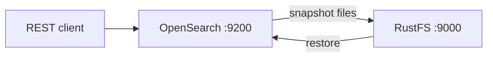
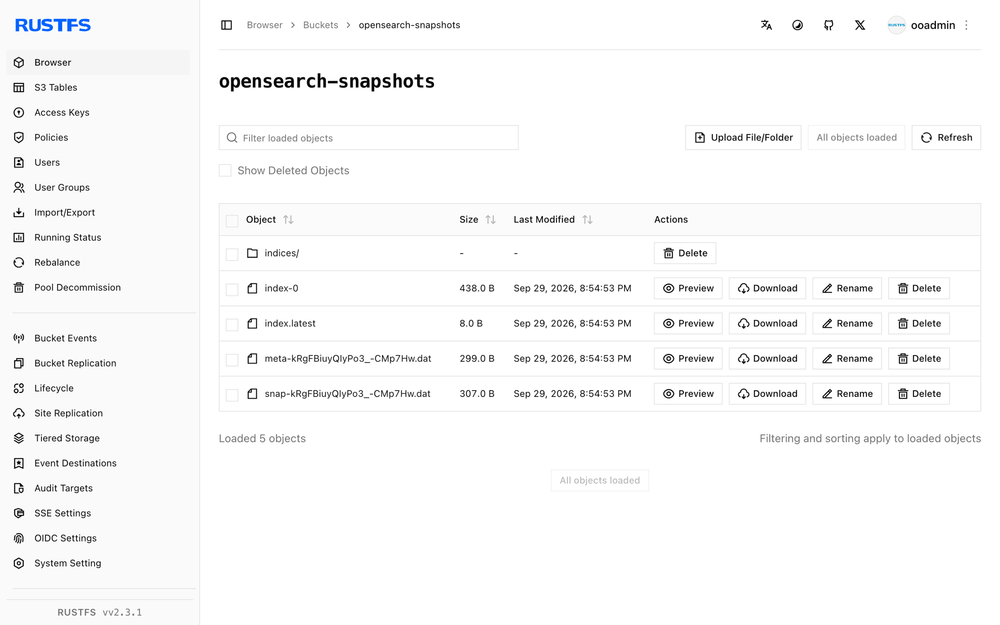

In dieser Anleitung verbinden Sie [OpenSearch](https://github.com/opensearch-project/OpenSearch) — die quelloffene Such- und Analyse-Suite, die von Elasticsearch abgeleitet ist — über das Plugin `repository-s3` mit **RustFS**. Sie registrieren ein S3-Snapshot-Repository auf einem RustFS-Bucket, erstellen einen Snapshot eines Index und stellen ihn wieder her. Der Ablauf wurde mit `opensearchproject/opensearch:3.8.0` und dem mitgelieferten Plugin `repository-s3` gegen `rustfs/rustfs-x86-musl:v2.3.1` verifiziert.

Sie benötigen Docker oder einen OpenSearch-Knoten, auf dem Sie Plugins installieren und die Konfiguration bearbeiten können. Dieses Setup ist für lokale Integrationstests gedacht, nicht für den Produktivbetrieb.

## Architektur



Das Plugin `repository-s3` schreibt Snapshots als Shard-Archive plus Metadaten-Blobs in den Bucket. Die Registrierung gilt clusterweit, daher benötigt jeder Knoten das Plugin und dieselbe Client-Konfiguration.

## 1. OpenSearch ausführen

Starten Sie einen einzelnen Knoten mit deaktiviertem Security-Plugin und einem kleinen Heap:

```bash
docker run -d --name opensearch --network oo-rustfs_default -p 9200:9200 \
  -e discovery.type=single-node \
  -e OPENSEARCH_JAVA_OPTS="-Xms512m -Xmx512m" \
  -e DISABLE_SECURITY_PLUGIN=true \
  opensearchproject/opensearch:3.8.0
```

Der Knoten ist bereit, wenn `curl http://localhost:9200` den Cluster-Header zurückgibt. Rechnen Sie mit ein bis zwei Minuten.

## 2. Plugin repository-s3 installieren

Das S3-Repository-Plugin ist nicht vorgeladen. Installieren Sie es und starten Sie den Knoten neu:

```bash
docker exec opensearch bin/opensearch-plugin install --batch repository-s3
docker restart opensearch
```

## 3. S3-Client konfigurieren

Zugangsdaten sind sichere Einstellungen. Sie gehören in den OpenSearch-Keystore, nicht in die Repository-Anfrage oder in `opensearch.yml`. Legen Sie die Keystore-Einträge an und ersetzen Sie alle Verbindungsplatzhalter:

```bash
docker exec opensearch sh -c \
  "printf '<your-access-key>' | bin/opensearch-keystore create 2>/dev/null; \
   printf '<your-access-key>' | bin/opensearch-keystore add -f -x s3.client.default.access_key; \
   printf '<your-secret-key>' | bin/opensearch-keystore add -f -x s3.client.default.secret_key"
```

Fügen Sie die nicht geheimen Client-Einstellungen zu `config/opensearch.yml` hinzu:

```yaml title="opensearch.yml"
network.host: 0.0.0.0
plugins.security.disabled: true
s3.client.default.endpoint: http://<your-rustfs-endpoint>:9000
s3.client.default.protocol: http
s3.client.default.path_style_access: "true"
```

Starten Sie den Knoten ein weiteres Mal neu, damit er sowohl den Keystore als auch die neuen Einstellungen liest:

```bash
docker restart opensearch
```

Legen Sie den Bucket an, während der Knoten startet:

```bash
rc mb rustfs/opensearch-snapshots
```

## 4. Repository registrieren und Snapshot erstellen

Legen Sie einen Testindex mit einem Dokument an und registrieren Sie anschließend das Repository:

```bash
curl -sX PUT http://localhost:9200/rustfs-demo -H "Content-Type: application/json" \
  -d '{"settings":{"number_of_shards":1}}'

curl -sX PUT http://localhost:9200/rustfs-demo/_doc/1 -H "Content-Type: application/json" \
  -d '{"product":"rustfs","via":"opensearch-snapshot"}'

curl -sX PUT "http://localhost:9200/_snapshot/rustfs-repo" -H "Content-Type: application/json" \
  -d '{"type":"s3","settings":{"bucket":"opensearch-snapshots","region":"us-east-1","server_side_encryption_type":"bucket_default"}}'
```

Die Einstellung `server_side_encryption_type: bucket_default` ist wichtig. Ohne sie fordert das Plugin SSE-S3 an. Eine selbst betriebene RustFS-Instanz ohne Master-Schlüssel für die serverseitige Verschlüsselung lehnt das ab.

Erstellen Sie einen Snapshot und warten Sie auf den Abschluss:

```bash
curl -sX PUT "http://localhost:9200/_snapshot/rustfs-repo/snapshot-1?wait_for_completion=true" \
  -H "Content-Type: application/json" -d '{"indices":"rustfs-demo"}'
```


```text
{"snapshot":{"snapshot":"snapshot-1","state":"SUCCESS","indices":["rustfs-demo"],...}}
```

## 5. Objekte prüfen und wiederherstellen

Listen Sie den Bucket auf:

```bash
rc ls rustfs/opensearch-snapshots/ -r
```


```text
index-0
index.latest
indices/5x1bwsWaSv2XINIbeoe-RQ/0/__GgxvoCw-TKuMMAYBq5Khag
indices/5x1bwsWaSv2XINIbeoe-RQ/0/snap-kRgFBiuyQIyPo3_-CMp7Hw.dat
meta-kRgFBiuyQIyPo3_-CMp7Hw.dat
snap-kRgFBiuyQIyPo3_-CMp7Hw.dat
```

Löschen Sie den Index und stellen Sie ihn aus dem Snapshot wieder her:

```bash
curl -sX DELETE http://localhost:9200/rustfs-demo
curl -sX POST "http://localhost:9200/_snapshot/rustfs-repo/snapshot-1/_restore?wait_for_completion=true"
curl -s http://localhost:9200/rustfs-demo/_doc/1
```


```text
{"_index":"rustfs-demo","_id":"1","found":true,"_source":{"product":"rustfs","via":"opensearch-snapshot"}}
```



## 6. Anhalten oder zurücksetzen

So bauen Sie die Demo ab und behalten die Objekte im Bucket:

```bash
docker rm -f opensearch
```

So löschen Sie die gespeicherten Snapshots:

```bash
rc rm rustfs/opensearch-snapshots/ --recursive --force
```

## Fehlerbehebung

### `Setting [access_key] is insecure, but property [allow_insecure_settings] is not set`

Zugangsdaten direkt in der Repository-Anfrage werden abgelehnt. Speichern Sie sie wie in Schritt 3 im Keystore. `access_key` und `secret_key` sind in OpenSearch sichere Einstellungen.

### `SSE-S3 requires RUSTFS_SSE_S3_MASTER_KEY ... (Status Code: 400)`

Das Plugin verschlüsselt Uploads standardmäßig mit SSE-S3. Registrieren Sie das Repository mit `"server_side_encryption_type": "bucket_default"`, damit kein Verschlüsselungs-Header gesendet wird, wie in Schritt 4.

### `unknown setting [s3.client.default.access_key]` beim Start

Die Einstellungen verweisen auf das Plugin repository-s3. Wenn der Knoten mit diesen Einstellungen nicht startet, ist das Plugin in diesem Container nicht installiert. Wiederholen Sie Schritt 2. Ein neuer Container verliert Plugins, die mit `docker exec` installiert wurden.

### Die Repository-Prüfung schlägt mit `path is not accessible` fehl

Der Knoten erreicht den Bucket nicht. Prüfen Sie, dass `s3.client.default.endpoint` vom Container aus erreichbar ist, `path_style_access` den Wert `"true"` hat und die Keystore-Zugangsdaten geladen wurden. Sie werden beim Start gelesen. Starten Sie neu, nachdem Sie sie hinzugefügt haben.

## Nächste Schritte

- Lesen Sie die [S3-Kompatibilitätshinweise](/de/administration/protocols/s3), bevor Sie weitere OpenSearch-Repositories verwenden.
- Erstellen Sie dedizierte Produktions-Zugangsdaten über die [Zugriffsschlüssel-Verwaltung](/de/security-compliance/iam/access-token).
- Folgen Sie der [OpenSearch-Snapshot-Dokumentation](https://docs.opensearch.org/docs/latest/tuning-your-cluster/availability-and-recovery/snapshots/index/), um Snapshots mit Richtlinien der Snapshot-Verwaltung (SM) zu automatisieren.
