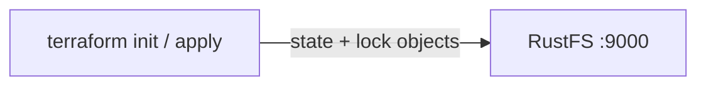
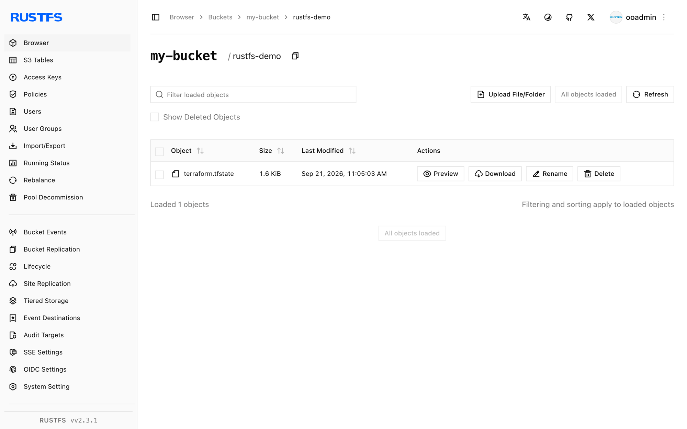

In dieser Anleitung verbinden Sie [Terraform](https://github.com/hashicorp/terraform) — das Infrastructure-as-Code-Werkzeug von HashiCorp — über das S3-Backend mit **RustFS**. Die State-Datei und die Sperrdatei, die parallele Läufe verhindert, werden als Objekte in RustFS gespeichert. Sie initialisieren das Backend, wenden eine kleine Konfiguration an und prüfen das State-Objekt in RustFS. Der Ablauf wurde mit `terraform 1.12.2` und `rustfs/rustfs-x86-musl:v2.3.1` verifiziert.

Sie benötigen eine RustFS-Bereitstellung, die von Ihrer Arbeitsstation aus erreichbar ist (siehe die Anleitungen unter [Installation](/de/installation)), und Terraform 1.10 oder neuer. Diese Version unterstützt die native S3-Sperre über `use_lockfile`.

## Architektur



Das S3-Backend speichert die State-Datei unter dem Präfix `key` im Bucket. Mit `use_lockfile = true` schreibt Terraform ein Objekt `<key>.tflock`, solange ein Lauf die Sperre hält. Das ersetzt für dieses Setup die frühere Sperre auf Basis von DynamoDB.

## 1. Projektdateien anlegen

Erstellen Sie ein Arbeitsverzeichnis:

```bash
mkdir rustfs-terraform
cd rustfs-terraform
```

Erstellen Sie die Konfiguration. Ersetzen Sie die Platzhalter für die Zugangsdaten und richten Sie den Endpunkt auf Ihren RustFS-Server aus. Verwenden Sie `localhost:9000`, wenn Terraform auf demselben Host läuft:

```hcl title="main.tf"
terraform {
  backend "s3" {
    bucket                      = "my-bucket"
    key                         = "rustfs-demo/terraform.tfstate"
    region                      = "us-east-1"
    endpoint                    = "http://localhost:9000"
    access_key                  = "<your-access-key>"
    secret_key                  = "<your-secret-key>"
    skip_credentials_validation = true
    skip_region_validation      = true
    skip_metadata_api_check     = true
    skip_requesting_account_id  = true
    force_path_style            = true
    insecure                    = true
    use_lockfile                = true
  }
}

provider "local" {}

resource "local_file" "demo" {
  content  = "provisioned with terraform, state stored in RustFS"
  filename = "${path.module}/demo.txt"
}
```

`force_path_style` und `insecure` wählen pfadbasierte Adressierung (Path-Style) über unverschlüsseltes HTTP. Genau das erwartet RustFS für den lokalen Endpunkt. `use_lockfile` aktiviert die native S3-State-Sperre, damit parallele Läufe den State nicht beschädigen können.

## 2. Backend initialisieren

Laden Sie den Provider herunter und konfigurieren Sie das S3-Backend:

```bash
terraform init -input=false
```


```text
Successfully configured the backend "s3"! Terraform will automatically
use this backend unless the backend configuration changes.
```

## 3. Konfiguration anwenden

Legen Sie die Ressource an und schreiben Sie den State nach RustFS:

```bash
terraform apply -auto-approve -input=false
```


```text
Apply complete! Resources: 1 added, 0 changed, 0 destroyed.
```

## 4. State in RustFS prüfen

Listen Sie die State-Objekte über die `rc`-CLI auf:

```bash
docker run --rm --network <rustfs-network> -v "$PWD:/m" \
  --entrypoint /bin/sh rustfs/rc:latest \
  -c 'rc alias set rustfs http://rustfs:9000 <your-access-key> <your-secret-key> >/dev/null && rc ls rustfs/my-bucket/rustfs-demo --recursive'
```


```text
[2026-09-21 03:05:03]   1.62 KiB rustfs-demo/terraform.tfstate
```

Sie können das Präfix auch in der RustFS Console (Weboberfläche) durchsuchen:



## 5. Prüfen, dass der State aus RustFS neu geladen wird

Führen Sie einen Plan aus. Terraform liest den State aus RustFS und vergleicht ihn mit der Konfiguration:

```bash
terraform plan -input=false
```


```text
No changes. Your infrastructure matches the configuration.
```

Der Plan meldet keine Änderungen, weil der State aus RustFS zurückgelesen wurde und nicht aus einer lokalen Datei.

## 6. Zerstören und zurücksetzen

Bauen Sie die Ressource ab. Die State-Aktualisierung wird auf dieselbe Weise nach RustFS geschrieben:

```bash
terraform destroy -auto-approve -input=false
```

Löschen Sie die State-Objekte in der RustFS Console (oder mit `rc rm`), um von vorn zu beginnen.

## Fehlerbehebung

### „dial tcp: lookup rustfs ... server misbehaving“ oder Verbindungsfehler

Der `endpoint` muss von dem Rechner aus erreichbar sein, auf dem Terraform läuft. Im Compose-Netzwerk verwenden Sie `http://rustfs:9000`, vom Host aus `http://localhost:9000`.

### „Bucket cannot have ACLs set“ oder Signaturfehler

`skip_credentials_validation`, `skip_region_validation`, `skip_metadata_api_check`, `skip_requesting_account_id`, `force_path_style` und `insecure` sind für einen Nicht-AWS-Endpunkt alle erforderlich. Fehlt eine davon, spricht das Backend die AWS-Standardwerte an statt RustFS.

### Der State erscheint nicht im Bucket

Stellen Sie sicher, dass der Bucket existiert und die Zugangsdaten mit den RustFS-Zugangsdaten übereinstimmen. Das State-Objekt erscheint nach dem ersten `init` oder `apply` unter dem Pfad `key` (in dieser Anleitung `rustfs-demo/terraform.tfstate`).

## Nächste Schritte

- Lesen Sie die [S3-Kompatibilitätshinweise](/de/administration/protocols/s3), bevor Sie weitere S3-Operationen verwenden.
- Erstellen Sie dedizierte Produktions-Zugangsdaten über die [Zugriffsschlüssel-Verwaltung](/de/security-compliance/iam/access-token).
- Folgen Sie der [Dokumentation zum Terraform-S3-Backend](https://developer.hashicorp.com/terraform/language/backend/s3) für Optionen wie Workspace-Präfixe und die Annahme von Rollen.
