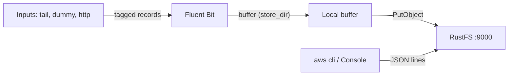
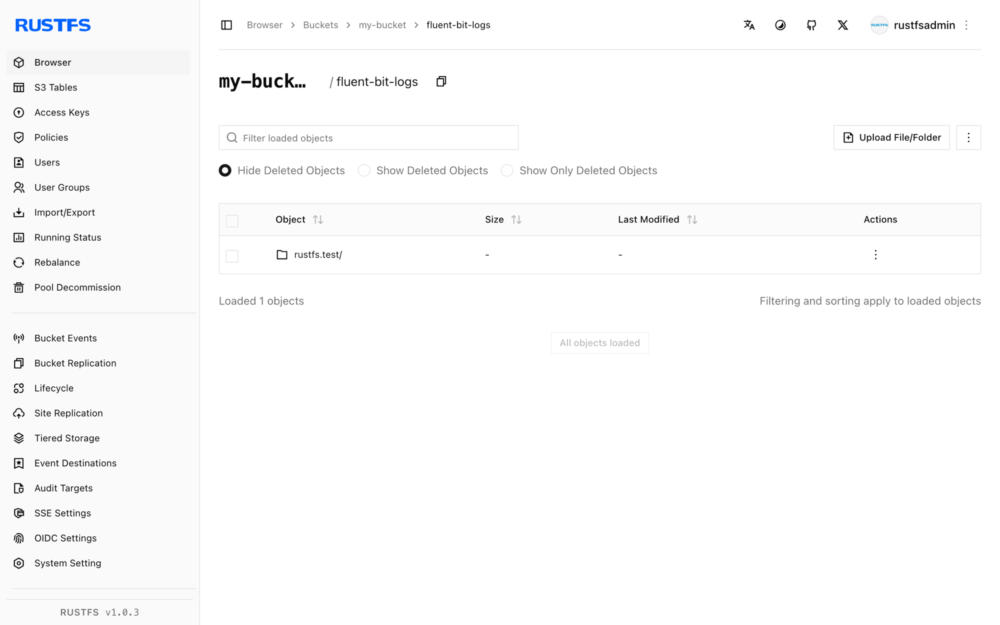

In dieser Anleitung verbinden Sie [Fluent Bit](https://github.com/fluent/fluent-bit) — den CNCF-Logprozessor und -Forwarder — mit **RustFS** als Logziel. Sie betreiben Fluent Bit mit dem `s3`-Output, puffern Datensätze auf der Festplatte, laden sie in einen RustFS-Bucket hoch und lesen eine ausgelieferte Logdatei zurück. Der Ablauf wurde mit `fluent/fluent-bit:3.2.10` schreibend in einen RustFS-Bucket über Path-Style-Adressierung verifiziert.

Sie benötigen Docker. Dieses Setup ist für lokale Integrationstests gedacht, nicht für den Produktivbetrieb.

## Architektur



Der S3-Output puffert getaggte Datensätze im `store_dir` und lädt eine Datei hoch, sobald sie `total_file_size` erreicht oder `upload_timeout` abläuft — was zuerst eintritt. Jedes hochgeladene Objekt ist eine Datei aus JSON-Zeilen.

## 1. Bucket anlegen

Der S3-Output erstellt niemals Buckets; Uploads schlagen mit `NoSuchBucket` fehl, wenn der Bucket fehlt. Legen Sie ihn zuerst an und ersetzen Sie alle Verbindungsplatzhalter:

```bash
aws s3 mb s3://my-bucket \
  --endpoint-url http://<your-rustfs-endpoint>:9000
```

## 2. S3-Output konfigurieren

Erstellen Sie die Fluent-Bit-Konfiguration:

```text title="fluent-bit.conf"
[SERVICE]
    Flush 2
    Log_Level info

[INPUT]
    Name dummy
    Tag rustfs.test
    Rate 200

[OUTPUT]
    Name s3
    Match *
    endpoint http://<your-rustfs-endpoint>:9000
    region us-east-1
    bucket my-bucket
    total_file_size 1M
    use_put_object On
    upload_timeout 30s
    store_dir /tmp/flb-store
    json_date_key date
    json_date_format iso8601
```

`use_put_object On` lädt jede gepufferte Datei mit einem einzigen `PutObject`-Aufruf hoch. `upload_timeout` erzwingt nach 30 Sekunden einen Upload, auch wenn der Puffer `total_file_size` noch nicht erreicht hat — Dateneingänge mit geringem Volumen brauchen diese Option, sonst bleiben ihre Datensätze auf der lokalen Platte.

:::note[Eigene Endpunkte verwenden standardmäßig Path-Style]

Fluent Bit 3.2 kennt keine Option `s3_force_path_style` — das Plugin weist sie als unbekannte Eigenschaft zurück. Wenn `endpoint` auf einen eigenen S3-Dienst zeigt, erfolgen die Anfragen im Path-Style, was den RustFS-Standardeinstellungen entspricht. Ein zusätzlicher Schalter ist nicht nötig.

:::

## 3. Fluent Bit starten

Starten Sie den Container und übergeben Sie die Zugangsdaten über die Standard-AWS-Umgebungsvariablen:

```bash
docker run -d --name fluent-bit \
  -e AWS_ACCESS_KEY_ID=<your-access-key> \
  -e AWS_SECRET_ACCESS_KEY=<your-secret-key> \
  -v "$PWD/fluent-bit.conf:/fluent-bit/etc/fluent-bit.conf:ro" \
  fluent/fluent-bit:3.2.10
```

Warten Sie auf den ersten Upload und prüfen Sie, dass der Worker sauber startete:

```bash
docker logs fluent-bit 2>&1 | grep "worker #0 started"
```

```text
[output:s3:s3.0] worker #0 started
```

## 4. Hochgeladene Objekte prüfen

Listen Sie den Bucket — das Standard-Schlüssellayout ist `fluent-bit-logs/<tag>/YYYY/MM/DD/HH/MM/`:

```bash
aws s3 ls s3://my-bucket/ --recursive \
  --endpoint-url http://<your-rustfs-endpoint>:9000
```

```text
2026-10-25 01:13:28  1021326 fluent-bit-logs/rustfs.test/2026/10/25/01/13/59-objectbmjH9744
2026-10-25 01:16:05   333735 fluent-bit-logs/rustfs.test/2026/10/25/01/15/34-objectKfCq13io
```

Lesen Sie ein Objekt zurück — jede Zeile ist ein JSON-Datensatz:

```bash
aws s3 cp s3://my-bucket/fluent-bit-logs/rustfs.test/2026/10/25/01/13/59-objectbmjH9744 - \
  --endpoint-url http://<your-rustfs-endpoint>:9000 | head -2
```

```json
{"date":"2026-10-25T01:13:59.204844Z","message":"dummy"}
{"date":"2026-10-25T01:13:59.206396Z","message":"dummy"}
```



## 5. Anhalten oder Zurücksetzen

Demo abreißen und die Bucket-Objekte behalten:

```bash
docker rm -f fluent-bit
```

Hochgeladene Logs löschen:

```bash
aws s3 rm s3://my-bucket/fluent-bit-logs --recursive \
  --endpoint-url http://<your-rustfs-endpoint>:9000
```

## Fehlerbehebung

### `PutObject request failed` mit `NoSuchBucket`

Der Ausgabe-Bucket existiert nicht. Legen Sie ihn wie in Schritt 1 an — das Plugin erstellt keine Buckets.

### `[config] s3: unknown configuration property 's3_force_path_style'`

Diese Option gibt es in Fluent Bit 3.2 nicht. Entfernen Sie sie; eigene Endpunkte nutzen bereits Path-Style-Adressierung.

### Objekte erscheinen nie und das Log bleibt still

Der Puffer hat `total_file_size` nicht erreicht, und es ist kein `upload_timeout` gesetzt. Ergänzen Sie `upload_timeout 30s`, damit schwache Eingänge periodisch hochladen.

### `InvalidAccessKeyId` im Fluent-Bit-Log

Die Umgebungsvariablen für Zugangsdaten fehlen im Container oder sind falsch. Der S3-Output liest `AWS_ACCESS_KEY_ID` und `AWS_SECRET_ACCESS_KEY`.

## Nächste Schritte

- Lesen Sie vor Multipart-Uploads oder Komprimierung die [S3-Kompatibilitätshinweise](/administration/protocols/s3).
- Erstellen Sie dedizierte Produktionszugangsdaten mit [Zugangsdatenverwaltung](/security-compliance/iam/access-token).
- Folgen Sie der [Fluent-Bit-S3-Output-Dokumentation](https://docs.fluentbit.io/manual/pipeline/outputs/s3) für `s3_key_format`, Komprimierung und `tail`-Input-Tuning auf demselben Bucket.
