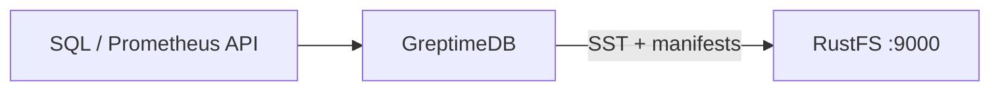
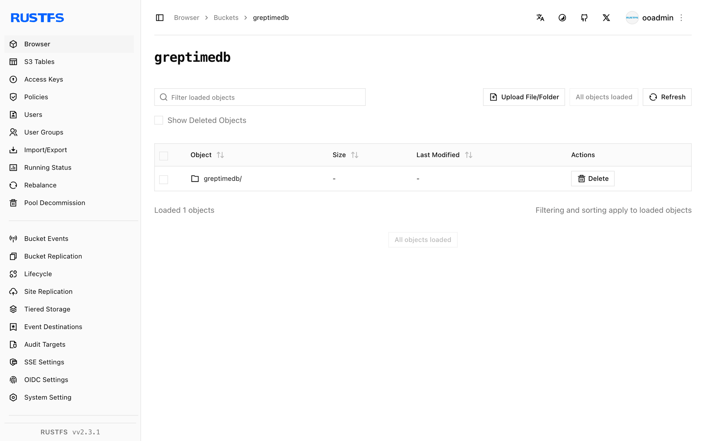

In dieser Anleitung verbinden Sie [GreptimeDB](https://github.com/GreptimeTeam/greptimedb) — die quelloffene, cloud-native Zeitreihendatenbank — mit **RustFS** als Objektspeicher-Backend. Sie starten eine Standalone-Instanz, deren Abschnitt `[storage]` auf einen RustFS-Bucket zeigt, schreiben Zeitreihenzeilen über die SQL-API und prüfen die Parquet-Dateien und Manifeste im Bucket. Der Ablauf wurde mit `greptime/greptimedb` (main, Commit `179ff8e5`) gegen `rustfs/rustfs-x86-musl:v2.3.1` verifiziert.

Sie benötigen Docker oder eine lokale GreptimeDB-Binärdatei. Dieses Setup ist für lokale Integrationstests gedacht, nicht für den Produktivbetrieb.

## Architektur



GreptimeDB hält das Write-Ahead-Log und die jüngsten Daten lokal und persistiert anschließend SSTables (Parquet) und Tabellen-Manifeste im Objektspeicher. Wenn das Speicher-Backend auf RustFS zeigt, ist der Bucket der dauerhafte Speicherort aller Tabellendaten.

## 1. Speicher-Backend konfigurieren

Legen Sie den Bucket und eine Konfigurationsdatei mit einem S3-Speicherabschnitt an. Ersetzen Sie alle Verbindungsplatzhalter:

```toml title="greptimedb.toml"
[storage]
type = "S3"
bucket = "<your-bucket>"
root = "greptimedb"
access_key_id = "<your-access-key>"
secret_access_key = "<your-secret-key>"
endpoint = "http://<your-rustfs-endpoint>:9000"
region = "us-east-1"
```

GreptimeDB verwendet für eigene Endpunkte standardmäßig Anfragen mit pfadbasierter Adressierung (Path-Style). Die Adressierung im Virtual-Hosted-Stil müssen Sie mit `enable_virtual_host_style` ausdrücklich aktivieren. Für RustFS ist daher kein zusätzliches Flag nötig.

## 2. GreptimeDB ausführen

Starten Sie eine Standalone-Instanz mit der Konfigurationsdatei:

```bash
docker run -d --name greptimedb --network oo-rustfs_default -p 4000:4000 -p 4002:4002 \
  -v "$PWD/greptimedb.toml":/etc/greptimedb/greptimedb.toml:ro \
  greptime/greptimedb:latest standalone start \
  --http-addr 0.0.0.0:4000 \
  --mysql-addr 0.0.0.0:4002 \
  --config-file /etc/greptimedb/greptimedb.toml
```

Port `4000` stellt den HTTP-SQL-Endpunkt bereit, Port `4002` das MySQL-Protokoll.

## 3. Zeitreihen schreiben und abfragen

Legen Sie eine Tabelle an, fügen Sie Zeilen ein und lesen Sie sie zurück. Der HTTP-SQL-Endpunkt erwartet formularcodierte Anfragen:

```bash
curl -s -X POST "http://localhost:4000/v1/sql" \
  --data-urlencode "sql=CREATE TABLE rustfs_demo (host STRING, cpu DOUBLE, mem DOUBLE, ts TIMESTAMP TIME INDEX)"

curl -s -X POST "http://localhost:4000/v1/sql" \
  --data-urlencode "sql=INSERT INTO rustfs_demo VALUES (\"node-1\", 0.31, 0.62, 1790681000000), (\"node-1\", 0.35, 0.63, 1790681060000), (\"node-2\", 0.51, 0.71, 1790681000000)"
```


```text
{"output":[{"affectedrows":3}],"execution_time_ms":2}
```

Fragen Sie die Zeilen wieder ab:

```bash
curl -s -X POST "http://localhost:4000/v1/sql" \
  --data-urlencode "sql=SELECT * FROM rustfs_demo ORDER BY ts"
```


```text
{"output":[{"records":{"rows":[["node-2",0.51,0.71,1790681000000],["node-1",0.35,0.63,1790681060000]],"total_rows":2}}]}
```

## 4. Objekte in RustFS prüfen

Listen Sie den Bucket auf. Nach dem Leeren der Memtable enthält der Bucket Parquet-SSTables und JSON-Manifeste:

```bash
rc ls rustfs/<your-bucket>/ -r
```


```text
greptimedb/data/greptime/public/1024/1024_0000000000/manifest/00000000000000000000.json
greptimedb/data/greptime/greptime_private/1025/1025_0000000000/b11e8b25-5763-4f05-bcab-b6ee0a756a69.parquet
greptimedb/data/greptime/greptime_private/1025/1025_0000000000/manifest/00000000000000000001.json
```

Jede Datenbank erhält ein Verzeichnis unter `data/`, und die Dateien `manifest/*.json` je Region beschreiben die SSTables, die GreptimeDB bei Abfragen wieder liest.



## 5. Anhalten oder zurücksetzen

So bauen Sie die Demo ab und behalten die Objekte im Bucket:

```bash
docker rm -f greptimedb
```

So löschen Sie die gespeicherten Daten:

```bash
rc rm rustfs/<your-bucket>/ --recursive --force
```

## Fehlerbehebung

### `Form requests must have Content-Type: application/x-www-form-urlencoded`

Der HTTP-Endpunkt `/v1/sql` akzeptiert nur formularcodierte Inhalte. Übergeben Sie SQL mit `curl --data-urlencode "sql=..."` (oder `application/x-www-form-urlencoded`), nicht als JSON-Body.

### Der Bucket bleibt leer

GreptimeDB schreibt Memtables asynchron in den Objektspeicher. Führen Sie einige weitere Inserts aus und warten Sie einige Sekunden, oder lösen Sie einen manuellen Flush aus, und listen Sie den Bucket danach erneut auf.

### Der Start schlägt mit einem S3-Fehler fehl

Stellen Sie sicher, dass `endpoint` das Schema enthält, der Bucket existiert und `access_key_id` sowie `secret_access_key` mit einem RustFS-Zugriffsschlüsselpaar übereinstimmen. Der Wert `root` ist optional, hält den Tabellenbaum aber unter einem bekannten Präfix.

## Nächste Schritte

- Lesen Sie die [S3-Kompatibilitätshinweise](/de/administration/protocols/s3), bevor Sie weitere GreptimeDB-Speicheroptionen verwenden.
- Erstellen Sie dedizierte Produktions-Zugangsdaten über die [Zugriffsschlüssel-Verwaltung](/de/security-compliance/iam/access-token).
- Folgen Sie der [GreptimeDB-Konfigurationsreferenz](https://docs.greptime.com/operational-guide/configure/configure-datanode/), um Flush-Intervalle und Cache-Schichten für Produktivlasten abzustimmen.
