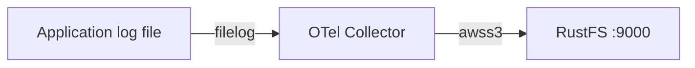

In dieser Anleitung verbinden Sie den [OpenTelemetry Collector](https://opentelemetry.io/docs/collector/) — die Telemetrie-Pipeline der CNCF — über den Exporter `awss3` des Collectors mit **RustFS**. Sie betreiben den Contrib-Collector mit einem Empfänger `filelog`, übertragen die Zeilen einer Datei in den Bucket `otel-data` und prüfen die partitionierten Objekte in RustFS. Der Ablauf wurde mit `otel/opentelemetry-collector-contrib:0.138.0` und `rustfs/rustfs-x86-musl:v2.3.1` verifiziert.

Sie benötigen Docker. Dieses Setup ist für lokale Integrationstests gedacht, nicht für den Produktivbetrieb.

## Architektur



Der Empfänger `filelog` liest die Logdatei fortlaufend, und der Exporter `awss3` lädt Stapel in den Bucket hoch, aufgeteilt in zeitbasierte Präfixe. Metriken und Traces können über denselben Exporter mit eigenen Pipelines geleitet werden.

## 1. Projektdateien anlegen

Legen Sie zuerst den Bucket an. Der Exporter legt keine Buckets an:

```bash
rc alias set rustfs http://<your-rustfs-endpoint>:9000 <your-access-key> <your-secret-key>
rc mb rustfs/otel-data
```

Erstellen Sie die Collector-Konfiguration und ersetzen Sie beide Platzhalter für die Zugangsdaten:

```yaml title="config.yaml"
receivers:
  filelog:
    include: [/var/log/app.log]
    start_at: beginning

exporters:
  awss3:
    s3uploader:
      region: us-east-1
      s3_bucket: otel-data
      endpoint: http://rustfs:9000
      s3_force_path_style: true
      disable_ssl: true
      file_prefix: logs/app
    marshaler: body

service:
  pipelines:
    logs:
      receivers: [filelog]
      exporters: [awss3]
```

Der Exporter liest die Zugangsdaten aus den Standard-Umgebungsvariablen `AWS_ACCESS_KEY_ID`, `AWS_SECRET_ACCESS_KEY` und `AWS_REGION`. `marshaler: body` schreibt jede Logzeile als einfachen Text. Lassen Sie die Einstellung weg, um stattdessen OTLP-JSON zu speichern. `s3_force_path_style` erzwingt pfadbasierte Adressierung (Path-Style). Zusammen mit `disable_ssl` ist das für einen Endpunkt mit unverschlüsseltem HTTP außerhalb von AWS erforderlich.

Erstellen Sie die Compose-Datei:

```yaml title="compose.yaml"
services:
  collector:
    image: otel/opentelemetry-collector-contrib:0.138.0
    command: ["--config=/etc/otelcol-contrib/config.yaml"]
    environment:
      AWS_ACCESS_KEY_ID: <your-access-key>
      AWS_SECRET_ACCESS_KEY: <your-secret-key>
      AWS_REGION: us-east-1
    volumes:
      - ./config.yaml:/etc/otelcol-contrib/config.yaml:ro
      - ./app.log:/var/log/app.log
    networks:
      - otel

networks:
  otel:
```

## 2. Collector starten und Logs erzeugen

Starten Sie den Stack und hängen Sie Zeilen an die überwachte Datei an:

```bash
echo "otel demo log line one" > app.log
docker compose up -d
echo "second line after start" >> app.log
```

Der Collector liest die Datei von Anfang an und lädt jeden Puffer hoch, wenn die Partition wechselt. Warten Sie nach der letzten Zeile etwa eine Minute, bevor Sie prüfen.

## 3. Objekte in RustFS prüfen

Listen Sie den Bucket auf:

```bash
rc ls rustfs/otel-data/ -r
```

Log-Datensätze werden unter zeitbasierten Partitionen mit dem konfigurierten Dateipräfix hochgeladen:

```text
year=2026/month=09/day=21/hour=15/minute=53/logs/applogs_288361608.txt
```

Lesen Sie ein Objekt zurück, um zu prüfen, dass die Zeilen unversehrt angekommen sind:

```bash
rc cat rustfs/otel-data/year=2026/month=09/day=21/hour=15/minute=53/logs/applogs_288361608.txt
```


```text
otel demo log line one
second line after start
```


## 4. Bereitstellung anhalten oder zurücksetzen

Stoppen Sie den Collector und behalten Sie die Daten:

```bash
docker compose down
```

Die Objekte bleiben im Bucket `otel-data`. Um sie zu löschen, entfernen Sie den Bucket:

```bash
rc rb rustfs/otel-data --force
```

## Fehlerbehebung

### `has invalid keys` beim Start des Collectors

Das Schema des Exporters `awss3` unterscheidet sich zwischen Collector-Versionen. Version 0.138 verschachtelt die Upload-Einstellungen unter `s3uploader`, wie oben gezeigt. Der Schlüssel für den Endpunkt heißt `endpoint` (nicht `s3_endpoint`). Neuere Versionen verschieben diese Schlüssel auf die oberste Ebene. Prüfen Sie die README Ihrer Collector-Version.

### Im Bucket erscheint nichts

Stellen Sie sicher, dass die Umgebungsvariablen für die Zugangsdaten am Collector-Container gesetzt sind, dass `s3_force_path_style` den Wert `true` hat und dass der Exporter `http://rustfs:9000` aus dem Compose-Netzwerk erreichen kann. Schalten Sie den Exporter `debug` auf derselben Pipeline hinzu, um zu sehen, ob überhaupt Datensätze fließen.

## Nächste Schritte

- Lesen Sie die [S3-Kompatibilitätshinweise](/de/administration/protocols/s3), bevor Sie weitere Collector-Operationen verwenden.
- Erstellen Sie dedizierte Produktions-Zugangsdaten über die [Zugriffsschlüssel-Verwaltung](/de/security-compliance/iam/access-token).
- Folgen Sie der [Dokumentation zum AWS-S3-Exporter](https://github.com/open-telemetry/opentelemetry-collector-contrib/tree/main/exporter/awss3exporter), um Pipelines für Metriken und Traces hinzuzufügen.
