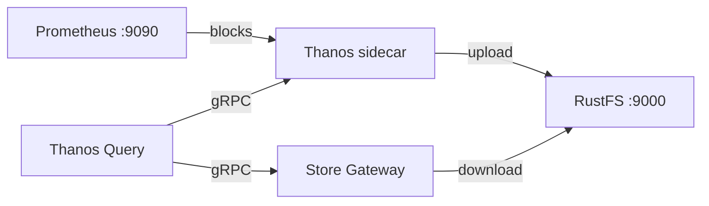
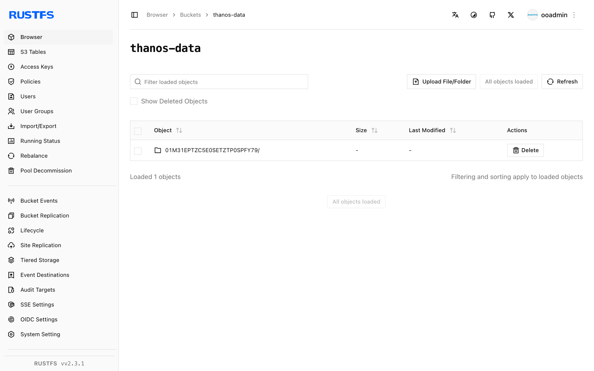

In dieser Anleitung verbinden Sie [Thanos](https://github.com/thanos-io/thanos) — die hochverfügbare Prometheus-Einrichtung mit Langzeitspeicher — mit **RustFS** als Objektspeicher. Sie betreiben Prometheus mit einem Thanos-Sidecar, der TSDB-Blöcke nach RustFS hochlädt, und fragen die historischen Daten anschließend über ein Store Gateway und ein Query-Frontend ab. Der Ablauf wurde mit `thanosio/thanos:v0.37.2`, `prom/prometheus:v2.53.1` und `rustfs/rustfs-x86-musl:v2.3.1` verifiziert.

Sie benötigen Docker mit dem Compose-Plugin. Dieses Setup ist für lokale Integrationstests gedacht, nicht für den Produktivbetrieb.

## Architektur



Der Sidecar beobachtet das Prometheus-TSDB-Verzeichnis und lädt jeden Zwei-Stunden-Block in den Bucket `thanos-data` in RustFS hoch. Das Store Gateway liest denselben Bucket und beantwortet Abfragen zu historischen Blöcken. Query bezieht damit sowohl die Live-Daten über den Sidecar als auch die älteren Daten über das Store Gateway.

## 1. Projektdateien anlegen

Erstellen Sie ein Arbeitsverzeichnis:

```bash
mkdir rustfs-thanos
cd rustfs-thanos
```

Erstellen Sie eine Umgebungsdatei und ersetzen Sie beide Platzhalter für die Zugangsdaten:

```ini title=".env"
RUSTFS_ACCESS_KEY=<your-access-key>
RUSTFS_SECRET_KEY=<your-secret-key>
```

Verwenden Sie dedizierte Zugangsdaten für den Bucket `thanos-data`. Nehmen Sie `.env` nicht in die Versionsverwaltung auf.

Erstellen Sie die Prometheus-Konfiguration mit einem externen Label. Thanos benötigt es, um Blöcke zu deduplizieren:

```yaml title="prometheus.yml"
global:
  scrape_interval: 5s
  external_labels:
    monitor: rustfs-demo

scrape_configs:
  - job_name: prometheus
    static_configs:
      - targets: ["localhost:9090"]
  - job_name: rustfs
    metrics_path: /metrics
    static_configs:
      - targets: ["rustfs:9000"]
```

Erstellen Sie die Objektspeicher-Konfiguration von Thanos:

```yaml title="bucket.yml"
type: S3
config:
  bucket: thanos-data
  endpoint: rustfs:9000
  access_key: ${RUSTFS_ACCESS_KEY}
  secret_key: ${RUSTFS_SECRET_KEY}
  insecure: true
```

Thanos interpoliert `.env`-Dateien nicht selbst. Ersetzen Sie die Platzhalter vor dem Start des Stacks durch dieselben Werte wie in `.env`:

```bash
sed -i.bak "s|\${RUSTFS_ACCESS_KEY}|$(grep RUSTFS_ACCESS_KEY .env | cut -d= -f2)|;s|\${RUSTFS_SECRET_KEY}|$(grep RUSTFS_SECRET_KEY .env | cut -d= -f2)|" bucket.yml
```

Erstellen Sie die Compose-Datei:

```yaml title="compose.yaml"
services:
  rustfs:
    image: rustfs/rustfs-x86-musl:v2.3.1
    environment:
      RUSTFS_ACCESS_KEY: ${RUSTFS_ACCESS_KEY}
      RUSTFS_SECRET_KEY: ${RUSTFS_SECRET_KEY}
      RUSTFS_VOLUMES: /data
      RUSTFS_ADDRESS: ":9000"
      RUSTFS_CONSOLE_ADDRESS: ":9001"
      RUSTFS_CONSOLE_ENABLE: "true"
    volumes:
      - rustfs-data:/data
    ports:
      - "9000:9000"
      - "9001:9001"
    healthcheck:
      test: ["CMD", "curl", "-sf", "http://127.0.0.1:9000/health"]
      interval: 10s
      timeout: 5s
      retries: 6
      start_period: 10s
    networks:
      - thanos

  create-bucket:
    image: rustfs/rc:latest
    depends_on:
      rustfs:
        condition: service_healthy
    environment:
      RUSTFS_ACCESS_KEY: ${RUSTFS_ACCESS_KEY}
      RUSTFS_SECRET_KEY: ${RUSTFS_SECRET_KEY}
    entrypoint:
      - /bin/sh
      - -c
      - |
        /usr/bin/rc alias set rustfs http://rustfs:9000 "$${RUSTFS_ACCESS_KEY}" "$${RUSTFS_SECRET_KEY}"
        /usr/bin/rc mb --ignore-existing rustfs/thanos-data
    networks:
      - thanos

  prometheus:
    image: prom/prometheus:v2.53.1
    command:
      - --config.file=/etc/prometheus/prometheus.yml
      - --storage.tsdb.path=/prometheus
      - --storage.tsdb.min-block-duration=2h
      - --storage.tsdb.max-block-duration=2h
      - --web.enable-lifecycle
    volumes:
      - ./prometheus.yml:/etc/prometheus/prometheus.yml:ro
      - prom-data:/prometheus
    ports:
      - "9090:9090"
    networks:
      - thanos

  sidecar:
    image: thanosio/thanos:v0.37.2
    command:
      - sidecar
      - --tsdb.path=/prometheus
      - --prometheus.url=http://prometheus:9090
      - --objstore.config-file=/etc/thanos/bucket.yml
    volumes:
      - ./bucket.yml:/etc/thanos/bucket.yml:ro
      - prom-data:/prometheus
    depends_on:
      create-bucket:
        condition: service_completed_successfully
    networks:
      - thanos

  store:
    image: thanosio/thanos:v0.37.2
    command:
      - store
      - --objstore.config-file=/etc/thanos/bucket.yml
      - --data-dir=/data
    volumes:
      - ./bucket.yml:/etc/thanos/bucket.yml:ro
      - store-data:/data
    depends_on:
      create-bucket:
        condition: service_completed_successfully
    networks:
      - thanos

  query:
    image: thanosio/thanos:v0.37.2
    command:
      - query
      - --http-address=0.0.0.0:9090
      - --store=sidecar:10901
      - --store=store:10901
    ports:
      - "9091:9090"
    depends_on:
      - sidecar
      - store
    networks:
      - thanos

networks:
  thanos:

volumes:
  rustfs-data:
  prom-data:
  store-data:
```

Die Flags `--storage.tsdb.min-block-duration` und `--storage.tsdb.max-block-duration` deaktivieren die Prometheus-Kompaktierung. Der Sidecar überträgt keine Blöcke aus einer kompaktierenden TSDB, weil die lokalen Blöcke dann nicht mehr zu den hochgeladenen passen würden.

## 2. Bereitstellung prüfen und starten

Prüfen Sie die Compose-Datei, bevor Sie Container starten:

```bash
docker compose config
```

Starten Sie den Stack und warten Sie, bis der Sidecar sich als bereit meldet:

```bash
docker compose up -d
docker compose logs sidecar | grep -m1 "status=ready"
```

Prüfen Sie, dass der Sidecar die externen Labels von Prometheus übernommen hat:

```bash
docker compose logs sidecar | grep "external labels"
```

Die Thanos-Query-Oberfläche antwortet unter `http://localhost:9091`, die RustFS Console (Weboberfläche) läuft unter `http://localhost:9001`.

## 3. Block nach RustFS hochladen

Der Sidecar lädt einen Block hoch, wenn Prometheus einen kompaktiert. Das geschieht an einer Blockgrenze von zwei Stunden. Um sofort einen Block zu erzeugen, erstellen Sie einen Snapshot der TSDB über die Admin-API. Bei deaktivierter Kompaktierung liefert der Sidecar den Snapshot des Head-Blocks direkt aus:

```bash
curl -s -XPOST http://localhost:9090/api/v1/admin/tsdb/snapshot | head -c 200
```

Warten Sie auf den Upload und prüfen Sie anschließend den Shipper-Zustand in Prometheus:

```bash
sleep 60
docker compose exec prometheus cat /prometheus/thanos.shipper.json
```

Die Liste `uploaded` sollte eine Block-ID enthalten:

```json
{
	"version": 1,
	"uploaded": [
		"01M31EPTZC5E0SETZTP0SPFY79"
	]
}
```

## 4. Historische Daten aus RustFS abfragen

Das Store Gateway synchronisiert den Bucket regelmäßig. Prüfen Sie, dass es den hochgeladenen Block heruntergeladen hat:

```bash
docker compose logs store | grep "loaded new block"
```

Fragen Sie eine Zeitreihe über das Query-Frontend im Zeitbereich des Blocks ab:

```bash
START=$(date -u -d '2 hours ago' +%s)
END=$(date -u +%s)
curl -s "http://localhost:9091/api/v1/query_range?query=up%7Bjob%3D%22prometheus%22%7D&start=$START&end=$END&step=30" | head -c 300
```

Das Store Gateway liefert die Antwort aus den Blöcken, die es aus RustFS heruntergeladen hat. Der Sidecar beantwortet den Live-Head. Beide Pfade laufen über denselben Query-Endpunkt.

## 5. Objekte in RustFS prüfen

Listen Sie den Bucket auf:

```bash
docker compose exec rustfs /usr/bin/rc ls local/thanos-data/ -r
```

Jeder Block wird als drei Objekte gespeichert: die Chunk-Dateien, der Index und `meta.json`:

```text
01M31EPTZC5E0SETZTP0SPFY79/chunks/000001
01M31EPTZC5E0SETZTP0SPFY79/index
01M31EPTZC5E0SETZTP0SPFY79/meta.json
```



## 6. Bereitstellung anhalten oder zurücksetzen

Stoppen Sie die Container und behalten Sie alle Daten:

```bash
docker compose down
```

Das RustFS-Volume behält die hochgeladenen Blöcke, daher beantwortet das Store Gateway historische Abfragen nach einem Neustart erneut. Um alles zu löschen, einschließlich der Blöcke in RustFS, fügen Sie `--volumes` hinzu.

## Fehlerbehebung

### Der Sidecar protokolliert `Compaction needs to be disabled`

Prometheus muss mit `--storage.tsdb.min-block-duration` gleich `--storage.tsdb.max-block-duration` laufen. Setzen Sie beide wie in der Compose-Datei auf `2h`. Andernfalls kann der Sidecar nicht garantieren, dass lokale Blöcke unverändert bleiben, und verweigert den Upload.

### `The specified bucket does not exist`

Thanos legt keine Buckets an. Prüfen Sie, dass der Dienst `create-bucket` erfolgreich abgeschlossen wurde:

```bash
docker compose logs create-bucket
```

### Abfragen liefern keine historischen Daten

Stellen Sie sicher, dass das Store Gateway mindestens einen Block geladen hat (`docker compose logs store | grep "loaded new block"`) und dass der Zeitbereich Ihrer Abfrage im Fenster des hochgeladenen Blocks liegt. Prüfen Sie in `meta.json` des Blocks in der RustFS Console die Werte `minTime` und `maxTime`.

## Nächste Schritte

- Lesen Sie die [S3-Kompatibilitätshinweise](/de/administration/protocols/s3), bevor Sie weitere Thanos-Komponenten verwenden.
- Erstellen Sie dedizierte Produktions-Zugangsdaten über die [Zugriffsschlüssel-Verwaltung](/de/security-compliance/iam/access-token).
- Folgen Sie der [Thanos-Dokumentation](https://thanos.io/tip/thanos/getting-started.md), um Compactor, Ruler oder Receive für eine Produktivtopologie hinzuzufügen.
