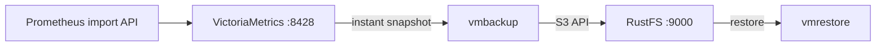

In dieser Anleitung verbinden Sie [VictoriaMetrics](https://github.com/VictoriaMetrics/VictoriaMetrics) — die Prometheus-kompatible Zeitreihendatenbank — über `vmbackup` und `vmrestore` mit **RustFS**. Sie betreiben eine Einzelknoten-Instanz, importieren Metriken, erstellen einen sofortigen Snapshot, sichern ihn in einen RustFS-Bucket und stellen die Daten in einem neuen Verzeichnis wieder her. Der Ablauf wurde mit den Images `victoria-metrics`, `vmbackup` und `vmrestore` in Version v1.x gegen `rustfs/rustfs-x86-musl:v2.3.1` verifiziert.

Sie benötigen Docker. Dieses Setup ist für lokale Integrationstests gedacht, nicht für den Produktivbetrieb.

## Architektur



`vmbackup` lädt einen konsistenten Snapshot zu einem festen Zeitpunkt vom Speicherverzeichnis an jeden S3-kompatiblen Endpunkt hoch. `vmrestore` kehrt den Vorgang um und erzeugt ein Datenverzeichnis, das eine VictoriaMetrics-Instanz direkt öffnen kann.

## 1. VictoriaMetrics ausführen

Legen Sie den Bucket an und starten Sie eine Einzelknoten-Instanz:

```bash
rc mb rustfs/vm-backups

docker run -d --name vm --network oo-rustfs_default -p 8428:8428 \
  -v vm-data:/storage \
  victoriametrics/victoria-metrics:latest \
  -storageDataPath=/storage -retentionPeriod=100y
```

## 2. Metriken importieren

Schreiben Sie ein paar Beispielwerte über die Prometheus-Import-API:

```bash
echo "vm_demo_metric 123" | curl -s --data-binary @- http://localhost:8428/api/v1/import/prometheus
echo "vm_demo_metric 456" | curl -s --data-binary @- http://localhost:8428/api/v1/import/prometheus
```

Der Endpunkt antwortet mit `204 No Content`. Prüfen Sie, dass die Daten abfragbar sind:

```bash
curl -s "http://localhost:8428/api/v1/export?match[]=vm_demo_metric"
```


```text
{"metric":{"__name__":"vm_demo_metric"},"values":[123,456],"timestamps":[1790680894604,1790680894619]}
```

## 3. Snapshot erstellen

Fordern Sie bei VictoriaMetrics einen konsistenten Snapshot an:

```bash
curl -s http://localhost:8428/snapshot/create
```


```text
{"status":"ok","snapshot":"20260929112134-18D9C6C76704F913"}
```

## 4. Snapshot nach RustFS sichern

Führen Sie `vmbackup` für dasselbe Speicher-Volume aus und ersetzen Sie die Platzhalter für die Zugangsdaten. Der Snapshot-Name stammt aus Schritt 3:

```bash
docker run --rm --network oo-rustfs_default \
  -e AWS_ACCESS_KEY_ID=<your-access-key> \
  -e AWS_SECRET_ACCESS_KEY=<your-secret-key> \
  --volumes-from vm \
  victoriametrics/vmbackup:latest \
  -storageDataPath=/storage \
  -snapshotName=20260929112134-18D9C6C76704F913 \
  -dst=s3://vm-backups/demo \
  -customS3Endpoint=http://<your-rustfs-endpoint>:9000
```


```text
backup ... to S3{bucket: "vm-backups", dir: "demo/"} is complete; uploaded 760 bytes
```

`-customS3Endpoint` leitet das AWS SDK auf RustFS um. Eigene Endpunkte werden automatisch mit pfadbasierter Adressierung (Path-Style) angesprochen. Setzen Sie `AWS_EC2_METADATA_DISABLED=true` auf Hosts ohne EC2-Metadatendienst, um Verzögerungen bei der Suche nach Zugangsdaten zu überspringen.

## 5. Prüfen und wiederherstellen

Listen Sie das Bucket-Präfix auf:

```bash
rc ls rustfs/vm-backups/demo/
```


```text
backup_complete.ignore
backup_metadata.ignore
data/
metadata/
```

`backup_complete.ignore` kennzeichnet ein abgeschlossenes Backup. Stellen Sie es in einem neuen Verzeichnis wieder her:

```bash
docker run --rm --network oo-rustfs_default \
  -e AWS_ACCESS_KEY_ID=<your-access-key> \
  -e AWS_SECRET_ACCESS_KEY=<your-secret-key> \
  -v /opt/vm-restore:/restore \
  victoriametrics/vmrestore:latest \
  -src=s3://vm-backups/demo \
  -storageDataPath=/restore \
  -customS3Endpoint=http://<your-rustfs-endpoint>:9000
```


```text
restored 760 bytes from backup in 0.055 seconds
```

Das wiederhergestellte Verzeichnis enthält `data/`, `metadata/` und eine Lock-Datei. Genau das erwartet eine VictoriaMetrics-Instanz unter `-storageDataPath`.


## 6. Anhalten oder zurücksetzen

So bauen Sie die Demo ab und behalten die Objekte im Bucket:

```bash
docker rm -f vm
docker volume rm vm-data
```

So löschen Sie die gespeicherten Backups:

```bash
rc rm rustfs/vm-backups/ --recursive --force
```

## Fehlerbehebung

### `vmbackup` hängt beim Start oder findet keine Zugangsdaten

Das AWS SDK fragt den EC2-Metadatendienst ab, wenn keine Umgebungs-Zugangsdaten vorhanden sind. Exportieren Sie auf Rechnern ohne IMDS `AWS_EC2_METADATA_DISABLED=true` neben den Schlüsselvariablen.

### Backup-Teile werden bei jedem Lauf erneut hochgeladen

`vmbackup` führt inkrementelle Backups aus, indem es lokale und entfernte Datei-Hashes vergleicht. Wenn Sie in ein neues Verzeichnis wiederherstellen und `vmbackup` von dort ausführen, wird alles erneut hochgeladen. Behalten Sie das ursprüngliche Datenverzeichnis für inkrementelle Läufe.

### Die Abfrage liefert direkt nach dem Import nichts zurück

Importe werden asynchron angenommen, und der Endpunkt für Sofortabfragen kann auf einem ausgelasteten Einzelknoten nachlaufen. Prüfen Sie mit `/api/v1/export` (oder warten Sie einige Sekunden), bevor Sie den Snapshot erstellen.

## Nächste Schritte

- Lesen Sie die [S3-Kompatibilitätshinweise](/de/administration/protocols/s3), bevor Sie weitere VictoriaMetrics-Komponenten verwenden.
- Erstellen Sie dedizierte Produktions-Zugangsdaten über die [Zugriffsschlüssel-Verwaltung](/de/security-compliance/iam/access-token).
- Folgen Sie der [vmbackup-Dokumentation](https://docs.victoriametrics.com/vmbackup/), um Backups zu planen und alte Snapshots zu bereinigen.
