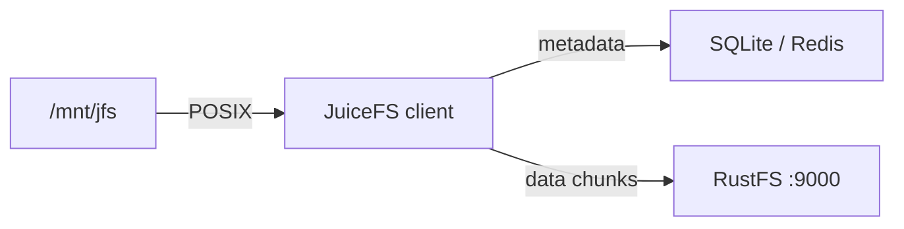

In dieser Anleitung verbinden Sie [JuiceFS](https://github.com/juicedata/juicefs) — das cloud-native verteilte POSIX-Dateisystem — mit **RustFS** als Objektspeicher-Backend. Sie formatieren ein Volume, dessen Daten-Chunks in einem RustFS-Bucket liegen, hängen es lokal ein und lesen und schreiben Dateien über den Mount. Der Ablauf wurde mit `juicefs v1.3.1` (Community Edition, SQLite-Metadaten-Engine) gegen `rustfs/rustfs-x86-musl:v2.3.1` verifiziert.

Sie benötigen die JuiceFS-Binärdatei, eine Metadaten-Engine und FUSE (`fuse3` unter Linux). Diese Bereitstellung ist für lokale Integrationstests gedacht, nicht für den Produktivbetrieb.

## Architektur



JuiceFS teilt jede Datei in Chunks und speichert sie als Objekte unter `chunks/` im Bucket, während die Metadaten-Engine Namen, Inodes und das Layout führt. Das Dateisystem verhält sich wie eine lokale Platte, hält lokal aber keine Daten.

## 1. Das Volume formatieren

Legen Sie den Bucket an und formatieren Sie ein JuiceFS-Volume auf RustFS. Ersetzen Sie alle Verbindungsplatzhalter. Die Bucket-URL trägt den Endpunkt und wählt damit pfadbasierte Adressierung (Path-Style):

```bash
rc mb rustfs/jfs-demo

juicefs format \
  --storage s3 \
  --bucket http://<your-rustfs-endpoint>:9000/jfs-demo \
  --access-key <your-access-key> \
  --secret-key <your-secret-key> \
  sqlite3:///opt/juicefs/jfs.db \
  rustfs-jfs
```

```text
Data use s3://<your-rustfs-endpoint>:9000/jfs-demo/rustfs-jfs/
<STATUS> OK, rustfs-jfs is ready
```

`sqlite3:///opt/juicefs/jfs.db` ist die Metadaten-Engine für diesen Test. Verwenden Sie in der Produktion stattdessen Redis, MySQL oder PostgreSQL, damit mehrere Clients dasselbe Volume einhängen können.

## 2. Das Volume einhängen

Hängen Sie das Dateisystem mit derselben Metadaten-URL ein:

```bash
mkdir -p /mnt/jfs
juicefs mount -d sqlite3:///opt/juicefs/jfs.db /mnt/jfs
```

```text
OK, rustfs-jfs is ready at /mnt/jfs
```

Das Flag `-d` lässt den Mount im Hintergrund laufen. Das Volume ist jetzt ein POSIX-Dateisystem.

## 3. Dateien lesen und schreiben

Verwenden Sie den Mount wie jedes andere Verzeichnis:

```bash
echo "hello rustfs jfs" > /mnt/jfs/hello.txt
dd if=/dev/urandom of=/mnt/jfs/blob.bin bs=1M count=3
mkdir -p /mnt/jfs/dir1 && echo nested > /mnt/jfs/dir1/nested.txt
cat /mnt/jfs/hello.txt
```

```text
hello rustfs jfs
```

Prüfen Sie das Volume mit `juicefs info`:

```text
/mnt/jfs :
  inode: 1
  files: 2
   dirs: 2
 length: 3.00 MiB
```

## 4. Chunks in RustFS prüfen

Listen Sie die Bucket-Präfixe auf:

```bash
rc ls rustfs/jfs-demo/ -r
```

Jede Datei wurde in inhaltsadressierte Chunk-Objekte aufgeteilt:

```text
rustfs-jfs/chunks/0/0/1_0_17
rustfs-jfs/chunks/0/0/3_0_3145728
rustfs-jfs/chunks/0/0/4_0_7
```

Der Chunk-Name kodiert Inode, Chunk-Index und Größe. `3_0_3145728` ist zum Beispiel die 3-MiB-Datei aus Schritt 3.


## 5. Stoppen oder zurücksetzen

Hängen Sie das Volume aus und löschen Sie optional die Volume-Metadaten und die Bucket-Daten:

```bash
juicefs umount /mnt/jfs
juicefs destroy --force sqlite3:///opt/juicefs/jfs.db rustfs-jfs
rc rm rustfs/jfs-demo/ --recursive --force
```

## Fehlerbehebung

### `unknown option: --daemon`

Das Hintergrund-Flag hat einen einzelnen Bindestrich: `juicefs mount -d`. Ohne das Flag bleibt der Mount im Vordergrund (nützlich zur Fehlersuche).

### `fusermount3: mount failed: Permission denied`

Das Einhängen braucht das FUSE-Gerät. Fügen Sie in einem Container `--device /dev/fuse --cap-add SYS_ADMIN` hinzu (oder `--privileged`). Installieren Sie auf einem Host `fuse3` und prüfen Sie, dass `/dev/fuse` existiert.

### Der Mount hängt oder erreicht den Speicher nicht

Der Client muss sowohl die Metadaten-Engine als auch den Bucket-Endpunkt erreichen. Weil die Bucket-URL den Endpunkt enthält, prüfen Sie ihn vom Mount-Host aus mit `curl`, bevor Sie formatieren.

## Nächste Schritte

- Lesen Sie die [S3-Kompatibilitätshinweise](/de/administration/protocols/s3), bevor Sie weitere JuiceFS-Speicher-Backends einsetzen.
- Erstellen Sie dedizierte Produktions-Zugangsdaten über die [Zugriffsschlüssel-Verwaltung](/de/security-compliance/iam/access-token).
- Folgen Sie der [JuiceFS-Dokumentation](https://juicefs.com/docs/community/quick_start_guide/), um die Metadaten-Engine auf Redis umzustellen und das Volume von mehreren Clients einzuhängen.
