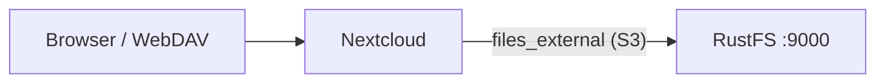

In dieser Anleitung verbinden Sie [Nextcloud](https://github.com/nextcloud/server) — die selbst gehostete Plattform für Zusammenarbeit an Inhalten — über die App External Storage mit dem S3-Backend mit **RustFS**. Sie aktivieren `files_external`, hängen einen RustFS-Bucket in die Dateiansicht jedes Benutzers ein und laden eine Datei über WebDAV hoch, die direkt im Bucket landet. Der Ablauf wurde mit `nextcloud:32.0.15` (SQLite, einzelner Container) gegen `rustfs/rustfs-x86-musl:v2.3.1` verifiziert.

Sie benötigen Docker oder eine vorhandene Nextcloud-Instanz mit Zugriff auf `occ`. Diese Bereitstellung ist für lokale Integrationstests gedacht, nicht für den Produktivbetrieb.

## Architektur



Nextcloud leitet Dateioperationen am Mount-Punkt an das S3-Backend weiter. Objekte liegen unter ihren Pfaden relativ zum Mount, daher spiegelt der Bucket die Namen, die Benutzer sehen.

## 1. Nextcloud installieren

Starten Sie Nextcloud mit einem Admin-Konto und ersetzen Sie alle Verbindungsplatzhalter. SQLite hält den Test in sich geschlossen. Verwenden Sie in der Produktion MariaDB oder PostgreSQL:

```bash
docker run -d --name nextcloud --network oo-rustfs_default -p 8080:80 \
  -e NEXTCLOUD_ADMIN_USER=<admin-user> \
  -e NEXTCLOUD_ADMIN_PASSWORD=<admin-password> \
  nextcloud:32.0.15
```

Wenn die Weboberfläche nach dem Start noch den Installer zeigt, schließen Sie ihn manuell ab:

```bash
docker exec -u www-data nextcloud php occ maintenance:install \
  --admin-user <admin-user> --admin-password <admin-password>
```

## 2. Die App External Storage aktivieren

Die App `files_external` gehört zu Nextcloud, startet aber deaktiviert, und ihre `occ`-Befehle existieren erst, wenn die App aktiviert ist:

```bash
docker exec -u www-data nextcloud php occ app:enable files_external
```

```text
files_external 1.24.1 enabled
```

## 3. Den RustFS-Bucket einhängen

Legen Sie einen externen Speicher vom Backend-Typ `amazons3` mit dem Authentifizierungs-Backend `amazons3::accesskey` an. Ersetzen Sie alle Verbindungsplatzhalter:

```bash
docker exec -u www-data nextcloud php occ files_external:create \
  /rustfs amazons3 amazons3::accesskey \
  --user <admin-user> \
  --config bucket=<your-bucket> \
  --config hostname=<your-rustfs-endpoint> \
  --config port=9000 \
  --config use_ssl=false \
  --config use_path_style=true \
  --config key=<your-access-key> \
  --config secret=<your-secret-key>
```

```text
Storage created with id 1
```

Der Mount-Punkt `/rustfs` erscheint in der Dateiansicht des angegebenen Benutzers. `use_path_style=true` wählt pfadbasierte Adressierung (Path-Style) und ist für einen Endpunkt außerhalb von AWS erforderlich. Prüfen Sie die Verbindung, bevor Sie sie verwenden:

```bash
docker exec -u www-data nextcloud php occ files_external:verify 1
```

```text
  - status: ok
  - code: 0
```

## 4. Eine Datei hochladen und prüfen

Laden Sie über den WebDAV-Endpunkt hoch, der über den externen Speicher schreibt:

```bash
echo "nextcloud writes to rustfs" > /tmp/nc-demo.txt

curl -u <admin-user>:<admin-password> \
  -T /tmp/nc-demo.txt \
  http://localhost:8080/remote.php/dav/files/<admin-user>/rustfs/nc-demo.txt \
  -o /dev/null -w "%{http_code}\n"
```

```text
201
```

Lesen Sie sie über denselben Pfad zurück und bestätigen Sie dann das Objekt in RustFS:

```bash
rc ls rustfs/<your-bucket>/ -r
```

```text
[2026-09-29 13:42:48]       27 B nc-demo.txt
```

Der Objektschlüssel entspricht dem Pfad innerhalb des Mounts, daher lassen sich über Nextcloud hochgeladene Dateien auch direkt mit jedem S3-Client lesen.


## 5. Stoppen oder zurücksetzen

Um den Mount zu entfernen, ohne den Bucket anzufassen:

```bash
docker exec -u www-data nextcloud php occ files_external:delete 1
```

Um den Bucket-Inhalt zu löschen:

```bash
rc rm rustfs/<your-bucket>/ --recursive --force
```

## Fehlerbehebung

### `There are no commands defined in the "files_external" namespace`

Die App ist noch nicht aktiviert. Führen Sie zuerst `occ app:enable files_external` aus. Die Befehle `occ files_external:*` registrieren sich erst danach.

### `Not enough arguments (missing: "authentication_backend")`

`files_external:create` nimmt das Speicher-Backend und das Authentifizierungs-Backend als zwei getrennte Argumente: `amazons3 amazons3::accesskey`. Die Backend-Bezeichner listet `occ files_external:backends` auf.

### Der Mount erscheint, ist aber leer, oder Uploads schlagen fehl

Prüfen Sie, dass `hostname` vom Nextcloud-Container aus erreichbar ist (verwenden Sie den Namen im Container-Netzwerk, nicht `localhost`), dass `use_path_style` `true` ist und dass der Bucket existiert. `occ files_external:verify <id>` meldet den genauen Verbindungsfehler.

## Nächste Schritte

- Lesen Sie die [S3-Kompatibilitätshinweise](/de/administration/protocols/s3), bevor Sie weitere Backends für externen Speicher einsetzen.
- Erstellen Sie dedizierte Produktions-Zugangsdaten über die [Zugriffsschlüssel-Verwaltung](/de/security-compliance/iam/access-token).
- Folgen Sie der [Nextcloud-Dokumentation zum externen Speicher](https://docs.nextcloud.com/server/latest/admin_manual/configuration_files/external_storage_configuration_gui.html), um den Mount mit Gruppen zu teilen und Versionierung zu aktivieren.
