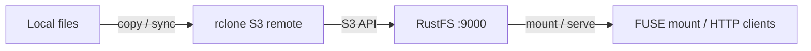

In dieser Anleitung verbinden Sie [rclone](https://github.com/rclone/rclone) — das Kommandozeilenwerkzeug zum Synchronisieren von Dateien mit Cloud-Speicher — über sein S3-Backend mit **RustFS**. Sie konfigurieren ein S3-Remote für RustFS, kopieren und synchronisieren Dateien, lesen Objekte zurück, veröffentlichen einen Bucket über HTTP mit `rclone serve` und hängen den Bucket mit `rclone mount` als lokales Dateisystem ein. Der Ablauf wurde mit `rclone v1.75.1` gegen `rustfs/rustfs-x86-musl:v2.3.1` verifiziert.

Sie benötigen Docker oder eine lokale rclone-Binärdatei. Diese Bereitstellung ist für lokale Integrationstests gedacht, nicht für den Produktivbetrieb.

## Architektur



Eine Remote-Definition steuert jeden rclone-Befehl: Datentransfer, Mount und Bereitstellung verwenden dieselbe S3-Verbindung.

## 1. Das Remote konfigurieren

Legen Sie eine rclone-Konfigurationsdatei mit einem S3-Remote für RustFS an und ersetzen Sie alle Verbindungsplatzhalter. Der Provider `Other` schaltet AWS-spezifisches Verhalten ab, und für eigene Endpunkte wird pfadbasierte Adressierung (Path-Style) automatisch verwendet:

```ini title="rclone.conf"
[rustfs]
type = s3
provider = Other
access_key_id = <your-access-key>
secret_access_key = <your-secret-key>
endpoint = http://<your-rustfs-endpoint>:9000
region = us-east-1
```

## 2. Objekte kopieren und lesen

Legen Sie den Bucket an und laden Sie ein Verzeichnis mit `rclone copy` hoch:

```bash
rc mb rustfs/rclone-demo
rclone copy /data rustfs:rclone-demo/seed
```

Listen Sie auf und lesen Sie zurück:

```bash
rclone ls rustfs:rclone-demo/seed
rclone cat rustfs:rclone-demo/seed/hello.txt
```

```text
  3145728 blob.bin
       18 hello.txt
hello from rclone
```

`rclone lsd rustfs:` listet jeden Bucket am Endpunkt auf.

## 3. Ein Verzeichnis synchronisieren

`rclone sync` macht das Ziel identisch mit der Quelle, einschließlich Löschungen. Entfernen Sie eine lokale Datei und synchronisieren Sie:

```bash
rm /data/hello.txt
rclone sync /data rustfs:rclone-demo/seed
rclone lsf rustfs:rclone-demo/seed
```

```text
blob.bin
```

`hello.txt` verschwindet aus dem Bucket. Fügen Sie zuerst `--dry-run` hinzu, um die Änderungen vorzuschauen, ohne den Bucket zu verändern.

## 4. Einen Bucket über HTTP bereitstellen

Veröffentlichen Sie den Bucket-Inhalt als HTTP-Dateiserver:

```bash
rclone serve http --addr 0.0.0.0:8080 rustfs:rclone-demo/seed
```

Jeder HTTP-Client kann die Objekte jetzt herunterladen:

```bash
curl -s http://localhost:8080/blob.bin -o /dev/null -w "%{http_code} %{size_download} bytes\n"
```

```text
200 3145728 bytes
```

`rclone serve` unterstützt außerdem WebDAV-, SFTP- und S3-Endpunkte über dasselbe Remote.

## 5. Den Bucket als Dateisystem einhängen

Wenn FUSE verfügbar ist, hängen Sie den Bucket lokal ein und verwenden Sie ihn wie ein Verzeichnis:

```bash
rclone mount rustfs:rclone-demo /mnt/rclone --daemon
ls /mnt/rclone/seed
echo test > /mnt/rclone/write-test.txt
cat /mnt/rclone/write-test.txt
```

Dateien, die über den Mount geschrieben werden, erscheinen in RustFS als gewöhnliche Objekte:

```bash
rc ls rustfs/rclone-demo/ -r
```

```text
[2026-09-29 11:12:41]        5 B write-test.txt
```

Hängen Sie mit `fusermount -u /mnt/rclone` aus, wenn Sie fertig sind.

## 6. Stoppen oder zurücksetzen

rclone hält keinen serverseitigen Zustand. So löschen Sie die Demo-Daten:

```bash
rclone purge rustfs:rclone-demo
```

## Fehlerbehebung

### `Access Denied` oder leere Auflistungen

Prüfen Sie, dass `endpoint` das Schema enthält und dass das Schlüsselpaar zu einem RustFS-Zugriffsschlüssel passt. Der Wert `region` ist für den S3-Signer erforderlich, auch wenn RustFS ihn ignoriert. Belassen Sie `us-east-1`.

### Der Mount scheitert mit `fusermount3: mount failed: Permission denied`

Das Einhängen braucht das FUSE-Gerät und erhöhte Rechte. Starten Sie in einem Container mit `--device /dev/fuse --cap-add SYS_ADMIN` und verwenden Sie `--privileged`, wenn der Mount-Helfer weiterhin scheitert. Prüfen Sie auf einem Host, dass `fuse3` installiert ist und `/dev/fuse` existiert.

### Die Synchronisierung hat am Ziel nichts gelöscht

`rclone copy` löscht nie. Nur `rclone sync` (oder `rclone delete`) entfernt Zielobjekte, und `--dry-run` ist der sichere Weg, beides vorzuschauen.

## Nächste Schritte

- Lesen Sie die [S3-Kompatibilitätshinweise](/de/administration/protocols/s3), bevor Sie weitere rclone-Backends einsetzen.
- Erstellen Sie dedizierte Produktions-Zugangsdaten über die [Zugriffsschlüssel-Verwaltung](/de/security-compliance/iam/access-token).
- Folgen Sie der [rclone-S3-Dokumentation](https://rclone.org/s3/) für Flags wie `--transfers`, Bandbreitengrenzen und Crypt-Overlays.
